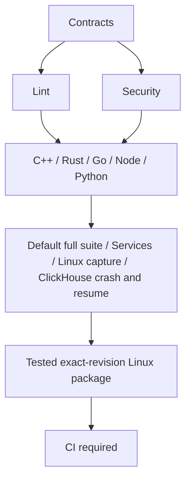

# GitHub CI / delivery

`ci.yml` is the only push/PR/merge-queue orchestrator. Feature branches run via pull requests;
main/master pushes and manual runs use the same checks. Reusable Rust, CMake, lint and security workflows
have no duplicate push/PR triggers. Security keeps its weekly/manual entry.



The final job runs with `always()` and requires **every** prerequisite to report `success`.
Failures, cancellation, unknown/missing results and unexpected skips fail the gate. Registered tshark field
exceptions remain explicitly unverified in Rust interoperability logs; they are not rewritten as passes.
Hardware-specific throughput targets are not portable CI thresholds.

Checks include strict workflow/schema tests and injected bad graphs/results, exact clang-format,
Rust format/clippy/docs plus Linux/macOS tests, Go 1.22 compatibility/current patched toolchain and races,
Node 22/24 locked install/Node + business DOM + real Chromium/type/build, pinned Python lock/Ruff/Black/mypy, full-history secrets,
full npm lock audit, all Go modules vuln scan, isolated Linux veth capture, and real ClickHouse durability.

Remote actions are full-SHA pinned (the standalone SLSA reusable workflow retains its verifier-required
version tag). Tokens default to contents:read, checkout does not persist credentials, jobs have timeouts,
concurrent obsolete CI runs cancel, and evidence is retained for 7–14 days. No soft-failure security jobs.

`delivery.yml` reuses the entire CI on `v*` tag pushes; only success can create a **draft** private-repository
GitHub Release. It checks tag == vVERSION, package SHA256SUMS and manifest commit == GITHUB_SHA. Packages
contain tested Linux binaries, Pro static assets, schemas/configs and build identity. Manual delivery is a
build-only rehearsal. No tags/releases are created by the normal feature-branch push.

The previous C++ SLSA workflow is manual only; private repository metadata is not automatically sent to
public Rekor logs. No production server, environment credentials or public Pages domain are configured.
Production deployment requires the owner's actual target and environment review policy. Repository branch
protection settings are unchanged; maintainers should require the stable `CI required` check.

Local reproduction:

```bash
python3 -m pip install -r tests/ci/requirements.txt
python3 -m unittest discover -s tests/ci -v
actionlint -shellcheck= -pyflakes=
bash scripts/lint/lint-all.sh
bash scripts/test/test-all.sh
```

macOS live BPF capture requires capture permission; an unavailable capture is not a local green result.
Linux hosted CI validates privileged capture on an isolated veth/namespace and cleans it afterward.
