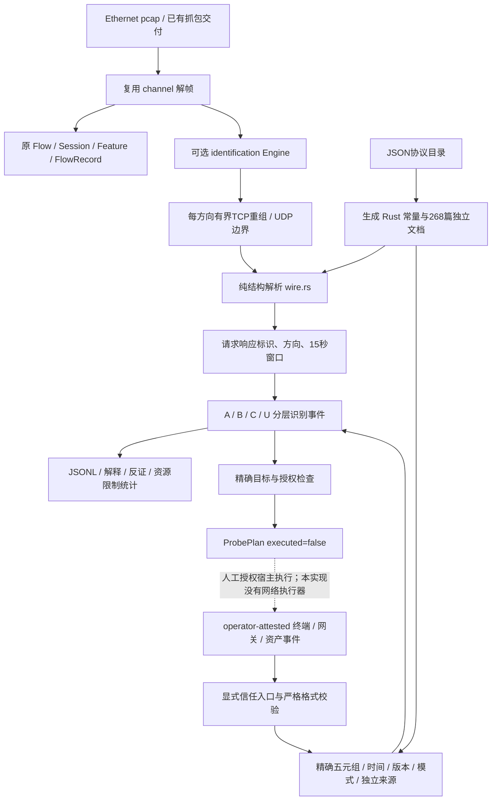
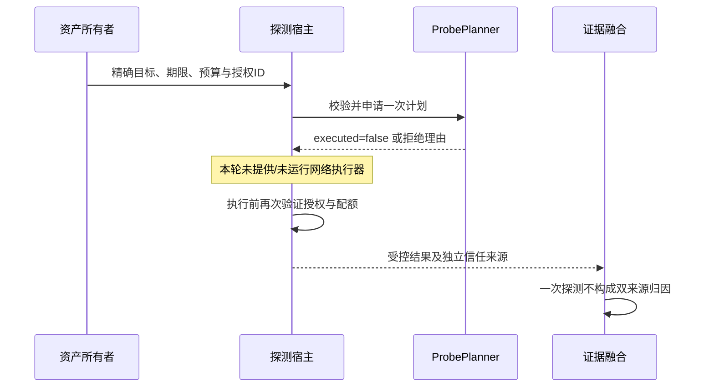

# VPN / ZTNA 分层识别引擎与运行契约

版本：2026-10-26.1。输入：[识别手册](../vpn_ztna_protocol_identification_2026.md)。
[逐项算法目录](../protocols/README.md) · [实现与验收](../planning/VPN-ZTNA-20261026.md)。

## 1. 材料学习后的工程裁决

现有 layered-plugin-architecture 的 L0 契约/L1 核心/L3 宿主边界继续适用：
协议字典是版本化数据，字节解析为纯函数，会话重组和证据关联在可选分析模块，探测执行属于宿主。
TSG 技术引入方案及本地论文揭示“多条检测路径”和属性聚合的价值，同时记录了单一指纹、
共享CDN和第三方崩溃带来的误报/故障风险。本实现不复制泄漏源码或把历史商业签名当当前可靠规则。
现有论文/方案没有提供本项目的新协议准确率或性能证据。

原 DPI 只有 TLS/HTTP/DNS 的三个检测器；本轮补充结构解析及独立 `identification` 分析模块。
没有扩展固定21维特征、FlowRecord v2、共享环ABI或ClickHouse列，也没有把整个 M10 插件化计划标成完成。
`cythsec-analyze` 原有快速路径可获得新增基础协议 AppId；更深的双向确认/上下文归因由 `cythsec-identify` 输出独立JSONL。



## 2. 覆盖单位与真实能力

真源为 `configs/registry/vpn-protocols.json`。268项由原始V/P/O编号90项、承载/密码/控制22项、认证14项、
国内厂商产品32项、海外产品19项及拆分变体91项组成。品牌、产品模式、混淆技术与线缆协议仍为不同对象。
每项有独立MD和可运行的上下文关联路径；这与268种协议都存在通用字节签名、或都已有真实PCAP测试完全不同。

| 路径 | 当前代码行为 | 不宣称的能力 |
| --- | --- | --- |
| ESP/AH/GRE/IPIP/IPv6-in-IP/EtherIP | 原始IP协议号、头部结构/长度验证 | 密文解密、ICV验证、品牌归因 |
| IKEv1/v2、NAT-T | 有界头/payload链、non-ESP marker、双向SPI及初始交换关联 | 后续加密Notify、MOBIKE、完整SA认证 |
| WireGuard | type/reserved/长度/index，双向init-response receiver匹配 | MAC/AEAD验证、PSK有无、Amnezia变体自动套用 |
| PPTP、L2TPv2、VXLAN、Geneve | 标准控制/封装的有界结构检查 | PPTP-GRE跨流Call-ID完整关联、L2TPv3私有cookie、所有扩展 |
| OpenVPN | 明确支持未加密、无tls-auth的v2 reset/ACK布局；TCP前置帧长 | 自动猜HMAC位置、tls-crypt明文解析、全部控制包 |
| SOCKS4/4a、SOCKS5 | 明文握手结构及反向响应/方法匹配 | SOCKS5已认证转发成功、连接内所有后续请求 |
| SSH、DTLS1.2、QUIC v1/v2、TLCP | 外侧结构候选；TLS/HTTP复用既有解析器 | SSH通道用途、DTLS1.3统一头解密、QUIC Initial AEAD/QPACK、完整TLCP认证 |
| 其他加密代理/产品/身份/混淆 | 可信上下文的精确关联，逐对象规则不互相继承 | 无密钥密文唯一识别、现成EDR/API采集器、真实型号全覆盖精度 |

`candidate`（C）为有界结构候选；`wire_confirmed`（A）只表示指定双向结构关系匹配，
不是密码学验证成功。当前自动A路径仅为WG、IKE初始交换、支持的OpenVPN reset、PPTP控制与SOCKS握手。
TLS/DTLS/QUIC等未实现完整双向状态机的路径保持C，不能借通用“任意双向都有包”晋升。
`context_verified`（B）表示信任域外导入的上下文满足规则；`unknown`（U）是有效结果。
D仅表示目录中的公开产品能力，不可生成某个流已经使用产品的结论。

## 3. 会话、重组与资源边界

- 复用既有Ethernet/VLAN/IPv4/IPv6解码，非首片仍显式进入decode_errors；本轮没有新增IP分片重组。
- TCP两方向分别使用既有 `Stream` 的序号、乱序、重传和重叠仲裁；只解析连续前缀。
- 同五元组的新SYN/ISN或60秒空闲生成新epoch，防止跨连接拼接证据；不跨NAT/端口迁移凭IP强行合流。
- 双向结构确认要求反方向、同协议、匹配标识、正时间顺序且间隔≤15秒；重复数据包不能累计独立证据。
- 默认最多4096个会话epoch、每方向4096字节已交付前缀、8192字节乱序缓冲、16384序号跨度；
  每epoch最多32条去重结构事实。前缀可调64..8192，epoch上限不能超过4096。
- 这是可选深分析路径，具有分配和有界查表成本，未宣称每包零分配或10G线速。完整payload状态预算约
  4096×2×(8192+8192)字节的上界量级，另加Rust容器/元数据开销；真实RSS/P95尚未标定。
- 长捕获超出epoch容量会统计capacity_drops并使CLI退出非零；没有静默无限积累或假装输出完整。
- 截断/前缀预算耗尽使流保持降级标记，不能凭不完整数据给自动A。decode_errors、时间回退另行统计。

## 4. 可信上下文格式与信任边界

CLI只在显式传入 `--trusted-evidence` 时读取operator-attested TSV，绝不从流量载荷、SNI或网页提取“可信证据”。
这是人工/外部采集器已认证输入的接口；本轮没有实现EDR/API连接器、事件签名验签或管理端鉴权。
操作者必须保证输入文件和trust_root受控，不能把攻击者自行填写的来源名当真实身份认证。

每个非注释行14列，以真实TAB分隔：

```text
evidence_id trust_root kind protocol_id version mode src_ip src_port dst_ip dst_port ip_proto start_us end_us verdict
```

上述空格仅为列名展示；实际文件必须用TAB。kind只能为 `inventory/endpoint/gateway/probe`，
verdict只能为 `assert/deny`，protocol_id必须已登记；ID唯一，字符串长度≤128，无控制字符。
单事件时间窗≤300秒；文件≤1MiB、≤4096事件。输出不保存凭据、UUID、认证哈希或原始会话内容。

B判据为：同一目录ID、相同版本和模式、实际流的正/反精确五元组、时间窗重叠，且至少两个不同
evidence_id、两个trust_root、两种kind。来自同一探测响应派生的证书和页面不是两个独立来源。
`deny`优先降为U并输出反证ID；冲突产品或同对象不同版本/模式的有效quorum不得任意选一个。

身份面、产品、混淆轴分别输出；认证成功不等于已建立L3隧道，TLS/QUIC不等于任一代理。

## 5. 主动探测设计

`ProbePlanner`是无socket、无进程启动、无提权的库接口，输出 `executed=false`。
授权必须提供ID、期限、精确IP+端口+protocol_id允许列表及全局预算；拒绝通配范围、未知ID、0端口、
无效地址、过期授权和重复目标。每计划≤3包、≤3秒，授权范围必须由宿主在执行前再次验证。
生成计划会消耗预算；获取计划不是自动执行批准。各协议文档给出标准握手或受管会话导出方法。



## 6. 本地使用

```bash
python3 tools/codegen/gen-vpn-protocols.py --check
cargo build --offline --bin cythsec-identify
./target/debug/cythsec-identify --catalog
./target/debug/cythsec-identify -r datasets/pcap/sample-ipv4-mixed.pcap -o build/identifications.jsonl
# 只有明确受信的、脱敏、按上述格式准备的输入才使用此参数：
./target/debug/cythsec-identify -r input.pcap --trusted-evidence attested.tsv -o build/identified-context.jsonl
```

输出文件须为新路径，已存在的文件不会被覆盖。仅支持经典Ethernet pcap；pcapng、非Ethernet不会静默重新解释。真实产品样本尚需所有者提供，
不会借用权限受限抓包、互联网主动扫描或收集用户凭据补齐。协议独立文档的统计模型是设计，
本轮未训练、未部署，不输出伪造概率或>99.5%实测承诺。
