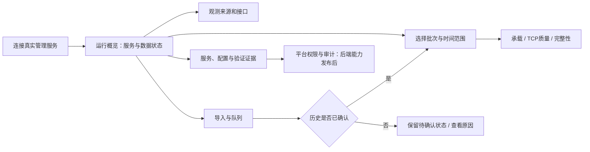

# CythSec 前端控制台完整设计

版本：1.0

设计日期：2026-10-27（Asia/Shanghai）

状态：设计基线，供评审和后续逐页开发；不是功能已全部实现的声明。

## 1. 设计交付与阅读顺序

| 文档 | 回答的问题 |
| --- | --- |
| 本文 | 产品范围、用户任务、完整菜单、页面清单、当前与目标的区别 |
| [布局与交互规范](layout-and-interaction.md) | Pro外壳、栅格、页面模板、线框结构、反馈、响应式与可访问性 |
| [逐页功能与显示规格](pages.md) | 36个逻辑页面各显示什么、怎么筛选、有哪些操作、依赖什么数据 |
| [数据、接口与权限](data-and-permissions.md) | 指标口径、实际API、拟定契约、角色边界、字段与能力状态 |
| [开发顺序与验收](delivery-and-acceptance.md) | 哪些先做、后端先补什么、每页怎样判定完成、设计检查结果 |

设计文件不注册运行菜单。实施时，`web/console/config/routes.ts` 仍是路由、菜单和面包屑的
唯一运行时真源；本文的目标菜单必须按能力发布逐项写入它，不另建第二份前端运行菜单配置。
本轮不将尚无后端能力的页面、模拟账号或虚构业务数据加入现有产品。

## 2. 产品范围与任务

产品名称：**CythSec 网络可观测与运维控制台**。

服务网络运维、采集与数据维护人员、平台管理员：

1. 判断服务是否可连接、观测数据是否新鲜、采集和处理是否完整。
2. 查询本机网络接口、路由和接口累计计数。
3. 在明确批次和时间窗内分析TCP/UDP等承载、通用头候选和传输质量观察。
4. 跟踪聚合批次从接收到持久化的真实阶段，处理积压、容量和失败。
5. 管理平台自己的服务访问、管理员权限、配置版本和审计。
6. 查看构建/测试/独立裁判的实际证据，识别未核验和能力缺口。

分析对象是网络运行与粗粒度聚合，不建立公共用户个人上网画像、逐用户应用/域名访问记录、
跨用户追踪或VPN封锁操作界面。平台管理员账号指本控制台操作者，与网络接入用户不是同一对象。

透明串联、旁路镜像、离线PCAP描述观测来源或声明模式。当前AF_PACKET/BPF发送接口不可用，
控制台只展示已知能力和证据，不提供桥接启停、生产转发策略发布或业务阻断按钮。

## 3. 事实基线与设计状态

| 标记 | 含义 | 产品中的呈现 |
| --- | --- | --- |
| E | 已有页面与API，但可能需要按本设计调整 | 保留真实能力，不把设计改动标成已完成 |
| R | 可以基于现有只读数据复用，但页面尚未实现 | 完成数据覆盖与权限验收后再发布菜单 |
| P | 缺后端业务契约/存储/权限或调度能力 | 只存在于设计稿；运行菜单不发布 |
| C | 当前为局部能力，目标页面还依赖后端补充 | 分项标明可用部分，剩余项保持未知/未开通 |

截至设计日，现有六个业务页面：`/`、`/interfaces`、`/routes`、`/traffic`、`/analytics`、`/system`。
有真实聚合导入、窗口查询、磁盘队列状态及静态Bearer服务访问；没有完整多观测点管理、
管理员账号平台、告警调度、统一审计、保留策略执行器、异步导出和真实转发控制。
完整能力缺口见 [技术层级与字段目录](../防火墙分析识别属性清单_透明串联与旁路镜像.md)。

本地依赖修复后的技术基线继续使用 Umi Max 4.7.27、React 18.3.1、Ant Design 6.6.8、
ProComponents 3.1.14-2；路由安全兼容层见 [依赖修复](../development/dependency-remediation.md)。
本设计不要求在设计阶段升级组件或新增图表依赖。

## 4. 主要使用流程

全局保留观测来源、批次、时间、指标版本和数据新鲜度上下文。链路切换不能悄悄改变统计范围。
平台身份变化必须清空旧身份页面数据和迟到请求，返回401不能继续显示原身份的统计。

## 5. 完整菜单与页面清单

“可见”指目标菜单布局，不代表当前即上线。详情页、个人页与异常页不占左侧一级菜单位置。

| ID | 菜单组 | 页面 / 目标路由 | 模板 | 状态 | 菜单 |
| --- | --- | --- | --- | --- | --- |
| P01 | 工作台 | 运行概览 `/` | 总览 | E | 可见 |
| P02 | 观测接入 | 观测点 `/collection/sensors` | 列表 | P | 可见 |
| P03 | 观测接入 | 观测点详情 `/collection/sensors/:sensorId` | 详情 | P | 隐藏 |
| P04 | 观测接入 | 数据接入 `/collection/sources` | 列表+配置 | C | 可见 |
| P05 | 观测接入 | 采集配置版本 `/collection/configurations` | 版本详情 | P | 可见 |
| P06 | 网络运行 | 网络接口 `/interfaces` | 列表 | E | 可见 |
| P07 | 网络运行 | 接口详情 `/network/interfaces/:interfaceId` | 详情 | R | 隐藏 |
| P08 | 网络运行 | 路由表 `/routes` | 列表 | E | 可见 |
| P09 | 网络运行 | 接口流量 `/traffic` | 列表+趋势 | E | 可见 |
| P10 | 网络运行 | 网络健康 `/network/health` | 总览 | P | 可见 |
| P11 | 流量分析 | 聚合历史 `/analytics` | 查询分析 | E | 可见 |
| P12 | 流量分析 | 批次详情 `/analytics/batches/:batchId` | 详情 | R | 隐藏 |
| P13 | 流量分析 | 承载协议统计 `/analytics/carriers` | 查询分析 | R | 可见 |
| P14 | 流量分析 | TCP质量 `/analytics/tcp` | 查询分析 | R | 可见 |
| P15 | 流量分析 | TLS/QUIC头候选 `/analytics/transport-headers` | 查询分析 | R | 可见 |
| P16 | 流量分析 | 采集完整性 `/analytics/integrity` | 诊断分析 | R | 可见 |
| P17 | 流量分析 | 指标字典 `/analytics/metrics` | 字典详情 | R | 可见 |
| P18 | 数据管理 | 导入任务 `/data/imports` | 任务列表 | C | 可见 |
| P19 | 数据管理 | 写入队列 `/data/queue` | 管道状态 | R | 可见 |
| P20 | 数据管理 | 存储状态 `/data/storage` | 总览 | C | 可见 |
| P21 | 数据管理 | 保留策略 `/data/retention` | 配置+预览 | P | 可见 |
| P22 | 数据管理 | 导出任务 `/data/exports` | 任务列表 | P | 可见 |
| P23 | 运维中心 | 服务状态 `/operations/services` | 总览+详情 | C | 可见 |
| P24 | 运维中心 | 日志诊断 `/operations/logs` | 检索列表 | P | 可见 |
| P25 | 运维中心 | 运维告警 `/operations/alerts` | 列表+详情 | P | 可见 |
| P26 | 运维中心 | 告警规则 `/operations/alert-rules` | 列表+表单 | P | 可见 |
| P27 | 运维中心 | 验证报告 `/operations/verification` | 列表+报告 | P | 可见 |
| P28 | 平台管理 | 系统信息 `/system` | 描述详情 | E | 可见 |
| P29 | 平台管理 | 版本与能力 `/administration/capabilities` | 能力矩阵 | C | 可见 |
| P30 | 平台管理 | 服务访问 `/administration/access` | 连接表单 | C | 可见 |
| P31 | 平台管理 | 平台账号与角色 `/administration/accounts` | 列表+详情 | P | 可见 |
| P32 | 平台管理 | 操作审计 `/administration/audit` | 检索列表 | P | 可见 |
| P33 | 平台管理 | 平台设置 `/administration/settings` | 分组表单 | P | 可见 |
| P34 | 全局 | 个人偏好 `/preferences` | 表单 | P | 隐藏 |
| P35 | 全局 | 登录/服务连接 `/login` | 连接表单 | C | 隐藏 |
| P36 | 全局 | 异常状态 `/status/:code` | Result | C | 隐藏 |

P36覆盖403、404、500、服务不可达与能力未开通；当前已有独立404。未来`code`只能采用固定枚举。
帮助、指标释义和快捷键说明在全局抽屉内展开，不增加另一套业务路由。
详情路径中的对象ID必须是后端稳定标识，当前接口名称和batch ID不能任意混用。

## 6. 左侧菜单与顶部内容

一级组顺序固定：工作台 → 观测接入 → 网络运行 → 流量分析 → 数据管理 → 运维中心 → 平台管理。
左侧仅展开当前组，记忆同一平台账号的折叠偏好；深链接进入时展开父组并高亮当前叶子。
详情页高亮其所属列表，隐藏详情菜单条目；面包屑保留可返回的列表链接与筛选上下文。

顶部从左到右：品牌/折叠、当前实例或观测范围、服务健康摘要、任务/通知、帮助、实际访问身份。
单实例阶段只显示配置目标及其证据状态，不伪造“生产环境”或“全网”范围。
全局搜索先只搜索菜单和静态帮助；后端没有统一搜索前，不搜索业务数据。
任务/通知入口在对应后端能力未发布时不显示空红点或虚构未读数。

页头：面包屑、页面名称、业务口径说明、最近成功更新时间、刷新/主要操作。
页脚：根VERSION版本、数据来源或部署标识、帮助链接；版本详情放P29，避免占据业务空间。

## 7. 信息优先级与视觉基线

所有页面统一使用 Ant Design Pro 的 ProLayout、PageContainer、ProCard、ProTable、
ProDescriptions、ProForm及Ant Design原生反馈组件；按已锁版本的实际API开发。

信息优先级：影响判断的失败/未知状态 → 当前范围与时间 → 核心指标 → 趋势与比较 → 明细 → 口径。
以列表和可追溯详情为主，不将所有数据堆成大屏；不默认使用地图、拓扑动画、排行榜或饼图。
拓扑只有经过真实资源关系校验后才设计，不由IP相邻或时间相近推断。

设计画布以1440×900为主要基准，同时验收1920、1280、1024、768和390宽度。
主题采用Ant Token：默认浅色、主色`colorPrimary`使用现有Ant蓝；深色仅通过官方算法切换，
不重写`.ant-*`内部结构。不把红绿颜色作为唯一状态表达。

## 8. 发布和设计待决项

本设计的确定项：Pro体系、现有六路由保留、四类能力状态、批次隔离、真实状态优先、先只读后写入。

| 事项 | 本设计默认值 | 何时重新决策 |
| --- | --- | --- |
| 平台形态 | 单实例先行，多观测点为后续能力 | 有真实观测点注册与授权契约后 |
| 业务数据粒度 | 粗粒度聚合，不暴露原始PCAP和逐用户记录 | 新数据契约经独立范围评审后 |
| 图表 | 原生Pro/Ant容器；优先表格，图表库待实现时单独核对依赖 | 需要交互趋势且现有组件不足时 |
| 身份 | 现有服务Bearer连接；目标为真实平台身份 | 身份提供方、会话与撤销契约确定后 |
| 存储治理 | 当前容量只读；策略编辑等待后端预览/审计能力 | 保留策略服务完成后 |
| 告警 | 只面向本平台服务、队列和采集质量 | 有调度器、规则存储与去重证据后 |
| 国际化 | zh-CN默认；时间显示明确时区 | 有产品语言要求后 |

设计默认值不是用户对生产部署、外部消息发送或权限扩大所作的批准。
后续开发按 [交付顺序](delivery-and-acceptance.md) 推进，不能为了填满菜单而先实现空壳页面。

## 9. 参考与现有契约

- [Ant Design Pro 官方工程](https://github.com/ant-design/ant-design-pro)
- [ProComponents 官方工程](https://github.com/ant-design/pro-components)
- [Ant Design Layout](https://ant.design/components/layout-cn/)
- [Ant Design 数据展示](https://ant.design/docs/spec/data-display-cn/)
- [仓库前端标准](../development/frontend-standard.md)
- [承载聚合与完整性](../observability/aggregate-stats.md)
- [聚合持久化](../observability/persistence.md)、[持续写入队列](../observability/ingest-worker.md)
- [真实访问认证与当前角色边界](../development/control-access.md)
