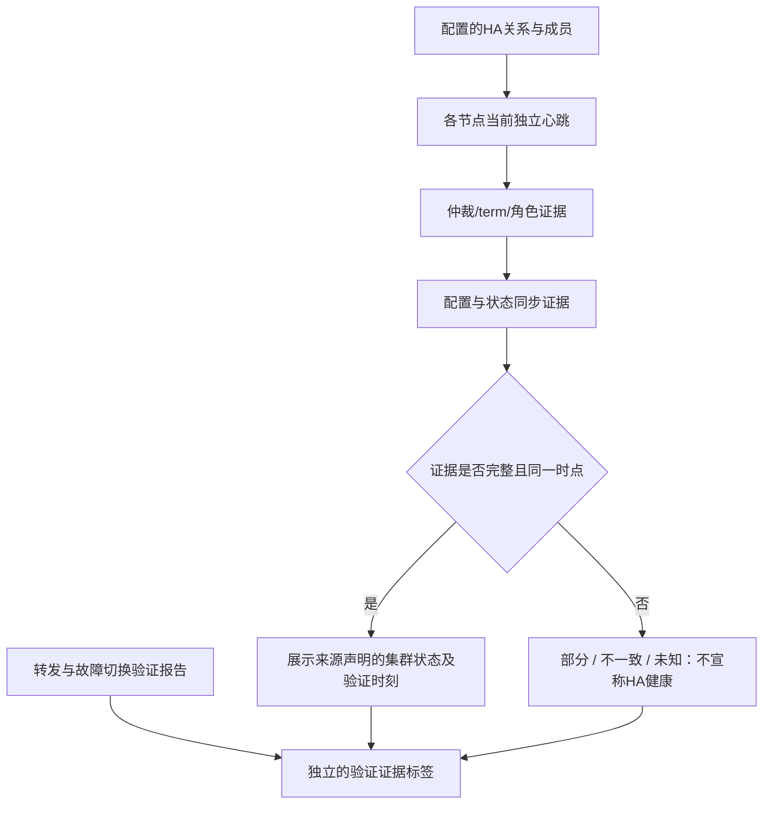

# 网络安全设备运维特性与控制台细化

版本：1.1，2026-10-27。状态：目标规格；所有硬件、HA、旁路、配置分发能力都需后端证据。
这些内容扩展既有P10/P23/P27/P28/P29/P33和P41/P48，不另造与主菜单重复的管理页面。

## 1. 设备级能力总览

控制台区分“管理服务所在主机”“采集设备”“安全设备连接器”和“真实转发设备”。
本机routerd可读到接口不意味着控制台已控制整台防火墙。每个能力显示：
capability_id、声明来源、支持版本、当前可用状态、验证时间、证据引用和限制。

| 特性 | 入口与布局 | 显示内容 | 控制与边界 |
| --- | --- | --- | --- |
| 部署形态 | P29能力矩阵、P03来源概要 | 透明串联/镜像/离线声明、实际收包后端、发送验证证据 | 三种形态不是已实现功能按钮；未验证发送明确标未核验 |
| 接口与端口 | P07详情、P10端口面板 | 物理/逻辑接口、速度/双工/协商、MTU、光模块、收发错误、链路变化 | 来源未提供不猜；admin状态与oper状态独立 |
| 双机与集群 | P10“HA”Tab、P41管理拓扑 | 节点角色、term/epoch、成员资格、心跳、配置版本、同步滞后、隔离原因 | 仅观察；不提供主备切换或仲裁操作 |
| 冗余链路 | P10链路Tab | LAG/成员、STP或其他协议状态、实际来源、容量、断链历史 | 未接协议数据不生成环路/收敛成功结论 |
| Bypass与故障模式 | P29转发能力、P10故障面板 | 软件/硬件Bypass支持声明、期望与实测状态、fail-open/closed配置引用 | 无硬件读证据只显示未知；本阶段没有切换按钮 |
| 硬件健康 | P28资源Tab | CPU/内存/磁盘、温度、风扇、电源、网卡、可选NUMA/丢弃 | A04当前不提供这些字段；缺传感器不显示0°C或健康 |
| 容量与资源 | P10/P20/P52 | 利用率、队列、drop原因、处理延迟、backpressure、数据覆盖 | 百分比需容量分母；容量标称与实测分开 |
| 时间同步 | P23服务、P48质量 | 时钟源、offset、同步状态、最后校准、漂移可信度 | 不同步时禁算跨设备端到端延迟，仍显示本地阶段耗时 |
| 配置版本与漂移 | P05采集版本、P33平台配置、P48适配器配置 | 期望/已保存/已加载/实测版本、脱敏差异、校验结果、漂移 | 保存成功不等于设备生效；本阶段不下发转发配置 |
| 版本与升级证据 | P29版本与能力 | 当前软件/规则元数据版本、来源签名、兼容矩阵、已导入验证报告 | 不设计远程任意包执行；升级与回退需独立发布流程 |
| 证书与凭据 | P30/P48连接配置 | 证书主体摘要、签发链、到期、秘密引用、轮换结果阶段 | 不显示秘密；不以忽略证书错误恢复连接 |
| 配置备份清单 | P33“备份记录”Tab | 已有备份元数据、摘要、来源、创建时刻、验证/到期、受控下载 | 备份任务/恢复尚未实现，不给恢复生产按钮 |
| 维护窗口 | P26告警规则、P33配置 | scope、起止、受影响规则、抑制理由、审批/审计引用 | 只抑制通知，仍记录真实事件与采集缺口；到期自动退出须有后端 |
| 许可证与支持信息 | P29只读可选区域 | 真正提供的授权能力、到期与来源 | 无许可证机制时不展示虚构商业授权、容量或厂商认证 |

## 2. HA状态：避免把两台在线误称高可用

P10 HA页：上方集群范围和快照时间；左16列成员/管理关系；右8列仲裁与同步状态；
下方成员表和配置差异。成员列含稳定ID、声明角色、实测角色、term、心跳时间、
配置期望/应用版本、状态同步年龄、来源、原因。不能仅用“主/备”两个绿色框代表HA可用。

状态区分：无集群配置、正常来源声明、成员失联、角色冲突、配置漂移、同步滞后、证据不全。
“切换耗时”只来自真实演练报告；当前心跳正常不证明生产切换成功，模拟测试不替代实际报告。

## 3. 配置、维护和运维反馈

配置表单统一呈现“草稿→校验→持久保存→服务加载→实际核对”，每阶段有对象版本和时间。
无法在线配置的字段显示来自启动配置并给文档路径，不提供假保存。
差异视图按字段显示旧/新值与受影响资源，秘密只显示引用变更。
有外部副作用的功能进入任务系统并复用N24的幂等、对账和未知结果语义；
当前支持范围仅只读连接校验和授权工单，不扩大到网络转发配置。

维护窗口表单设计值：名称1—64字符、必选scope/资源和规则、开始/结束时间与时区、
原因1—512字符；结束必须晚于开始，单次默认最长24小时目标，服务端可收紧。
预览列出将抑制的通知而非被删除的事件；涉及范围修改时旧预览失效。
未有N09调度/审计能力前不可上线“立即维护”操作。

## 4. 联动配置表单的精确规格

| 字段 | 约束与组件 | 验证/错误反馈 |
| --- | --- | --- |
| 名称 | ProFormText，1—64字符 | 同scope重复名提示；内部ID仍唯一 |
| 设备引用 | 授权资产Select，单选 | 不能手填未经登记的公网地址；权限变化立即失效 |
| 适配器 | 服务端支持清单Select，显示版本/能力 | 无真实适配器只说明未支持，不列模拟厂商 |
| 连接配置引用 | 目录登记的端点/传输/TLS策略引用 | 服务端验证网络范围、证书与重定向；拒绝任意URL代请求 |
| 凭据引用 | 秘密存储选择器，提交ID | 后端验证用途/范围/到期；GET不回显秘密 |
| 允许能力 | 后端能力白名单Checkbox | 读事件、读健康、读目录、工单等分项；配置权限不隐含投递权限 |
| 轮询与超时 | InputNumber，单位显式 | 设计默认30s/10s，实际上下限由适配器schema提供；禁止0无限 |
| 输入大小与频率 | 配额配置摘要，适配器提供可编辑范围 | 超限拒绝有计数；不悄悄截断为合法事件 |
| 字段映射 | 固定schema字段映射表+脱敏合成样本 | 缺必填/类型错/未知字段阻止发布；不得执行JS表达式 |
| 维护与启用 | 时间窗引用、Switch | 保存、启用、首次成功事件阶段分开 |

这些默认值是设计参数，不能覆盖真实适配器声明；没有统一适配器时不实现万能配置表单。

## 5. 实施依赖和验收

复用N04时序、N08服务资源、N09维护调度、N11能力、N13审计、N14配置，以及N20—N25联动；
扩展的字段与子资源尚未实现，须先纳入对应OpenAPI和权限测试，不增加“隐藏探测接口”。

必验：主备角色同时主、term过期、只有管理心跳但转发未知、同步队列阻塞、配置不同步、
缺光模块/风扇传感器、64位计数重置、时间失步、维护到期、范围变更、秘密轮换失败、
备份摘要不符、配置加载失败，以及设备宣称Bypass支持但无状态证据。
上述场景都不能被一个“设备在线”绿色状态覆盖。
