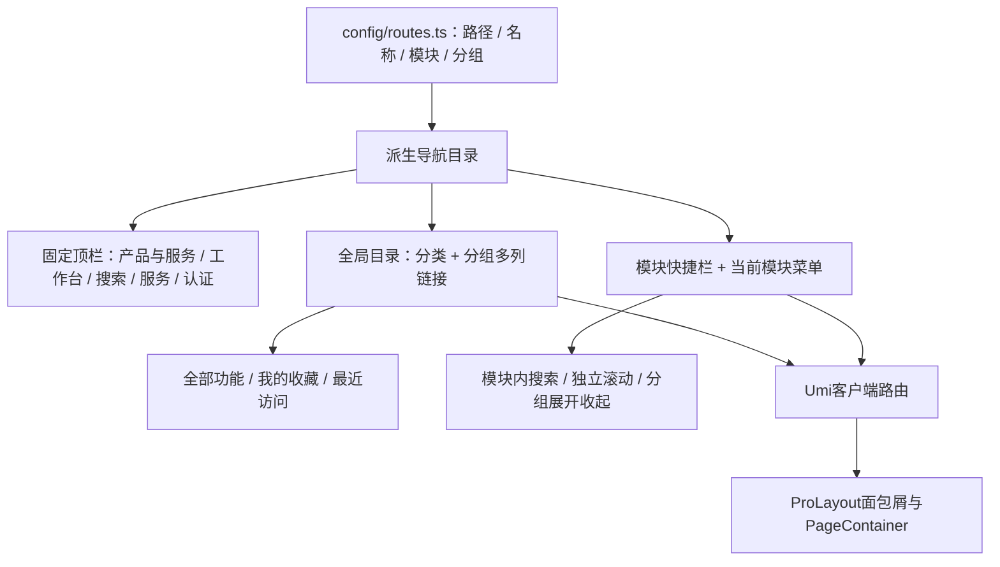

# 控制台导航收纳与动效

## 参考与落实范围

2026-10-27，在用户已登录的阿里云控制台首页只读查看整体导航：顶栏、产品与服务面板、
左侧分类、分组多列链接、收藏入口与搜索。没有修改云资源、账户、收藏或其他设置，
没有将云账号、账单或资源明细写入工程。参考对象是整体控制台的信息组织，不是某一云产品的业务页面。
[阿里云官方控制台首页说明](https://help.aliyun.com/zh/management-console/console-home-1)可供后续核对。

CythSec沿用自身标识与Ant Design主题。当前实施六个业务页面，开发环境另含五个设计视图；
目标设计中的未发布能力不会因为导航重构变成可用功能。端口保持15173，复用同一Umi应用与ProLayout。

## 信息架构与收纳

| 层级 | 内容与行为 | 收纳规则 |
| --- | --- | --- |
| 全局顶栏 | 产品与服务、品牌返回首页、工作台、搜索功能、真实服务状态、访问认证 | 高50px，固定；窄屏隐藏工作台文字入口和展开的服务摘要，保留认证与菜单入口 |
| 产品与服务 | 左侧模块分类，右侧分组多列链接 | 桌面最大1040px；分类区200px；中屏2列，窄屏1列；超长目录在面板内部滚动 |
| 模块快捷栏 | 工作台、网络管理、流量分析、平台管理；开发环境含设计工作区 | 宽56px；图标+短名称+Tooltip；点击进入该模块首个已发布页面 |
| 当前模块菜单 | 模块名、搜索、可折叠分组、叶子页面 | 宽216px；与页面独立滚动；当前页持续选中；收起后只保留模块快捷栏 |
| 窄屏 | 当前模块菜单抽屉 | 768px以下不占主内容宽度；从顶栏进入；切换后关闭；标题不重复 |

路由平铺保持原有URL；`consoleProduct`与`consoleSection`只提供分组元数据。
开发组由父路由继承模块信息。目录派生器不注册路由，不构建第二份路径清单，
404、重定向及无实际页面的父节点不成为目录叶子。

## 搜索、收藏与访问记录

- 全局搜索匹配功能名、模块名、分组与路径；分类与标签页共同限定当前结果。
- 模块内搜索只过滤当前模块；搜索清空后恢复该模块所有已发布分组。
- 收藏星标可切换，空收藏显示“暂无收藏”；不默认替用户收藏页面。
- 最近访问按实际进入的已发布路径去重、前移，最多8条；未知路径不记录。
- 偏好保存在当前浏览器的`cythsec.console.navigation.v1`，只含已发布路径和侧栏收起状态。
  不保存查询参数、任意URL、业务对象、流量信息、凭据或云控制台账户内容。
- 损坏JSON、禁用存储、容量不足时回退内存使用；生产加载时过滤开发专用路径。
- 所有站内跳转使用Umi Link，保持同一SPA和服务访问边界。

## 动效与可访问性

| 交互 | 实现 | 约束 |
| --- | --- | --- |
| 分类目录 / 窄屏菜单 | Ant Drawer原生入场、遮罩与退场 | Esc或关闭按钮退出；焦点由官方组件管理；退场后销毁内容，避免隐藏抽屉残留焦点 |
| 菜单分组 | Ant Menu原生展开收起 | 支持键盘；按当前页面选中叶子；不重新制作折叠控件 |
| 功能侧栏收起 | 内容transform/opacity，布局占位200ms同步收缩 | 保留56px快捷栏；收起内容设置inert和aria-hidden，不进入Tab顺序 |
| 链接与模块切换 | Ant主题颜色；160ms背景/颜色过渡 | 不为业务页面增加整屏飞入、弹跳或加载延迟 |
| 减少动态效果 | 监听prefers-reduced-motion，Ant motion=false，自有过渡关闭 | 系统偏好改变后即时生效；不覆盖Ant私有选择器 |

动效时长是CythSec实施值，不宣称与阿里云私有实现逐帧相同。
侧栏占位宽度过渡用于同步内容重排；面板本身采用transform/opacity，避免页面被覆盖。
导航层级采用Pro布局、Ant浮层默认层级，侧栏保持在顶栏和抽屉下方。

## 工程验证与边界

实现位于`web/console/src/navigation/`，运行时通过`src/app.tsx`接入。
组件测试保留真实Ant控件与客户端路由，覆盖搜索、收藏增删、最近访问、分组收纳、
损坏偏好、侧栏隐藏和抽屉切换。生产构建检查设计视图不进入路由与产物。
布局验收同时检查1440px桌面和390px窄屏；浏览器截图与门禁日志保留在本机忽略目录
`build/cloud-console-navigation/`。测试结果与未核验项见[本轮验收记录](cloud-navigation-verification.md)，不以设计说明代替验证。
