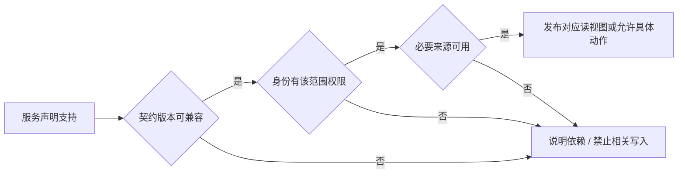

# 数据、接口与权限设计

本文件与 [逐页规格](pages.md) 联动。A为当前已核对API，N为目标契约组，不能把N端点视为现有服务。
源文件：`web/console/src/api/types.ts`、`analytics.ts`、`http.ts`，服务端shared controlplane和
`services/telemetryd/internal/api/server.go`。描述字段必须以服务端契约为最终依据。

## 1. 现有API清单

路径均为服务自身路径；前端routerd使用`/api/v1`，telemetryd使用`/telemetry/api/v1`开发代理。
跨服务请求不能共享Bearer凭据。只有`healthz`健康读端点在当前鉴权策略下允许匿名。

| ID | 所属服务 / 实际入口 | 当前响应或行为 | 支撑页面 |
| --- | --- | --- | --- |
| A01 | routerd GET `/api/v1/interfaces` | `InterfaceInfo[]` | P01/P06/P07 |
| A02 | routerd GET `/api/v1/routes` | `Route[]`，当前IPv4/平台支持范围 | P01/P08 |
| A03 | routerd GET `/api/v1/traffic` | `TrafficCounters[]`，累计计数 | P07/P09 |
| A04 | routerd GET `/api/v1/system` | hostname/os/arch/go_version/pid | P01/P28 |
| A05 | telemetryd GET `/api/v1/analytics/imports` | 已保存批次有界列表`items,total`，无服务端任意全文过滤 | P01/P11/P12/P13/P18/P20 |
| A06 | telemetryd GET `/api/v1/analytics/imports/{id}` | 批次信息+窗口分页；from/to/offset/limit | P11—P17 |
| A07 | telemetryd POST `/api/v1/analytics/imports` | 同步严格导入，首次201/重复200，保存确认 | P04/P11/P18 |
| A08 | telemetryd GET `/api/v1/analytics/ingest` | 队列与消费者状态，不是逐任务列表 | P01/P04/P11/P18/P19 |
| A09 | telemetryd POST `/api/v1/analytics/ingest` | 202、内容ID和queue阶段持久确认，不等于历史保存 | P04/P11/P18 |
| A10 | routerd/telemetryd GET `/api/v1/session` | enabled/name/role/can_ingest；真实服务身份 | P23/P30/P35 |
| A11 | 各服务 GET `/healthz` | 服务名与status；前端当前接入两服务 | P01/P23 |
| A12 | 各服务 GET `/api/v1/version` | 版本、修订、构建时间和Go版本 | P23/P28/P29 |
| A13 | telemetryd GET `/api/v1/targets` | 已登记目标列表，非实际抓取/健康结果 | P23局部 |
| A14 | telemetryd GET `/api/v1/targets/{name}` | 登记目标详情，不证明该目标在线 | P23局部 |
| A15 | 各服务 GET `/metrics` | Prometheus文本，可能被关闭；当前无统一Web时序服务 | 后续N04/N08的输入 |

API存在与UI已经接线分别判定。例如四服务都拥有healthz，不表示当前浏览器代理已接入四服务。
认证已启用时GET/HEAD需凭据，当前仅telemetryd两项聚合POST按can_ingest放行；其他写操作仍拒绝。

### 1.1 现有字段显示映射

| 对象 | 真实字段 | 前端显示和边界 |
| --- | --- | --- |
| InterfaceInfo | name/index/mtu/mac/flags/up/running/loopback/broadcast/multicast/point_to_point/addresses | 本机接口快照；index可用于当前快照，不保证重启后的永久身份 |
| InterfaceAddr | ip/cidr/scope/is_loopback | scope未返回时标未提供，不猜业务安全区 |
| Route | interface/destination/gateway/mask/flags/metric/ref/use | 路由表条目；不是转发成功记录 |
| TrafficCounters | interface/rx_bytes/tx_bytes/rx_packets/tx_packets/rx_errors/tx_errors/rx_dropped/tx_dropped | 平台累计计数；没有稳定测量间隔/重置证据时不提供速率 |
| SystemInfo | hostname/os/arch/go_version/pid | 管理服务所在环境；没有CPU/内存/磁盘利用率 |
| AggregateImport | id/stored_at/windows/first_window_seconds/last_window_seconds/bytes/status | 内容地址批次；未带用户、文件名或sensor ID |
| AggregatePage | import/items/total/offset/limit | 当前查询匹配总窗数与一页内容；不可将items数量冒充total |
| AggregateWindow | window_start_seconds/window_seconds/sampling_interval/suppressed/statistics | 名义窗和采样声明；不是完整现场覆盖时长 |
| CaptureStatus | input_complete/analysis_complete/capture_loss_status/published_windows/suppressed_windows/source_counter_consistent | 三类完成/损失状态独立；计数声明不能替代采集真值 |
| AccessIdentity | enabled/name/role/can_ingest | 服务级身份，非全平台会话；can_ingest仅描述现有聚合写入能力 |

### 1.2 当前聚合与导入限制

- 仅完整聚合JSONL，最大1MiB、最多1024窗；不接收原始PCAP、任意标签、IP、域名、账号或载荷。
- 当前窗口查询按起点匹配`[from,to)`，offset最大1024，limit为1—100；非法/重复/未知参数按后端拒绝。
- 当前队列与历史分别最多64MiB/1024批；这是本机开发实现的配置上限，不是生产容量承诺。
- API返回的窗口是内部观测结构的投影。未暴露的原始诊断字段不能由前端重建成“来源真值”。
- 目前前端ApiEnvelope类型只声明data/error；服务端已有code/request_id。实现全局错误引用时应补齐类型与解析，不用设计稿假定它已接线。
- 本机回环访问限制与服务端输入校验继续生效；把按钮放到页面上不能改变后端接受范围。

## 2. 目标新增契约组

这些路径是设计提案，不是已实现API。具体归属在后端设计评审确定，不要求新增微服务。
所有新增写端点需改变当前默认拒绝策略，并完成独立权限与审计验收后才能发布前端动作。

| ID | 目标契约 / 路径提案 | 最小数据内容 | 前置 |
| --- | --- | --- | --- |
| N01 | 观测点目录 `/api/v1/observability/sensors`、`/{id}` | 稳定ID、显示名、管理范围、声明模式、能力证据、心跳/观测时间 | 登记持久化、来源认证、范围授权 |
| N02 | 聚合来源档案 `/api/v1/observability/sources` | 类型、schema、绑定范围、配置引用、最近接受阶段 | 不接受任意探测URL/执行命令；来源与批次关联有证据 |
| N03 | 采集配置版本 `/api/v1/observability/configurations` | 版本、参数、校验、适用范围、实际生效状态 | 版本并发控制、服务端支持值、审计；不含生产转发控制 |
| N04 | 时序与网络健康 `/api/v1/observability/health-series` | 指标ID、单位、资源、时间、重置/质量标记、真实间隔 | 来源时钟、保留与查询上限、指标计算语义 |
| N05 | Schema/指标字典 `/api/v1/schemas` | 字段、单位、可空性、版本、支持范围、不可用原因 | 与实际生产者及查询DTO一致 |
| N06 | 数据管理 `/api/v1/data/tasks`、`storage`、`retention` | 逐任务阶段、存储容量证据、版本化保留草稿与影响预览 | 有界元数据、保护对象、真实确认、审计与恢复 |
| N07 | 聚合导出 `/api/v1/data/exports`、`/{id}`、受控下载 | 不可变范围、状态、产物摘要、过期、记录数 | 专用权限、后台作业、同范围校验、输出限额 |
| N08 | 运维服务/日志 `/api/v1/operations/services`、`logs` | 本平台服务状态与脱敏结构日志、固定查询字段 | 授权服务清单、脱敏、无任意文件读/命令执行 |
| N09 | 运维告警 `/api/v1/operations/alerts`、`alert-rules` | 条件、评估状态、事件、去重、恢复、确认记录 | 调度器、持久状态、权限、通知安全配置 |
| N10 | 验证报告 `/api/v1/operations/verifications` | 修订、环境、真实退出码、分组结果、可信来源和产物引用 | 结构化报告导入、来源校验、受控产物访问 |
| N11 | 能力目录 `/api/v1/capabilities` | 支持声明、可用状态、版本、范围、限制和证据引用 | 各服务真实发布；不能由前端权限或菜单推断 |
| N12 | 平台身份 `/api/v1/identity/...` | 真实会话、主体、角色/专门权限、范围、到期/撤销 | 身份方案确定、服务端鉴权、会话与账号审计 |
| N13 | 操作审计 `/api/v1/audit/events` | 主体、动作、资源、结果、确认阶段、时间、request_id | 服务端事实源、脱敏、保留和完整性 |
| N14 | 平台配置 `/api/v1/administration/settings` | 分组配置、版本、校验、服务端秘密引用 | 最小权限、并发控制、引用校验；不返回秘密 |

对需要CRUD的资源，方法、分页、错误码和并发条件须在服务端OpenAPI确定后接入。
前端不以猜测路径发送测试写请求；原始启动flag/env/YAML与在线配置要有明确映射和优先级。

### 2.1 v1.1新增资产与安全协作契约

N15—N19覆盖资产、地址绑定、关系、区域通信与服务；N20—N25覆盖连接器、健康、事件、模板、持久任务与阶段计数。
定义、路径提案和专门权限统一列于[安全设备联动第6节](security-integrations.md#6-新增契约组与权限)，对象与时间/域语义见[网络资产](network-assets.md)。
全部为P状态，不改变A07/A09严格聚合输入schema，不将IP/MAC额外键塞入现有导入。
新增资产地址精确检索、历史与导出须服务端按scope/resource/permission分别授权；禁止单凭前端筛选控制范围。

## 3. 目标公共对象形状

以下是新增API的设计要求，不向现有严格JSONL契约直接塞入这些键。

### 3.1 列表和详情

| 字段 | 类型 | 语义 |
| --- | --- | --- |
| id | string | 服务端稳定标识，不能由显示名拼接 |
| scope_ref | string或受控对象 | 平台管理范围引用，服务端强制过滤 |
| revision | string | 并发版本；不能用浏览器时间戳替代 |
| observed_at | RFC3339或null | 来源实际观测时间，必须来自来源证据 |
| received_at | RFC3339或null | 平台接收时间，与观测时间分开 |
| fetched_at | 前端本地元数据 | 本次请求成功时间，不回填为来源观测时间 |
| availability | 固定枚举 | present/unknown/unsupported/not_enabled/partial/stale等，由各契约明确映射 |
| unavailable_reason | 固定原因码或null | 不包含路径、秘密、原始载荷或任意错误堆栈 |
| provenance_ref | string或null | 受控来源/证据引用，不能接受任意外部URL |
| schema_version | 明确版本 | 版本不兼容时停止对应写入/派生计算 |

新增列表采用`items/total/offset/limit`或明确cursor机制；同一资源不能混用两种分页而不说明。
排序字段、范围、最大页数均为白名单；筛选变化清空分页位置；total为null时不能伪造总数。

### 3.2 作业对象

| 字段 | 类型 | 语义 |
| --- | --- | --- |
| job_id / parent_job_id | string / nullable | 重试新作业与原作业关联 |
| kind / stage | 固定枚举 | 导入、导出等类型与真实处理阶段 |
| submitted_at / accepted_at / completed_at | 时间或null | 未发生的阶段不填当前时间 |
| request_id | string或null | 请求关联，不是幂等键 |
| content_id | string或null | 已确认内容地址；当前聚合由服务端规范化生成 |
| durable_stage | 固定枚举或null | queue/history等实际保证，不能用一个布尔“成功”替代 |
| outcome / error_code | 枚举 / nullable | succeeded/failed/cancelled/unknown_result，不用缺失错误推断成功 |
| artifact_ref | 受控引用或null | 仅已就绪且权限有效的产物 |

任务进度只有在后端有可解释分母时显示百分比；不使用计时器随机推进。
超时、客户端关闭与服务器取消不同；显示“结果待核实”后按对象ID查询实际状态。

### 3.3 能力对象与菜单发布

能力至少包含`capability_id/declared_support/availability/scope/revision/limitations/evidence_ref`。
声明支持、服务可连接、被授权和证据验证是不同维度：

网络失败时能力为未知，不能把上次true长期缓存以允许写入；初始设计稿不向菜单发布所有P页面。
服务重新连接后重新校验能力；实际请求404/403与能力声明冲突时撤销对应动作并显示可解释原因。

## 4. 指标显示字典

| 指标组 | 真实字段或依据 | 显示单位 / 合计规则 | 不允许的解释 |
| --- | --- | --- | --- |
| TCP/UDP/其他IP | tcp_packets/udp_packets/other_ip_packets | 包；仅同批次同口径有效窗可相加，标“已发布窗观察值” | 总体线速、完整所有线上包量 |
| TLS记录头候选 | tls_record_candidate_packets | 采样流中的候选包数；可为null | TLS连接数、VPN识别数、解密数量 |
| QUIC长头候选 | quic_long_header_candidate_packets | 指定版本/条件下的候选包数；可为null | 全部QUIC、应用/网站归因 |
| 样本流 | contributing_sampled_flows | 当窗贡献采样流数；跨窗不去重相加成活跃总量 | 用户数、设备数、跨窗唯一会话数 |
| TCP质量候选 | retransmission/out_of_order/forward_gap_candidates | 候选事件数；需要来源/采样/状态说明 | 确定网络丢包、业务故障原因 |
| SYN响应时差 | response_delay_samples/upper_bounds_ms/histogram | 毫秒区间、样本数、非累积桶 | 网站加载时间、完整端到端RTT、桶中心精确p95 |
| 截断/头不全/碎片 | integrity投影中的相应字段 | 当前窗记录数，解释解析覆盖 | 原生产链路损坏或攻击确认 |
| 容量拒绝/迟到/时钟回退 | capacity_rejected_packets/late_records/timestamp_regressions | 本分析处理诊断，非业务丢弃策略 | 生产网关已阻断的报文数 |
| 来源丢包 | capture_loss_status/source_counter_consistent | 声明/未知/不一致；和本机计数分开 | 本机0丢弃因此上游0丢包 |
| 队列容量 | pending/max batches、pending/max bytes | 批次与字节分别计算百分比，分母有效才显示 | 历史总数据量或业务流量速率 |
| 进程作业计数 | *_this_process/consecutive_failures | 当前进程；重启归零 | 全历史累计、已确认数据丢失量 |
| 存储逻辑字节 | A05所有已返回批次bytes之和 | B/KiB/MiB，注明逻辑数据 | 文件系统实际占用或剩余磁盘空间 |
| 接口累计值 | A03各字段 | 累计包/字节/错误，平台范围 | 未验证时间差下的bit/s、链路利用率 |

所有采样指标使用观察值，不自动乘采样间隔外推。不同批次可能来自同一输入，不能合计为全网量。
整窗与子组均可能被抑制；null/缺失/真实0分开显示。来源字段缺失时不按名义窗宽推算覆盖。
当前聚合没有有效判定分母或全量覆盖，相关率值默认不设计为可见卡片。

## 5. 当前权限与目标权限

### 5.1 当前真实行为

| 情况 | 读取 | 写入 |
| --- | --- | --- |
| 未配置认证的回环开发模式 | 按原有本机服务约束 | 原有本机聚合校验继续生效；没有已认证管理员身份 |
| viewer有效服务凭据 | 当前已授权服务的GET/HEAD | 聚合导入403 |
| operator/admin有效服务凭据 | 当前已授权服务的GET/HEAD | 仅telemetryd两个聚合POST开放；两者当前写能力相同 |
| 身份未知/无效/服务认证不可用 | 401/错误视图 | 禁止；不以角色名称或旧成功值放行 |

当前`enabled=false`不能解释为超级管理员；当前`can_ingest`不能扩展为完整平台权限。
UI按钮权限只用于交互；服务端对每次请求重新检查主体、范围、对象与操作。

### 5.2 目标最小权限矩阵

这是N12目标，当前尚未发布。角色仅为默认集合，敏感动作还需专门权限及管理范围。

| 能力 | viewer | operator | admin |
| --- | --- | --- | --- |
| 授权范围网络/聚合/质量只读 | 是 | 是 | 是 |
| 查看来源、指标与安全化服务摘要 | 是 | 是 | 是 |
| 聚合导入/查询接收结果 | 否 | 是 | 是 |
| 来源元数据/采集统计配置草稿 | 否 | 专门权限 | 专门权限 |
| 查看敏感运行日志 | 否，除安全摘要 | 专门权限 | 专门权限 |
| 告警确认/备注 | 否 | 是 | 是 |
| 告警规则发布/通知配置 | 否 | 专门权限 | 专门权限 |
| 聚合导出与产物下载 | 专门权限 | 专门权限 | 专门权限 |
| 保留策略保存/执行清理 | 否 | 否 | 专门权限及预览确认 |
| 平台账号/角色/会话撤销 | 否 | 否 | 专门权限及审计 |
| 查询操作审计 | 限制后的摘要 | 专门权限 | 专门权限 |
| 修改本地显示偏好 | 是 | 是 | 是 |
| 生产转发/用户封锁控制 | 不在本设计 | 不在本设计 | 不在本设计 |

目标权限ID采用资源动作形式，例如`aggregate.read`、`aggregate.ingest`、`source.edit`、
`alert.acknowledge`、`retention.execute`、`identity.manage`、`audit.read`。
它们是目标命名方案，不是当前session已经返回的字段，也不由前端从role自动扩展。

### 5.3 目标动作权限字典

以下为设计期统一命名，N12实际发布前一律不当作session现有能力。角色分配使用上表和专门权限，
对象范围检查始终在服务端执行；相同动作的列表入口和详情入口必须使用同一权限。

| 资源 | 读取权限 | 目标写入/特殊动作权限 |
| --- | --- | --- |
| 平台摘要/网络运行 | `summary.read` / `network.read` | 无网络修改 |
| 观测点 | `sensor.read` | `sensor.register` / `sensor.edit` |
| 聚合来源 | `source.read` | `source.edit` |
| 采集统计配置 | `collection_config.read` | `collection_config.draft` / `collection_config.validate` / `collection_config.apply` |
| 聚合/字典 | `aggregate.read` / `metric.read` | `aggregate.ingest` |
| 数据任务/存储 | `data_task.read` / `storage.read` | 由明确任务类型权限决定，不授予通用执行权限 |
| 保留策略 | `retention.read` | `retention.edit` / `retention.preview` / `retention.execute` |
| 聚合导出 | `export.read` | `export.create` / `export.download` / `export.cancel` |
| 服务/日志 | `ops.service.read` / `logs.read` | 日志导出另需`logs.export`；无重启/Shell动作 |
| 运维告警 | `alert.read` | `alert.acknowledge` / `alert.assign` / `alert.note` |
| 告警规则 | `alert_rule.read` | `alert_rule.draft` / `alert_rule.validate` / `alert_rule.publish` / `alert_rule.toggle` |
| 验证报告 | `verification.read` | 受控产物下载`verification.artifact.download` |
| 平台账号 | `identity.read` | `identity.invite` / `identity.manage` / `identity.revoke_session` |
| 审计 | `audit.read` | 仅`audit.export`，不提供修改/删除 |
| 设置 | `settings.read` | `settings.validate` / `settings.edit` |
| 个人偏好 | 当前主体读取 | `preferences.edit`，不得修改他人偏好 |

### 5.4 会话与界面清理

- 当前服务凭据分别保存在页面内存，只发送给所属服务；刷新/断开后需重新连接。
- 401发生时撤销该服务凭据、清旧身份页面状态；旧请求/延迟响应体不能清除后来已验证的新身份。
- 403不是密码错误；显示范围/权限不足，不重复弹出凭据框诱导不断输入。
- 未来N12会话到期/撤销来自服务端，不靠前端解码声明或本地时钟证明有效。
- 服务连接、后端目标配置与操作者角色不同；设置页面不能让浏览器成为任意URL代理。

## 6. 写操作、版本与错误

目标写流程：编辑本地草稿 → 服务端校验 → 差异/影响预览 → 按真实权限提交 → 显示接受阶段 → 查询生效结果。
没有生效证据时保持“已接受/待确认”。配置使用ETag/revision，409/412要求比较和重新加载。

| 状态/结果 | 目标界面行为 |
| --- | --- |
| 400/415 | 就地显示契约/格式错误，保留可修正输入；不回显敏感原文 |
| 401/403 | 按会话与权限规则处理，不改为成功空表 |
| 404 | 对象不存在与路由不存在分开；保留回列表入口 |
| 409/412 | 冲突视图，展示已脱敏差异；不能强制覆盖 |
| 413 | 明确大小上限及当前文件大小；不尝试拆碎一个必须完整的聚合批次 |
| 429 | 只在服务端发布后按Retry-After处理，不提前假设已有速率限制 |
| 500/网络超时 | 读可重试；写入先查内容/任务状态，避免重复副作用 |
| 503 | 未启用与服务临时不可用按固定原因码区分 |
| 507 | 容量不足，保留源输入并说明拒绝阶段，不自动丢历史或绕过队列 |

当前A07/A09内容去重是现有保证；未来其他写操作必须明确自己的幂等和版本语义，不能套用它。

## 7. 版本、隐私与可追溯性

1. 每个可显示指标必须登记生产者、接口投影、单位、缺失原因、采样/抑制、来源时间与支持版本。
2. 高层属性目录不能直接成为telemetryd严格聚合DTO；新增字段先评审，持久化粒度与保留期单独确定。
3. 图表、明细与导出使用同一范围快照；只能声明当前证据支持的结果，不能将目录标签变成识别事实。
4. 业务数据、凭据和秘密不进入浏览器埋点。CSV公式转义、日志纯文本显示与产物访问权限必须验收。
5. 设计状态、编译成功、测试退出0、第三方独立核验与生产部署分别记录；未核验仍为未核验。

## 8. 新增网络配置契约（P53）

| ID | 实际入口 | 已实现能力 | 权限与阶段 |
| --- | --- | --- | --- |
| A16 | routerd GET /api/v1/network/configuration | 草稿快照、版本、能力与ETag | 当前读取身份；无鉴权仅本机回环开发；不是系统运行态 |
| A17 | routerd POST /api/v1/network/configuration/preview | 通用模型校验、三类原生配置预览、摘要 | 读取身份可预览；纯生成，不探测目标、不执行OS命令 |
| A18 | routerd PUT /api/v1/network/configuration | 私有目录持久化最新草稿、If-Match版本控制 | 必须已认证admin+存储启用；仅draft_saved，不是已应用 |
| N26 | 网络系统应用/确认/回滚（尚未发布） | Netplan / NetworkManager / UCI原生事务与运行态核对 | NC-02—NC-05完成前can_apply=false；后续需独立应用权限、任务、审计与断线回滚 |

P53配置模型、原生映射、发行版选型和后续门禁见[网络配置专项](network-configuration.md)及[API说明](../development/network-configuration-api.md)。

## 9. P53只读观测与预检查增量

| ID | 实际入口 | 内容与状态 | 权限 |
| --- | --- | --- | --- |
| A19 | routerd GET /api/v1/network/configuration/observation | 内核运行态、管理器响应与工具版本、接口归属；known区分未知与空集合 | 读取权限；单并发、超时、输出限额、固定只读查询 |
| A20 | routerd POST /api/v1/network/configuration/preflight | 绑定当前草稿与新快照的五字段比较、阻断/待核对项 | 读取角色；不改变保存权限，不授予系统应用 |

完整字段、原生数据源、快照限制和剩余NC-02任务见[运行态预检查](network-preflight.md)。报告不是审批或应用令牌，不能把差异项直接作为删除/写入计划。
