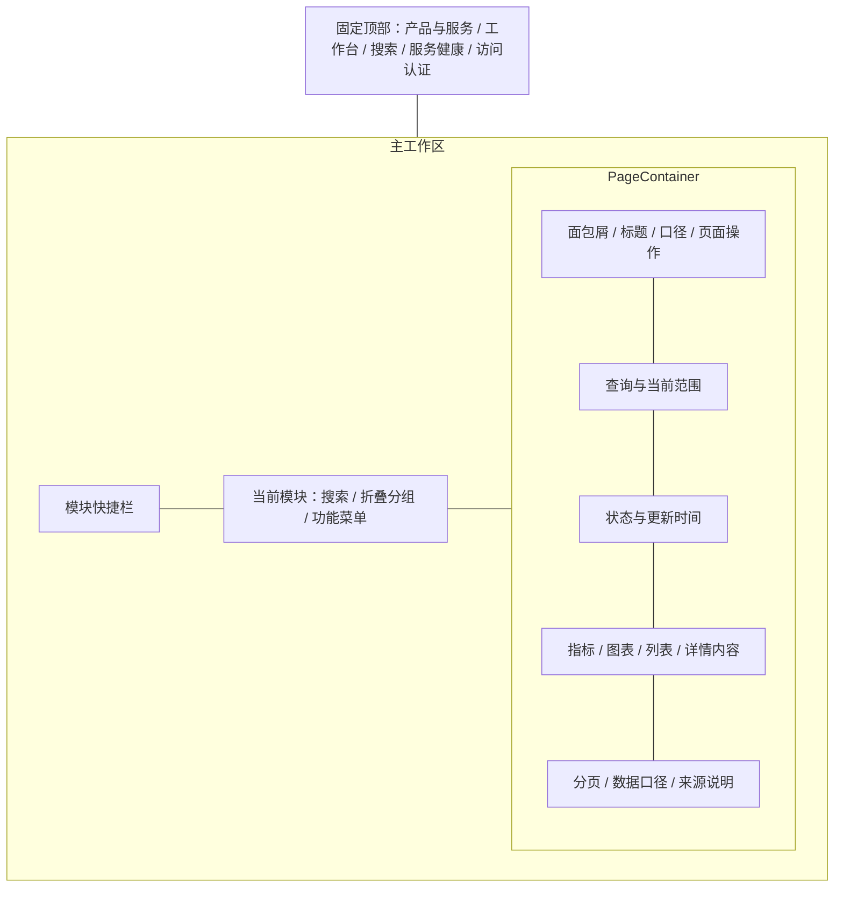
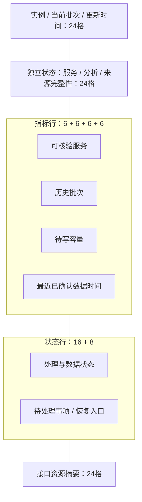
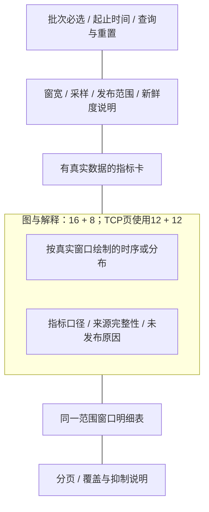
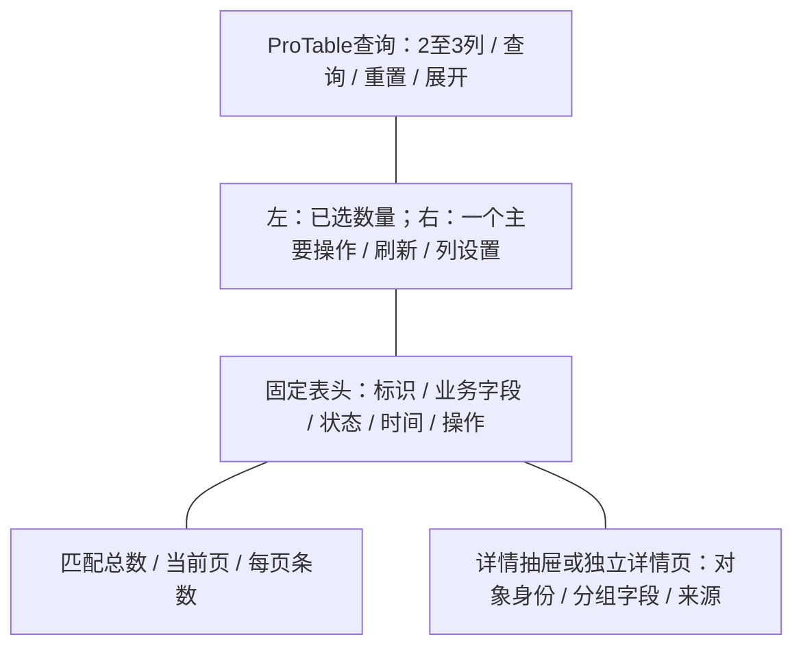
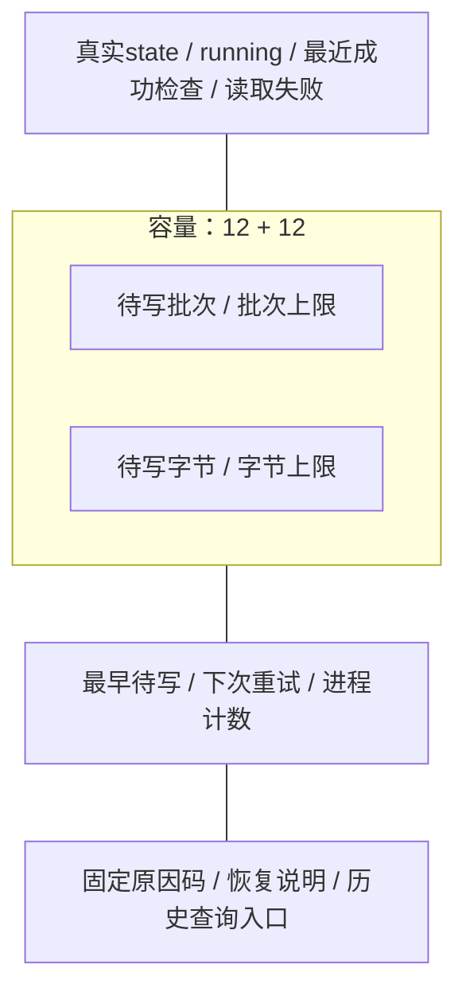
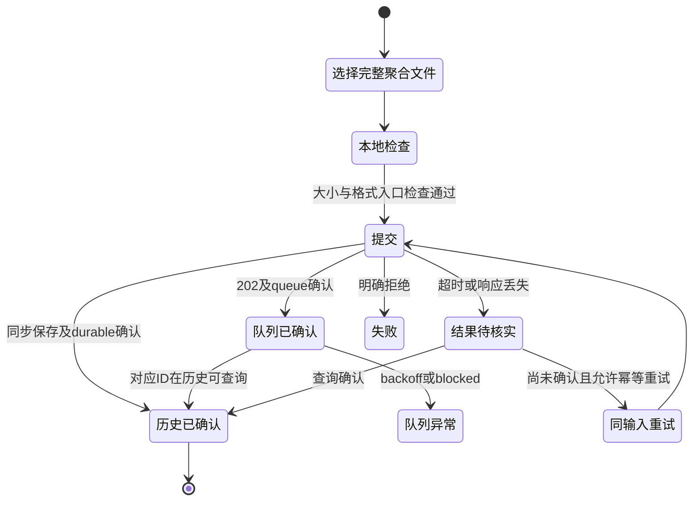

# 布局、显示和交互规范

本文件是目标设计，页面对应关系见 [逐页规格](pages.md)。架构/结构图用Mermaid，
实际界面使用既定Ant Design Pro组件；结构图不是已完成的视觉界面截图。

## 1. 统一外壳与尺寸

| 区域 | 1440基准值 | 实施方式 / 规则 |
| --- | --- | --- |
| 顶部 | 高50px，固定 | ProLayout headerRender；全局产品入口、搜索、服务与访问认证 |
| 侧边栏 | 模块快捷栏56px + 功能菜单216px | ProLayout menuRender；功能菜单可独立收起；768px以下使用抽屉 |
| 主内容 | 左右/上下24px | PageContainer与业务容器布局；不覆盖Ant私有结构 |
| 布局栅格 | 24列，列间16px，行间24px | Row/Col或Pro布局；卡片内容不采用固定绝对坐标 |
| 卡片 | 内容间距16px，内部留白24px | ProCard / Ant Token |
| 页标题 | 20px，主文本 | 标题和口径说明分层，不能用超大数字替代标题 |
| 正文 / 表格 | 默认14px | Token统一；说明最小12px，关键状态不能仅用小字 |
| 标准控件 | 默认Ant中尺寸 | 主次按钮、输入、日期等使用官方组件 |
| 抽屉 | 桌面480/720px两档 | 普通详情480、复杂表单720；窄屏铺满可用宽度 |
| 弹窗 | 简单确认480px，短表单560px | 大量字段转详情/抽屉，避免多层弹窗 |

浅色主题为默认；颜色、背景、边框、阴影均来自Ant Design Token。图表颜色用于承载类别，
业务状态仍用文字+图标；不同图表对同一指标保持同一图例顺序与色标。
不以渐变背景、旋转地球、装饰数字、无意义地图或卡片海替代可读内容。

菜单组图标固定为工作台DashboardOutlined、观测接入ApiOutlined、网络运行ClusterOutlined、
流量分析AreaChartOutlined、数据管理DatabaseOutlined、运维中心ToolOutlined、平台管理SettingOutlined。
图标来自`@ant-design/icons`；叶子默认使用名称，避免各层重复图标。父组无已发布可见子页时隐藏。
服务连接、帮助和异常页不能依赖业务能力查询成功才能进入，避免认证初始化死锁。

顶部服务摘要区独立展示routerd与telemetryd，未来其他服务须由真实后端状态聚合支撑。
窄屏用带可访问名称和Tooltip的状态点；错误展开可到P23，不让长文本被截断或覆盖认证按钮。

当前已发布导航和动效实施细则见[云控制台式导航](cloud-navigation.md)。上文未接入后端的目标菜单仍按能力发布，不作为占位入口上线。

## 2. 八类页面模板

| 模板 | 区域顺序 | 主组件 | 对应页面 |
| --- | --- | --- | --- |
| L01 总览 | 范围→质量提示→4指标卡→主状态/待处理→资源摘要 | PageContainer/ProCard/Statistic/Table | P01/P10/P20/P23 |
| L02 列表 | 查询表单→工具栏→状态条→表格→分页 | ProTable/ProForm/Tag/Alert | P02/P06/P08/P18/P22/P24/P25/P26/P27/P29/P31/P32 |
| L03 查询分析 | 批次与时间→发布状态→指标→时序/分布→明细 | ProCard/Form/DatePicker/表格及受控图表 | P09/P11/P13/P14/P15/P16 |
| L04 详情 | 对象标题/状态→Descriptions→Tabs→关联证据 | ProDescriptions/Tabs/Timeline | P03/P07/P12/P28，P27详情 |
| L05 配置/版本 | 版本摘要→分组表单→差异/校验→固定操作栏 | ProForm/Steps/Descriptions | P04/P05/P21/P26/P31/P33/P34 |
| L06 管道状态 | 状态Banner→容量→时间/进程计数→原因/恢复说明 | Alert/Progress/Statistic/Descriptions | P19，P18结果 |
| L07 服务连接 | 真实服务目标→连接状态→凭据表单→错误/帮助 | ModalForm/Input.Password/Result | P30/P35 |
| L08 异常 | 固定错误类型→解释/请求引用→恢复动作 | Result/Button | P36 |

页面可组合模板，但不新建第二套视觉系统。ProTable当前密度图标的已知兼容限制继续保留；
表格大小可以由已验证的组件属性控制，不能为恢复一个图标引入React版本冲突。

### 2.1 总览区域结构（P01）

每张指标卡包含名称、值与单位、来源范围、更新时间/可用状态、详情入口。缺字段显示状态文案，
不填演示数字。四卡全部未知时仍展示来源原因，不以骨架屏无限等待。

### 2.2 查询分析区域结构（P11/P13—P16）

图和表必须用同一个查询范围与响应版本。没有完整查询范围时，标题写“当前页”，不能让图显示
第一页而指标卡显示“全部”。一张图默认最多6条可区分系列；多于6条先筛选或分组，不堆叠成不可读色带。

### 2.3 列表与详情结构

主标识列固定左侧，单行操作最多两个直接入口，其他使用Dropdown。批量操作只在后端支持
同范围权限、逐项结果和并发校验后出现；当前只读网络页不保留不可用的批量修改入口。

### 2.4 配置版本结构（P05/P21/P33）

草稿、校验、接受和生效是不同阶段。实际未提供发布API时，文档中的按钮不能作为产品占位上线。
表单底栏不遮住最后一项；退出未保存修改时给出保留/放弃选项。

### 2.5 队列结构（P19）

两条容量条不能合成一个百分比；分母无效或不可用时不绘制百分比。显示0积压需要本次有效响应。

## 3. 表格显示规则

- 普通列表默认20条，选项20/50/100；聚合窗目标默认50条且不超过后端100上限，当前实现默认100须在实施时迁移。
- 明确后端分页与前端完整列表分页；当前页条数不等于总数。列表没有总数时写“已加载N项”，不造总数。
- 标识、时间、数量和状态提供排序；服务器不支持的排序只作用于已完整获取的有界集合，页头明确范围。
- ID/地址等技术字段使用等宽字体；默认截短，展开/Tooltip给完整值，可复制时说明复制对象。
- 长说明使用省略和可展开详情；禁止依赖鼠标悬停才能取得关键错误、状态或权限解释。
- 数值右对齐，数量使用千位分隔，字节单位使用B/KiB/MiB；比特率用bit/s，仅在口径满足时出现。
- 相同列名和单位贯穿列表、详情、图表和导出；不得把“候选”在小屏里省略成确定结论。
- 无结果显示匹配范围与重置入口；API失败显示Alert和request_id，不能转成“暂无数据”。

默认列宽目标：主标识180—220px、状态120px、时间180px、数量120px、说明至少240px、
操作128px。实际按内容与固定列组合调整，列宽总量超出容器时启用表内横滚，不压缩到不可读。
移动端主要操作采用适当的原生控件尺寸与触控间距，避免通过缩小字体塞进桌面布局。

## 4. 查询、时间与图表规则

1. 分析页必选批次，首次加载可明确选择最近保存批次；用户选定后，轮询不能替换选择。
2. 对象删除/不可访问时清理其数据，提示重新选择，不自动显示另一个批次但保留原标题。
3. 查询参数只允许已发布字段；`from/to`转Unix秒，范围为`[from,to)`，翻页使用明确offset/limit。
4. 日期控件显示当前解释时区。默认浏览器本机时区；UTC以明确偏移展示，导出包含时区。
5. 禁止起点不小于终点、非法日期、超安全整数和未知参数。夏令时歧义必须说明，不默默选择另一个时间。
6. 不将窗宽当实际覆盖时长；数据空洞保持空洞，不补0、不平滑跨过抑制或缺失窗口。
7. 所选范围中只汇总同批次、相同指标版本和有效口径；含缺失时标局部观察值及贡献窗口数。
8. 直方图使用真实桶边界与非累积桶计数；不由桶中心估算一个看似精确的延迟分位数。
9. 当前批次最多1024窗。若图需全范围，必须完整有界读取或等待后端汇总契约，不能以当前页代替。
10. 图表必须同时提供同口径表格，支持键盘读取；图例、单位、范围、样本与更新时间不可省略。

## 5. 数据状态视觉字典

| 状态 | 表达 | 操作规则 |
| --- | --- | --- |
| loading | 首次Skeleton/Spin，说明正在读取哪个来源 | 写操作等待真实权限和能力，不无限转圈 |
| empty | Empty + 具体范围/引导 | 只在成功响应空集合后出现 |
| error | Alert + 简明原因 + request_id + 重试 | 只读可重试；写结果不确定先查状态 |
| unknown | 文字“未知”+原因 | 不显示0、绿勾或默认正常 |
| unsupported | “来源未提供/不支持”+受影响字段 | 不提供同义伪指标替代 |
| not_enabled | “未启用/未开通”+已知配置依据 | 与查询失败分开 |
| suppressed | “样本不足，统计未发布”+阈值口径 | 不反推被抑制的数值 |
| stale | 旧值+最后成功时间+“已过期” | 只有同范围只读数据可保留，不用于允许写操作 |
| partial | 已有部分结果+缺失来源 | 每部分独立状态，整体不直接标完成 |
| unauthorized | 认证要求 / 403说明 | 清旧身份数据，保留安全返回路径 |
| queued | “队列已确认，历史尚未确认” | 保留源输入，等待历史查询证据 |
| durable | “已保存，可查询” | 仍保留input/analysis/loss独立状态 |

主色仅表达交互；success/warning/error颜色通过Ant Token使用。告警、质量、任务和权限四种
状态不能压成同一个health字段。鼠标或键盘聚焦状态徽标可打开定义与来源。

## 6. 刷新与异步交互

| 数据 | 目标默认刷新 | 超时/失败策略 |
| --- | --- | --- |
| 服务健康 | 5秒 | 2.5秒超时；失败是检查不可达，不推断业务管道状态 |
| 接口 | 5秒 | 普通查询10秒；失败撤销当前有效状态 |
| 接口累计计数 | 3秒 | 无时序依据不算速率 |
| 队列 | 3秒 | 2.5秒超时；超时不无限保留旧0积压 |
| 历史列表 | 首次、手动、写入确认变化 | 保留用户选择，不因每次轮询跳到最新 |
| 窗口结果 | 查询/翻页/选择变化 | 请求代次隔离，超时显示来源错误 |
| 未来日志/告警 | 默认暂停自动滚动，轮询策略由能力发布 | 用户阅读时显示新增条数，不夺走滚动位置 |

切换实例、身份、对象、时间范围、指标版本时生成新的请求范围键；旧请求即使晚返回也不能覆盖。
页面隐藏可暂停高频轮询，恢复时先校验身份与能力；不对不幂等写入做后台自动重试。

## 7. 导入确认交互

错误说明保留固定原因与阶段；本次文件名只在本地提示，不传到查询URL或普通日志。
未启用队列只有收到明确disabled状态后才走同步导入；队列状态请求失败不能自动改走同步。

## 8. 响应式与可访问性

| 宽度 | 导航与布局 | 表/表单 |
| --- | --- | --- |
| >=1440 | 完整侧栏，24列 | 多列表单，分析16+8/12+12 |
| 1280—1439 | 同样结构，次要说明折叠 | 不挤压关键列，不自动省略状态 |
| 1024—1279 | 默认折叠侧栏 | 指标2列，图表按内容换行 |
| 768—1023 | 原生抽屉菜单 | 主体单列，查询2列转1列 |
| <768 | 单列，顶部保留范围/访问入口 | 390宽验收；表格独立横滚，表单铺满 |

固定列/头/底栏不能阻挡内容或键盘焦点；不为容纳表格让整页横向溢出。只在受限表容器内横滚。
图表表格切换、过滤、重试、复制、导入均可键盘操作。表单有可访问标签和就地错误，错误后
焦点移到首个错误字段；抽屉关闭回到打开按钮。状态含文字，动效尊重系统减少动效设置。
目标文本对比度至少4.5:1，大字至少3:1；实施验收检查实际Token组合，不能仅凭组件品牌认定满足。

## 9. 安全和内容显示

所有服务内容按纯文本渲染，不执行日志或错误里的HTML。下载、复制与导出遵守相同数据范围。
返回路径只允许本应用内的规范化白名单路由，不接受协议相对、反斜线绕过或外部URL。
凭据不进URL、localStorage、sessionStorage、Cookie、截图样例、埋点或日志。
全局帮助不嵌入第三方实时访问统计；外部文档链接明确目的地址，不自动发送业务上下文。

## 10. 页面发布前必须核对的布局内容

标题与实际范围一致；核心字段/单位/口径齐全；所有空/错/未知/部分/抑制状态有文案；
主要操作有真实后端和权限；无障碍与窄屏能完成同一任务；图表可回到同范围明细；
刷新不抢选择/滚动/输入；任务接受与执行结果分开；未开通能力不能靠样式或示例数据冒充。

## 9. v1.1图形化细化

本规范保留为统一Pro外壳和基础交互真源；新增专业图表与构图见[可视化规范](visualization-spec.md)。
新增资产页的标识、MAC可见性和关联置信状态见[资产画像](network-assets.md)，联动阶段语义见[安全设备联动](security-integrations.md)。
