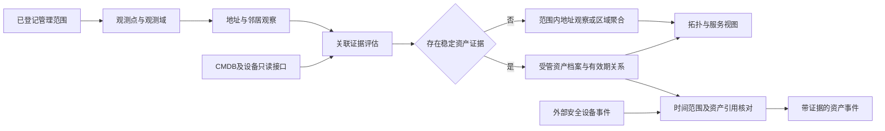
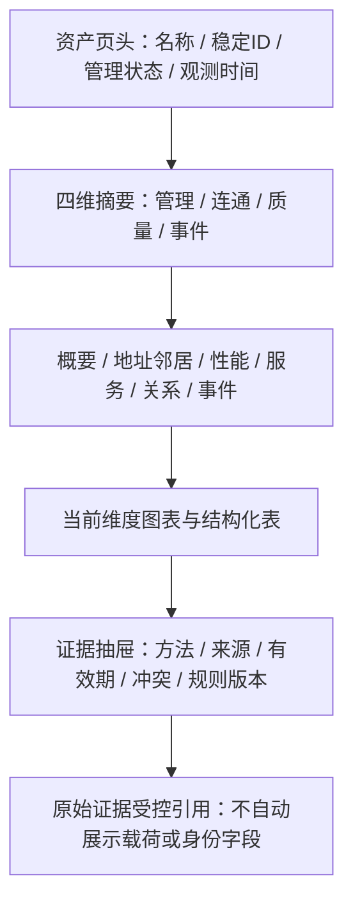

# 网络资产画像与关系视图精细设计

版本：1.1，2026-10-27。状态：目标设计，未实现。关联：[总览](README.md)、[可视化规范](visualization-spec.md)、[安全设备联动](security-integrations.md)。

## 1. 画像对象、数据边界与入口

画像定义为网络资源的技术档案：标识、地址有效期、所在网络、设备角色、接口、服务、
容量、质量、配置与安全事件证据。对象包括网关、交换机、防火墙、采集器、受管服务器和明确纳管的设备。
经过网关但未纳管的地址属于“外部地址聚合”，不能自动成为长期设备档案。
公共用户出口只展示链路、网段/安全区与服务类别的聚合；不建立公众终端逐设备通信轨迹、
个人应用/域名历史、身份映射或规避工具封锁视图。

IP/MAC是技术标识，可能具有可关联性。设计不要求姓名、手机号、账户等身份字段；
也不将“无姓名”表述为绝对匿名。资产地址受范围授权、保留期、查询和导出控制。
正常页面不展示载荷、完整URL、DNS查询明细、DHCP客户端标识或设备使用者身份。

入口新增“网络资产”组，置于“网络运行”后。P37—P43共7页，全部为P状态；
P38为隐藏详情。原P01/P06/P07/P10增加资产跳转，但后端尚未建立资产关联时不显示伪造链接。

## 2. 识别模型与事实规则

### 2.1 标识与关联

| 对象 | 键与字段 | 必须遵守的语义 |
| --- | --- | --- |
| Asset | asset_id、scope_id、kind、display_name、management_status | asset_id由目录服务分配；不能用IP或MAC散列冒充永久设备身份 |
| ObservationDomain | scope_id、sensor_id、domain_id、vrf_id、vlan_stack | VLAN需区分内外标签；VRF未知用null，不能默认为全局 |
| AddressObservation | observation_id、domain_ref、address_family、ip、observed_at、valid_until | IP同值而域不同不合并；IPv4与IPv6可归于同资产但需独立证据 |
| NeighborObservation | domain_ref、interface_ref、mac、neighbor_ip、method、observed_at | MAC只表当前链路层邻居；非以太网/隧道/流导出可能没有MAC |
| AssetBinding | asset_ref、observation_ref、valid_from、valid_to、evidence_ids、binding_state | 绑定有时间范围、支持/反对证据与冲突状态，不跨租期追溯合并 |
| Interface | interface_id、asset_ref、if_index、name、addresses、capacity_bps | ifIndex重启可变；稳定性策略由设备适配器发布 |
| Relationship | source_ref、target_ref、type、direction、valid_range、provenance | 物理、邻居、路由可达、观察通信是不同关系 |
| ServiceObservation | asset_ref、transport、port、method、first_seen、last_seen | 看到端口或单包不等于确认服务、漏洞或版本 |

绑定状态用“已核实 / 有证据待核实 / 冲突 / 未关联”，不生成未经校准的97%置信度。
role字段区分“目录声明”和“观测候选”；不因OUI就认定型号/操作系统或厂商安全水平。
MAC为本地管理/随机化时标明属性；一个MAC可有多个地址，一个IP可对应NAT后的多设备。
无资产目录证据时，列表标题用“地址观察”，不显示“设备总数”。

### 2.2 不同部署形态的可见性

| 场景 | 可显示 | 不能推断 |
| --- | --- | --- |
| 同一广播域的网桥观察 | 帧源/目的MAC、VLAN、IP、观察方向 | MAC永久不变；帧源必为最终终端 |
| 路由出口 | 本链路下一跳MAC、源/目的IP、接口 | 远端主机MAC；一个公网IP就是一台终端 |
| NAT/CGNAT之后 | 当前观测域的地址、区域聚合 | 内部设备及其用户；未提供映射时的内外地址关联 |
| SPAN/TAP镜像 | 带来源和方向质量的观察 | 镜像未见就是设备离线；单向样本能给出双向会话质量 |
| IPFIX/其他流导出 | 实际模板字段、导出器/观测域、采样说明 | 模板未提供的MAC/载荷；采样值直接等于全量 |
| 离线PCAP | 文件/批次的观察时间与接口说明 | 当前在线状态；文件时间等于服务当前时间 |

MAC显示时固定附加“本链路观察”帮助提示。NAT仅可引用受管基础设施的映射证据；
本设计不接入公共订户身份映射。物理拓扑依赖设备库存、LLDP或接口配置证据，
流量观察只形成通信关系，不补成物理连接。

## 3. P37—P43逐页设计

### P37 资产目录 `/assets`

- **状态/来源**：P；依赖N15资产目录、N16地址绑定。前端不能从现有聚合JSONL反推出资产。
- **目标**：找到受管设备、识别资产证据缺口和地址冲突。
- **布局**：页头；范围+时间+资产类型筛选；四项摘要；24列中左18列ProTable、右6列证据质量面板。
- **摘要**：受管资产数、当前有心跳资产、待核实绑定、冲突观察。每项有分母/时点，不能与全部过境地址相加。
- **列**：名称/稳定ID、类型、管理状态、管理地址、最近链路邻居、观测域、角色来源、数据时间、关联状态、关联安全事件数。
- **默认排序**：冲突优先，其次更新时间；可切名称/最近观察；默认25行，最大100行，服务端游标分页。
- **筛选**：scope/site/zone、类型、已登记/未关联、来源、关联状态、时间。IP精确/CIDR与MAC精确检索仅在授权范围内。
- **操作**：详情、查看证据、维护非身份标签；目录导入需预览冲突和持久任务。无“扫描全网”“按访问行为分群”。
- **空/失败**：未配置目录时给接入说明；无匹配可清筛选；目录错误不显示0资产。
- **跳转**：进入P38携带asset_id和as_of；返回恢复筛选与游标；导出需单独权限，默认不含MAC。

### P38 资产技术画像 `/assets/:assetId`

- **状态/来源**：P；N15—N19、N22。无授权或资产删除分别403/404，不能回显缓存名称。
- **布局**：页头显示类型图标、名称、管理状态、数据新鲜度；左侧6列证据摘要，右侧18列Tabs。
- **概要标签页**：身份与管理范围；角色声明/证据；接口容量；15分钟质量趋势；当前配置版本；安全事件摘要。
- **地址与邻居**：有效期时间带、IP/域/接口、MAC类型、观察来源和冲突；有历史权限才显示到期绑定。
- **性能与质量**：bps/pps、利用率、接口errors/discards、RTT样本分位数、重传候选比例，均显示口径和缺失区间。
- **服务**：仅该受管设备的基础设施服务类别、端口、观察方法、确认状态；不关联公众终端访问目的域名。
- **关系**：一跳邻居与通信安全区，切换“物理证据 / 逻辑邻居 / 区域通信”；默认不展开整个图。
- **事件**：设备告警、配置变更、连接器故障，分别显示外部来源、归一化规则和原始证据引用。
- **维护**：责任团队（系统/组织团队，非设备使用者）、运维标签、期望角色；变更用ETag并记录审计。
- **操作**：查看事件、跳到接口、查看联动任务；不直接执行阻断、远程命令或主动扫描。
- **状态**：无流量≠离线，目录注册≠在线；有心跳才显示在线，超阈值显示观测过期。

### P39 IP资源与地址观察 `/assets/addresses`

- **状态/来源**：P；N16。全局IP资源分配来自IPAM/目录，不从采样推算可用地址。
- **布局**：上方CIDR/VRF选择；左侧8列受管前缀树，右侧16列地址表；下方按需展开分配时间带。
- **显示**：IP/前缀、地址族、scope/VRF、分配状态、已核实资产引用、最近观察、绑定有效期、冲突、证据源。
- **图形**：IPv4可作有界地址块占用图，区分“已分配/有观察/无证据”；IPv6用前缀树和计数，不绘制全空间方格。
- **筛选**：精确IP/CIDR、地址族、域、分配状态、冲突、时点；过大前缀必须先聚合。
- **操作**：核对关联证据、进入受管资产、导出授权资源清单；没有分配服务时禁止编辑IPAM。
- **失败**：分配源不可达时保留来源过期提示；不把“未观察”标为“空闲可分配”。

### P40 二层邻居与MAC观察 `/assets/neighbors`

- **状态/来源**：P；N16/N17，依赖同链路或受管设备邻居表；没有MAC字段时整区说明不适用。
- **布局**：链路层可见性说明；按观测域分组表；选行打开480px证据抽屉。
- **显示**：MAC、本地管理/组播属性、接口/域/VLAN、邻居IP、方法、首次/最近观察、时效、来源角色。
- **筛选**：精确MAC、域、接口、方法、冲突。厂商/OUI只能作为候选属性，不作为归属或设备类型真值。
- **操作**：查看ARP/ND/设备表证据摘要、绑定待核实资产；人工确认须写依据，不能吞掉反证。
- **异常**：多IP同MAC可为网关；同MAC跨域不自动合并；镜像重复不当成MAC漂移攻击。

### P41 网络拓扑 `/assets/topology`

- **状态/来源**：P；N17。默认“受管基础设施拓扑”，不是公共终端全网关系图。
- **布局**：左260px范围/图层；中央自适应图；右360px对象详情；底部时间/图例。窄屏详情改Drawer。
- **图层**：物理连接（库存/LLDP证据）、逻辑邻居（路由/邻居表）、区域通信（窗口聚合）；不可同时混成一种边。
- **节点**：网关/交换机/安全设备/采集器/受管服务；形状+图标表达类型；边框与文字表达状态。
- **边**：方向、容量、测得bps/利用率、有效期、证据；未提供容量不画利用率。虚线为待核实关系，不动画为“真实流量”。
- **交互**：拖动只改个人布局；缩放、聚焦、搜索受管资产、单跳展开、固定位置、表格替代、图层开关、时间回看。
- **限制**：初始≤80节点/160边，展开≤300节点/600边；超过先聚合至site/zone并显示省略数量。限制是目标预算，非已测性能。
- **操作**：进入资产/接口/证据；保存个人视图；受控导出脱敏图片，附范围与时间。
- **未知**：单向观察不画反向边；没有关系数据时不按IP相近自动连线。

### P42 区域通信矩阵 `/assets/communications`

- **状态/来源**：P；N18。默认安全区×安全区；设备级仅限明确纳管的基础设施，不查询公众过境终端画像。
- **布局**：范围/时窗/指标/方向；主矩阵16列；右8列选中单元格条形分解；底部聚合明细。
- **显示**：安全区、bytes/packets、观察流数、协议构成、数据质量、覆盖率；非采样校正值明确为观察值。
- **交互**：点击格子联动表格；框选区域只改变查询，不产生策略；切换来源/目的轴保持方向说明。
- **控制**：同一窗口/域去重；已采样和未采样不无说明相加；小样本抑制与未知不画成零。
- **操作**：查看区域级异常和受管链路证据；不展开为公众终端对端清单或个人历史。

### P43 受管服务与暴露面 `/assets/services`

- **状态/来源**：P；N19，基于已有配置与被动证据，无主动探测任务。
- **布局**：角色/安全区/类别筛选；服务类别堆叠条；服务表；证据侧栏。
- **显示**：资产引用、监听/观察地址与端口、承载、服务候选、确认状态、配置暴露范围、证据时间、关联告警。
- **分类**：管理、名称解析、时间同步、观测导出、应用基础设施、未知；不以端口号确定应用版本。
- **操作**：查看资产、证据、关联事件；只有签名/版本证据与匹配规则齐全时才显示外部漏洞引用。
- **边界**：“观察到响应”≠互联网可达，“有端口”≠漏洞；可达性必须引用受管配置或独立验证证据。

## 4. 网络画像的视觉组成

不使用缺少定义的综合健康/风险分数或雷达图。资产头部用可解释的四个维度：
**管理状态、连接证据、质量观察、安全事件**。每项可展开来源、时间与缺口。

技术关系图必须回答“哪个受管资源、哪条链路、哪个时间窗”；不能以炫酷图形掩盖缺数据。
画像数据使用N15—N19独立契约；原有1MiB聚合导入接口仍拒绝未定义IP/MAC键。

## 5. 最小存储与验收

目标资源：assets、address_observations、asset_bindings、relationships、service_observations。
每条观察保留scope/domain/source/version/event_time/received_at/expiry和质量；绑定不改写原始观察。
建议开发默认值：基础设施技术时序30天、邻居观察7天、已核实目录保留到注销后30天；
这些是设计参数，未实现、未获生产确认，必须由部署方配置和验证删除。公共过境地址不建长期档案。

必验：跨VRF同IP、租期交替、NAT多设备、随机MAC、IPv6隐私地址、网关MAC、多源冲突、
时间倒退、镜像双份、数据过期、撤销权限、目录删除、scope切换晚到响应、导出字段限制。
这些用例均不得把不确定绑定升级为已核实资产。

技术参考：[RFC 826 ARP](https://www.rfc-editor.org/info/rfc826/)、
[RFC 7011 IPFIX](https://www.rfc-editor.org/info/rfc7011/)。本设计的关联规则和保留值属于产品设计，非RFC规定。
