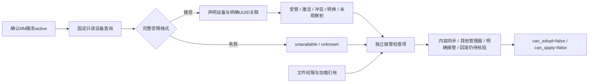

# NC-02B3B1：NetworkManager设备受管与活动配置关联

本阶段接续[来源权限与加载引用](network-source-authority.md)，在同一来源检查接口中读取
NetworkManager设备状态与活动配置UUID。控制台P53新增“设备关联”页签，不新增服务、端口或写入入口。
范围为当前服务身份可见的NM设备视图，不能推定独占归属、实际配置内容同步或管理链路可恢复。

## 固定读取链路

Linux上确认NetworkManager服务active后，以固定参数调用：

```text
nmcli -t -m multiline -f GENERAL.DEVICE,GENERAL.STATE,GENERAL.CON-UUID device show
```

无用户命令/设备参数插值，无shell、秘密查询、交互授权、load/reload/up/down或网络写入。
沿用单次1.5秒、stdout 1MiB、整体6秒上下文与固定工具目录，不新增依赖。
最多512设备，重复设备、重复/缺失/额外字段、未知状态码、坏转义或UUID均使整份设备查询不可读取。
设备与文件引用查询互相独立；任一失败不抹掉另一项证据，也不当作不存在。
文件、引用和设备分次读取，可能发生状态变更，不构成事务快照。

字段依据：[NetworkManager官方nmcli实现](https://github.com/NetworkManager/NetworkManager/blob/main/src/nmcli/devices.c)。
设备状态依据：[官方NMDeviceState](https://networkmanager.pages.freedesktop.org/NetworkManager/NetworkManager/nm-dbus-types.html#NMDeviceState)。
本地格式测试不代表Ubuntu、Rocky、Kylin或OpenWrt目标环境已认证。

## 数据契约

`device_evidence`包含state、固定scope=visible_nm_device_associations、observed_at与固定diagnostic。
state为observed/inactive/unavailable/unsupported/not_checked；observed仅表示查询格式已接受。
非Linux不执行主机查询，其他backend本轮not_checked。

`profiles[].device_association`包含state、可空device_state、managed与active_profile_matches。
只关联明确nm:UUID且字面设备绑定已解析的profile。无明确UUID或待解析绑定始终unknown。
只返回布尔匹配，不返回其他配置UUID或整个设备清单。

| state | 条件与含义 |
| --- | --- |
| active | 设备状态100，受管且活动UUID与当前profile相同 |
| conflicting | 受管设备有明确活动UUID且与当前profile不同，包含其他profile激活中的状态 |
| unmanaged | 设备状态10，NM未管理；不代表其他管理器不存在 |
| unavailable_device | 状态20，受管但暂不可用 |
| inactive | 状态30或120，断开或失败；保留原始状态码区分 |
| transitioning | 其余已知受管转换状态；同UUID也不能写成已激活 |
| not_observed | 查询成功但声明设备未出现，仅限当前身份视图 |
| unknown | 查询不可读取、未提供、设备状态0、明确激活状态却无UUID，或配置绑定/UUID不足 |

设备状态0的managed与UUID匹配为null，不能回填false；无设备条目时状态码亦null。
NM受管不证明其他管理器未同时操作该设备。active不证明磁盘、daemon内存或内核字段相同。
关联不是源文件引用：文件引用冲突时，设备仍可能报告active；接管检查分别保留两项。

## 控制台与接管检查

ProDescriptions显示查询状态、观察范围与时间；ProTable显示配置标识、设备、关联状态、
设备状态码、NM受管、活动UUID匹配。未知保留文字未知，布尔false明确显示否/不匹配。
旧后端缺少扩展时不制造未激活或未受管结论。
前端校验字段组合、UUID、绑定、平台、范围、时间和query-state，不接受缺证据的active。

非active关联增加明确阻断项；active只去除该关联阻断，不消除既有权限、来源、插件、内容、
管理链路、接管确认和回滚条件。can_adopt=false、can_apply=false，未增加系统执行路径。



后续仍需实际加载网络字段比较、跨管理器设备归属、Netplan字段归因、ifcfg/插件清单与明确接管。
本阶段没有完成整个NC-02B3B或NC-03。验证见[验收记录](network-device-association-verification.md)。
