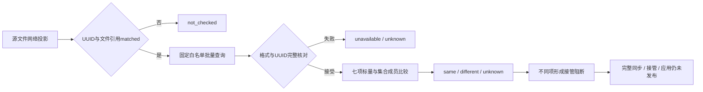

# NC-02B3B2：NetworkManager加载标量与集合成员比较

接续[设备关联](network-device-association.md)，本阶段检查源文件投影与NM当前可见profile设置的基础差异。
沿用来源检查POST接口和控制台15173，在持久配置抽屉增加“加载差异”页签。

## 读取范围与查询

只有明确nm:UUID且单源文件加载引用matched的声明参与查询。
在既有服务/设备/文件引用查询后，使用一次受限批量请求；最多64个源文件对应的唯一UUID。

```text
nmcli -t -m multiline -f connection.uuid,connection.type,connection.interface-name,802-3-ethernet.mtu,ipv4.method,ipv6.method,ipv4.addresses,ipv6.addresses,ipv4.dns,ipv6.dns,ipv4.dns-search,ipv6.dns-search connection show uuid UUID1 uuid UUID2
```

字段与批量ID语义依据[官方nmcli文档](https://networkmanager.pages.freedesktop.org/NetworkManager/NetworkManager/nmcli.html)。
MTU的auto及地址/列表输出参考[官方字段实现](https://github.com/NetworkManager/NetworkManager/blob/main/src/libnmc-setting/nm-meta-setting-desc.c)。
仅解析白名单字段，不请求秘密、完整profile、VPN或802.1x信息；无shell、任意命令、写操作或交互授权。
UUID必须满足既有严格格式并作为独立argv传递。沿用固定工具目录、单命令1.5秒、stdout 1MiB、
来源检查整体6秒上下文；未读取完毕不补造默认成功，文件系统读取仍非强制可中断操作。

记录按UUID对应，不按返回顺序对应。重复、额外UUID、非Ethernet类型、缺失/重复/额外字段、
坏转义、超限等使本次批量不可读取；缺少个别已请求profile时该profile独立unavailable。
不能读取时不回退宽泛输出。原始响应只在内存解析，不落盘或回传；单字段格式超出投影能力时保留unknown。

## 比较口径

| 字段 | 口径 | 未核验边界 |
| --- | --- | --- |
| device | 字面接口名称 | 匹配/重命名规则、独占设备归属 |
| mtu | profile MTU声明；auto/0规范为数值0并显示“自动” | 自动值不等于内核当前MTU；既有源投影未支持的值保留未知 |
| ipv4_method / ipv6_method | 分别比较明确地址方式 | 来源省略不推定为auto或disabled |
| addresses | IPv4/IPv6静态地址的规范字符串集合 | 顺序、地址族分组、地址属性与动态租约 |
| dns | IPv4/IPv6静态DNS地址集合 | 顺序、优先级、路由域、动态DNS与最终解析器行为 |
| search | 规范化后的搜索域集合 | 顺序、地址族分组与路由专用域 |

集合去重并排序后比较成员；不是列表顺序比较，也不证明重复数量一致。
仅比较源文件明确配置且两侧能解析的字段。省略、格式未解析和明确空集合不同：省略保留null，明确空为[]。
source_unset_or_unsupported时仍可显示已读到的加载值，但不能得出same。
对象字段值只有数字、字符串、字符串数组或null，无原始配置和凭证。

## 响应与接管语义

`profiles[].loaded_comparison`为可选扩展：

| 字段 | 值 |
| --- | --- |
| scope | 固定nm_profile_scalar_and_sets |
| state | partial/different/unavailable/unsupported/not_checked |
| observed_at / diagnostic | 检查时间与固定诊断代码；失败时间不表示成功观测 |
| fields | 有结果时固定七项，失败或未比较时为空；每项field/state/reason/source/loaded |
| fields[].state | same/different/unknown，仅对该项与上述口径成立 |

任一different使profile汇总different并产生loaded_settings_different阻断项。
其余有结果的profile保持partial，即使七项都same也没有“完整一致”或passed状态。
来源、设备、加载字段均分次读取，且仅为可见profile设置；不是设备已应用设置、内核运行态或跨文件事务。
路由及其属性、网关/策略路由、忽略自动DNS/路由开关、完整字段与其他插件仍未核验。
can_adopt=false、can_apply=false，保留明确接管、管理链路与回滚条件。

前端核对平台、UUID、来源引用与归因、七字段顺序、源值对应、same/different数值关系、unknown原因和汇总状态。
旧后端没有比较报告时显示“未取得”，不可读取时提供读取权限/工具或格式反馈。
ProTable展开显示逐字段来源与加载值、结果和依据，保留横向滚动、键盘页签与窄屏布局。



后续继续完整字段/顺序/路由语义、Netplan字段归因、跨管理器归属、ifcfg/插件和明确接管。
本轮验收见[验证记录](network-loaded-settings-verification.md)，不将格式夹具替代目标Linux运行证据。
