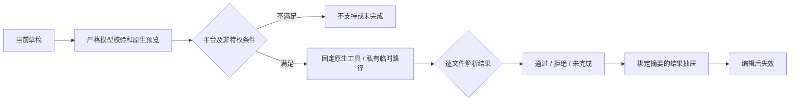

# NC-02B1：原生配置解析校验

P53 在同一套控制台中增加“原生工具校验”及结果抽屉。输入为当前表单的静态 IP、
MTU、DNS、搜索域与路由，沿用既有模型约束、权限连接和同源代理。

## 范围与结果

| 层次 | 状态与含义 |
| --- | --- |
| 通用模型 | 先执行现有 Validate/Compile；无效或含未知字段时不启动工具 |
| 原生解析 | 本阶段实现；检查目标工具是否接受生成的配置 |
| 持久配置及来源 | NC-02B2源文件快照见[规格](network-persistent-inspection.md)；完整归因与接管未完成 |
| 管理连接、接管及事务应用 | NC-02B3/NC-03 待开发；can_apply 始终 false |
| 目标系统认证 | Ubuntu、Rocky、麒麟 V11 Server、OpenWrt 的版本/CPU/接口矩阵独立未核验 |

`passed` 表示本次原生解析接受该摘要的配置；不是内核状态、持久化、连通性或回滚验证。
`rejected` 表示原生进程非零拒绝；`unavailable` 表示工具缺失、非特权条件不满足、执行超时、
输出超限或结果缺失；`unsupported` 表示平台/参数/版本不支持。每个生成文件保留独立检查结果。
任何未完成检查都不能使汇总变为通过。

## 原生命令

| 管理器 | 固定流程 | 通过范围 |
| --- | --- | --- |
| NetworkManager | 核对 nmcli >=1.40；生成 keyfile 通过 stdin 交给 `nmcli --offline connection modify connection.autoconnect yes` | 离线连接配置解析；不连接 daemon，无在线重试 |
| Netplan | 核对 systemd 为 running/degraded；核对 generate 帮助包含 root-dir/mapping；0700临时根下放0600配置；`netplan generate --root-dir TEMP --mapping DEVICE` | 解析完整临时配置，查询其中一个接口映射；不生成/应用后端配置 |
| OpenWrt UCI | 0700临时目录下写0600配置；`uci -c TEMP -P TEMP/delta -s export ABSOLUTE_TEMP_FILE` | UCI 严格语法解析；不验证 netifd 的运行语义 |

命令参数全部由服务端固定流程及已校验的设备名生成。HTTP 不接受工具路径、命令、目录或原始配置文本。
执行器仅查找 `/usr/bin`、`/usr/sbin`、`/bin`、`/sbin` 中的工具，不使用 Shell，清空继承环境，
HOME/TMPDIR 指向私有临时目录，不继承 DBus 会话、凭据或用户初始化脚本。
每个服务实例只允许一个原生校验请求，总预算6秒、单进程1.5秒、stdout上限1MiB，stderr不回传。
临时目录在完成或失败时清理。root进程拒绝执行，要求以普通服务账号运行；不自动 sudo 或修改权限。
临时目录隔离是路径约束，不等同于容器或内核沙箱。

Netplan 官方说明早期启动的 generate 可能启动单元，因此同时保留启动阶段检查、非特权进程和
只解析的 mapping 模式，不能用普通 generate 或 apply 替代。
参见 [Netplan generate](https://netplan.readthedocs.io/en/stable/netplan-generate/)。
nmcli 的 offline 输入输出契约见 [官方手册](https://networkmanager.dev/docs/api/latest/nmcli.html)，
1.40引入情况见 [发布说明](https://networkmanager.dev/blog/networkmanager-1-40/)。
UCI 绝对路径加载使 `has_delta=false`，不合并宿主 `/tmp/.uci` 暂存：见
[file.c](https://github.com/openwrt/uci/blob/master/file.c) 与
[delta.c](https://github.com/openwrt/uci/blob/master/delta.c)。不能替换成 `export network`，也不执行 import/commit/reload。

## API、权限与页面

`POST /api/v1/network/configuration/native-validation` 接受与预览相同的严格 JSON 配置。
开启访问策略时 viewer/operator/admin 均可校验；仅允许 routerd 的该精确 POST 路径。
`capabilities.can_validate_native=true` 表示可请求校验，不代表宿主已安装目标工具。

| 字段 | 内容 |
| --- | --- |
| draft_digest/backend/platform/checked_at | 绑定草稿、目标和本次完成时间 |
| status/scope/tool_version | 汇总结果、parser 或 offline_profile、可取得的工具版本 |
| checks[] | artifact/state/code/message；不包含工具原始输出和临时目录 |
| can_apply | 固定 false |

400：模型/未知字段/大小；415：媒体类型；429：正在校验并返回 Retry-After=1；503：服务执行错误。
工具不可用或配置拒绝作为 HTTP200 中的明确业务结果返回，前端不能把 HTTP200 当作通过。

前端保留10秒请求超时、错误反馈和旧响应隔离。编辑任何配置或重新读取版本即移除旧校验报告；
重新校验时清除上次结果。检查后端摘要格式、目标管理器、文件列表与非空检查项，拒绝空检查或
含未完成项的假通过；不显示系统应用按钮。

验证结果与环境边界见 [验收记录](network-native-validation-verification.md)。
