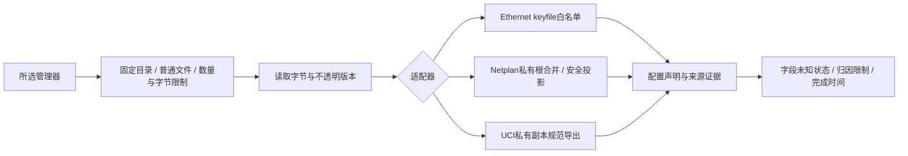

# NC-02B2：原生配置文件读取与来源快照

P53 增加“读取持久配置”入口。只需要选择管理器，不要求先创建接口草稿。
结果分为“配置声明”和“来源证据”，与草稿、运行态观测、原生解析校验分别展示。

## 来源与覆盖范围

| 管理器 | 实际读取 | 投影与归因 | 保留边界 |
| --- | --- | --- | --- |
| NetworkManager | /usr/lib、/etc、/run 下的 NetworkManager/system-connections/*.nmconnection | 从源字节解析 Ethernet keyfile；配置UUID或不透明文件引用；每个声明关联一个来源 | 不查询daemon内存；不处理ifcfg及其他插件，整体标partial；不据文件存在认定NM已加载或接管 |
| Netplan | /lib/netplan、/etc/netplan、/run/netplan 的*.yaml | 读取源字节并复制至私有根；固定netplan get --root-dir TEMP network.ethernets；受限Python投影 | 合并保留原层级和文件名；声明关联全部输入文件，origin_verified=false；不猜测某字段由哪个文件贡献 |
| OpenWrt | /etc/config/network | 读取源字节、创建私有副本；固定uci -s export ABSOLUTE_COPY；解析原生规范输出 | 排除/tmp/.uci暂存；不使用ubus uci get冒充已提交配置；复杂协议、桥接接管及策略路由另验 |

NM来源目录、字段和gateway优先级依据[官方keyfile说明](https://networkmanager.dev/docs/api/latest/nm-settings-keyfile.html)。
Netplan合并视图与root-dir依据[官方get说明](https://netplan.readthedocs.io/en/stable/netplan-get/)。
UCI绝对路径加载不应用delta的条件见[file.c](https://github.com/openwrt/uci/blob/master/file.c)及
[delta.c](https://github.com/openwrt/uci/blob/master/delta.c)。原生命令的发行版/版本矩阵仍需实际环境验证。

Netplan读取需要系统netplan、python3及PyYAML；Go二进制内嵌投影程序，不接受HTTP脚本或路径。
OpenWrt使用原生uci及Go解析器，不要求Python。NM keyfile读取不要求nmcli或Python。
Python纯投影回归只需要Python3；原生YAML解码另外实测，不能用JSON投影测试冒充目标Netplan运行认证。

## 字段契约

| 对象/字段 | 含义及限制 |
| --- | --- |
| snapshot.id/backend/platform/scope/observed_at/status | 本次来源快照及完成时间；scope为keyfile_profiles、merged_ethernets或committed_network |
| snapshot.can_apply | 固定false，不签发执行许可 |
| sources[].id/path/storage/state/bytes | 不透明来源ID、限定来源路径、persistent/runtime/vendor、read/unavailable/unsupported；不可读大小为未知 |
| sources[].version_tag | 对实际读取字节计算的HMAC-SHA256；使用随机进程内密钥；不是原始文件SHA256或持久审计ID |
| profiles[].reference/device/binding | 配置引用、文件中的设备声明；declared不代表真实内核绑定，匹配/重命名不能归因时unresolved |
| profiles[].source_ids/origin_verified | 字段投影能否关联到一个已读取源文件；不代表文件权限合格、管理器已加载、实际归属或接管授权 |
| profiles[].mtu/addresses/dns/search/routes | 基础网络字段白名单，按来源规范解析；不返回原始配置、认证字段、私钥、连接身份或任意扩展属性 |
| profiles[].field_states | configured：显式值，包括空集合；unset：未显式配置；unsupported：未解析。后两者值为null，不回落0/空集合 |
| routes[].metric | null表示路由项未显式配置Metric，0保留为显式零；不猜测管理器默认值或全局继承 |
| profiles[].methods | 来源中明确声明的地址方式、DHCP/RA开关；缺失时不推导默认配置 |

版本标识可在同一服务进程内比较。重启后密钥更换，旧标识失效，必须重新读取。
对含认证信息的源文件，不公开可被离线猜测的普通内容摘要。原始字节仅用于有界读取和私有临时副本，
不进入HTTP响应、业务日志、草稿存储或浏览器存储。

同接口多个声明、同UUID多个文件、临时与持久层冲突均不自动选取赢家。
NM只覆盖*.nmconnection；其他文件、插件或ifcfg不因本轮读取而被认定不存在。
普通主机/设备名、IP及域名字段仍按网络语法校验。NM复杂路由属性、全局路由继承及DNS路由域、
UCI无法归属的路由、Netplan复杂路由属性保留为未解析，不静默截掉约束。

## 读取与执行边界

固定来源路径，不跟随源文件末级符号链接，只读取普通文件；非阻塞打开避免FIFO挂起。
最多64个源文件，单文件1MiB、源字节合计2MiB。目录枚举有数量上限，截断和读取失败必须显式反馈。
单实例只允许一个来源读取请求；检查6秒上下文，固定原生命令单进程1.5秒，stdout上限1MiB，stderr不回传。
文件系统等待不保证由进程超时强行中止。文件按次读取，快照不是跨文件原子事务。

Netplan有任何源层读取失败时不执行不完整合并。UCI从已读副本导出，绝对路径阻止合并宿主delta。
临时目录0700、文件0600，完成/失败时清理；进程强制终止的残留不作为验收证据或自动接管输入。
不执行set/import/commit/reload/apply，不修改系统网口、IP、DNS、路由或源文件权限，也不自动提权。

## 控制面与后续

POST `/api/v1/network/configuration/persistent-inspection`，正文只有backend；严格JSON复用既有128KiB上限。
未知字段、非法backend、多个对象在读文件前拒绝；忙返回429与Retry-After=1；服务失败503。
平台/工具/文件不可读取属于明确业务状态，HTTP200不代表读取完整。
开启访问策略时沿用routerd的viewer/operator/admin读取权限，只放行该精确POST路径。
capabilities.can_inspect_persistent表示可发起读取，不代表宿主适配认证完成。

前端使用同源代理、10秒超时；校验快照、来源引用、字段状态、空值与不可应用声明。
旧响应隔离，读取失败清除旧报告；编辑或重新读取草稿使报告失效。源报告不自动填入草稿或签发接管。
现有preflight仅比较运行态，未关联本快照，不改变其接管阻断结论。

NC-02B3继续处理字段级合并归因、ifcfg/插件能力、管理器实际加载、配置权限、设备绑定、
明确接管与一致性复核；NC-03再处理事务应用、管理链路确认与独立回滚。
验证见[本轮记录](network-persistent-inspection-verification.md)。
