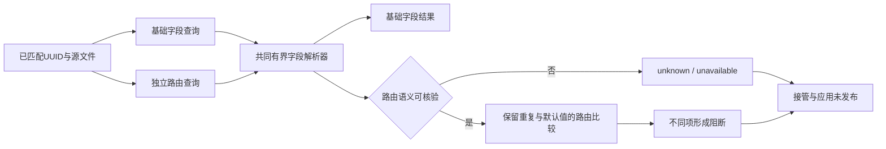

# NC-02B3B3：路由加载核验与有界解析

日期：2026-10-29。接续[基础加载比较](network-loaded-settings.md)。
控制台P53的来源抽屉增加“路由差异”，沿用统一路由、15173与已有只读来源API。
工程要求追踪见[高可靠工程基线](../development/high-assurance-engineering.md)。

## 读取与隔离

基础字段和路由分别以固定字段清单进行NM批量只读查询，最多64个已匹配UUID。
路由字段：connection.uuid/type，以及IPv4/IPv6的gateway、routes、route-metric、route-table、
never-default、ignore-auto-routes、routing-rules。
不调用reload、up、down、modify或秘密查询；工具路径、argv、权限和超时沿用既有边界。
总检查上下文6秒、单命令1.5秒、stdout 1MiB；累计耗尽时报告不可读取，不延长或绕过预算。

路由字段在旧版本不支持、无权限、超时或格式不兼容时，路由项unavailable，基础加载结果仍保留。
两次查询不是同一时刻快照。成功只表示观察到相应profile声明，不是设备已应用内容。

共享NM字段解析器改为逐行Scanner：输入≤1MiB、行≤65536字节、记录≤64。
固定字段/唯一UUID、重复/缺失/额外字段、坏转义及超限检查均在投影前执行，错误不返回半份记录。
它只服务当前两类真实查询，不提供任意字段、命令或外部插件接口。

## 支持口径

NM非pretty路由输出按“目标前缀 下一跳 [Metric]”读取；逗号分隔路由，IPv6先解nmcli转义。
依据：[NM官方路由输出实现](https://github.com/NetworkManager/NetworkManager/blob/main/src/libnmc-setting/nm-meta-setting-desc.c)与
[官方配置属性](https://networkmanager.pages.freedesktop.org/NetworkManager/NetworkManager/nm-settings-nmcli.html)。

| 条件 | 处理 |
| --- | --- |
| 普通路由带明确IP下一跳 | 规范目标网络与下一跳，Metric为uint32或未指定 |
| gateway声明 | 转为对应地址族默认路由声明；不推断内核安装结果 |
| 未指定Metric / 显式0 | 分别序列化metric default / metric 0，不合并 |
| 相同声明重复 | 排序但不去重；按多重集合比较，重复数量变化形成不同 |
| 连接级route-metric非-1（包括0）、route-table非0 | 未核验；不抹掉继承或选表语义 |
| never-default / ignore-auto-routes启用、routing-rules非空 | 未核验 |
| route属性、直连无下一跳、多路径或未知格式 | 未核验，禁止截取前三项冒充支持 |
| 跨地址族、非IP/带zone/未指定/组播下一跳、超过256路由 | 未核验 |
| 来源未显式配置 / 明确空加载列表 | 来源null、加载[]、结果unknown，不改成same |

源keyfile同样保留上述边界，新增ignore-auto-routes检查。
修正旧代码将连接级route-metric=0归作默认值，以及接受跨地址族源路由的情况；现在routes=unsupported、值null。
未改变现有完整系统应用许可，未把配置投影升级为执行能力。

## 契约与界面

`profiles[].routing_comparison`为可选扩展：

| 字段 | 含义 |
| --- | --- |
| state | same/different/unknown/unavailable/unsupported/not_checked |
| scope | 固定nm_declared_route_multiset |
| observed_at / reason | 检查时间及固定依据代码；失败时间不冒充成功观测 |
| source / loaded | 已规范的路由字符串数组或null，保留重复数量；空数组只用于已读到的空列表 |

same仅说明上述目标/下一跳/Metric多重集合一致，不代表完整路由语义、顺序、全局默认、动态路由或内核FIB一致。
different产生loaded_routes_different接管阻断。unknown不补造默认列表；can_adopt/can_apply均false。
前端校验来源对应、排列、重复、默认Metric、状态组合、UUID/平台/引用与时间，拒绝伪same。
ProTable汇总并展开来源/加载声明；无新CSS体系、独立服务或第二控制台。

测试与证据见[验收记录](network-route-evidence-verification.md)。复杂语义、实际Linux矩阵、接管和回滚仍待后续。
