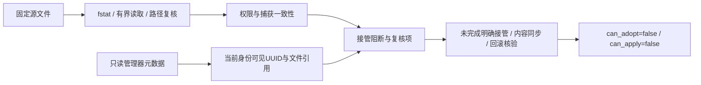

# NC-02B3A：来源权限、捕获一致性与加载引用

在既有来源快照中增加safety、manager、load_reference与authority，控制台增加“接管条件”页签。
本阶段只读取和核对，不发布接管或系统应用操作，can_apply与can_adopt始终false。

## 文件权限与一致性

| 字段 | 来源与含义 |
| --- | --- |
| sources[].safety.uid/gid/mode | 从已打开描述符的fstat读取UID、GID和八进制权限；未取得保留null/空，不将UID0当作缺失 |
| safety.stable | 对比读取前后描述符与读取后路径的inode、类型、大小、mtime、权限、UID/GID；未知为null，变化为false |
| safety.status/codes | meets_baseline/review/blocked/unknown及固定诊断代码；只表示本项检查结果 |
| authority.status/can_adopt/issues | blocked/review_required、固定false、来源/配置引用/级别/代码/说明 |

所有来源要求普通文件、root所有者、无特殊权限位、无组/其他写入权限。
NM额外要求无组/其他权限。Netplan/UCI的组或其他读取权限标review，保留对默认配置访问范围的复核。
这是接管检查基线，不改变系统文件权限，不推定管理器已接受文件。
读取中发现描述符/路径身份或元数据变化，丢弃该源字节，返回不可读取及阻断项，禁止继续不完整合并。

检查窗口之外仍可能发生变更，跨文件读取仍非原子。stable=true不消除后续写入的TOCTOU风险。
HMAC版本只绑定内容；权限与身份条件在本快照中另列。未来执行前必须重新核对完整事实，不能只比较内容版本。

## NetworkManager可见引用

先以固定只读systemctl查询确认NetworkManager服务active，再调用：

`nmcli -t -f UUID,FILENAME connection show`

不调用load/reload/modify/up，不请求秘密字段，不请求交互授权，不在不支持字段时回落到宽泛输出。
字段依据[NM keyfile官方说明](https://networkmanager.dev/docs/api/latest/nm-settings-keyfile.html)与
[Red Hat keyfile管理说明](https://docs.redhat.com/en/documentation/red_hat_enterprise_linux/9/html/configuring_and_managing_networking/assembly_networkmanager-connection-profiles-in-keyfile-format_configuring-and-managing-networking)。

| profile.load_reference | 结论 |
| --- | --- |
| matched | 当前身份可见清单中，明确UUID和文件路径同时匹配 |
| not_observed | 成功查询的可见清单中未出现该UUID；不能改写为“全局未加载” |
| conflicting | 同UUID出现多个引用，或明确文件路径不匹配 |
| unknown | 无明确UUID、内存profile无文件、服务/工具/格式不可读取，或适配器未提供 |

manager记录state、visible_profile_references范围、观察时间与固定诊断，不公开整份daemon配置清单。
引用匹配不证明已激活，也不证明daemon内存内容与磁盘相同；配置文件被手动修改后仍可能未reload。
Netplan/OpenWrt本轮只做文件基线，不用运行文件名或UCI逻辑接口名推定实际加载一致。

## 接管条件

来源清单不完整、源文件不可读/不稳定、权限不满足、字段未归因、绑定不明确、未解析字段、引用冲突均阻断。
权限需复核、非持久来源、缺加载引用等保留复核项。明确接管、管理链路、独立回滚及运行内容核验始终另列。
没有“全部检查通过即可执行”的路径，也不以文件存在或引用匹配发放执行许可。

新字段为可选扩展，旧后端没有这些数据时显示“接管条件未取得”，不制造默认通过。
前端校验UID/GID、八进制权限、未知稳定性、可见范围及can_adopt=false；阻断项不能被汇总为review_required。

后续NC-02B3B处理实际加载内容、设备所有权、字段级归因、插件/ifcfg与明确接管。
NC-03处理受控应用、确认和独立回滚。目标系统运行矩阵仍需独立验收。
结果见[验收记录](network-source-authority-verification.md)。
