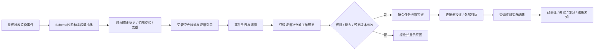
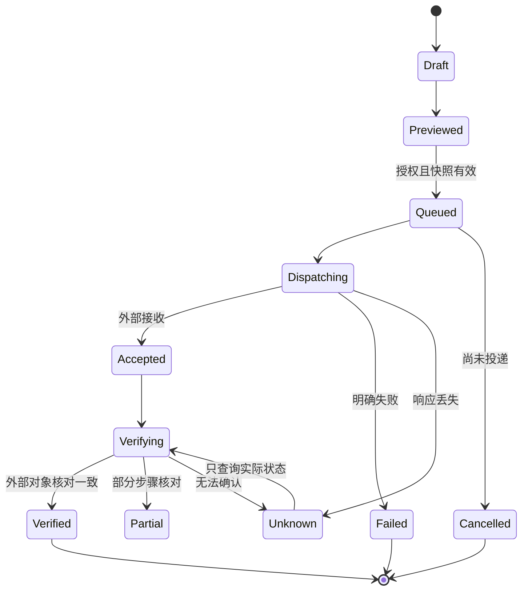

# 安全设备联动与事件协作精细设计

版本：1.1，2026-10-27。状态：目标设计，未接入真实设备、未发送通知或执行变更。
关联：[网络资产](network-assets.md)、[数据契约](data-and-permissions.md)、[图表目录](visualization-spec.md)。

## 1. 联动目标与产品边界

联动把受管网络基础设施、NGFW/IDS/IPS/WAF、SIEM、流量观测与工单系统的状态和安全事件
汇聚到同一证据链。首期包括只读健康同步、告警接收、事件去重、资产核对、工单协作与回执查询。
设备报告的“已阻断”只是来源设备声明，不作为CythSec执行动作；必须显示声明来源和证据。

不设计公共用户行为追踪、VPN封锁、订户身份映射、面向过境公网IP的批量阻断。
此阶段不实现网关阻断、端口隔离、路由牵引或远程shell；任何未来设备配置写入均需单独能力设计和验收。
自动化仅限明确授权范围内的事件补充、平台事件流转和工单任务，默认“草稿/未启用”。

## 2. 设备类型与连接能力矩阵

| 类别 | 只读接入与内容 | 首期可设计联动 | 限制 |
| --- | --- | --- | --- |
| NGFW/IDS/IPS | TLS事件流、厂商受控API；告警、设备健康、策略版本摘要 | 事件关联、证据补充、工单 | 不发布阻断规则；不承诺任意厂商兼容 |
| WAF/网关安全服务 | 归一化告警与聚合计数 | 对受管服务关联事件 | 不保留完整URL、Cookie、请求载荷及公众客户端轨迹 |
| SIEM/SOC | 经鉴权事件API、固定事件schema | 接收事件、推送经授权的脱敏事件包、更新协作状态 | 入站/出站权限独立，映射与去重版本可追溯 |
| 交换机/路由器 | SNMPv3只读、受控NETCONF读取或厂商API | 接口/LLDP/容量/设备健康同步 | 不允许任意OID/CLI/用户URL；支持字段以适配器为准 |
| CMDB/IPAM | 只读资产/前缀接口或校验文件导入 | 目录对账、冲突待办 | 不引入使用者身份信息；导入不覆盖未解决反证 |
| 流量导出器 | IPFIX模板与记录、观测域/序列/采样元数据 | 数据质量告警、来源健康 | 模板丢失/过期不得误解字段；不重建公众终端画像 |
| 工单平台 | 固定模板API | 创建工单、查询工单、事件状态同步 | 发送前预览字段；幂等、状态核对和权限必需 |
| 通知平台 | 服务端受控连接器 | 发送授权的运维事件摘要 | 本轮不发送；模板禁止秘密、身份与原始载荷 |

协议支持是适配器能力，不能因设备类型相同就显示“已兼容”。TLS事件传输、厂商REST和
只读设备管理都要分别经过测试；不以“连接成功”证明能解析所有事件。

## 3. 连接器契约与生命周期

连接器最小字段：connector_id、scope_id、type、adapter_id、adapter_version、endpoint_ref、
credential_ref、tls_policy_ref、allowed_capabilities、mapping_version、config_version、
health_state、last_transport_ok、last_valid_event、last_verified_action、rate_limit、owner_team。

凭据由服务端秘密存储保存；浏览器只显示引用、设置时间和到期状态，不回显。
连接地址由服务端资产目录选择/审批，不能把任意用户URL传到后台代请求；
实施时校验解析后的地址范围、重定向、DNS重绑定、代理策略与证书，不能仅校验文本主机名。

连接器状态：未配置、已配置未验证、传输正常、认证失败、解析异常、延迟、熔断、停用。
“正常”需要分别展示传输、解析和业务查询维度。无事件可能表示安静，不能据此认定故障；
必须参考心跳/轮询、事件契约或独立健康信号。错误详情脱敏但保留request_id。

## 4. 事件与任务状态模型

### 4.1 事件对象与语义

字段：event_id、source_event_id、source_ref、scope_id、observed_at、received_at、
source_clock_quality、category、source_severity、normalized_severity、normalization_version、
asset_refs、binding_state、summary、evidence_refs、dedup_key、occurrences、workflow_state。

事件工作流：新建→已确认→调查中→已解决→重新打开；误报为独立结案原因。
工作流已解决不代表威胁已消除；设备清除告警也不等于本平台调查完成。
外部严重级别与归一化等级并列可查，不产生黑箱风险分数。来源重复事件按稳定ID去重；
没有稳定ID时用受控指纹+有界时间窗并显示“可能合并”，保留合并审计。
相近时间或同一公网IP不能作为确定资产关联依据。

### 4.2 联动任务阶段

HTTP 2xx/202、排队、对端接受、实际对象验证四者分开。响应丢失先对账再决定重试；
幂等键由服务端绑定scope+operation+target+payload_hash，不因前端刷新改变。
取消仅在未投递时可保证；已发出的工单操作只能用明确支持的补偿操作，不能显示通用“回滚成功”。
未知/部分结果必须保留，不能为完成率统计改成成功。

## 5. P44—P52逐页设计

### P44 安全运行概览 `/security`

- **状态/来源**：P；N20—N24，既有聚合服务不提供本页数据。
- **布局**：范围/时间；四指标；16列事件趋势+8列来源健康；16列事件类别堆叠+8列待处理任务；底部事件表。
- **指标**：未解决事件数、受影响受管资产数、证据不足事件数、结果未知联动任务数；分别展示分母与刷新时刻。
- **图形**：严重级别趋势、类别条形、来源时延热图；事件热度不标成攻击强度或成功入侵。
- **筛选/操作**：scope、时间、来源、级别；点击图形筛选P45；跳P50/P52。无“封锁全部”入口。
- **异常**：来源断流时事件减少显示覆盖缺失，不显示安全状况改善。

### P45 安全事件 `/security/events`

- **状态/来源**：P；N22；ProTable默认25行，服务器排序/游标。
- **布局/列**：筛选行+分布小图+事件表；级别、摘要、来源设备、类别、资产关联状态、发生/接收时间、重复次数、工作流状态。
- **筛选**：时间、级别、类别、来源、受管资产、工作流、证据质量；查询字段白名单。
- **操作**：详情、确认、分配运维团队、结案；批量确认最多50条并显示逐项结果，不包含设备配置动作。
- **显示**：去重计数与事件行数分开；高优先级排序不改变实际时间顺序口径。
- **失败**：权限撤销清空旧数据；长摘要截断可展开，外部文本只按文本渲染。

### P46 事件详情 `/security/events/:eventId`

- **状态/来源**：P；N22/N23/N24；外部事件原文不可直接嵌HTML。
- **布局**：页头级别/状态/来源；左16列时间线与证据，右8列受管资源和可用协作动作。
- **内容**：来源声明、归一化映射、时钟质量、关联方法、反证/缺口、事件发生/接收/确认时间、工单与任务引用。
- **Tabs**：调查摘要、来源证据、关联事件、协作记录、审计；未具备解析字段显示未提供。
- **操作**：确认/团队分配/结案；预览补充诊断或工单内容后创建任务；无后端权限时不出现可执行按钮。
- **校验**：结案理由必填；版本过期返回冲突并保留输入；不能将人工结案等同安全设备已恢复。

### P47 联动设备与连接器 `/integrations`

- **状态/来源**：P；N20/N21；前端卡片不是厂商兼容认证。
- **布局**：类型/能力/状态筛选；连接器摘要表；选中项能力矩阵。
- **列**：名称、受管设备引用、适配器及版本、支持能力、传输/解析/业务三态、最近有效事件、凭据有效期、范围。
- **操作**：登记草稿、查看详情、停用接入、编辑版本；验证只调用适配器固定健康读方法，不能输入命令。
- **错误**：证书/权限/超时/格式分别展示；不因TLS成功就显示事件格式通过。

### P48 连接器详情 `/integrations/:connectorId`

- **状态/来源**：P；N20/N21/N25。
- **布局**：左6列设备/版本/范围；右18列Tabs：健康、字段映射、权限能力、受控配置、变更审计。
- **显示**：端到端延迟分位数、拒绝/重复/解析失败计数、检查点、adapter版本、证书身份摘要、秘密引用状态。
- **操作**：配置预览、固定健康读校验、映射样本脱敏验证、版本提交；样本只能使用合成或已批准脱敏数据。
- **配置**：速率限制、轮询间隔、允许的资产范围、消息大小上限、重试策略；秘密从专用入口一次提交、无回显。
- **并发/失败**：ETag冲突不覆盖；配置保存、适配器加载、首次有效数据三个阶段分开。

### P49 协作流程模板 `/integrations/playbooks`

- **状态/来源**：P；N23；首期仅“证据补充→事件更新→工单”固定步骤模板，无任意脚本执行器。
- **布局**：模板列表；720px编辑Drawer；步骤预览用Steps/Timeline；复杂DAG暂不提供拖拽编程。
- **字段**：模板ID、版本、触发条件、适用受管范围、步骤类型、输入最小字段、超时、幂等/对账方式、启用状态。
- **操作**：新建草稿、静态校验、合成事件预演、版本发布、停用；发布不自动运行。
- **预演**：仅验证数据映射/权限和生成动作计划，无外部投递；必须显著标注“预演，无外部动作”。
- **限制**：首期手动触发；未来自动化只允许已授权低影响协作动作，必须有配额与熔断。

### P50 联动任务 `/integrations/tasks`

- **状态/来源**：P；N24；浏览器内临时请求状态不能充当任务持久记录。
- **布局/列**：阶段分布+筛选+任务表；任务ID、类型、模板版本、来源事件、目标受管资源、提交者、当前阶段、外部回执、更新时间。
- **筛选**：阶段、动作、连接器、事件、范围、时间；结果未知独立可筛。
- **操作**：详情；未投递可取消；未知先对账；明确可幂等的失败项才允许重试。
- **指标**：成功率分母只含定义好的终态集；未知/进行中/取消数量独列，不能隐藏。

### P51 任务详情与回执 `/integrations/tasks/:taskId`

- **状态/来源**：P；N24/N13。
- **布局**：任务摘要；横向阶段Steps；左右16/8列步骤证据与目标/外部对象；底部审计。
- **内容**：不可变预览摘要、payload_hash、授权与范围、幂等键引用、模板版本、每次投递、回执、对账结果、异常和下一步。
- **操作**：对账、符合条件的重试、未投递取消；外部对象跳转需固定域名白名单，不能直接打开事件提供的任意URL。
- **反馈**：202显示已接收；已核对的外部工单存在且字段一致才显示已验证；部分步骤成功逐项展示。
- **保留**：审计不含秘密/原始载荷；下载证据包需独立权限并做字段白名单。

### P52 联动健康与数据链路 `/integrations/health`

- **状态/来源**：P；N21/N25。
- **布局**：左16列接收→校验→归一化→入库→协作链路；右8列故障队列；下方连接器×时间热图和延迟曲线。
- **显示**：各阶段received/accepted/rejected/deduplicated/persisted/delivered计数、单位、窗口、重启/缺数标记、队列积压、死信与恢复。
- **交互**：点击阶段筛选连接器与错误类别；只显示脱敏样例；离线预演与真实链路严格分栏。
- **操作**：查看故障任务、配置版本和对账；死信重放必须预览范围、限额、幂等与审计，不做一键无限重放。
- **错误**：阶段计数不一致标为待核对；来源时钟不可信时不计算伪精确端到端延迟。

## 6. 新增契约组与权限

下列N15—N25均为提案，尚无可调用后端。目标路径放在对应服务OpenAPI后才能成为正式契约。

| ID | 契约与路径提案 | 核心要求 |
| --- | --- | --- |
| N15 | `/api/v1/assets`、`/{id}` | 目录、稳定身份、受管范围、角色证据、版本 |
| N16 | `/api/v1/assets/address-observations`、`bindings`、`neighbors` | 域、IP/MAC可空、时效、冲突、关联依据、范围化检索 |
| N17 | `/api/v1/assets/relationships` | 关系类型、时间、provenance、分层与有界展开 |
| N18 | `/api/v1/analytics/zone-communications` | 区域/受管基础设施聚合、采样、去重、覆盖与抑制 |
| N19 | `/api/v1/assets/service-observations` | 基础设施服务、候选/核实、暴露证据 |
| N20 | `/api/v1/integrations/connectors` | 设备/适配器、秘密引用、版本、能力白名单 |
| N21 | `/api/v1/integrations/connectors/{id}/health` | 固定只读方法、独立阶段、可审计任务、配额 |
| N22 | `/api/v1/security/events`、`/{id}` | 字段最小化、来源级别/归一化、去重、资产关联、工作流 |
| N23 | `/api/v1/integrations/playbooks`、`/{id}/preview` | 有限步骤、无副作用预演、快照版本、范围 |
| N24 | `/api/v1/integrations/tasks`、`/{id}`、`/{id}/reconcile` | 幂等、真实外部回执、先对账、未知/部分、持久化 |
| N25 | `/api/v1/integrations/pipeline` | 阶段计数、健康时序、死信、来源和质量 |

权限新增：asset.read、asset.evidence.read、asset.address.read、asset.metadata.write、
asset.export、security.event.read、security.event.manage、integration.read、integration.configure、
integration.secret.rotate、integration.preview、integration.ticket.submit、integration.reconcile、
integration.task.cancel、integration.audit.read。每个权限均受服务端scope/resource约束。
只读观察员不能凭事件管理权限发送工单；配置连接器不自动获得秘密读取或任务投递权限。
操作者、权限快照、动作资源和结果写入N13，不把审计留在浏览器。

## 7. 发布与负向验收

先只读接入与事件，再无副作用预演，再有明确授权的工单任务；配置写入/隔离/阻断不在本阶段。
必验：重复/乱序事件、时钟漂移、超大/恶意文本、未知schema、越界资产、无权限地址展开、
秘密过期/日志泄漏、证书错误、DNS重绑定/重定向、配额、模板版本冲突、响应丢失、重启恢复、
重复工单防护、未知结果对账、未投递取消、不可取消投递、部分步骤、外部状态被人工修改。
不得以模拟回执通过代替真实设备适配器验收；本次设计稿没有执行任何外部联动。
