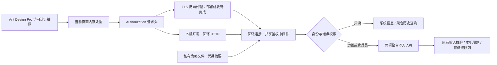

# 控制台与聚合服务访问认证

本轮实现范围为 routerd、telemetryd 和 Pro 控制台。使用静态高熵 Bearer 服务凭据，
配置只保存 SHA-256 摘要，浏览器只在当前页面内存保存原值。刷新、断开或服务返回 401 后
需要重新连接。基础规则参考 [RFC 6750](https://www.rfc-editor.org/rfc/rfc6750) 与
[OWASP REST Security](https://cheatsheetseries.owasp.org/cheatsheets/REST_Security_Cheat_Sheet.html)。

## 凭据与启动

在仓库根执行以下命令，工具创建新文件并在安全终端输出一次凭据。不要将输出重定向到
项目、日志或长期记忆，不把凭据放入 URL、命令行参数或 shell 历史。工具拒绝覆盖已有文件。
凭据由 32 字节安全随机数生成，不能用用户密码替代。

```bash
mkdir -p secrets
(cd services/routerd && GOWORK=off go run ./cmd/access-key -name analyst -role viewer -out ../../secrets/access.json)
# 在控制台“访问认证”入口分别连接两个服务。
build/bin/routerd -addr 127.0.0.1:8080 -access-file secrets/access.json
build/bin/telemetryd -addr 127.0.0.1:8083 -access-file secrets/access.json -aggregate-dir build/aggregate-storage/local/archive
```

策略文件结构为 `principals` 数组，各项包含 `name`、`role`、`sha256`，只保存摘要。
文件须为私有普通文件（无组/其他用户权限），最大 64 KiB、最多 128 项；未知字段、非法摘要、
重复名称或摘要及空名单均拒绝启动。文件读取、权限或格式错误不会退回未鉴权模式。
优先级为 flag `-access-file` > `ROUTERD_ACCESS_FILE` / `TELEMETRYD_ACCESS_FILE` > YAML `access_file`。
服务启动日志的 `access_enabled` 明示实际状态，不记录凭据或策略内容。

默认监听地址改为 `127.0.0.1:8080` / `127.0.0.1:8083`。未启用鉴权时仅允许绑定回环 IP；
通配地址或非回环监听启动失败。未配置策略的本机开发模式在控制台明确显示“鉴权未启用”，
不生成管理员身份。

## 端点权限

| 范围 | viewer | operator / admin |
| --- | --- | --- |
| `GET/HEAD /healthz` | 允许匿名 | 允许匿名 |
| `GET/HEAD` 业务接口、版本、session、metrics | 需有效凭据 | 需有效凭据 |
| telemetryd `POST /api/v1/analytics/imports` | 403 | 允许，继续执行原有输入与本机访问校验 |
| telemetryd `POST /api/v1/analytics/ingest` | 403 | 允许，继续执行原有队列与容量校验 |
| 其他写操作 | 拒绝 | 拒绝，待端点级设计与验收后开放 |

首版 admin 与 operator 对聚合写入权限相同，不包含账号管理或其他服务写权限。
无效或缺失 Authorization 返回 401 和 `WWW-Authenticate`；合法身份越权返回 403。
只接受单个 Bearer 请求头，不接受 URL、Cookie 或请求体中的凭据。CORS 预检允许 Authorization，
不免除后续请求的鉴权。响应使用 `Cache-Control: no-store`。

`GET /api/v1/session` 返回实际身份的 `enabled/name/role/can_ingest`。`enabled=false` 表示未启用
身份验证，身份字段为空；此时 `can_ingest` 不用于声明身份权限，本机开发沿用原有聚合访问约束。

## 传输与前端状态



浏览器在提交凭据前验证目标为 HTTPS 或回环 HTTP。服务端依据真实连接的 RemoteAddr / TLS
判断传输，拒绝非回环明文连接；不信任 X-Forwarded-For / X-Forwarded-Proto 作为放行依据。
生产需由可信的本机 TLS 反向代理接入；本轮未部署 TLS 或完成 mTLS 验收。

两个服务的凭据分别保存和发送。连接、断开和凭据失效会重挂载页面、丢弃旧身份的迟到响应；
匿名开放服务切换到要求鉴权时也会清空旧页面状态，重复 401 不造成重挂载循环。
只读身份可查询历史但禁用上传；权限未知或认证服务不可用时同样禁用上传。
服务端始终执行权限检查，修改前端按钮不能绕过。没有写入 localStorage、sessionStorage 或 Cookie。

## 开发服务访问范围

本版本 Umi webpack 开发服务器读取 HOST 用于提示，却调用 `listen(port)` 省略绑定地址。
`npm run dev` 的 `scripts/loopback-only.cjs` 为该开发进程的 HTTP / HTTPS 服务补齐回环绑定，
显式非回环绑定报错；原始 TCP 端口探测不受影响。该补丁不进入生产构建，也不修改系统设置。

真实 socket 测试覆盖默认监听与通配地址拒绝；`lsof` 验证应用实际绑定 `127.0.0.1:15173`。
Umi 输出的 Network URL 不作为安全验收依据。使用仓库的 `npm run dev` 启动入口。

## 阶段边界

CYS-RTD-014、CYS-SEC-002、CYS-CON-028 均为部分完成：mTLS、凭据到期/动态撤销、限流、
持久会话、自动登录路由、账号管理与持久审计尚未实现。policyd / dnsd 尚未接入策略配置与
权限映射。撤销或变更凭据后需替换私有文件并重启相关服务。

原有 21 项依赖审计阻断与 tshark 未核验项继续保留，不因此允许合入 main 或生产发布。
