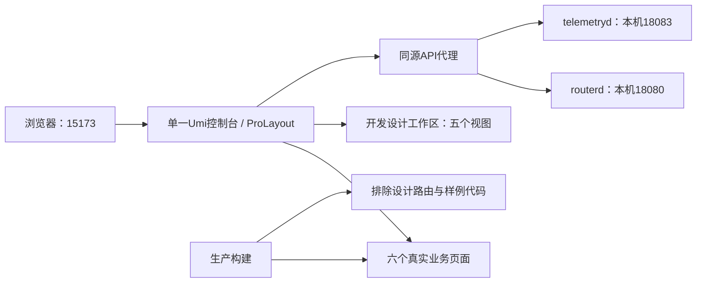

# 统一控制台工程与验收

日期：2026-10-27。浏览器统一入口：`http://127.0.0.1:15173`。

## 1. 工程结构

仅保留`web/console`一个应用、一个Umi构建和一个ProLayout。
路由、菜单、面包屑统一由`config/routes.ts`生成；设计页只输出PageContainer及业务内容，
不创建React根、不监听hash、不启动自己的服务，也不复制服务认证组件。



后端端口是服务内部连接目标，不是额外前端入口。浏览器不需要分别访问后端或静态预览端口。
当前开发环境的设计数据仍为固定样例，只有六个业务页面连接真实业务接口；尚未实现的后端能力没有因此上线。

## 2. 入口和运行命令

| 用途 | 同一应用中的位置 |
| --- | --- |
| 运行概览 | `/` |
| 接口、路由、流量 | `/interfaces`、`/routes`、`/traffic` |
| 聚合分析、系统信息 | `/analytics`、`/system` |
| 开发设计工作区 | `/design`跳转`/design/overview` |
| 设计拓扑、资产、联动、事件 | `/design/topology`、`/design/asset`、`/design/integrations`、`/design/incident` |
| 控制面API | `/api/v1/*`、`/healthz` |
| 聚合API | `/telemetry/api/v1/*`、`/telemetry/healthz` |

```bash
# 开发：默认15173；CLion Run Console使用相同入口
npm --prefix web/console run dev

# 先停止开发实例，再在同一15173复验生产产物
npm --prefix web/console run build
npm --prefix web/console run preview
```

`PORT`允许明确选择一个实例端口；启动前检查与实际监听必须使用同一个值，不能自动寻找下一个端口。
`VITE_ROUTERD_TARGET`/`VITE_TELEMETRYD_TARGET`仍支持指定真实服务，启动默认值与CLion一致。
只监听回环地址。原15174开发实例、15176静态预览不再运行，独立预览构建脚本已删除。

## 3. 冲突与生命周期

`scripts/start-console.cjs`在加载Umi之前探测所选端口，避免Umi先清理`.umi`再发现端口冲突。
`STRICT_PORT`采用同一值，HTTP/HTTPS实际listen另有端口与回环约束，防止探测竞争后悄悄改端口。
重复启动应退出1，保留原实例和生成文件；不会自动结束占用端口的其他进程。

Umi的setup/typecheck会重建开发生成目录。执行会重建该目录的门禁时先停止开发实例，
完成后重新启动；不能在旧页面残留编译错误时声称浏览器验收通过。
内部链接使用主应用Link，保留父级状态及服务凭据；路由切换重建页内筛选/抽屉状态。

## 4. 验收与证据

新增自动检查：开发/生产路由隔离、组件文件存在、统一端口与非法端口拒绝、
端口冲突先于Umi启动、最终HTTP监听拒绝端口递增、真实路由内部跳转保留父级状态、
设计视图不创建第二套菜单或请求管理接口、事件确认在无后台时禁用。

证据位于`build/unified-console`：生产构建、完整lint/test日志及退出码、同源HTTP检查和浏览器截图。
构建产物另检查ASSET-DEMO等样例标识不出现在生产JavaScript中。
脚本退出码与第三方裁判跳过项分别记录；既有tshark例外不改写为通过。

最终代码验收：

| 检查 | 实际结果 |
| --- | --- |
| 仓库完整lint门禁（CLion包装调用lint-all.sh） | 退出0 |
| 仓库默认完整test门禁（CLion包装调用test-all.sh） | 退出0；既有tshark跳过14/2/8仍为未核验 |
| 前端回归 | 18个文件，63项通过 |
| 生产构建 | 退出0；不包含设计样例标识 |
| 生产预览同源请求 | 两项health、system及业务深链接HTTP 200 |
| 重复启动 | 退出1，原实例及生成入口摘要保持不变 |
| CLion配置 | 36项共享配置与负向注入通过 |
| 本机采集复验 | 现有普通用户权限下16项断言通过；未执行sudo |

运行时布局修复：Umi静态layout配置只转发title/locale，mix布局、224侧栏与现代actionsRender必须在app.tsx运行时设置；
禁用旧rightContentRender后，服务状态和认证统一显示在顶部，不再挤入侧栏。

保留真实业务与开发设计数据隔离；本次整合不将52页规划标为生产功能全部完成。

浏览器最终检查：11个同源入口直达均可见，错误/警告记录为空；1440桌面和390窄屏复验通过。
窄屏表格使用有界网格与容器滚动，页面scrollWidth为375，小于390视口；没有覆盖Ant内部控件样式。
最终兼容性清理后前端63项再跑通过，生产构建再跑退出0。
