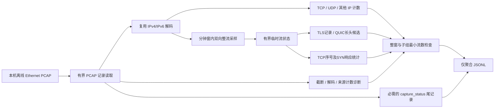

# 承载协议聚合观测与采集完整性

状态：本地实现，离线 Ethernet PCAP 入口；验收结果见 [本批记录](../planning/AGGREGATE-20261026.md)。

`cythsec-observe` 提供网络运行质量统计：TCP／UDP 报文量、TLS 记录和 QUIC 长头候选计数、TCP 重传／乱序候选、SYN 响应时差直方图及采集完整性诊断。它不调用应用或 VPN 识别器，不输出用户、逐流、网站域名、载荷或专属指纹，不执行探测、转发或阻断。

## 数据路径和资源边界



- 默认 60 秒窗，可选 60～3600 秒；按 PCAP 时间戳向下对齐。只产生有输入的窗，跨大间隔不补造“零流量”窗口。
- 默认采样间隔 1，即处理所有符合条件的流。`--sample-every N` 使用窗口内随机密钥的哈希选择约 1/N 的双向流，同一窗内同一流两方向一致。窗口更换随机状态，不输出密钥或哈希，不进行按包独立抽样。
- 默认最多 4096 个采样流，允许 20～65536。容量达到上限后保留已接纳流，拒绝新流并累计 `capacity_rejected_packets`；尾记录标记分析不完整，退出 2，不静默淘汰或假装完成。
- 临时状态只有双向规范化元组、序号游标、SYN 时间和候选布尔值；换窗后丢弃。既有 PCAP 读取器每条记录上限 256 KiB，新模块不缓存报文序列或重组应用载荷。释放内存不保证分配器立即清零。
- 整窗最少 20 条不同的已接纳采样流，否则 `statistics=null`。TLS、QUIC 和 TCP 质量子组也分别执行此门槛。时差直方图最少 20 条不同流贡献，每条流每窗最多一次；元组复用不会累加直方图贡献。

最小流数是输出抑制措施。流数不等于用户数，此实现不提供差分隐私或用户级匿名性保证。输入 PCAP 本身仍可能含敏感数据，应留在本机受控存储中；这个入口不会复制为逐流导出文件。

## 统计口径

| 字段 | 来源与含义 | 限制 |
| --- | --- | --- |
| `tcp_packets` / `udp_packets` / `other_ip_packets` | 全部可解码且归属当前窗的 IP 记录，按 IP 协议号计数 | 不受流采样影响；非首片等解码失败另计，不能称为全部线上包数 |
| `tls_record_candidate_packets` | 采样流内，报文载荷起点满足 TLS 记录头及完整长度条件的包数 | 不重组跨 TCP 段记录，不解密；可能漏计或误匹配，不代表 TLS 会话数或应用总量 |
| `quic_long_header_candidate_packets` | 采样流内，满足 QUIC v1/v2 长头格式和捕获长度边界的包数 | 只检查最多 128 字节头部；不含短头、Retry、版本协商或未知版本，不做加密真实性确认 |
| `judged_segments` | 采样 TCP 流中占用序号空间的段（数据、SYN、FIN） | 纯 ACK 不进入重传分母；SYN／FIN 可属于候选事件 |
| `retransmission_candidates` | 段末序号不超过当前方向已推进游标 | 基于可见序号的候选，不确认发送端重传原因 |
| `out_of_order_candidates` | 旧新序号重叠，或在已见高水位之前补洞 | 简化的头部启发式；没有完整 SACK／ACK 历史和字节区间表 |
| `forward_gap_candidates` | 当前段起点在连续游标之后 | 可由镜像缺包、乱序、采样边界或真实丢包引起，不能直接叫网络丢包率 |
| `response_delay_histogram` | 首次无歧义 SYN 到反向 SYN-ACK 的观测时间差 | 观测点对应的一段往返和服务端响应，不等于用户完整 RTT、单向延迟或网站加载时延 |

TLS 头部要求类型 20～23、版本字段 3.1～3.3、记录长度 1～18432 且记录完整捕获。QUIC 要求长头和固定比特、已知版本、CID 长度不超过 20、可解析的 token/length 变长整数及足够的捕获字节。CID 内容不会提取或存储。这些是通用承载头候选，不能用来判定 VPN、具体应用或访问网站。

序号使用模 2³² 比较，半空间距离歧义计入 `ambiguous_sequences`，不强行判断先后。新的裸 SYN 如果表明元组复用则重置双向质量状态。算法不承诺与所有 Wireshark TCP expert 判定一致；当前独立对照仅覆盖验收合成场景。

SYN 响应要求反向 ACK 恰为初始序号加一、时间不倒退且差值不超过 30 秒。同序号 SYN 重发、SYN 携带数据、时间异常会排除时差样本。该排除借鉴 [RFC 6298 的重传测时原则](https://www.rfc-editor.org/rfc/rfc6298.html)，本模块没有实现 TCP RTO 估计器。序号语义见 [RFC 9293](https://www.rfc-editor.org/rfc/rfc9293.html)，对照字段见 [Wireshark TCP 字段表](https://www.wireshark.org/docs/dfref/t/tcp.html)。

时差桶为 `(−∞,1]`、`(1,5]`、`(5,10]`、`(10,25]`、`(25,50]`、`(50,100]`、`(100,250]`、`(250,1000]`、`(1000,30000]` 毫秒及溢出桶。负值会被拒绝，因此首桶实际为 `[0,1]`。超 30 秒也被拒绝，当前溢出桶恒为零。桶没有做累积和。

采样指标输出观察值，不乘 N 外推，不宣称无偏总体估计。首尾窗可能只覆盖几秒，跨窗 TCP 状态会重置；本版只输出计数，不用名义窗宽伪造 PPS、Gbps 或覆盖时长。UDP／TLS／QUIC 没有从密文中推测重传或 RTT。

## 完整性与 JSONL 契约

每个输入窗产生一条 `aggregate_window`，含 `schema_version=1`、`window_start_seconds`、`window_seconds`、`sampling_interval`、`suppressed`、`statistics`。低于最小流数时只有抑制原因，统计对象为 `null`；`null` 不等于零。

发布窗的 `statistics` 含上述协议计数、`contributing_sampled_flows`、`integrity` 和 `tcp_quality`。子组不够时相应计数或对象为 `null`。TCP 质量含候选计数、`sampled_tcp_flows`、`ambiguous_sequences`、`reused_tuples`、`ambiguous_responses`、`unmatched_responses`、时差样本数、非累积桶以及上界数组；样本不足时样本数和桶均为 `null`。

`integrity` 全部是窗级计数：

| 字段 | 含义 |
| --- | --- |
| `records` / `captured_octets` / `wire_octets` | 读取到的记录、实际捕获字节、PCAP 原始长度声明之和；wire 字节不是独立链路仪器计量 |
| `snaplen_truncated` | 捕获长度小于原始长度声明的记录 |
| `decoded_ip` / `non_ip` | 可解码 IP 与非 IP 记录 |
| `decode_incomplete` | 解码头不全 |
| `unparsed_fragments` | 不含可用 L4 的非首片 |
| `unsupported_or_bad_headers` | 其他不支持或无效的头部 |
| `fragmented_transport` | 可解码的 IP 首片，仅计报文总量，不进入质量和承载候选统计；IPv6 原子分片不是实际分片 |
| `unusable_transport` | 已解码 IP 中无法用于 L4 统计的头部或长度；是 decoded 的子集，不与之相加 |
| `timestamp_regressions` | 当前窗内时间戳相对已见最大值倒退 |
| `late_records` | 属于已关闭旧窗的记录；只计健康事件和字节，不重新归属流量 |
| `unsampled_packets` / `sampled_packets` | 可用记录按整流抽样排除／接纳的包数 |
| `capacity_rejected_packets` | 抽样选中但流表容量拒绝的包数 |

可核对第一层守恒：

```text
records = decoded_ip + non_ip + decode_incomplete
        + unparsed_fragments + unsupported_or_bad_headers + late_records
```

末尾必须有 `capture_status`。正常 EOF 只证明文件记录边界可读，不证明网卡、内核、镜像口或传输链路没丢包。

| 尾记录字段 | 口径 |
| --- | --- |
| `input_complete` | 是否正常读到记录边界 EOF |
| `analysis_complete` | 文件读取未异常且没有流容量拒绝；不保证所有包均可解码或全量采样，仍须读 integrity 和 sampling_interval |
| `published_windows` / `suppressed_windows` | 已处理窗中发布／抑制数量 |
| `capture_loss_status` | `unknown`／`declared_zero`／`declared_nonzero`／`inconsistent_counters` |
| `source_counter_consistent` | 未提供来源计数为 `null`，提供则为守恒校验结果 |
| `source_scope` | 有来源计数时为 `operator_declared_same_capture`，否则 `null` |

来源计数必须三项一起提供，并明确属于同一次采集、同一过滤器、同一计数层：`source_delivered=读取记录数`，且 `source_delivered+source_dropped=source_eligible`。加法溢出也失败。常见网卡／pcap API 计数口径未必满足该等式，不能未经换算直接填入。工具只检查用户声明的算术一致性，不独立认证计数真实性。

正常执行退出 0；配置、输出、文件异常、容量拒绝或计数不一致退出 2。文件中途损坏时保留已算出的聚合窗、尾记录标记输入／分析不完整并退出 2。文件头、参数或输出路径出错可能没有尾记录。消费方必须同时检查退出码和尾记录；缺尾记录一律视为未完成。空输入可有零窗及正常尾记录，仍不能证明零线上流量。

## 本地运行与验收

```bash
cargo build --frozen --bin cythsec-observe
# -o 使用 create_new，拒绝覆盖已有文件；省略 -o 则写 stdout。
target/debug/cythsec-observe -r build/example.pcap -o build/aggregate.jsonl
# 可选来源计数，必须来自同一采集的相同计量层。
target/debug/cythsec-observe -r build/example.pcap \
  --source-eligible 223 --source-delivered 220 --source-dropped 3

cargo test --frozen -p traffic-engine --lib observability
bash scripts/verify/check-aggregate-observability.sh
bash scripts/verify/check-aggregate-observability.sh --tshark
```

入口只读取 classic PCAP（Ethernet），不接受 PCAPNG 或其他链路类型。tshark 对照缺少工具时退出 3 并标注未核验，不计通过。合成输入由独立 Python 代码构造，覆盖 60 流、200 TCP 包、20 UDP 包、20 次重传候选、20 次乱序候选及 20 个 4 ms SYN 响应。损坏文件、容量耗尽、来源计数不一致、参数残缺、覆盖输入和小流量抑制均有反向验证。

新门禁接入 Rust 测试分组、默认全量测试和 Rust CI 的互操作步骤；发布包包含 `cythsec-observe`。本地验证不替代 GitHub Linux/macOS 矩阵、真实链路校准或吞吐压测，本版没有城域网线速能力证明。
