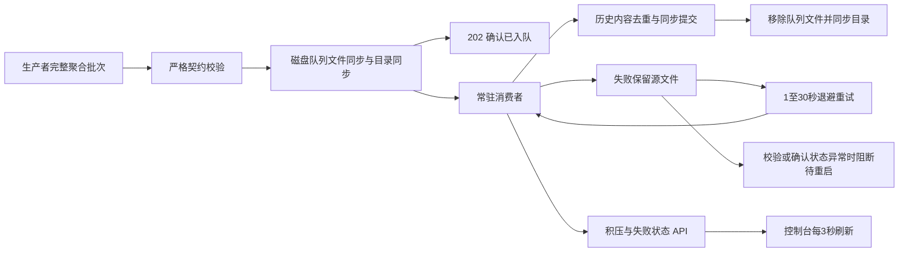

# 聚合批次持续写入队列

本批在[聚合持久化](persistence.md)之上增加可选的磁盘待写队列和常驻消费者。接收端只接受 `cythsec-observe` 的完整聚合 JSONL，沿用全部字段、最小流数、长度、整数和尾记录校验；不接收原始 PCAP 或逐用户／应用／域名记录。

“持续”指后台连续消费已提交的完整批次。生产者仍须提交已完成的批次，本版没有新增实时抓包轮转器、无限 JSONL 流切窗或 ClickHouse 常驻写入。恢复以批次为单位，不是半文件字节续传。

## 数据路径与确认点



- 队列复用既有不可变批次存储和单写者文件锁；队列与历史目录必须不同，均为私有目录。不要把队列目录同时用于其他存储或并行外部写入。
- 返回 HTTP **202** 时只确认队列文件和目录已同步，响应 `acknowledged_stage=queue`、`durable=true`；这不等于历史写入完成。再次提交尚在队列内的相同批次，返回同一 ID 和 `duplicate=true`。
- 消费者先确认历史同步提交，再移除对应队列文件、同步队列目录。中断在历史提交之前时，源批次仍在；中断在历史提交之后、队列确认之前时，重启重试由历史内容去重收口。交付语义是至少一次尝试、同内容一份历史，不宣称任意外部系统“恰好一次”。
- 队列元数据来自磁盘，不另设易漂移的内存偏移 checkpoint。启动逐文件验证后恢复待写项；已完成批次的确认体现为队列文件已移除。成功历史批次不会因队列重试被覆盖。
- 按最早入队文件时间处理，同时间以内容 ID 排序。固定九位小数时间字符串避免整秒与小数秒按字符串排序颠倒。队首失败时暂停后续消费，不跳过或删除失败批次。
- 目的存储容量不足或普通 I/O 失败按 1、2、4、8、16、30 秒退避，随后最多每 30 秒重试。异常文件、存储提交状态不确定、队列确认失败进入 `blocked`；应停止服务、检查／恢复数据后重启，不伪造成功。
- 退出时先等待在途 HTTP 请求结束，再取消消费者，最后关闭两个存储。剩余队列留盘；不保证 OS／磁盘失效时的 fsync 调用有硬实时超时。

## 有界资源与背压

单批最多 1 MiB／1024 窗。队列和历史分别最多 64 MiB／1024 批，两者上限独立，合计管理数据最多 128 MiB。到达队列上限时返回 **507** 和 `Retry-After: 1`；未确认接收，生产者必须保留输入并有界重试。没有自动删除历史或绕过队列以掩盖容量问题。

消费者每轮最多尝试八批，空闲轮询间隔 250 ms；实际吞吐由同步落盘开销决定。本版没有城域网容量、持续写入吞吐或 p99 延迟的性能证明，仍是有限容量本机开发实现。

## 配置与 API

```bash
# 仓库根目录；使用已有四栈构建生成的服务。
./build/bin/telemetryd -addr 127.0.0.1:8083 \
  -aggregate-dir ./build/aggregate-history \
  -aggregate-queue-dir ./build/aggregate-queue

# 生产者逐批提交已完成 JSONL；保留源文件直至按自身策略确认。
curl --fail-with-body -H 'Content-Type: application/x-ndjson' \
  --data-binary @build/example-aggregate.jsonl \
  http://127.0.0.1:8083/api/v1/analytics/ingest
curl --fail-with-body http://127.0.0.1:8083/api/v1/analytics/ingest
```

配置名 `aggregate_queue_dir`，环境变量 `TELEMETRYD_AGGREGATE_QUEUE_DIR`，命令行 `-aggregate-queue-dir`，优先级沿用 flag > env > YAML > 默认值。默认关闭；队列要求同时启用 `aggregate_dir` 并绑定回环 IP。与历史目录相同会被文件锁拒绝；损坏队列导致启动失败。旧的同步 `POST /analytics/imports` 保留，显式同步导入不会自动经过队列。

| 端点 | 行为 |
| --- | --- |
| `POST /api/v1/analytics/ingest` | 严格 JSONL；队列同步确认后 202，重复待写批次仍为 202；只有内容 ID、duplicate、durable 和确认阶段，不回显路径或输入名 |
| `GET /api/v1/analytics/ingest` | 队列与消费者状态；存储已启用但队列未启用时 `enabled=false,state=disabled` |
| `GET /api/v1/analytics/imports` | 既有历史批次查询；是否可查询历史与是否还在队列中是不同问题 |

403／400／413／415 继续遵守既有访问和输入限制；未启用队列 POST 返回 503；队列容量满 507；其他写入未确认返回 500。

状态字段：

- `enabled`／`running`／`state`：配置与工作进程状态。state 为 disabled、stopped、idle、writing、backoff、blocked。
- `pending_batches`／`pending_bytes`／`max_batches`／`max_bytes`：本次查询时的磁盘待写量和容量上限。并发状态不是与历史表的全局事务快照，不能据此推断业务流量率。
- `oldest_queued_at`／`next_retry_at`／`last_error`：可空时间和固定错误码；不包含路径、域名、用户或载荷。
- `completed_this_process`／`duplicates_this_process`／`failures_this_process`／`consecutive_failures`：进程内操作计数，重启归零；它们不是历史数据总数。

`/healthz` 仍是进程健康端点，不代表写入管道健康。当前运行状态由此专用 API 和页面读取，尚未增加队列 Prometheus 指标或告警调度。

## 控制台

“聚合分析”新增持续写入状态面板，每三秒刷新；请求超过 2.5 秒会撤销旧状态并显示超时，不能无限保留旧的零积压。启用队列时，页面上传走入队接口，明确显示“历史写入尚未确认”；历史批次实际可查询后才显示可查询。工作进程完成计数变化会刷新历史列表，保留用户当前选择；刚提交的批次出现后才自动选择该批次。

队列状态查询失败时保留历史查询功能，暂停新上传，不静默切换到同步导入。明确未启用队列时才沿用同步导入。页面分别显示等待、写入、退避、阻断、容量和原始分析完成状态，不把未知或失败画成零积压。

## 验证

`bash scripts/verify/check-aggregate-storage.sh` 现在同时运行原持久化验证和新增 `check-aggregate-ingest.py`。新增脚本从真实 Rust 输出起步，模拟目的目录不可用、队列接收后 SIGKILL、历史已提交但确认中断，重启后对照历史内容和去重计数；再次空队列重启验证进程计数归零而历史不变。默认全量测试和既有控制面 CI 自动继承该入口。

Go race 测试还覆盖队列容量、退避上限、来源文件保留、取消退出、异常队列阻断和时间排序。前端覆盖接收／完成区分及错误状态。完整实跑结果记录在 [本批阶段记录](../planning/INGEST-20261026.md)。
