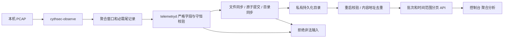

# 聚合结果持久化与控制台查询

本批为承载协议和网络质量聚合结果建立有限容量的本地历史存储，服务端使用 Go 标准库，前端沿用现有 React 控制台，无新增第三方依赖。它只接收 [聚合观测契约](aggregate-stats.md) 的 JSONL，不接收 PCAP、逐流或用户记录。

## 数据路径



本版的本地不可变 JSONL 存储用于开发和有限数据量联调，不冒充 ClickHouse。现有 ClickHouse `flows` 表与 Native 编码不属于这个聚合历史存储。常驻列存后端、自动采集／导入调度、大规模查询、自动归档和多节点写入尚未实现。

## 写入和恢复语义

- 显式配置 `aggregate_dir` 或 `-aggregate-dir` 才启用。启用时服务必须绑定回环 IP（例如 `127.0.0.1:8083`）；HTTP 处理器也检查连接来源。现有服务没有生产认证，不允许把该接口直接暴露到公网。
- 目录新建为 0700，已有目录必须为私有目录。批次文件为 0600；通过文件锁限制同一目录只有一个写进程。目标平台是 Linux／macOS 的本地文件系统，不承诺 NFS 或 Windows 文件锁语义。
- 导入时先解析完整 JSONL，必须有且只有一个最终 `capture_status`，后面不能再出现数据。窗口必须升序、不重叠，且窗宽／采样间隔一致；尾记录中的发布／抑制数量必须相符。
- 所有层级均拒绝未知字段和缺失必需字段；非可空字段的 `null` 被拒绝，不会悄悄变为 0。数值限制在 JavaScript 安全整数内，避免控制台无声舍入。字符串只允许固定类型、原因和来源状态枚举，不存文件名、IP、域名、任意标签或载荷。
- 校验抑制门槛、记录守恒、TCP／UDP 总量、时差直方图桶边界和样本数。校验不等于认证采集端真值，来源计数仍是操作者声明。
- 合法对象规范编码后计算 SHA-256 内容地址。完全相同的批次（含统计与状态）即使 JSON 空白或键顺序不同，也只保存一次；不同参数产生的结果仍是不同批次，不能认定它们来自不同原始采集。
- 先写临时文件并同步，随后以不覆盖已有文件的硬链接原子提交，再同步目录，之后才能返回 `durable=true`。中断发生在确认前时，客户端应保留输入并重试。提交后目录同步失败会停止继续写入，需重启校验；不返回已持久化的成功承诺。
- 启动时清理未提交临时文件，逐个校验已提交文件的哈希、权限和 schema。损坏、超额或非法文件导致启动失败，不把损坏历史悄悄变成空列表。查询时也重新校验文件。
- 单批最大 1 MiB、1024 个窗口；存储最多 64 MiB、1024 批。达到上限返回 507，不自动删除旧数据。需要扩容时应停止服务后备份／迁移，不在运行目录中并行修改文件。

文件成功读完与分析完成状态可以为 `false`；这类有完整尾记录的部分结果允许保存，原状态必须在查询与页面上保留。持久化成功只证明保存完成，不能把部分分析变成通过，也不能把 `unknown` 丢包状态变成零。

## API

基础路径 `/api/v1/analytics/imports`，响应沿用 `{code,data,error,request_id}`。仅接受实际本机连接，不信任 `X-Forwarded-For`。

| 方法和路径 | 行为 |
| --- | --- |
| `POST /api/v1/analytics/imports` | `Content-Type: application/x-ndjson`，原始聚合 JSONL；首次保存 201，重复 200；返回批次摘要、`duplicate`、`durable` |
| `GET /api/v1/analytics/imports` | 返回最近写入优先的有限批次列表、总数和存储类型；无数据为 `items=[]` |
| `GET /api/v1/analytics/imports/{id}` | 查询单批窗口，返回 `import` 状态、`items`、`total`、`offset`、`limit` |

窗口查询参数 `from`／`to` 为 Unix 秒，按窗口起点匹配 `[from,to)`。默认全部时间；`offset` 默认 0、最大 1024；`limit` 默认 100、范围 1～100。未知、重复或非法参数返回 400。没有匹配窗口为 `items=[]`，不会造出零流量窗口。

状态码：400 格式／契约错误；403 非本机连接；404 批次不存在；413 请求超限；415 媒体类型错误；500 磁盘读写或校验失败；503 未启用持久化；507 容量已满。错误不回显未受信任的字段值。

## 本机运行

```bash
# 仓库根目录构建及启动；服务不会自动抓包或导入任何文件。
(cd services/telemetryd && GOWORK=off go build -o ../../build/telemetryd ./cmd/telemetryd)
./build/telemetryd -addr 127.0.0.1:8083 -aggregate-dir ./build/aggregate-history

# 另一个终端：先生成聚合 JSONL，再显式导入。目标输出必须是新文件。
./target/release/cythsec-observe -r build/example.pcap -o build/example-aggregate.jsonl
curl --fail-with-body -H 'Content-Type: application/x-ndjson' \
  --data-binary @build/example-aggregate.jsonl http://127.0.0.1:8083/api/v1/analytics/imports
curl --fail-with-body http://127.0.0.1:8083/api/v1/analytics/imports

# 控制台开发代理：/telemetry -> telemetryd；其他 /api 仍指向 routerd。
(cd web/console && npm run dev -- --host 127.0.0.1)
# 打开 http://127.0.0.1:5173/analytics
```

页面支持文件导入、批次切换、时间范围和分页；显示承载计数、TCP 质量候选、采集诊断和时差桶。统计被抑制、时差未发布、没有历史、后端未启用、读取失败分别展示；不提供跨批次总计，以免重复计算重叠数据。时间输入与展示使用浏览器本机时区。

生产反向代理尚未配置，本轮只验证开发代理。本地回环约束不等于完整鉴权／RBAC／审计；此项仍是控制面生产开发的前置工作。

## 验证入口

```bash
(cd services/telemetryd && GOWORK=off go test -race ./...)
(cd web/console && npm run typecheck:all && npm run lint && npm test)
bash scripts/verify/check-aggregate-storage.sh
```

独立端到端脚本生成合成 PCAP，调用真实 Rust 聚合入口和真实 Go HTTP 服务，写入临时目录，停止／重启服务后逐对象对照，并注入字段越界、缺尾记录和已提交文件损坏。默认 `test-all.sh` 与控制面 CI 已接线。验证结果与全局开发阶段见 [核心进度记录](../planning/CORE-STATUS-20261026.md)。
