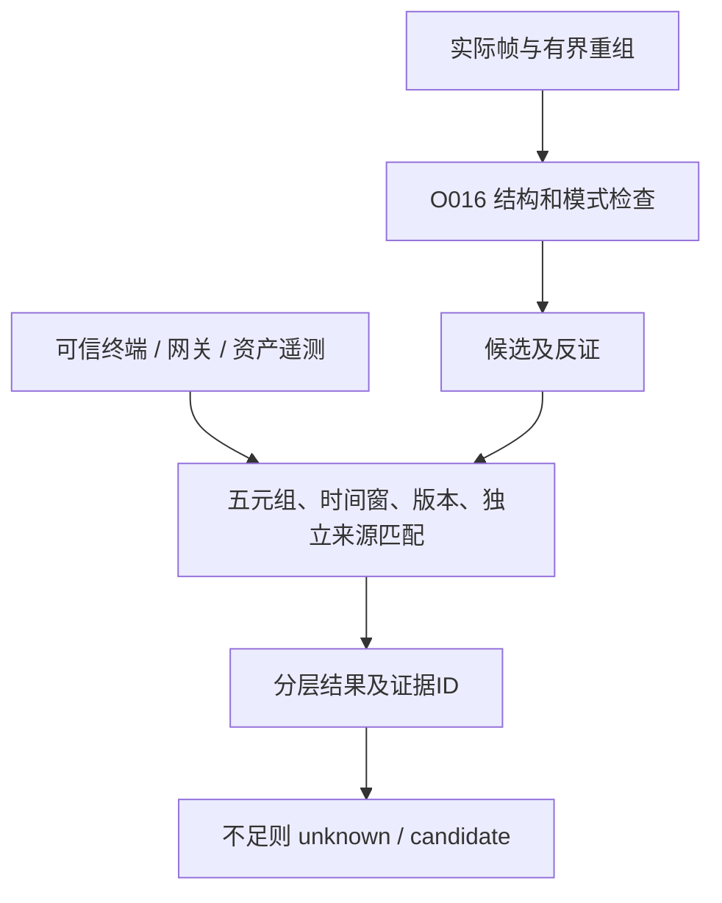

<!-- GENERATED: configs/registry/vpn-protocols.json; gen-vpn-protocols.py -->
# O016 · Timing obfuscation/traffic shaping

规则修订：`2026-10-26.1`。对象层次：`overlay`。输入位置：手册 §3。

本项直接对应目录对象；同一承载不自动归因其他产品或混淆层。

## 实现与观测边界

可信上下文关联已实现；未实现无条件密文唯一识别，真实型号/版本正样本待补。目录存在只表示覆盖了设计和关联接口，不代表真实样本召回率已通过。
运行时入口为 `cythsec-identify`，标准结构判据在 `dpi/wire.rs`，上下文裁决在
`identification/evidence.rs`。既有 DPI 接口仍保留四态语义；完整识别事件单独输出，不改写 FlowRecord ABI。

## 被动特征算法

1. **观测条件与帧约束**：分方向IAT、burst长度、周期谱和自相关；按网络拥塞/丢包分层。
2. **会话与状态关联**：时间戳质量、时钟偏差与shape配置一并验证。
3. **反证与降级**：视频/游戏/心跳有同类时序，不能推断具体协议。
4. **输出维度**：本对象仅写 `overlay` 轴；传输、安全握手、隧道、接入架构、产品和混淆层分别保留。缺失值为 `null`，不以端口补齐。

TCP 先按序号重组连续前缀，再检查帧长；UDP 保留数据报边界。捕获截断、乱序缺口、未知版本、预算耗尽分别留痕。
分类状态为 `candidate / wire_confirmed / context_verified / unknown`。`candidate` 为C；只有指定解析器
完成相应双向标识校验才可给A；A表示观测到符合结构的交互，不表示密码学认证成功。
B要求同一目录ID/版本/模式的至少两个独立信任来源匹配实际五元组与时间窗；配置文件中的单方声明不够。
资料级D仅存在目录，不写成某条网络流已经命中。

## 统计特征与算法

采集 首16包有符号长度序列, 双方向IAT分位数与burst长度, 上下行字节比和连接持续时间, 迁移/重键/复用事件（仅经验证的会话标识）。令包长为带方向符号的 `l_i`，相邻到达间隔为 `dt_i`；
使用长度直方图、IAT分位数、burst游程和 `bytes_up/(bytes_down+1)` 作为候选特征。
比较目标样本与HTTPS/H3/WebRTC/SSH负样本的条件分布，按产品版本、链路和模式分层。
训练数据按设备/站点/时间拆分，不能让同一会话相邻包泄漏到测试集；用独立校准集标定阈值并报告每类混淆矩阵。

本轮未训练或部署该统计模型，不能输出虚构概率；端口、熵、长度、SNI/JA3/JA4或单IP均不能独立晋升A/B。

## 主动验证与补充遥测

本机延迟/抖动受控注入，不修改业务网络。

计划类型：`managed_session_export`。先由 `ProbePlanner` 校验精确IP/端口/目录ID允许列表、授权ID、过期时间、
单目标/全局预算和不超过3秒的超时，再生成 `executed=false` 的计划；没有内置网络扫描器或自动发包。
执行器属于宿主/受管实验环境，必须再次校验授权并回传结果。静默、超时、连接拒绝和fallback均只记录结果，不能证明协议不存在或认证成功。
成功探测最多是一种证据来源，不能用同一次响应派生的证书/页面/指纹冒充多个独立来源。

## 识别与证据流

## 验收设计

- 正样本：按具体版本/配置生成双向流，并保存脱敏终端/网关会话、时间和配置摘要；合成结构测试不能替代真实产品PCAP。
- 反例：视频/游戏/心跳有同类时序，不能推断具体协议。
- 边界：每个长度字段的0/最小值/越界/截断，方向反转、错标识、重复包、会话重用、超时和内存上限。
- 上下文：缺一来源、同源重复、错五元组、过期事件、不同版本/模式、相反结论和未知目录ID必须不能给B。
- 主动验证：无允许列表、过期授权、预算超限拒绝；计划不得自行产生网络副作用。
- 指标：分别报告precision/recall/FPR/unknown及P95资源成本；当前不宣称全协议实测准确率。

## 参考与维护

- [输入识别手册](../vpn_ztna_protocol_identification_2026.md)
- [引擎架构与运行契约](../architecture/vpn-ztna-identification.md)
- 依据输入手册的能力/可见性记录；未重新核实全部厂商SKU和私有线缆格式，不将资料级D当运行时结论。

更新JSON真源后运行 `python3 tools/codegen/gen-vpn-protocols.py`，再以 `--check` 验证；不要单改生成文档。
