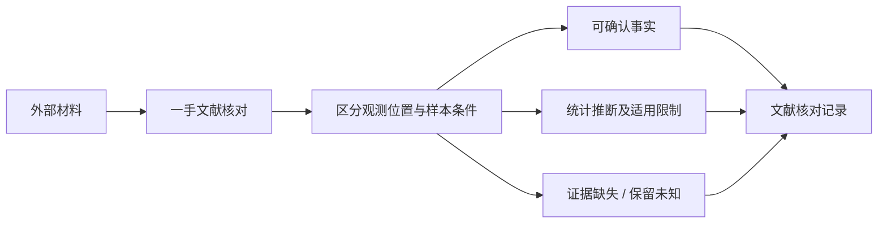

# Trojan材料核对与观测边界

核对日期：2026-10-28。输入为[不翻车的Trojan文章](https://bufanche.com/protocols/trojan/)。
本笔记记录协议原理、证据等级和误判问题，不提供运营商公共用户出口的识别、主动探测或封锁实现。

## 资料与核验状态

| 资料 | 本轮核对 | 不能外推的内容 |
| --- | --- | --- |
| 输入文章 | 已阅读；其中实测由作者报告 | 没有取得其原始抓包、逐连接标签和完整实验工件，未独立复现 |
| [Trojan官方协议文档](https://trojan-gfw.github.io/trojan/protocol) | 已核对TLS保护请求和回落语义 | 协议文本不证明任意实现或部署具有相同行为，也不证明“永远无法识别” |
| [USENIX Security 2024论文页面](https://www.usenix.org/conference/usenixsecurity24/presentation/xue-fingerprinting) | 已核对题目、作者及摘要；研究讨论嵌套协议栈的统计可见性 | 本轮未逐表复核论文数据，未复现其分类器；不能将博客转述数字作为本系统指标 |
| 文章所述Xray版本、默认值与弃用提示 | 未逐项核对当前官方版本 | 不作为工程依赖、兼容性或部署结论 |

## 可确认的协议层次

官方协议说明：连接先建立TLS通道，后续应用请求位于其保护内。
因此，普通外部镜像所见的外层TLS，不能等同于已读取或验证Trojan应用请求。
TLS终止点或自有服务内部记录属于另一种观测条件，不能混用为外侧可见证据。

回落机制使部分未通过应用验证的连接交由其他服务处理。返回网站页面、错误页、关闭或超时，
均不足以唯一确认或排除该协议；它们也不能证明应用认证成功。

论文摘要表明，嵌套握手可能留下统计可见性；该研究对象跨越多个代理形式。
“存在可研究的统计现象”与“某条公众连接已被唯一归因为Trojan”是不同结论。
TLS客户端实现的相似性也不能直接替代应用协议身份。

## 对文章实验的解读限制

- 作者报告的是特定客户端、请求、配置和时段下的结果，不是本项目的独立实测。
- 单一、小规模对照中的未观察到误报，不等于总体误报率为零；基率与样本构成会影响结论。
- 重复观测未必是独立样本；同一环境、会话复用和相同客户端会使结果相关。
- TCP分段、TLS记录与应用消息属于不同层次，不能把不同层的长度和计数直接互换。
- 密文统计结果不能证明应用认证、用户身份、行为动机或访问内容。

本轮没有提取或固化文章中的长度阈值，没有运行其演示程序，没有发起网络探测，
也没有据此变更协议识别或阻断代码。

## 本项目的记录要求

外侧仅能确认TLS时，应用身份保留未知；不得因缺少证据回落为“正常已确认”或“Trojan已确认”。
自有、受管服务的协议排障应明确观测位置、版本、时间和证据来源，不保留认证材料或原始业务载荷。
文献结论、作者报告和本地实验分别记录，禁止把阅读文献标记为算法验收完成。

现有[P012目录文档](../protocols/P012.md)由注册表生成。本笔记不直接改写生成物，
不改变其能力状态，也不代表真实协议样本召回或生产适配已经通过。
