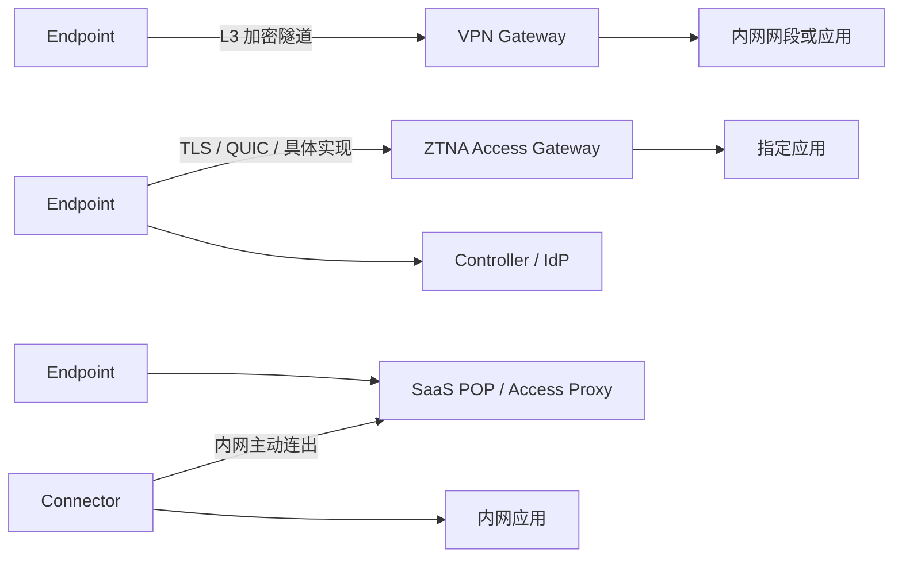
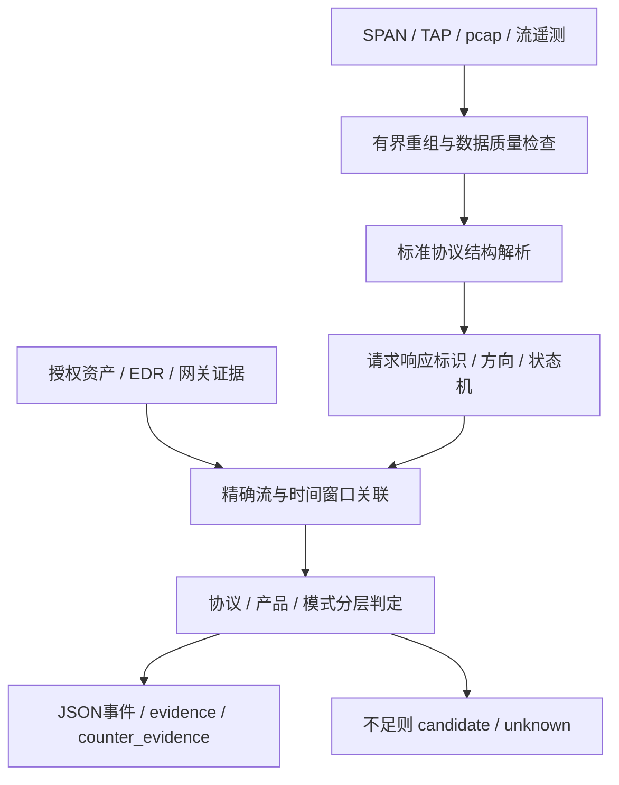

# 全球 VPN / 代理混淆 / 中国厂商 SSL VPN 与零信任隧道：协议识别工程手册

> 版本：v1.1｜工程适配更新：2026-10-26｜原始资料核对截止：2026-10-23｜范围：网络资产盘点、被动流量分析、企业授权监测和产品兼容性评估。
>
> **准确性声明**：本手册是一份**尽可能广覆盖的识别清单**，不可能凭公开材料给出所有厂商、所有软件版本、所有私有隧道的通用字节签名。`品牌` ≠ `协议`，`零信任` ≠ `独立的线缆层协议`，`TLS/443` ≠ `SSL VPN`。对尚无公开报文格式的实现统一标记 `需样本验证`。不建议仅凭单一端口、SNI、JA3/JA4 或服务端证书作阻断决策。

## 工程实现入口（2026-10-26）

本轮已将本清单整理成 [268项逐项算法文档](protocols/README.md)，真源为
`configs/registry/vpn-protocols.json`。90个V/P/O编号全部覆盖，另拆出承载、认证、厂商产品和组合变体。
[引擎架构](architecture/vpn-ztna-identification.md) 逐项声明实际解析子集、可信上下文接口与未实现部分。
`cythsec-identify` 提供离线pcap到分层识别事件的入口；不是268种协议均可无密钥纯DPI唯一识别。
A/B/C/D/U边界继续适用，真实厂商样本、统计模型训练和主动网络执行器仍需独立验收。

逐项勾选的工程状态见[协议适配状态清单](protocols/ADAPTATION-STATUS.md)与[OSI 分层视图](protocols/ADAPTATION-STATUS-BY-LAYER.md)：
覆盖本目录268项及基础协议补充项，分别记录实现审查、本地测试、独立对照与完整适配，
目录覆盖不自动计作适配完成。分层口径见[OSI 分类与适配规划](planning/protocol-osi-classification.md)。

## 目录

1. [识别对象、证据等级和观测点](#1-识别对象证据等级和观测点)
2. [基础 VPN 与隧道协议总表](#2-基础-vpn-与隧道协议总表)
3. [现代代理、抗封锁和混淆技术总表](#3-现代代理抗封锁和混淆技术总表)
4. [HTTPS/HTTP2/HTTP3/QUIC 传输封装、国密与认证协议](#4-httpshttp2http3quic-传输封装国密与认证协议)
5. [中国厂商 SSL VPN / ZTNA / SDP / SASE 产品矩阵](#5-中国厂商-ssl-vpn--ztna--sdp--sase-产品矩阵)
6. [海外主流企业 VPN / 零信任产品补充](#6-海外主流企业-vpn--零信任产品补充)
7. [可实施的被动识别特征矩阵](#7-可实施的被动识别特征矩阵)
8. [多阶段 DPI 分类引擎设计](#8-多阶段-dpi-分类引擎设计)
9. [测试样本、验收指标与误报防控](#9-测试样本验收指标与误报防控)
10. [厂商识别待办与开放问题](#10-厂商识别待办与开放问题)
11. [公开资料和技术标准](#11-公开资料和技术标准)

## 1. 识别对象、证据等级和观测点

### 1.1 六个互不等价的字段

| 字段 | 示例 | 识别结论可达到什么层次 |
|---|---|---|
| `transport_family` | TCP / UDP / ESP / GRE | 基础网络承载 |
| `cryptographic_transport` | TLS / DTLS / QUIC / IKEv2 / WireGuard | 外部安全握手类型 |
| `tunnel_or_proxy_family` | IPsec / OpenVPN / SOCKS5 / VLESS / MASQUE | 隧道或代理家族，部分需会话授权日志或解密 |
| `access_architecture` | L3 VPN / Web VPN / TCP 端口转发 / ZTNA 应用代理 / SDP | 接入架构，不等于线缆协议 |
| `vendor_product` | EasyConnect / SecPath / iOA / SASE / AISDP | 厂商产品；通常需要多个独立证据 |
| `obfuscation_overlay` | REALITY / ShadowTLS / Salamander / AmneziaWG / FinalMask | 混淆层；仅凭外侧抓包经常只能推测 |

### 1.2 证据等级（**用于每一条检测结果**）

- **A — 标准协议可解析**：符合协议的结构约束和状态机，且至少有双向握手。例如 IKE、QUIC、可确认的 WireGuard 握手。
- **B — 多证据强关联**：可见握手 + 经维护的网关资产清单/终端进程/网络遥测中的两项独立佐证。
- **C — 行为推断**：包长、流量方向、时间间隔、目的地址、TLS 指纹等弱特征组合，只能输出 `suspected`。
- **D — 仅产品公开能力**：厂商声明支持 SSL VPN/SDP 或“加密隧道”，但没有确切线缆报文特征；**不能**直接开发为确定性签名。
- **U — 未知/待验证**：不能可靠区分普通 HTTPS 与加密隧道。

### 1.3 观测条件

| 观测位置 | 能看到 | 看不到或不保证 |
|---|---|---|
| 出口镜像（只看加密流量） | IP、端口、时序、长度、可观察握手、部分 ClientHello 和 QUIC Initial | TLS 1.3 服务端证书正文、TLS/HTTP 内层应用、ECH 保护的真实 SNI/ALPN、私有隧道载荷 |
| 客户端 EDR/网络扩展 | 程序签名、进程路径、连接对端、虚拟网卡、路由变更、DNS 变化 | 未授权对端内部内容 |
| VPN/SDP/ZTNA 网关及管理平台 | 登录会话、用户/设备、租户、隧道类型、策略、真实应用日志 | 平台未记录的加密外层细节 |
| 授权的 TLS 终止点/代理 | HTTP 方法、路径、CONNECT、WebSocket、gRPC、协议升级 | 端到端禁止解密或未终止的内层隧道 |
| 授权实验室 PCAP + 服务端版本清单 | 精确可重复的正样本，建立版本化特征 | 不能外推所有部署和版本 |

**注意**：TLS 1.3 中服务端证书通常在加密握手中传输；QUIC Initial 可被具备协议解析能力的监测器处理，但这不意味着 QUIC 后续应用内容可见。ECH（RFC 9849）可保护真实 ClientHello（包括敏感 SNI/ALPN）。

## 2. 基础 VPN 与隧道协议总表

`端口`列仅指默认值、常见值或关联端口，**不是充分识别依据**。

| ID | 技术/协议 | 常见外层 | 常见端口/协议号 | 推荐识别信号 | 风险或备注 |
|---|---|---|---|---|---|
| V001 | IPsec ESP Tunnel / Transport | IP | IP protocol 50 | ESP SPI/序号结构、IKE 相关会话 | 加密载荷不可按应用解码 |
| V002 | IPsec AH | IP | IP protocol 51 | AH 头与协议解析 | 相对少见 |
| V003 | IKEv1 | UDP | 500 / 4500 | ISAKMP 头/Cookie/交换类型，双向协商 | 旧式部署 |
| V004 | IKEv2 | UDP | 500 / 4500 | IKEv2 报文头、Exchange Type、SPI、消息 ID | 现代 IPsec 基础 |
| V005 | IPsec NAT-T | UDP | 4500 | IKE non-ESP marker 与 UDP 封装 ESP，按类型区分 | 4500 不是只能承载 IPsec |
| V006 | L2TP | UDP | 1701 | L2TP 控制/数据字段和会话行为 | L2TP 自身不加密 |
| V007 | L2TP/IPsec | UDP + ESP | 500/4500、1701（内层） | 外侧优先标识 IKE/IPsec | 1701 通常对外不可见 |
| V008 | PPTP | TCP + GRE | TCP 1723、GRE 47 | PPTP 控制连接与 GRE 关联 | **不安全/遗留** |
| V009 | GRE / mGRE | IP | protocol 47 | GRE 头和标志位 | 本身不加密 |
| V010 | IP-in-IP | IP | protocol 4 | IP 包内封装 IP | 本身不加密 |
| V011 | IPv6-in-IPv4 | IP | protocol 41 | IPv6 封装头 | 本身不加密 |
| V012 | L2TPv3 | UDP/IP | 配置可变 | L2TPv3 Session ID/Cookie | 二层隧道，常叠加安全层 |
| V013 | EtherIP | IP | protocol 97 | EtherIP 头 | 二层封装 |
| V014 | VXLAN | UDP | 4789 | VXLAN 标志/VNI | **Overlay 不等于 VPN 加密** |
| V015 | Geneve | UDP | 6081 | Geneve 头/VNI | Overlay 不等于加密 |
| V016 | GENEVE/IPsec、GRE/IPsec、IPIP/IPsec | 复合 | 可变 | 先识别外层，再关联内层 | 非单一协议 |
| V017 | OpenVPN UDP | UDP | 1194、可变 | OpenVPN opcode/session/control 交互、证书或密钥配置 | TLS 包不一定以纯 TLS record 开始 |
| V018 | OpenVPN TCP | TCP | 1194、443、可变 | TCP 帧长 + OpenVPN 控制通道结构/握手状态机 | 可能被包装为普通 TLS |
| V019 | OpenVPN tls-crypt / tls-crypt-v2 | TCP/UDP | 可变 | 外层仍可识别部分传输行为，传统控制包签名失效 | 需单独样本 |
| V020 | OpenVPN over stunnel/SSH/obfs | TCP/UDP | 443 / 可变 | **只能先确定外层** TLS/SSH/obfs；内层需终点数据 | 不得直接判为 OpenVPN |
| V021 | WireGuard | UDP | 51820、可变 | 报文类型、握手长度/双向匹配与状态机 | 固定握手结构；支持漫游 |
| V022 | AmneziaWG | UDP | 可变 | 非标准 WireGuard 变体，随机报头/填充/前置噪声；需已知授权正样本 | 单包无法通用判别 |
| V023 | IKEv2/IPsec MOBIKE | UDP | 500/4500 | IKEv2 扩展与地址迁移 | 可变对端地址 |
| V024 | SSTP | TLS/TCP | 443 | HTTPS 隧道关联 SSTP 会话特征（需要可见相应层） | Windows 生态 |
| V025 | SoftEther native SSL-VPN | TLS/TCP | 443、5555、992（配置可变） | 授权终点特征与客户端进程，不能只看 TLS | 支持多种兼容模式 |
| V026 | OpenConnect / ocserv | TLS/TCP + DTLS/UDP | 443 | TLS 控制会话与 DTLS 数据通道关联 | 依协议模式有差异 |
| V027 | Cisco AnyConnect SSL VPN | TLS + DTLS | 443、可变 | 端点产品特征、CSTP/DTLS（可见时） | 厂商/版本差异 |
| V028 | Palo Alto GlobalProtect | TLS 与/或 IPsec | 443、UDP4501（部署可变） | Portal/Gateway + 实际隧道流双证据 | 不可只按端口 |
| V029 | Fortinet FortiClient SSL VPN | TLS/DTLS | 443 / 10443 等可变 | SSL VPN 门户/服务端日志/授权终点 | 版本差异大 |
| V030 | Ivanti Connect Secure / Pulse Secure | TLS + 可选 UDP | 443 可变 | 特定网关/客户端 + 流量关联 | 不宜固定字节签名 |
| V031 | F5 BIG-IP APM Network Access | TLS | 443 可变 | 会话与虚拟 IP/网络访问日志 | 产品功能不同 |
| V032 | Juniper Network Connect | TLS | 可变 | 旧式客户端/网关 | 遗留 |
| V033 | Check Point Mobile Access / Remote Access VPN | HTTPS 或 IKE/IPsec | 443/500/4500 等 | 分辨门户与 IPsec 通道 | 产品配置变化 |
| V034 | StrongSwan / Libreswan / Openswan | IKE/IPsec | 500/4500 等 | 标准 IKE/IPsec，可结合主机资产识别实现 | 实现名不可直接从 IKE 推断 |
| V035 | SSTP/PPP/EAP | TLS 内封装 | 可变 | 必须看到相应应用层或终点日志 | EAP 不是 VPN 隧道 |
| V036 | SSH VPN / `ssh -w` | TCP SSH | 22、可变 | SSH Identification + KEX；TUN/TAP 属性终点可见 | SSH 端口转发≠必为 VPN |
| V037 | Tailscale / Headscale / ZeroTier / Nebula | UDP 及中继 | 可变 | 以 WireGuard 或独立 Overlay 为基础，各自控制面不同 | 不是单一通用隧道格式 |
| V038 | Cloudflare WARP | MASQUE / WireGuard（按版本与模式） | UDP/TLS 可变 | 标准协议 + 受管客户端/服务侧证据 | 不可把所有 WARP 当 WireGuard |

## 3. 现代代理、抗封锁和混淆技术总表

### 3.1 代理/网络核心

| ID | 协议或生态 | 外层形态 | 能否由纯被动 DPI 可靠辨认？ | 注意 |
|---|---|---|---|---|
| P001 | SOCKS4 / SOCKS4a | 明文 TCP | 协议握手可见时可以 | 没有原生加密 |
| P002 | SOCKS5 | 明文 TCP 或被其他隧道包裹 | 裸握手可以；加密后不行 | SOCKS5 本身不保证加密 |
| P003 | HTTP Proxy / CONNECT | HTTP 明文或 HTTPS | 明文方法/授权解密可见 | HTTPS 上的 CONNECT 在 TLS 内 |
| P004 | HTTP/2 CONNECT / Extended CONNECT | TLS/H2 | 加密时只知 TLS/HTTP 外观 | 可能承载常规服务 |
| P005 | HTTP/3 CONNECT / MASQUE CONNECT-UDP / CONNECT-IP | QUIC/H3 | 只看外层多为 QUIC；方法在加密后不可见 | 标准代理而非专属翻越协议 |
| P006 | SSH dynamic forwarding（SOCKS） | SSH | 只知 SSH，不一定能判断代理用途 | 终点日志可辅助 |
| P007 | Shadowsocks AEAD | TCP/UDP 加密 | 通用确定签名通常不可用 | 须区分 SS 老式 stream 与 AEAD |
| P008 | Shadowsocks 2022 | TCP/UDP 加密 | 需合规实验数据及统计/终点信息 | 具体密钥与实现不公开时不可解 |
| P009 | ShadowsocksR（SSR） | TCP/UDP + 插件 | 遗留方案，混淆变化大 | `auth_*`/`tls1.2_ticket_*` 等不是 TLS 标准协议 |
| P010 | V2Ray VMess | RAW/TLS/WS/gRPC 等 | 外层可见，内层可能不可见 | 加密隧道 |
| P011 | Xray VLESS | RAW/TLS/REALITY/XHTTP 等 | 外侧仅能判承载层或疑似 | VLESS 与 REALITY 是不同层 |
| P012 | Trojan / Trojan-Go | TLS（常用） | 外侧通常类似 TLS | 不应把合法 HTTPS 定性为 Trojan |
| P013 | Hysteria v1 | QUIC | 只能先识别 QUIC | 已有新版本 |
| P014 | Hysteria2 | QUIC/TLS1.3 | 无已知密钥时很难与其他 QUIC 一刀切区分 | 可启用 Salamander/Gecko |
| P015 | TUIC v5 | QUIC | 通常只能确定 QUIC + 弱关联 | 版本与实现相关 |
| P016 | AnyTLS | TLS | 不能仅凭 TLS 确认 | 多连接复用 |
| P017 | NaïveProxy | 标准浏览器栈 HTTP/2/3 代理 | 专门减小独特指纹，单端口不可靠 | 需合法端点/进程证据 |
| P018 | Snell | 加密代理 | 部分实现可用实验签名 | 客户端生态较窄 |
| P019 | ShadowTLS v1/v2/v3 | TLS 伪装外层 | 外层表现为 TLS，需额外验证 | 常包裹其他代理 |
| P020 | Cloak | TLS/网页外观 | 需终点/授权样本 | 小众 |
| P021 | Brook / Brook WSS | TCP/UDP/WebSocket/TLS | 按具体模式识别外层 | 不同版本行为不同 |
| P022 | Outline | Shadowsocks 生态 | 按具体 SS 部署识别 | 品牌/客户端≠新的线缆协议 |
| P023 | Psiphon | SSH/OSSH/HTTP 等多传输 | 必须按实际承载方式判别 | 产品具自适应选路 |
| P024 | Tor OR / TLS | TLS、Tor cell 协议（密文内） | 公开中继 IP/终点配合，不能仅因 TLS 判定 | 注意隐私权 |
| P025 | Tor obfs4 | 混淆传输 | 需配置/正样本，通用签名弱 | 抗主动扫描 |
| P026 | Tor Snowflake | WebRTC 等 | 通常只能确认 WebRTC/ICE/DTLS | 可能与会议流量混淆 |
| P027 | Tor meek / WebTunnel | HTTPS/Web 伪装 | 需多证据 | 不等于普通访问即为 Tor |
| P028 | OpenVPN over Tor / WireGuard over TLS | 多层封装 | 需逐层解析，终点日志才能可靠断定 | 不要臆测内层 |

### 3.2 混淆、变形、指纹处理

| ID | 名称 | 类型 | 被动识别边界 |
|---|---|---|---|
| O001 | REALITY | TLS 握手伪装 | 不存在对所有版本、所有目标通用的确定签名 |
| O002 | XTLS Vision | 流控/传输优化 | 不能独立当作网络协议 |
| O003 | XHTTP | HTTP 模式传输 | 加密状态下可只见 TLS/H2/H3 形态 |
| O004 | FinalMask | Xray TCP/UDP 外层伪装处理 | 包序列因配置而异 |
| O005 | Salamander | Hysteria2 QUIC 外层混淆 | 无共享密钥时外层 QUIC 标志可能失效 |
| O006 | Gecko | 握手分片/随机填充混淆 | 新旧版本和部署支持不同，需验证 |
| O007 | AmneziaWG v1/v2/v3.1 | WireGuard 报头和分组混淆 | WireGuard 固定头/长度规则不适用于所有版本 |
| O008 | obfs4 | Tor pluggable transport | 加密/随机化握手，依赖授权上下文 |
| O009 | Snowflake/WebTunnel/meek | Tor 抗封锁传输 | 可能仅能判断外层 WebRTC/HTTPS |
| O010 | simple-obfs HTTP/TLS | SS 插件 | 仅模仿部分 HTTP/TLS 外观；旧式 |
| O011 | v2ray-plugin | WebSocket/TLS 插件 | WS 可见需无 TLS 或经合法终止 |
| O012 | SSR `http_simple`/`http_post`/`tls1.2_ticket_auth`/`random_head` | 老式混淆 | 流量统计与实现版本有关 |
| O013 | TLS ClientHello fragmentation | 分片 | 分片本身不说明 VPN |
| O014 | TCP segmentation/record fragmentation | 传输切片 | 应先重组会话，减少误报 |
| O015 | Packet padding/random length | 包长扰动 | 统计学仅能辅助 |
| O016 | Timing obfuscation/traffic shaping | 时序扰动 | 不能确定协议 |
| O017 | Port hopping | 端口迁移 | 关联多流，不能将端口即协议 |
| O018 | UDP2RAW FakeTCP/ICMP | UDP 封装技术 | 外层外观需注意伪 TCP 不具真实 TCP 状态 |
| O019 | Domain fronting/CDN reverse proxy | 路由/反向代理 | 合法用途很多，需明确配置事实 |
| O020 | uTLS/浏览器 TLS 模仿、JA3/JA4 模仿 | 指纹处理 | 同指纹可能有完全不同应用 |
| O021 | TLS ECH | 保护真实 ClientHello | RFC 标准隐私机制，**不是 VPN 证据** |
| O022 | QUIC padding/fragmentation | 传输变形 | 合法 HTTP/3 同样可能出现 |
| O023 | WireGuard pre-shared key | 密钥增强 | 不等于混淆 |
| O024 | Noise protocol framework | 密钥协商框架 | 使用 Noise ≠ 必为 WireGuard |

## 4. HTTPS/HTTP2/HTTP3/QUIC 传输封装、国密与认证协议

### 4.1 实际承载层与可见性

| 层次 | 项目 | 需要观察的属性 | 容易混淆的对象 |
|---|---|---|---|
| TLS | TLS1.2/1.3、mTLS、Session Resumption、ECH | Record、ClientHello、TLS 版本、扩展、（若明文可见）ALPN/SNI | 普通 HTTPS、业务 API |
| DTLS | DTLS1.2/1.3 | datagram record、握手序号、重传 | WebRTC、SSL VPN 数据通道 |
| QUIC | QUIC v1/v2、HTTP/3 | Long Header、Version、Connection ID、Initial 解码，连接迁移 | 视频、浏览器、VPN、MASQUE |
| HTTP | HTTP/1.1、HTTP/2、HTTP/3 | HTTP Upgrade、CONNECT、Extended CONNECT | 企业 API、正常反向代理 |
| WebSocket | WS/WSS | HTTP 101 升级（若可见） | 实时网站/IM/代理 |
| gRPC | gRPC/H2 | `content-type: application/grpc` 等（需要可见 HTTP） | 常规微服务 |
| MASQUE | CONNECT-UDP/CONNECT-IP | HTTP 层方法/路径（通常加密） | 其他 HTTP/3 服务 |
| 国密 TLS | TLCP/国密 SSL、TLS1.3 国密套件 | 按公开规范的 TLS/TLCP 握手、协商算法、证书类型 | 不能从 SM2 证书推导特定 VPN 厂商 |
| 商用密码 | SM2/SM3/SM4、RFC 8998 TLS1.3 国密套件 | 若协商可见记录实际 cipher suite 与扩展 | 密码算法≠接入协议 |
| 认证 | RADIUS、TACACS+、LDAP/LDAPS、Kerberos、SAML、OAuth2、OIDC、CAS、FIDO2、WebAuthn、OTP | 仅控制面/身份面识别 | **认证协议不是 VPN 数据面** |
| 控制面 | SPA/SDP single-packet authorization、控制器注册、设备态势上报 | 控制器/网关日志及特定实现 | SPA 机制不等于统一的标准线缆格式 |
| 数据面 | 客户端到接入网关、网关到 Connector、Connector 到应用 | 分开建模每一段连接 | 零信任不一定建立完整 L3 隧道 |

**特别区分**：TLS 1.3 国密套件、TLCP、SSL VPN 国密产品是不同层次；“支持国密”不说明采用哪一种线缆级握手。对于 TLS 1.3，不能宣称从镜像口直接获取所有服务端证书信息。标准参考：RFC 8998、RFC 8446、RFC 9849。

### 4.2 ZTNA 三种典型数据路径



要分别标注：`client_to_pop`、`connector_to_pop`、`connector_to_origin`。连接器**通常从内网主动连出**并不意味着一定是 WireGuard、QUIC 或 TLS 某个固定协议；必须查证具体厂商版本。

## 5. 中国厂商 SSL VPN / ZTNA / SDP / SASE 产品矩阵

**矩阵中“已证实”仅表示可从公开资料确认的产品、接入模型或标准协议族，不代表公开了私有帧格式。** 厂商专有控制/数据协议不公开时，`wire_signature` 一律写 `UNKNOWN—需样本验证`。`D` 意味着产品能力级证据。每行列出的特征是建议采集的观测点，不是未经验证的匹配规则。

| 厂商/生态 | 已核实产品/家族 | 公开可证实的接入或承载 | 推荐收集的识别证据 | 私有报文状态 | 依据 |
|---|---|---|---|---|---|
| **深信服 Sangfor** | SSL VPN、EasyConnect、IPsec/SSL 综合网关 | SSL/TLS VPN、IPsec；Web/TCP/L3 等资源接入 | 已知受管网关资产、EasyConnect 客户端进程/签名、TLS 握手、VPN 会话日志、虚拟网卡 | UNKNOWN—需版本 PCAP | [S01] |
| 深信服 | 零信任/安全接入/SASE 相关产品 | ZTNA/应用或网络接入，具体部署依版本 | 区分旧 SSL VPN 客户端与新零信任客户端、终端进程/网关日志 | UNKNOWN | [S01] |
| **华为 Huawei** | USG/HiSecEngine SSL VPN、旧 SecoClient/SVN | SSL/TLS；Web 代理、文件共享、端口转发、网络扩展；IPsec | SSL v-gateway 配置、证书/端口、网络扩展路由、客户端程序 | 具体帧 UNKNOWN | [S02] |
| 华为 | 华为云 VPN/云安全接入 | IPsec VPN 等，依具体云产品 | 云端 VPN 连接类型、IKE SA/ESP、网关侧日志 | 标准 IPsec 可识别 | [S02] |
| **新华三 H3C** | SecPath SSL VPN、iNode | SSL/TLS；**Web / TCP / IP** 三种接入；示例网关默认 TCP443 | SSL VPN Gateway、接入类型、iNode 客户端、双向 TLS | 私有 IP 接入封装 UNKNOWN | [S03] |
| 新华三 | SecCenter ZTNA / SDP | SDP Controller、可信网关、终端管理平台、客户端 | 单点认证→动态授权→网关访问关联 | UNKNOWN | [S04] |
| **奇安信 QAX** | 安全接入网关 SSL VPN、IPsec VPN 安全网关 | 厂商公开的 SSL VPN / IPsec 产品类别 | 受管网关和终端代理清单、IKE/TLS、会话日志 | 私有 SSL 数据面 UNKNOWN | [S05] |
| 奇安信 | ZTNA、可信应用代理/API 代理/访问控制台 | ZTNA 应用级/网络代理；OIDC、SAML、OAuth2、CAS 为身份面 | IdP/访问代理日志与 Connector 会话关联 | UNKNOWN | [S05] |
| **天融信 Topsec** | TopVPN、国密 SSL VPN、国密 IPsec VPN | SSL VPN 与 IPsec；存在国密套件产品 | IKE/TLS/TLCP 握手、产品资产、终端/网关日志 | 私有帧 UNKNOWN | [S06] |
| 天融信 | SDP 安全网关/访问控制网关 | SDP/零信任访问产品 | 控制器、终端、可信网关日志及流量配对 | UNKNOWN | [S06] |
| **启明星辰 Venustech** | SSL VPN 系统 | SSL VPN 客户端与服务端接入 | 客户端、HTTPS/TLS、网关日志 | 私有帧 UNKNOWN | [S07] |
| 启明星辰 | 天清 SDP 访问控制网关、鸿蒙 SDP SDK | SDP、网络隐身、国密商密隧道、动态授权 | 客户端 SDK、认证/商密协商、SDP 网关会话 | UNKNOWN | [S08] |
| **绿盟 NSFOCUS** | 企业 VPN / 零信任相关方案（按项目核实） | 公开资料讨论 SSL VPN 与零信任应用接入模型 | 优先取得确切产品 SKU、部署图及网关访问日志 | **具体厂商协议未核实** | [S09] |
| **山石网科 Hillstone** | StoneOS SSL VPN、ZTNA 访问方案 | 零信任客户端 + 网关 + 管理平台，客户端兼容 SSL VPN | 区分 SSL VPN 与 ZTNA 模式，终端标签及授权日志 | UNKNOWN | [S10] |
| **安恒 DBAPPSecurity** | SSL VPN 安全网关、IPsec VPN、综合安全网关 | SSL VPN、IPsec 公开产品线 | 国密/国际 TLS 协商、IKEv2、设备资产 | SSL 私有帧 UNKNOWN | [S11] |
| 安恒 | ZTSA 零信任安全访问控制系统、零信任 VPN | 身份、终端和应用动态访问控制 | 控制器/网关/代理分段日志 | UNKNOWN | [S11] |
| **迪普科技 DPtech** | 安全网关/防火墙 VPN 能力（按 SKU 核实） | **本次未核实具体 SSL VPN/ZTNA 版本的厂商原始配置文档** | 先索取产品型号和固件版本；不得生成品牌字节签名 | **待核实** | — |
| **锐捷 Ruijie** | RG-EG 等网关 | 官方列出 IPsec VPN 与 SSL VPN 支持 | RG-EG 型号、IPsec 握手及 SSL 门户 | 私有帧 UNKNOWN | [S12] |
| **360 企业安全** | 零信任安全访问、360 连接云 | 安全云客户端→云端 POP→**内网主动建立加密隧道的 Connector** | Endpoint-POP 与 Connector-POP **分别建流**，管理平台日志 | **未公开精确数据帧** | [S13] |
| **亚信安全 AsiaInfo Security** | AISDP 零信任访问控制系统 | 安全代理网关、身份/终端授权；官方隐私说明提到 SSL VPN 隧道 | AISDP App/PC 端、网关日志、SSL/TLS 外层 | **协议细节 UNKNOWN** | [S14] |
| **阿里云 Alibaba Cloud** | 办公安全平台 SASE、零信任内网访问 VPN 版 | 官方明确：**TLS + 自研协议**；HTTP/HTTPS/TCP 资源接入 | SASE App、SASE POP、终端/资源连接器、TLS 及控制台日志 | 自研部分 **UNKNOWN** | [S15] |
| **腾讯云 Tencent Cloud** | VPN Connection、iOA 零信任 | 云 VPN 的 IPsec/SSL；iOA 提供隧道资源动态访问控制 | 云 VPN 网关/IKE 记录、iOA 隧道资源会话 | iOA 私有数据面 UNKNOWN | [S16] |
| **火山引擎/字节** | 飞连（Feilian） | 官方明确：**应用网关、代理模式、L3 VPN 模式**，其中 L3 使用虚拟网卡 | 终端接入模式、客户端、代理网关或 VPN 网关会话 | 具体线缆协议 UNKNOWN | [S17] |
| **中国电信天翼云** | VPN 连接 | 官方明确云 VPN 支持 **标准 IPsec**（具体产品可能不支持 SSL VPN） | IKE/IPsec SA、云端 VPN 连接日志 | 标准协议可解析 | [S18] |
| **中国移动移动云** | 云 VPN / 零信任类产品（需型号） | 本次未取得足以锁定某 SKU 数据面的原始资料 | 先查具体服务和接入类型，避免将“移动云”当协议 | 待核实 | — |
| **中国联通联通云** | 云 VPN / 安全接入（需型号） | 本次未核实特定型号的公开隧道细节 | 优先查 VPN/IPsec/SDP 的技术手册 | 待核实 | — |
| **联软科技 LeagSoft** | UniAccess / 终端准入和接入产品 | 被阿里云 SASE 官方列为可能与虚拟网卡模式冲突的 VPN 类客户端 | UniAccess 进程、网络驱动、实际外联和路线变化 | 无公开统一字节签名 | [S19] |
| **派拉 Paraview** | 零信任安全访问/统一访问网关 | 官方描述 **无 Agent 的 HTTPS/SSH/RDP/API** 模式，也有 IAM/网关策略；不必建立 L3 VPN | 浏览器/应用代理与 IAM 日志，不应默认标 VPN 隧道 | 若私有网关有需单独核实 | [S20] |
| **竹云 BambooCloud** | IAM / 零信任相关方案（需具体产品） | 本次未取得可锁定实际数据面的公开原厂资料 | 区分身份管理与真实转发隧道 | 待核实 | — |
| **网宿科技 Wangsu** | SASE / 安全接入产品（需具体 SKU） | 本次未取得可确认某版本线路协议的原厂资料 | POP/Connector/终端/服务台账三方关联 | 待核实 | — |
| **中兴 ZTE** | 防火墙 / IPsec 等网络设备 | 标准 IPsec 互通由天翼云列为兼容厂商之一 | IKE SA、ESP、设备型号/会话 | 具体 SSL/ZTNA 待核实 | [S18] |
| **其他 OEM/密码厂商** | 国密 SSL VPN、IPsec VPN、商密安全接入 | 可能是 TLCP/标准 TLS/标准 IKE/IPsec 或专有国密隧道 | 国密算法协商与双端日志、生产商信息 | **不能按“国密”反推出品牌** | [S06] |

### 5.1 厂商矩阵的准确解读

1. `SSL VPN` 是产品类别，具体数据面可能是 TLS 内封装 TCP、网络扩展的虚拟网卡传输、DTLS 辅助通道，亦可能使用特有端点协商。
2. `ZTNA/SDP/SASE` 是架构或产品：可能仅使用标准 HTTPS 反向代理，或 HTTP CONNECT，也可能使用客户端隧道、专有 TLS 上数据帧或 IPsec/WireGuard。**不存在“零信任统一握手”**。
3. `官方支持 SSL VPN` **不等于** `内部完整隧道协议有公开 RFC`。
4. 同一厂商一个产品线通常有 **多个网关版本、客户端操作系统和传输模式**。必须至少使用 `(厂商, 产品, 服务端版本, 客户端版本, 模式)` 定位样本。
5. 证书 `O`、网页图标、客户端 exe 文件名、产品域名均可作为资产佐证，**不可当作独立通用匹配条件**。
6. 华为 **SecoClient 已停止演进**；老客户端的流量不能直接代表当前华为新产品的全部行为。[S02]

## 6. 海外主流企业 VPN / 零信任产品补充

| 产品/厂商 | 协议或模式候选（按部署） | 被动识别建议 |
|---|---|---|
| Cisco Secure Client / AnyConnect | TLS/DTLS、IPsec/IKEv2 | 关联门户、终端和隧道 |
| Palo Alto GlobalProtect | SSL/TLS、IPsec | 不同 gateway/protocol 模式单独样本 |
| Fortinet FortiClient/FortiSASE | SSL VPN、IPsec、ZTNA | 明确 SSL、IPsec、代理型 ZTNA 三类 |
| Ivanti Connect Secure / Pulse | TLS VPN、端口转发/网络接入 | 产品系列、版本化识别 |
| F5 BIG-IP APM | TLS 应用代理与网络访问 | 终点上下文必需 |
| Citrix Gateway / NetScaler | TLS/ICA/HDX/网络 VPN 等 | 区分 ICA/HDX 应用与 VPN |
| Check Point Harmony Endpoint / Remote Access | IKE/IPsec 与安全访问 | 标准解析 + 端点佐证 |
| Zscaler ZPA / ZIA | 云应用连接器、HTTPS/TLS 代理 | 用户侧与 Connector 侧分开标注 |
| Netskope Private Access / SASE | 应用访问代理/连接器 | API/代理/出站连接器日志优先 |
| Cloudflare Zero Trust / WARP | MASQUE、WireGuard（按模式） | 版本/模式与受管日志关联 |
| Tailscale/Headscale | WireGuard + DERP 等中继 | UDP WireGuard 与中继链路分开 |
| ZeroTier | 自有网络虚拟化及中继 | 不直接写成 WireGuard |
| NetBird / Netmaker | WireGuard 基础的零信任/组网 | 控制面与数据面区分 |
| OpenZiti | Zero Trust Overlay | 授权正样本 + 终点清单 |
| Google BeyondCorp Enterprise / Chrome Enterprise Premium | 浏览器/反向代理/身份访问控制 | **可能根本没有 L3 VPN 隧道** |
| Microsoft Entra Private Access / Global Secure Access | 客户端转发/身份感知代理 | 按当前 Agent 模式与网关日志验证 |
| AWS Client VPN | OpenVPN 相关 TLS 隧道（产品具体文档） | 官方云网关 + 客户端配置识别 |
| OpenVPN Access Server / CloudConnexa | OpenVPN | OpenVPN 握手和产品元数据 |
| Perimeter 81 / Harmony SASE | ZTNA、WireGuard 等依版本 | 不根据品牌假定唯一承载协议 |

## 7. 可实施的被动识别特征矩阵

| 协议族 | 第一阶段包/会话级观测 | 二次校验 | **典型误判** | 可达置信度 |
|---|---|---|---|---|
| IKEv1/v2 | UDP 500/4500 + 完整 ISAKMP/IKE header | 双向 SPI、交换类型/长度，NAT-T 标记 | 任意 UDP500 流量 | A |
| ESP | IP protocol 50、SPI/序列 | IKE SA/网关配置 | 类似格式随机数据 | A/B |
| PPTP | TCP 1723 控制消息 | 关联 GRE 数据流 | 单独 GRE | A |
| L2TP | UDP 1701 + 标准 header | Session ID/控制交互 | 非 L2TP 1701 流量 | A |
| WireGuard | UDP 首包类型字段 + 握手分组长度/格式 | initiator/reply 双向配对，随后数据会话 | 单包长度碰撞/自定义 UDP | A/B |
| AmneziaWG | WireGuard 结构被改变，可能有随机前缀与噪声 | 受管客户端/网关与已标注 PCAP | 任意“随机 UDP” | B/C，不能通用 A |
| OpenVPN | 控制包状态机/包结构 | 双向握手及服务器日志 | 任意高熵包 | A/B（明文可解析的控制层） |
| TLS / SSL VPN 候选 | TLS ClientHello、ALPN/SNI（如果可见） | VPN 网关资产 + Client/Server 会话 + VPN 分配地址 | **所有 HTTPS** | 仅 TLS 可 A；SSL VPN 为 B/C |
| DTLS | DTLS Record、握手序号 | 与同一认证会话/TCP 控制通道关联 | WebRTC | A；厂商为 B |
| QUIC/H3 | QUIC long header/Version/CID + Initial | HTTP/3 协商，设备/网关关联 | 正常网站、视频、通话 | A（QUIC）；具体代理 C |
| WebSocket / gRPC | HTTP Upgrade / H2 gRPC（明文或合法 TLS 终止后） | 服务、账号、端点规则 | 普通 WebSocket 和微服务 | A（HTTP）；隧道目的 B/C |
| MASQUE | 经授权可见的 CONNECT-UDP/CONNECT-IP | 路由或 POP 网关记录 | 普通 HTTP/3 | A（能看到 HTTP 层时） |
| VLESS / VMess / Trojan / AnyTLS | 多种封装，单一加密链路特征不足 | 终端核心配置、网关/代理日志、已授权实验 PCAP | 普通 TLS/HTTPS | B/C/U |
| Hysteria2 / TUIC | QUIC，可能有附加混淆 | 客户端配置 + 端点日志 + QUIC 状态 | HTTP/3、WebRTC | B/C/U |
| REALITY/ShadowTLS/NaïveProxy | 外观接近正常 TLS/HTTP | 受控实验、确定客户端进程和服务端 | 正常浏览器 | B/C/U |
| SASE/ZTNA 私有数据面 | 出站持久化 TLS/QUIC/其他连接 | 控制器、Connector、Agent 三方台账 | 云管代理、普通微服务 | B/C/U |
| TLCP/国密 TLS | 公开规范的握手/密码套件特征 | 网关资质与产品日志 | 国密电子政务 HTTPS | A（密码协议）；厂商 B |

### 7.1 WireGuard 正常形态（仅用于合规抓包的正样本分类）

WireGuard UDP 报文的**类型字段**通常位于起始的 4 字节，小端整数值分别对应握手发起(1)、回应(2)、Cookie(3)、数据(4)。典型基础握手 UDP payload 长度：**148、92、64 字节**；数据包大于固定最小值。严格检测还应验证字段布局、保留字节、双向相关标识符、后续序列，不能只看 `长度=148`。对 AmneziaWG 混淆、UDP 再封装及报文分片，该签名可能失效。

### 7.2 DPI 强制负面原则

- **禁止规则**：`TCP 443 => SSL VPN`；`UDP 443 => Hysteria2`；`JA3=X => VLESS`；`IP 位于 CDN => 代理`；`有 ECH => 翻墙`。
- **禁止将厂商 URL 当作所有租户的固定 SNI**。定制域名、私有部署、证书轮换、负载均衡和 ECH 会使静态规则失效。
- 只要数据面隐藏在 TLS 1.3/QUIC/REALITY/ShadowTLS 等承载中，**不能宣称可从无密钥 PCAP 读取内层协议**。

## 8. 多阶段 DPI 分类引擎设计

### 8.1 引擎框架



### 8.2 分类顺序

1. **先做强解析**：IP protocol 50/51/47、UDP IKE、PPTP、L2TP、WireGuard、可解析的 OpenVPN，而不是按端口贴标签。
2. **安全传输解析**：TLS、DTLS、QUIC，保留协商元数据和 **ECH 存在性**，不可暗示获得 ECH 真 SNI。
3. **控制面关联**：源主机上已授权 Agent、网关访问日志、认证事件、隧道分配 IP、路由变更；事件时间需处理 NTP 偏移。
4. **厂商/版本判别**：只有多个独立证据成立才输出 `vendor_product`；信息不足则输出 `encrypted_tunnel_suspected` 或 `unknown_encrypted`。
5. **统计模型只是弱判别**：包长度/方向/周期/连接寿命。单独使用不得定性，也不建议自动阻断。
6. **证据可回溯**：保留匹配规则版本、PCAP 哈希（受控保留）、样本生成方式、网关版本、分类解释。

### 8.3 建议 JSON 事件模式

```json
{
  "timestamp": "2026-10-23T00:00:00Z",
  "flow_id": "sensor-a:123456",
  "src_ip": "192.0.2.10",
  "dst_ip": "198.51.100.20",
  "src_port": 53000,
  "dst_port": 443,
  "ip_proto": "tcp",
  "transport_family": "TCP",
  "cryptographic_transport": "TLS1.3",
  "tunnel_or_proxy_family": "UNKNOWN",
  "access_architecture": "UNKNOWN",
  "vendor_product": null,
  "vendor_version": null,
  "session_leg": "client_to_gateway",
  "obfuscation_overlay": null,
  "classification": "unknown_encrypted",
  "confidence_level": "U",
  "evidence": ["TLS ClientHello valid"],
  "counter_evidence": [],
  "signature_id": "proto-tls-v1",
  "source_policy": "authorized-network-monitoring"
}
```

### 8.4 建议数据表（ClickHouse / PostgreSQL）

| 表 | 主键与必要字段 | 用途 |
|---|---|---|
| `vpn_protocol_catalog` | `protocol_id`,`family`,`standard_status`,`revision`,`source_url` | 版本化规则字典 |
| `vpn_vendor_products` | `vendor_id`,`product_id`,`product_version`,`access_mode`,`evidence_tier` | 厂商与 SKU 目录 |
| `vpn_protocol_signatures` | `signature_id`,`protocol_id`,`layer`,`rule_version`,`min_evidence`,`fpr_baseline` | 检测签名与误报约束 |
| `vpn_flows` | `flow_id`,`five_tuple`,`first_seen`,`last_seen`,`bytes_up/down`,`quic_cid` | 会话级网络流 |
| `vpn_handshake_events` | `event_id`,`flow_id`,`protocol`,`field_json`,`parse_status` | 可解析握手事实 |
| `vpn_endpoint_evidence` | `evidence_id`,`host_id`,`process_signature`,`adapter`,`routes`,`timestamp` | 授权终端侧佐证 |
| `vpn_gateway_evidence` | `evidence_id`,`gateway_id`,`session_id`,`user_pseudonym`,`product_version` | 网关/API 强证据 |
| `vpn_classification_results` | `flow_id`,`label`,`confidence`,`evidence_ids`,`rule_version`,`review_state` | 模型输出与审计 |
| `vpn_false_positive_cases` | `case_id`,`detector`,`actual_label`,`error_root_cause`,`fix_version` | 误报复盘 |

### 8.5 工具选型与边界

| 工具 | 适合职责 | 注意 |
|---|---|---|
| Wireshark / tshark | 解析 PCAP、标准协议字段、交互校验 | 解析与解密边界不同 |
| Zeek | 会话/协议日志、脚本关联、行为分析 | 需实际部署解析器插件 |
| Suricata | 标准协议解析、流量规则、EVE JSON | 不能仅靠 payload 字符串准确识别私有 TLS 隧道 |
| nDPI | 应用协议识别器基线 | 精度依版本/模型/特征库 |
| Wireshark custom dissector | 在授权样本上开发私有协议解析 | 仅基于确知帧格式与许可资料 |
| eBPF / osquery / EDR | 终端进程与连接、路由、虚拟网卡关联 | 权限、隐私与系统兼容 |
| ClickHouse | 高吞吐遥测与历史关联 | 脱敏、保留期限和数据治理 |

## 9. 测试样本、验收指标与误报防控

### 9.1 分组收集正样本（仅授权实验网络）

必须对每一厂商按以下维度生成测试矩阵：`gateway SKU` × `server firmware` × `client OS` × `client version` × `access_mode` × `IPv4/IPv6` × `TCP/UDP` × `TLS/DTLS/QUIC` × `国密/国际算法` × `直接/经代理/NAT/CDN`。每组同步保存客户端/网关日志、会话双向 PCAP（按权限最小化）、配置清单及时间戳。升级客户端或加密库后应回归测试。

### 9.2 必须收集的**反例**

普通 HTTPS/H2/H3、Teams/Zoom/腾讯会议 WebRTC、CDN 视频、HTTP CONNECT 企业代理、mTLS 微服务、正常 SSH、常规 IPSec 站点隧道、普通国密 HTTPS、浏览器 ECH、云容器隧道、不同 WireGuard 变种、QUIC 加密实时业务。没有反例集，无法宣称“全部识别”。

### 9.3 验收指标

| 指标 | 定义与建议目标（**工程目标，不是实测承诺**） |
|---|---|
| Precision | **已标记某具体协议**的会话中，真实属于该协议的比例；高风险自动动作宜 >99.5%，否则仅告警 |
| Recall | 实际属于某协议的会话被识别覆盖比例；分别统计明文可解析、加密伪装、未知协议 |
| False Positive Rate | 误报数/真实非目标流数；按 TLS、QUIC、WebRTC 等大类分别估算 |
| Unknown Rate | 流量分类为未知的比例，必须显式报告，不得强制塞入某一 VPN 类别 |
| Version Drift | 产品升级导致分类规则退化或失效的比例 |
| P95 分类时延 | 建议按控制面和数据面分层设定，避免为取证消耗不必要的大量会话内容 |
| Explainability | 每条判断能复现证据字段、规则版本、至少一条排除条件 |

### 9.4 权限与合规

本指南仅面向资产自查、网络运维、合规监测和已经取得授权的企业网络。终端进程与 VPN 登录记录属于可能涉及个人信息的运营数据，按最小必要原则处理。对未知隧道优先记录“未知”，不得通过未授权的主动探测、破解加密或收集用户凭证来弥补信息空白。**识别 HTTPS 传输不代表可以依法读取其中的内容**。

## 10. 厂商识别待办与开放问题

### P0：优先采集真实正样本（应用范围大，产品类别已验证）

- 深信服 SSL VPN / EasyConnect：Web、TCP、L3 逐模式。
- 华为 USG SSL VPN（包括旧 SecoClient 与继任客户端）：Web Proxy、Port Forwarding、Network Extension。
- H3C SecPath/iNode：Web、TCP、IP；H3C ZTNA：SDP controller/client/gateway。
- 奇安信：SSL VPN、ZTNA、可信应用代理分别建模。
- 天融信：TopVPN 国际/国密 SSL、TopVPN IPsec、SDP 网关分开。
- 启明星辰：天清 SDP、商密隧道、旧 SSL VPN。
- 山石网科：SSL VPN 与 ZTNA 模式切换，不能合并。
- 安恒：SSL、IPsec、ZTSA 零信任三条产品线。
- 亚信 AISDP、阿里云 SASE、腾讯 iOA、飞连、360 Connector 各自分开。

### P1：尚需厂商型号/固件/原厂白皮书确认

迪普、绿盟具体 SSL VPN/零信任型号、移动云、联通云、联软 UniAccess、竹云、网宿，及国产密码厂商的 TLCP/私有隧道实现。本清单**没有**将它们的未知数据面虚构为 TLS、DTLS、QUIC 或 WireGuard 的固定一种。

### P2：协议覆盖与弱信号补充

AmneziaWG 版本变迁、REALITY/XTLS/XHTTP/FinalMask、Gecko/Salamander、Cloudflare MASQUE、Tor 可插拔传输、企业 HTTPS proxy、未知 Overlay。重点建立 `unknown / suspected / verified` 标签和版本化负样本。

## 11. 公开资料和技术标准

以下均为资料链接；标注的“厂商官方”仅证明特定文档所明确陈述的内容，**不等于厂商披露了完整私有协议格式**。

| 编号 | 出处 | 可支持的事实 |
|---|---|---|
| [S01] | [深信服 SSL VPN 官方支持](https://support.sangfor.com.cn/productDocument/read?category_id=56008&product_id=20&version_id=50) | EasyConnect、SSL/IPsec；部分访问模式 |
| [S02] | [华为 SSL VPN 技术说明](https://info.support.huawei.com/info-finder/encyclopedia/zh/detail?action=queryEntityDetail&keyword=SSL+VPN)、[华为旧 SecoClient 状态](https://info.support.huawei.com/hedex/api/pages/EDOC1100149311/AZJ0713J/17/resources/log/SYSTEM_6_VPNCLIENTUPLD.html) | Web/文件/端口/网络扩展；SecoClient 停止演进 |
| [S03] | [H3C SSL VPN 配置指导（2026）](https://www.h3c.com/cn/d_202603/2784392_30005_0.htm) | Web/TCP/IP 接入、TLS 服务端、默认端口示例 |
| [S04] | [H3C ZTNA 零信任一体机](https://www.h3c.com/cn/Products_And_Solution/Proactive_Security/Product_Series/Border_Security/ZTA/H3C_ZTNA/H3C_ZTNA/) | SDP Controller、Gateway、客户端 |
| [S05] | [奇安信产品目录](https://www.qianxin.com/product)、[奇安信零信任统一身份认证](https://www.qianxin.com/product/detail/pid/415) | SSL VPN、ZTNA 产品目录；SAML/OIDC 等身份面 |
| [S06] | [天融信官网](https://www.topsec.com.cn/)、[TopVPN 技术规格书（PDF）](https://www.topsec.com.cn/uploads/2025-07-16/0808074a-3803-4ee1-a354-578f490ee2951752646595291.pdf) | SDP 产品目录；国密 SSL/IPsec 支持（规格需按型号核验） |
| [S07] | [启明星辰 SSL VPN 客户端使用资料（PDF）](https://www.venustech.com.cn/pdf/vpn.pdf) | 公开存在 SSL VPN 客户端用例，不说明底层唯一私有协议 |
| [S08] | [启明星辰天清 SDP 官方介绍](https://www.venustech.com.cn/new_type/cjSIMaqwg/) | SDP 网关、国密隧道、鸿蒙 SDK |
| [S09] | [绿盟官方刊物（PDF）](https://www.nsfocus.com.cn/uploadfile/2021/1122/20211122064605698.pdf) | SSL VPN 与零信任模型对比，不证明具体零信任协议 |
| [S10] | [山石网科 ZTNA 官方方案](https://www.hillstonenet.com.cn/solution-scene/2022/05/27/ztna_solution/) | SSL VPN 兼容、ZTNA 客户端/网关/平台 |
| [S11] | [安恒官方产品目录](https://www.dbappsecurity.com.cn/application/?sid=17326) | SSL/IPsec VPN、ZTSA 产品线 |
| [S12] | [锐捷 RG-EG3110 官方产品页](https://www.ruijie.com.cn/cp/aq-zhwg/eg3110/) | IPsec VPN/SSL VPN |
| [S13] | [360 零信任快速入门](https://saas.360.cn/help/e03829ac4bd86a408812a94992c9475f)、[360 连接器说明](https://saas.360.cn/help/5a961d8b2a40382973e045042f9bb953) | Connector 与平台之间加密隧道 |
| [S14] | [亚信 AISDP 官方隐私说明](https://www.asiainfo-sec.com/policy-aisdp.html) | SDP 代理及客户端 VPN 权限 / SSL VPN 隧道 |
| [S15] | [阿里云 SASE 产品概述](https://help.aliyun.com/zh/sase/product-overview/what-is-sase)、[功能特性](https://help.aliyun.com/zh/sase/features) | TLS + 自研协议、端到端/端到应用访问 |
| [S16] | [腾讯云 VPN 连接说明](https://cloud.tencent.com/document/product/554/18980)、[iOA 隧道资源策略](https://cloud.tencent.com/document/product/1092/128587) | 云 IPsec/SSL VPN、iOA 隧道类资源 |
| [S17] | [飞连零信任模式总览（2026）](https://docs.volcengine.com/docs/Feilian/zero-trust-access-overview?lang=zh) | 应用网关、代理、VPN L3 虚拟网卡模式 |
| [S18] | [天翼云 VPN 对接文档](https://www.ctyun.cn/document/10000057/11074141) | 云端 IPsec 互通与网关兼容 |
| [S19] | [阿里云 SASE 客户端冲突文档](https://help.aliyun.com/zh/sase/user-guide/network-conflict-problem) | UniAccess 等 VPN 客户端可与虚拟网卡模式冲突（非协议证据） |
| [S20] | [派拉零信任访问方案](https://www.paraview.cn/solution/show/62) | 无 Agent、HTTPS/SSH/RDP/API 模式 |
| [T01] | [Xray 传输配置官方说明](https://xtls.github.io/en/config/transport.html) | RAW/XHTTP/gRPC/WebSocket/Hysteria/MASQUE/REALITY/FinalMask |
| [T02] | [AmneziaWG 官方技术说明](https://docs.amnezia.org/documentation/how-amnezia-works/)、[AmneziaWG 3.1](https://docs.amnezia.org/documentation/instructions/amneziawg-signature/) | 混淆分组、握手随机化 |
| [T03] | [RFC 9849 ECH](https://www.rfc-editor.org/rfc/rfc9849.html) | ECH 对 TLS ClientHello 的保护 |
| [T04] | [RFC 8446 TLS 1.3](https://www.rfc-editor.org/rfc/rfc8446.html) | TLS 1.3 握手加密边界 |
| [T05] | [RFC 8998 TLS 1.3 国密套件](https://www.rfc-editor.org/rfc/rfc8998.html) | SM2/SM3/SM4 与 TLS1.3 |
| [T06] | [RFC 7296 IKEv2](https://www.rfc-editor.org/rfc/rfc7296.html) | IKEv2 报文格式 |
| [T07] | [RFC 9000 QUIC](https://www.rfc-editor.org/rfc/rfc9000.html) | QUIC 包格式与连接特征 |
| [T08] | [RFC 9298 CONNECT-UDP](https://www.rfc-editor.org/rfc/rfc9298.html)、[RFC 9484 CONNECT-IP](https://www.rfc-editor.org/rfc/rfc9484.html) | MASQUE 标准 |
| [T09] | [WireGuard 协议官网](https://www.wireguard.com/protocol/) | WireGuard 消息与握手机制 |

---

**交付边界结论**：对标准 IKE/IPsec、PPTP、L2TP、WireGuard（未混淆）、部分 OpenVPN，可以通过状态机获得高可信的协议级分类；对国内厂商 SSL VPN，可靠识别须结合具体产品版本、接入模式、客户端/网关日志；对加密且刻意隐匿内层的 ZTNA/代理/混淆协议，出口纯被动 DPI **不可能无条件 100% 唯一识别**。实际产品应承认“未知”，避免制造无法证明的确定性。
