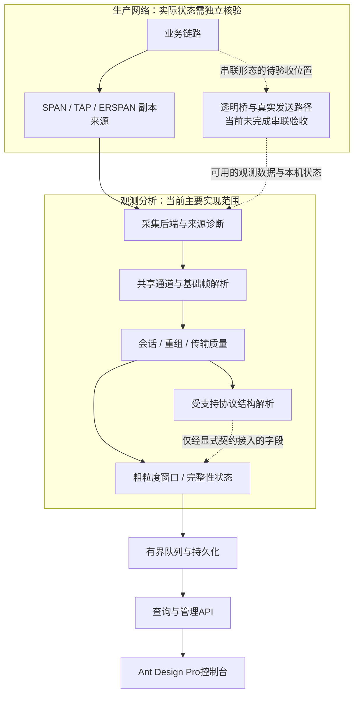

# 防火墙分析识别属性清单：串联透明网关与旁路镜像

版本：1.1

编制日期：2026-10-26

修订日期：2026-10-27

适用范围：网络攻击、内部横向移动与数据泄露分析所需的字段、画像属性、身份关联和证据质量。本文是字段目录；字段名称用于表达统一语义，不声称等同于某一产品的现有接口。

阅读索引：第0节为技术分层、工程映射与实现边界；第1—2节为标记与采集条件；第3—10节为L2—L7及加密协议；第11—12节为IP/ASN和域名站点画像；第13节为目的地IP与域名双识别；第14节为路由器、手机、电脑、IoT/OT等设备类型；第15—16节为主体画像和身份关联；第17—20节为攻击、横向移动、泄露和情报属性；第21—23节为证据、可见性边界和资料。

## 0. 技术层级、工程边界与当前实现

本节将后续属性目录映射到工程职责，不将目录中的字段直接改写为产品已支持能力。
层级编号用于区分组件职责，与后文 L2—L7 的网络协议层号不是同一编号体系。

### 0.1 三条独立链路

| 链路 | 处理对象与职责 | 必须独立保留的状态 | 当前边界 |
| --- | --- | --- | --- |
| 生产转发链路 | 真实业务报文的接收与发送；透明模式下需另有真实桥接与端口状态证据 | 原包接收、提交发送、发送失败、链路状态、旁通状态 | 本仓库现有采集后端不构成透明桥转发器，不能宣称已完成串联闭环 |
| 观测分析链路 | 原包的可用观测或镜像副本，经解析、会话整理和统计形成观察结果 | 来源、截断、解析失败、容量拒绝、时钟异常、分析完成状态 | 已有采集/共享通道/离线分析与粗粒度聚合实现；具体现场覆盖仍需验证 |
| 管理与数据链路 | 服务配置、鉴权、聚合写入/查询、控制台展示与服务健康 | 配置接受、身份、排队、持久化确认、查询结果和服务存活 | 已有部分控制面与本机聚合服务；健康在线不证明转发或分析覆盖完整 |

三条链路的“成功”不能互换：拿到副本不等于原包转发成功；分析出结果不等于业务已被处置；
API 返回接收不等于历史已经持久化；设备在线不等于其处于被验证的业务路径上。

### 0.2 组件职责分层

| 层级 | 主要职责 | 现有代码入口 | 可声明的实现状态 |
| --- | --- | --- | --- |
| T0 观测点与采集 | 获取实际可用报文、接口及采集诊断；区分原始长度与保存长度 | `dataplane/packet-engine/src/backends/`、`capture/` | 有经典PCAP、AF_PACKET、BPF实现；平台与权限验证分别记录，不能互相替代 |
| T1 报文交付与转发能力边界 | 分开表达采集接口和生产发送接口，声明数据有效期 | `dataplane/packet-engine/include/packet_engine/backend.h` | 有收发抽象；当前AF_PACKET/BPF后端的 `tx_burst` 返回 -1，尚无串联转发验收 |
| T2 通道与帧结构解析 | 跨语言数据交付、L2/L3/L4边界检查、错误分类 | `packet-engine/src/channel/`、`packet-engine/src/parser/`、`traffic-engine/src/channel/` | 有共享环与基础解析；未支持、截断、非首片等必须独立表达 |
| T3 会话与传输质量 | 在可见数据范围内维护会话与TCP状态，表达重传/乱序/时差观察 | `traffic-engine/src/flow/`、`session/`、`tcp/`、`reassembly/` | 有实现与测试；缺握手、单向、采集丢失和重组例外不升级为确定网络故障 |
| T4 协议结构解析 | 在可见且受支持的明文结构上提取字段，报告识别/需更多数据/拒绝/异常 | `traffic-engine/src/dpi/` | 有解析器；目录存在不表示每项已支持，加密内层不能由外层标签补造 |
| T5 粗粒度聚合与完整性 | 输出承载计数、TCP质量候选、时间窗与采集状态 | `traffic-engine/src/observability/`、`src/bin/observe.rs` | `cythsec-observe` 已实现；当前输出不提供VPN/应用/域名归因或逐用户画像 |
| T6 持久化与查询 | 严格校验聚合契约，保存/恢复队列，查询已保存窗口 | `services/telemetryd/internal/aggregate/`、`internal/api/` | 有本机有界存储和队列；不是全量属性数据仓库，也不是生产集群存储验收 |
| T7 管理与展示 | 配置、身份、运行信息、真实数据状态及操作反馈 | `services/pkg/controlplane/`、`services/routerd/`、`web/console/` | 有部分鉴权与Pro控制台；routerd当前网络信息API只读，不控制生产路由转发 |

源码核对点：[AF_PACKET发送接口](../dataplane/packet-engine/include/packet_engine/backends/af_packet.h)、
[BPF发送接口](../dataplane/packet-engine/include/packet_engine/backends/bpf_capture.h)、
[routerd当前API](../services/routerd/internal/api/server.go)。

以上路径均相对仓库根。`packet-engine`、`traffic-engine` 的短路径分别属于 `dataplane/`。
独立协议识别目录、规则编译/求值和机器学习原型，不自动视为已接入 T5/T6，更不视为已接入 T1。
任何模块能力必须沿实际调用链和契约核对，不能仅凭存在同名文件、枚举或测试向量认定生产可用。
例如重组模块存在，不代表所有解析器都消费重组结果；当前 `pipeline.rs` 仍保留按方向首个载荷和
`inspect_bytes` 的检查边界，需要逐个入口核对，不能统一表述为全流深度解析。

### 0.3 两种接入形态的架构关系

虚线表示条件关系或未完成的工程接线，不表示已经实现的数据通路。图中不从旁路分析器画回
生产发送路径的控制箭头；收到副本不能赋予旁路生产转发能力。T4解析器与T5聚合器目前具有
各自的调用路径与输出语义，不能因为处在同一个Rust包就假定所有解析字段都会落入聚合存储。

### 0.4 属性目录如何进入实现评审

每项字段至少需要填写以下映射信息；这是开发与验收元数据，不是在现有JSONL里直接增加键。

| 映射项 | 必填内容 |
| --- | --- |
| 语义归属 | 本文节号/字段名、单位、观测点、方向和时间口径 |
| 生产者 | 明确到模块/函数；没有生产者则标为目录需求或待集成 |
| 可用条件 | 明文/双向/完整头部/集成来源等必要条件，与第1节标记一致 |
| 状态表达 | present、unknown、unsupported、suppressed等如何映射到实际契约，不能自行混用不同枚举 |
| 输出与消费者 | 属性字典、内部结构、FlowRecord、聚合DTO和UI分别列出，不能将它们视为同一张表 |
| 版本与证据 | schema/算法/来源版本、正向样本、反向样本、独立裁判以及未核验项 |
| 存储与最小化 | 是否确有保存需求、保存粒度、权限和保留期；敏感字段不因出现在目录就自动持久化 |

现有 `configs/registry/attributes.json`、Rust FlowRecord 与聚合JSONL是不同契约。
当前telemetryd聚合DTO拒绝未知字段，并只接收固定枚举和聚合数值；本文的IP、域名、账号、
设备或画像字段不能直接加入该DTO。新增契约须单独评审、实现生产者和校验器，再由真实API/UI消费。

### 0.5 当前进度与验收口径

- 已验证的采集/分析证据与真实串联转发验收分开记录。现有实时抓包通过，不能补写成透明桥转发通过。
- 基础收发接口中的发送函数尚未实现，必须保持不可用，不得用“分析完成”“命中规则”或“处置意图”替代发送结果。
- `policyd` 的部署模式与规则求值属于管理/表达层；声明某种模式不证明数据面已按该模式运行。
- 采集完整性分为采集端、镜像上游和分析端：本地计数只能证明自身范围，不能证明上游无丢包。
- 已有粗粒度聚合、持久化和查询可以独立推进；生产数据库、高可用和大规模容量必须另有环境与实测证据。
- 现有DPI、TCP重组、FlowRecord中的第三方裁判跳过项继续保留为未核验，不因更新本目录而改写为通过。

工程说明另见 [采集与数据面](../dataplane/README.md)、[聚合持久化契约](observability/persistence.md)、
[管理服务访问认证](development/control-access.md) 与 [CLion验证入口](development/clion.md)。

## 1. 阅读口径与可观测性

### 1.1 两种模式的基础假设

- **串联透明网关**：设备以透明桥接方式位于被观察链路中，分析实际经过该设备的数据。透明串联不等于代理、不等于终止 TLS、不等于已经解密，也不等于能看到全部东西向流量。
- **旁路镜像**：设备通过 SPAN、TAP、ERSPAN 等接收流量副本。仅当镜像包含同一链路的完整双向报文、相同标签和足够报文长度时，协议字段的理论可见性才与串联一致。
- 表内的可见性描述是**数据来源条件**，不是对现场采集完整性、解析器能力或字段一定存在的承诺。两列相同是有意保留：决定可见性的往往是采集位置和加密边界，而不是是否串联。
- “终端代理”指装在终端上的采集代理；“网络代理”指显式代理、反向代理或 TLS 终止点。二者不是同一数据来源。
- 不发起主动扫描、漏洞验证、外部站点访问或业务请求。画像中的登记、路由、证书透明度和情报属性，表示可接入的数据，不表示本次已查询具体对象。

### 1.2 表内标记

| 标记 | 串联透明网关中的含义 | 旁路镜像中的含义 |
| --- | --- | --- |
| 报 | 所在链路的报文或可公开还原的协议字段可见；仍受抓包与解析条件约束 | 相同字段在副本中可见；受镜像范围、截断、丢包和标签保留约束 |
| 算 | 可基于实际可见流量计算或推断；必须保留口径、时间窗和置信度 | 同左；不完整镜像可能造成系统性偏差 |
| 明 | 仅在明文协议、可解析的解密结果，或相关应用明文片段可见时可得 | 同左；有镜像不代表有解密能力 |
| 联 | 仅靠该位置的普通网络流量无法可靠获得；需要表内指定的外部数据 | 同左；允许关联外部日志，但不能改称由镜像直接识别 |
| 本 | 该设备自身确实产生的本地状态、计数或处理记录 | 采集器自身记录；不代表生产链路设备的状态 |
| 报/联、算/联等 | 前项表示可直接得到的有限部分，后项表示补全或确认需要集成 | 同左；具体分界以“条件、来源及解释限制”列为准 |

表中的 `明` 始终是条件性能力。TLS、SSH、SMB 加密、IPsec、VPN 及应用端到端加密的内层字段，只有相应层的明文确实可供分析时才能填写。即使外层 TLS 已终止，内层加密附件、密码压缩包或端到端消息仍可能不可见。

“有证书”或“持有服务器证书私钥”也不等于可以还原任意加密会话；TLS 1.3及采用前向保密密钥交换的会话，不能仅靠证书私钥事后解密。应以真正获得的会话明文、相应会话密钥或终止点日志为准。[RFC 8446：TLS 1.3](https://www.rfc-editor.org/rfc/rfc8446.html)。

### 1.3 每个字段都应携带的解释属性

| 字段 | 类型与含义 | 串联 | 镜像 | 条件、来源及解释限制 |
| --- | --- | --- | --- | --- |
| `meta.field_origin` | 枚举：observed / computed / inferred / integrated / declared | 本 | 本 | 分开表示实际观察、确定计算、推断、外部关联与对象自报 |
| `meta.availability` | 枚举：present / absent / unknown / not_applicable / unavailable | 本 | 本 | 未知、协议未提供、未采集、不可解密不能混为一类 |
| `meta.unavailable_reason` | 枚举或列表：encrypted、not_on_path、truncated、loss、unsupported 等 | 本 | 本 | 不允许将缺字段默认解释为正常或零 |
| `meta.source_ref` | 原始报文、日志、资产记录或情报记录引用 | 本 | 本 | 可回溯到具体来源及版本 |
| `meta.event_time` | 时间：属性对应的事实发生时间 | 报/联 | 报/联 | 报文通常只能给出观测时间；应用事件时间来自应用日志 |
| `meta.observed_at` | 时间：在采集点第一次看到的时间 | 本 | 本 | 与对象实际创建时间分开 |
| `meta.valid_from` | 时间：属性或关联关系有效起点 | 算/联 | 算/联 | 适用于租约、身份、NAT、情报、资产归属 |
| `meta.valid_until` | 时间：属性或关联关系有效终点 | 算/联 | 算/联 | 未提供终点不代表永久有效 |
| `meta.confidence` | 数值或枚举：结论置信度 | 算/联 | 算/联 | 明确尺度及来源，不能把风险分数当置信度 |
| `meta.confidence_basis` | 列表：支持、冲突与缺失证据 | 算/联 | 算/联 | 包括共享地址、镜像缺失、加密等影响 |
| `meta.algorithm_version` | 字符串：解析、统计或推断实现版本 | 本 | 本 | 指纹、模型、分类字典也要可区分版本 |
| `meta.integrity_state` | 枚举：complete / partial / conflicting / unverified | 本/算 | 本/算 | 字段完整性不等同于事件真实性 |

## 2. 采集位置、方向与数据可见性

| 字段 | 类型与含义 | 串联 | 镜像 | 条件、来源及解释限制 |
| --- | --- | --- | --- | --- |
| `capture.sensor_id` | 字符串：采集设备唯一标识 | 本 | 本 | 与资产、终端标识分离 |
| `capture.observation_point_id` | 字符串：观测点标识 | 本/联 | 本/联 | 镜像源端口与采集器接收端口分别记录 |
| `capture.mode` | 枚举：inline_bridge / span / tap / erspan 等 | 本 | 本 | 描述本次记录实际来源 |
| `capture.interface_id` | 字符串：本地抓包接口 | 本 | 本 | 镜像接口不等于业务原始入接口 |
| `capture.original_ingress` | 字符串：业务原入接口 | 本/联 | 报/联 | 镜像需封装元数据或交换机日志；串联只知自身入接口 |
| `capture.original_egress` | 字符串：业务原出接口 | 本/联 | 报/联 | 不能由目的 MAC 直接得到远端交换机出接口 |
| `capture.network_namespace` | 字符串：租户、VRF、VPC 或网络命名空间 | 联 | 联 | 地址可跨租户重叠；需网络配置或平台元数据 |
| `capture.segment_id` | 字符串：网段与安全区域标识 | 联 | 联 | IP 私有/公有属性不能代替组织区域定义 |
| `capture.direction_basis` | 枚举：物理接口、地址范围、协议角色或外部映射 | 本/算 | 本/算 | 区分收发方向与业务上传下载方向 |
| `capture.traffic_scope` | 集合：南北向、东西向、管理、云内、远程接入 | 联 | 联 | 描述已覆盖范围；覆盖范围之外保持未知 |
| `capture.bidirectional_state` | 枚举：双向、仅源方向、仅目的方向、未知 | 算 | 算 | 单向观测不能证明对端没有回复 |
| `capture.asymmetric_routing` | 枚举与证据：疑似或已知路由不对称 | 算/联 | 算/联 | 网络路由日志可确认；缺回包只是线索 |
| `capture.packet_length_wire` | 整数，字节：接口提供的原始报文长度 | 本 | 本 | 是否包含 FCS、VLAN、封装须说明 |
| `capture.packet_length_saved` | 整数，字节：实际捕获长度 | 本 | 本 | 不等同于线速报文长度 |
| `capture.snaplen` | 整数，字节：捕获长度上限 | 本 | 本 | 直接影响 L7 和文件完整性 |
| `capture.truncated` | 布尔：捕获报文是否截断 | 本 | 本 | 上游已截断但未保留原长时可能未知 |
| `capture.sampling_method` | 枚举与参数：无采样、随机、固定比例等 | 本/联 | 本/联 | 流导出采样与原始包采样分开 |
| `capture.drop_count_local` | 整数：采集器本地丢弃计数 | 本 | 本 | 仅覆盖计数器已知的位置 |
| `capture.drop_count_upstream` | 整数：上游交换机、镜像或分流器丢弃计数 | 联 | 联 | 采集器自身无法完整测量上游丢包 |
| `capture.duplicate_packet_count` | 整数：可确认或疑似副本重复数量 | 算 | 算 | 多镜像源可能重复；与 TCP 重传区别 |
| `capture.reorder_extent` | 整数或分布：采集到达乱序程度 | 算 | 算 | 采集乱序不等于终端接收乱序 |
| `capture.timestamp_source` | 枚举：硬件、内核、采集服务或外部设备时间 | 本/联 | 本/联 | 区分业务原时间与副本到达时间 |
| `capture.clock_offset` | 时长与误差：相对参考时钟偏差 | 本/联 | 本/联 | 多源关联必须保留误差范围 |
| `capture.clock_resolution` | 时长：时间戳分辨率 | 本 | 本 | 分辨率高不代表准确度高 |
| `capture.offload_effects` | 列表：GRO、LRO、TSO、校验和卸载等影响 | 本/联 | 本/联 | 主机侧抓包可出现合并包或伪校验异常 |
| `capture.tag_preservation` | 状态：VLAN、MPLS、封装标签保留情况 | 本/联 | 本/联 | SPAN 可能去标签，未见标签不代表原流量无标签 |
| `capture.decrypt_state` | 枚举：未解密、成功、部分成功、失败、不适用 | 本/联 | 本/联 | 标明协议层及实际覆盖的会话片段 |
| `capture.decrypt_source` | 枚举与引用：终止点明文、会话密钥关联、代理日志等 | 联 | 联 | 普通透明桥和原始镜像都不自动具备这些来源 |
| `capture.parser_coverage` | 集合：支持的协议、版本、扩展与限制 | 本 | 本 | 未支持协议要明确标为不可解析 |
| `capture.flow_midstream` | 布尔：会话是否中途开始观测 | 算 | 算 | 缺握手会影响身份、协议角色和计量 |
| `capture.coverage_interval` | 时间区间：连续有效采集时段 | 本/联 | 本/联 | 中断和维护空窗独立表达 |

## 3. L2、地址分配与网络控制协议

### 3.1 以太网、VLAN 与链路身份

| 字段 | 类型与含义 | 串联 | 镜像 | 条件、来源及解释限制 |
| --- | --- | --- | --- | --- |
| `l2.src_mac` | 地址：当前链路源 MAC | 报 | 报 | 跨路由后常为上一跳设备 MAC，不是原始终端 MAC |
| `l2.dst_mac` | 地址：当前链路目的 MAC | 报 | 报 | 可能是下一跳、广播或组播地址 |
| `l2.src_mac_scope` | 枚举：全局管理、本地管理、随机化、未知 | 算 | 算 | 本地管理位不证明设备恶意或真实厂商 |
| `l2.oui_vendor` | 字符串：OUI 登记厂商 | 联 | 联 | 需 OUI 库；不能确认设备型号或所有者 |
| `l2.ethertype` | 整数：EtherType | 报 | 报 | 识别 IPv4、IPv6、ARP 等 |
| `l2.frame_size` | 整数，字节：当前采集口径帧长 | 报 | 报 | 是否含前导码/FCS需声明 |
| `l2.vlan_id` | 整数或数组：单层或多层 VLAN ID | 报 | 报 | 仅限采集时保留的标签 |
| `l2.vlan_pcp` | 整数：802.1Q 优先级 | 报 | 报 | 与业务优先级分类分开 |
| `l2.vlan_dei` | 布尔：丢弃资格标记 | 报 | 报 | 不是实际丢包记录 |
| `l2.qinq_stack` | 数组：外层/内层 TPID 与标签顺序 | 报 | 报 | 不可只保存最后一层 VLAN |
| `l2.broadcast_multicast` | 枚举：单播、广播、组播 | 算 | 算 | 可衍生占比与速率 |
| `l2.fcs_state` | 枚举：正确、错误、未提供 | 报/联 | 报/联 | 多数普通抓包不带 FCS；不可默认可校验 |
| `l2.mac_ip_binding` | 关系：MAC、IP、网段与有效时间 | 算/联 | 算/联 | ARP/DHCP/NDP 观察可建线索；交换机/NAC可增强确认 |
| `l2.mac_move_history` | 关系时序：MAC 出现位置变化 | 算/联 | 算/联 | 需要多点覆盖或交换机日志；不是单点就能定位物理端口 |
| `l2.stp_bridge_id` | 字符串：BPDU 中桥标识 | 报 | 报 | 仅相应控制报文经过或被镜像时 |
| `l2.stp_root_id` | 字符串：宣告根桥标识 | 报 | 报 | 自报拓扑信息；需配置/设备状态确认 |
| `l2.lldp_chassis_id` | 字符串：LLDP 机箱标识 | 报 | 报 | 链路本地协议可能不转发、不镜像 |
| `l2.lldp_port_id` | 字符串：LLDP 端口标识 | 报 | 报 | 设备自报，可伪造 |
| `l2.lldp_system` | 对象：系统名、能力、管理地址 | 报 | 报 | 与 CMDB 真正资产身份分开 |
| `l2.eapol_metadata` | 对象：EAPOL 类型、EAP 方法及可见声明身份 | 报 | 报 | 内层身份可能被隧道保护；认证成功需 AAA/NAC确认 |

### 3.2 ARP、IPv6 邻居发现、DHCP 与名称发现

| 字段 | 类型与含义 | 串联 | 镜像 | 条件、来源及解释限制 |
| --- | --- | --- | --- | --- |
| `arp.opcode` | 整数：请求或响应类型 | 报 | 报 | 仅所在广播域可见 |
| `arp.sender_ip` | IP：发送方协议地址 | 报 | 报 | 声明值，不是身份认证结果 |
| `arp.sender_mac` | MAC：发送方硬件地址 | 报 | 报 | 可与以太网头源 MAC 比较 |
| `arp.target_ip` | IP：目标协议地址 | 报 | 报 | 可累计查询范围 |
| `arp.target_mac` | MAC：目标硬件地址 | 报 | 报 | 请求中可能为未指定值 |
| `arp.gratuitous` | 布尔：免费 ARP 特征 | 算 | 算 | 正常漂移、HA 切换也会出现 |
| `ndp.message_type` | 枚举：RS、RA、NS、NA、Redirect | 报 | 报 | 受所在二层域及镜像范围约束 |
| `ndp.target_address` | IPv6：目标邻居地址 | 报 | 报 | 链路本地地址需附接口/区域 |
| `ndp.link_layer_option` | MAC：源/目标链路层地址选项 | 报 | 报 | 不等于跨路由终端 MAC |
| `ndp.router_flags` | 位集：路由器、管理、有状态配置等标记 | 报 | 报 | 记录原始位与解释 |
| `ndp.prefix_information` | 数组：前缀、长度、有效期、首选期 | 报 | 报 | 是 RA 宣告内容，不证明已应用 |
| `ndp.router_lifetime` | 时长：宣告路由器有效期 | 报 | 报 | 需结合出现时间 |
| `ndp.rdnss` | 数组：宣告 DNS 与搜索域 | 报 | 报 | 可影响域名解析，真实性需额外关联 |
| `dhcp.transaction_id` | 字符串：DHCPv4/v6 事务标识 | 报 | 报 | 与客户端、协议版本一起关联 |
| `dhcp.message_type` | 枚举：发现、请求、应答、释放等 | 报 | 报 | DHCPv4/v6消息语义不同 |
| `dhcp.client_identifier` | 字符串：Client ID、DUID、IAID | 报 | 报 | 不保证永久稳定或唯一 |
| `dhcp.assigned_address` | 地址或前缀：分配结果 | 报/联 | 报/联 | 可见 ACK/Reply 或 DHCP服务器租约日志 |
| `dhcp.server_identifier` | IP或标识：分配服务器 | 报 | 报 | 可与资产登记比较 |
| `dhcp.lease_lifetime` | 时长：租期与续租/重绑定时间 | 报/联 | 报/联 | 只看到请求不能确认租约生效 |
| `dhcp.hostname` | 字符串：声明主机名/FQDN | 报 | 报 | 自报，不是系统实际名称证明 |
| `dhcp.vendor_class` | 字符串：厂商类别 | 报 | 报 | 可伪造，适合作为指纹线索 |
| `dhcp.option_fingerprint` | 数组或散列：参数请求列表与选项顺序 | 算 | 算 | 指纹碰撞存在，不能精确确认 OS |
| `dhcp.network_options` | 对象：网关、DNS、域、MTU 等 | 报 | 报 | 分配值不证明终端实际采用 |
| `dhcp.relay_information` | 对象：giaddr、Option 82、v6 relay 元数据 | 报/联 | 报/联 | 需相关段报文或 DHCP日志；可辅助定位接入点 |
| `discovery.protocol` | 枚举：mDNS、LLMNR、NBNS、SSDP、WS-Discovery | 报 | 报 | 发现流量可能只存在本地广播/组播域 |
| `discovery.query_name` | 字符串：查询名称或服务类型 | 报 | 报 | 不是经过验证的资产名称 |
| `discovery.response_identity` | 对象：响应名、地址、服务/设备声明 | 报 | 报 | 名称投毒与正常设备发现需保留上下文 |
| `discovery.response_competition` | 对象：同查询多响应者及延时 | 算 | 算 | 只表示可见竞争，不能单独确认投毒 |

### 3.3 路由、组播与封装上下文

| 字段 | 类型与含义 | 串联 | 镜像 | 条件、来源及解释限制 |
| --- | --- | --- | --- | --- |
| `routing.protocol_metadata` | 对象：BGP、OSPF、IS-IS、VRRP等可见报文元数据 | 报 | 报 | 普通业务流量无法还原完整路由控制面 |
| `routing.advertised_prefixes` | 数组：路由宣告前缀与属性 | 报/联 | 报/联 | 需控制面报文或路由日志；不是已经安装的转发表 |
| `routing.advertising_peer` | 标识：宣告邻居、Router ID、ASN | 报/联 | 报/联 | 协议支持及配置决定可见性 |
| `routing.multicast_membership` | 关系：IGMP/MLD组、版本、成员报告 | 报 | 报 | 单点不能看到所有成员 |
| `encap.stack` | 数组：外层到内层协议与偏移 | 报 | 报 | 内层加密时只记录到可见边界 |
| `encap.outer_tuple` | 对象：外层源/目的IP、端口、协议 | 报 | 报 | 不可与隧道内终端五元组混淆 |
| `encap.inner_tuple` | 对象：可解析内层五元组 | 报/明 | 报/明 | GRE/VXLAN常可解析；加密VPN需明文或终止点日志 |
| `encap.vni` | 整数：VXLAN/Geneve虚拟网络标识 | 报 | 报 | 租户名称需云/网络平台映射 |
| `encap.geneve_options` | 数组：可见Geneve选项 | 报 | 报 | 私有选项语义可能需外部字典 |
| `encap.gre_key` | 整数：GRE Key及协议类型 | 报 | 报 | 标识语义依设备配置 |
| `encap.mpls_labels` | 数组：MPLS标签、TC、S、TTL | 报 | 报 | 业务归属需控制面或配置 |
| `encap.pppoe_session` | 标识：PPPoE会话ID与阶段 | 报 | 报 | 真实用户需接入认证/AAA日志 |
| `encap.ipsec_spi` | 整数：ESP/AH SPI与序列元数据 | 报 | 报 | 不提供ESP加密内层明文 |
| `encap.ike_metadata` | 对象：可见IKE版本、交换类型、提议 | 报 | 报 | 认证身份可能加密；协商完整结果需终止点日志 |
| `encap.vpn_type` | 枚举与置信度：IPsec、WireGuard、OpenVPN等 | 算/联 | 算/联 | 非标准端口和混淆可致误识别；不能凭UDP端口断言 |
| `encap.proxy_tunnel_target` | 地址：CONNECT、SOCKS等宣告目标 | 明 | 明 | 加密代理外层未解密时不可读；目标声明不是实际访问证明 |

## 4. L3 与 L4 报文属性

### 4.1 IPv4、IPv6 与 ICMP

| 字段 | 类型与含义 | 串联 | 镜像 | 条件、来源及解释限制 |
| --- | --- | --- | --- | --- |
| `ip.version` | 整数：4或6 | 报 | 报 | 内外层分别记录 |
| `ip.src` | IP：当前层源地址 | 报 | 报 | 可能伪造、NAT后地址或代理地址 |
| `ip.dst` | IP：当前层目的地址 | 报 | 报 | 不自动等于业务源站 |
| `ip.address_scope` | 枚举：私有、全局、回环、链路本地、组播等 | 算 | 算 | 组织内外属性需组织地址范围 |
| `ip.protocol` | 整数：IPv4 Protocol或IPv6最终Next Header | 报 | 报 | 扩展头链与最终上层协议分开 |
| `ip.total_length` | 整数，字节：IP报文长度 | 报 | 报 | 与L2长度、应用净载荷不同 |
| `ip.header_length` | 整数，字节：IP首部及扩展长度 | 报 | 报 | 需解析完整扩展头 |
| `ip.ttl_hop_limit` | 整数：TTL或Hop Limit | 报 | 报 | 观测值，不是原始初始值 |
| `ip.dscp` | 整数：DSCP | 报 | 报 | 可被中间设备改写 |
| `ip.ecn` | 整数：ECN标记 | 报 | 报 | 不等同于真实拥塞量 |
| `ip.checksum_state` | 枚举：IPv4首部校验状态 | 报 | 报 | IPv6无同类首部校验和；考虑采集卸载影响 |
| `ipv4.identification` | 整数：IPv4 ID | 报 | 报 | 不能单独稳定跟踪用户或主机 |
| `ipv4.fragment_flags` | 位集：DF、MF等 | 报 | 报 | 原始位与重组结论分别保存 |
| `ipv4.fragment_offset` | 整数：分片偏移 | 报 | 报 | 非首片可能没有端口 |
| `ipv4.options` | 数组：选项类型、长度、可见内容摘要 | 报 | 报 | 路由记录类内容不是完整路径真相 |
| `ipv6.flow_label` | 整数：Flow Label | 报 | 报 | 不保证全局唯一或跨连接稳定 |
| `ipv6.extension_chain` | 数组：逐跳、路由、目的选项、分片等顺序 | 报 | 报 | 未支持扩展可能阻断后续解析 |
| `ipv6.fragment_id` | 整数：IPv6分片标识 | 报 | 报 | 重组需完整相关分片 |
| `ip.reassembly_state` | 枚举：完整、缺片、重叠、超时、拒绝解析 | 算 | 算 | 缺片可能由采集丢失造成 |
| `ip.fragment_overlap` | 对象：重叠范围、冲突字节摘要 | 算 | 算 | 不同终端重组行为可能不同 |
| `ip.observed_hop_estimate` | 整数与置信度：基于TTL的跳数估计 | 算 | 算 | 初始TTL未知，不是路径追踪结果 |
| `icmp.type` | 整数：ICMP/ICMPv6类型 | 报 | 报 | 两个版本分别解释 |
| `icmp.code` | 整数：错误或状态码 | 报 | 报 | 错误宣告可被伪造 |
| `icmp.echo_identifier` | 整数：回显标识 | 报 | 报 | 仅相应消息存在 |
| `icmp.echo_sequence` | 整数：回显序列 | 报 | 报 | 可计算间隔、重排、匹配 |
| `icmp.quoted_tuple` | 对象：错误消息引用的原始报文五元组 | 报 | 报 | 引用部分可能短缺、伪造或已NAT转换 |
| `icmp.advertised_mtu` | 整数，字节：路径MTU相关消息宣告值 | 报 | 报 | 不直接证明全路径真实可用MTU |
| `icmp.payload_features` | 对象：长度、摘要、字节分布 | 报/算 | 报/算 | 高熵或大负载只是特征，不自动等于隧道 |

### 4.2 TCP、UDP 与其他传输协议

| 字段 | 类型与含义 | 串联 | 镜像 | 条件、来源及解释限制 |
| --- | --- | --- | --- | --- |
| `transport.src_port` | 整数：源端口 | 报 | 报 | 与源IP及网络命名空间一起解释 |
| `transport.dst_port` | 整数：目的端口 | 报 | 报 | 端口登记用途不是实际应用证明 |
| `transport.checksum_state` | 枚举：正确、错误、未验证、不适用 | 报 | 报 | 注意伪首部、分片及卸载影响 |
| `tcp.flags` | 位集：SYN、ACK、FIN、RST、PSH、URG、ECE、CWR等 | 报 | 报 | 保留原始组合 |
| `tcp.sequence` | 整数：序列号 | 报 | 报 | 原始值与相对值区分 |
| `tcp.acknowledgment` | 整数：确认号 | 报 | 报 | 只证明报文宣告，不保证应用已读取 |
| `tcp.header_length` | 整数：TCP头长度 | 报 | 报 | 与选项完整性关联 |
| `tcp.window_raw` | 整数：原始接收窗口 | 报 | 报 | 未见SYN时缩放因子可能未知 |
| `tcp.window_scale` | 整数：窗口缩放因子 | 报 | 报 | 仅对应握手选项可见时 |
| `tcp.window_effective` | 整数，字节：有效接收窗口 | 算 | 算 | 需确认该方向缩放因子 |
| `tcp.mss` | 整数，字节：宣告MSS | 报 | 报 | 不是路径实际MTU |
| `tcp.sack_permitted` | 布尔：是否宣告SACK支持 | 报 | 报 | 不代表后续一定使用 |
| `tcp.sack_blocks` | 数组：SACK确认区间 | 报 | 报 | 可辅助分析缺口，不能消除采集盲区 |
| `tcp.timestamp_options` | 对象：TSval、TSecr | 报 | 报 | 时钟速率、启动时间只能估计 |
| `tcp.options_order` | 数组：选项类型、顺序、未知选项 | 报 | 报 | 被动OS/栈指纹输入，可被中间盒改变 |
| `tcp.urgent_pointer` | 整数：紧急指针 | 报 | 报 | 仅按协议语义解释 |
| `tcp.payload_length` | 整数，字节：当前段有效负载长度 | 报 | 报 | 重传段不能重复计入净数据 |
| `tcp.retransmission_observed` | 计数与区间：疑似重传 | 算 | 算 | 镜像重复、丢包与重传需区分；不可直接当终端真实丢包率 |
| `tcp.duplicate_ack_count` | 整数：可见重复ACK数 | 算 | 算 | 需要ACK方向覆盖 |
| `tcp.out_of_order_count` | 整数：可见乱序段数 | 算 | 算 | 含采集链路引入的乱序可能 |
| `tcp.zero_window_events` | 数量与持续时间：零窗口事件 | 算 | 算 | 对端宣告的接收窗口状态 |
| `tcp.reset_origin` | 枚举与证据：观察到RST的方向 | 算 | 算 | 源地址可能伪造；不能直接归因某设备主动阻断 |
| `tcp.stream_gap_bytes` | 整数，字节：重组流中的可见缺口 | 算 | 算 | 不等于已确认生产链路实际丢失字节 |
| `tcp.stream_overlap_conflict` | 对象：重叠段内容冲突 | 算 | 算 | 保留双方内容摘要与解析选择 |
| `udp.length` | 整数，字节：UDP长度 | 报 | 报 | 分片、截断时须标明可用范围 |
| `udp.transaction_match` | 关系与置信度：应用请求/响应匹配 | 算 | 算 | UDP没有TCP式建立/关闭，需应用语义 |
| `sctp.association_metadata` | 对象：端口、验证标签、chunk类型、流ID | 报 | 报 | 相应协议存在且解析器支持时 |
| `transport.unknown_protocol` | 对象：协议号、载荷长度与摘要 | 报/算 | 报/算 | “未知”不是恶意分类 |

## 5. 会话、计量与时序行为

会话的字节口径必须区分链路字节、IP字节、传输载荷、去重后的流字节和应用实体字节；这些数值不能互换。连接日志中也存在不同层的字节计数与未捕获字节概念，可参照 [Zeek conn.log字段说明](https://docs.zeek.org/en/master/reference/logs/conn.html)。

| 字段 | 类型与含义 | 串联 | 镜像 | 条件、来源及解释限制 |
| --- | --- | --- | --- | --- |
| `flow.id` | 字符串：本次观测内唯一会话ID | 本 | 本 | 不是跨设备或跨重启天然统一ID |
| `flow.community_id` | 字符串：规范化流关联散列 | 算 | 算 | 保留算法、seed与方向约定；NAT两侧不一定相同 |
| `flow.tuple` | 对象：地址、端口、协议及网络上下文 | 报 | 报 | 五元组可能被复用；需会话起止时间 |
| `flow.initiator` | 端点与置信度：发起者 | 算 | 算 | 未见握手时可能未知；不能只按端口高低判断 |
| `flow.responder` | 端点与置信度：响应者 | 算 | 算 | 与上传接收方、攻击受害者分开 |
| `flow.direction` | 枚举：入站、出站、内部、跨区、未知 | 算/联 | 算/联 | 依赖组织地址、区域和NAT上下文 |
| `flow.first_seen` | 时间：首包观测时间 | 本 | 本 | 非真正连接创建时间的保证 |
| `flow.last_seen` | 时间：末包观测时间 | 本 | 本 | 不等于终端关闭时间 |
| `flow.observed_duration` | 时长：可见起止差 | 算 | 算 | 中途采集或超时会低估 |
| `flow.start_reason` | 枚举：握手、首包、中途恢复、外部日志 | 算/联 | 算/联 | 解释会话完整性 |
| `flow.end_reason` | 枚举：FIN、RST、空闲超时、采集停止、未知 | 算 | 算 | 超时只是本地会话记录结束 |
| `flow.state` | 枚举：未完成握手、已建立、关闭、拒绝推断等 | 算 | 算 | 双向覆盖不足时降低确定性 |
| `flow.handshake_complete` | 布尔或未知：可见TCP握手是否完整 | 算 | 算 | 不等于TLS握手或业务成功 |
| `flow.packets_src` | 整数：源方向可见包数 | 算 | 算 | 去重前后口径明确 |
| `flow.packets_dst` | 整数：目的方向可见包数 | 算 | 算 | 单向不可见不能填写真实零 |
| `flow.bytes_l2_src` | 整数，字节：源方向链路字节 | 算 | 算 | FCS/封装等计入方式明确 |
| `flow.bytes_l2_dst` | 整数，字节：目的方向链路字节 | 算 | 算 | 不是业务下载净字节 |
| `flow.bytes_ip_src` | 整数，字节：源方向IP层字节 | 算 | 算 | 包含IP头与可能的重传 |
| `flow.bytes_ip_dst` | 整数，字节：目的方向IP层字节 | 算 | 算 | 内外层分别计量 |
| `flow.bytes_stream_src` | 整数，字节：源方向重组去重载荷 | 算 | 算 | 缺口、截断和估计值单独标识 |
| `flow.bytes_stream_dst` | 整数，字节：目的方向重组去重载荷 | 算 | 算 | 密文载荷仍不是文件明文字节 |
| `flow.bytes_application` | 整数，字节：应用实体净字节 | 明 | 明 | 需完整应用解析；压缩前后分别记录 |
| `flow.rate_series` | 时间序列：包速率、字节速率 | 算 | 算 | 附窗口宽度、采样和缺失范围 |
| `flow.packet_size_distribution` | 分布：按方向包长统计 | 算 | 算 | 封装、MTU和卸载影响显著 |
| `flow.interarrival_distribution` | 分布：包间隔及方向切换间隔 | 算 | 算 | 副本延迟与批量上送会改变时序 |
| `flow.burst_features` | 对象：突发长度、间隔、峰值、持续时长 | 算 | 算 | 附定义与时间分辨率 |
| `flow.idle_active_intervals` | 数组：活跃期与空闲期 | 算 | 算 | 空闲判定口径明确 |
| `flow.rtt_estimate` | 时长分布与方法：TCP或其他可用RTT估计 | 算 | 算 | 采集点位置、重传、单向和ACK机制影响；不是业务耗时 |
| `flow.application_latency` | 时长：可匹配请求至响应的观测间隔 | 明/算 | 明/算 | 需协议事务；不是服务器内部执行耗时 |
| `flow.jitter` | 时长分布：选定间隔或RTT波动 | 算 | 算 | 明确针对何种时间序列 |
| `flow.bytes_ratio` | 比值：双方向字节比例 | 算 | 算 | 分母为零与不可见分开；不能直接解释为泄密 |
| `flow.request_response_ratio` | 比值：请求/响应数量或大小比例 | 明/算 | 明/算 | 需可靠事务解析 |
| `flow.concurrent_count` | 整数：对象在时间窗内并发会话数 | 算 | 算 | 不是终端系统级真实socket数 |
| `flow.new_connection_rate` | 数值：单位时间新连接数 | 算 | 算 | 中途采集的首包不能全算真实新建 |
| `flow.failed_connection_rate` | 比例与原因：可见失败/超时 | 算 | 算 | 无响应不等于服务拒绝，需保留采集缺失 |
| `flow.fanout_hosts` | 整数：时间窗内不同目标数 | 算 | 算 | 目标键应含网络命名空间 |
| `flow.fanout_ports` | 整数：时间窗内不同目标端口数 | 算 | 算 | 扫描特征输入，不是扫描定性 |
| `flow.fanin_sources` | 整数：目标收到的不同来源数 | 算 | 算 | NAT/代理可能压缩或放大来源计数 |
| `flow.periodicity` | 对象：主周期、抖动、覆盖与置信度 | 算 | 算 | 定时更新、监控与C2可能相似 |
| `flow.retry_pattern` | 对象：重试间隔、退避、目标轮换 | 算 | 算 | 不等同于恶意自动化 |
| `flow.activity_calendar` | 分布：时段、星期、节假日活动 | 算/联 | 算/联 | 用户所在地、班次与节假日表需外部数据 |
| `flow.first_seen_relation` | 关系：对象对、首次/最近通信时间 | 算 | 算 | “本地首次”不等于全球首次或新注册 |
| `flow.baseline_deviation` | 数值与参照：相对自身/同群历史偏离 | 算/联 | 算/联 | 附基线窗、群体、缺失与算法；不在本文定义判定阈值 |

## 6. DNS、解析链与加密 DNS

普通 DNS 字段在明文 DNS、可解析的解密结果或解析器日志中可得。DoH把查询与响应放入HTTPS交换；未解密时不能直接看到查询名。[RFC 8484：DNS over HTTPS](https://www.rfc-editor.org/rfc/rfc8484.html)。SVCB/HTTPS中的服务优先级、目标名、ALPN、端口与地址提示是服务发现信息，不能当作已完成的连接结果。[RFC 9460：SVCB与HTTPS记录](https://www.rfc-editor.org/rfc/rfc9460.html)。

| 字段 | 类型与含义 | 串联 | 镜像 | 条件、来源及解释限制 |
| --- | --- | --- | --- | --- |
| `dns.transport` | 枚举：UDP、TCP、DoT、DoH、DoQ、未知 | 报/算 | 报/算 | 加密DNS精确类型可能需终止点确认；端口仅为线索 |
| `dns.client_endpoint` | 端点：当前请求发送者 | 报 | 报 | 可能是递归解析器，不是原始用户 |
| `dns.resolver_endpoint` | 端点：当前解析服务端 | 报 | 报 | 可见连接对象，不等于最终权威服务器 |
| `dns.transaction_id` | 整数：DNS事务ID | 明 | 明 | 与连接、查询名、类型、时间一起匹配 |
| `dns.query_name_raw` | 字符串：原始查询名 | 明 | 明 | 保留大小写、转义和原始字节可用性 |
| `dns.query_name_normalized` | 字符串：规范化FQDN | 明/算 | 明/算 | IDNA和尾点规范化可追溯 |
| `dns.query_type` | 整数：A、AAAA、TXT、MX、SRV、HTTPS等 | 明 | 明 | 保存未知类型编号 |
| `dns.query_class` | 整数：查询类别 | 明 | 明 | 不默认全部为IN |
| `dns.opcode` | 整数：操作码 | 明 | 明 | 普通查询、更新等分别解释 |
| `dns.flags` | 位集：QR、AA、TC、RD、RA、AD、CD等 | 明 | 明 | AD是解析器宣告，不是采集器完成DNSSEC验证 |
| `dns.rcode` | 整数：应答码及扩展码 | 明 | 明 | NXDOMAIN与超时、拒绝、无数据分开 |
| `dns.answers` | 数组：应答RR名称、类型、值 | 明 | 明 | 解析到地址不等于实际访问 |
| `dns.authority_records` | 数组：权威段记录 | 明 | 明 | 需区分响应中的宣告与可信登记信息 |
| `dns.additional_records` | 数组：附加段记录 | 明 | 明 | 可含地址提示或EDNS，不代表均可信 |
| `dns.ttl` | 时长或数组：每条记录TTL | 明 | 明 | 观察TTL可能已递减；不等于权威原始TTL |
| `dns.cname_chain` | 有向链：CNAME与后续解析 | 明/算 | 明/算 | 链不完整时标注缺口 |
| `dns.response_size` | 整数，字节：DNS消息大小 | 明 | 明 | 与IP包长分开 |
| `dns.response_latency` | 时长：匹配查询至响应间隔 | 明/算 | 明/算 | 是观测点间隔，不是完整递归计算时间 |
| `dns.retry_count` | 整数：同查询可见重试数 | 明/算 | 明/算 | 缓存和并行查询影响解释 |
| `dns.tcp_fallback` | 布尔与关系：UDP截断后TCP查询 | 明/算 | 明/算 | 需同时观察相关事务 |
| `dns.edns_udp_size` | 整数，字节：EDNS宣告UDP大小 | 明 | 明 | 不是实际可用路径MTU |
| `dns.edns_do` | 布尔：DNSSEC OK请求位 | 明 | 明 | 请求DNSSEC记录不代表验证成功 |
| `dns.edns_client_subnet` | 前缀：ECS地址族、前缀长、值 | 明 | 明 | 可能只是聚合前缀，不能定位真实用户 |
| `dns.dnssec_records` | 数组：RRSIG、DNSKEY、DS、NSEC等 | 明 | 明 | 记录存在不等于信任链有效 |
| `dns.dnssec_validation` | 枚举：有效、无效、未验证及原因 | 明/联 | 明/联 | 需验证器、信任锚和时间；也可接解析器验证日志 |
| `dns.svcb_priority` | 整数：SVCB/HTTPS优先级 | 明 | 明 | 区分AliasMode和ServiceMode |
| `dns.svcb_target` | 域名：SVCB/HTTPS目标名 | 明 | 明 | 服务目标可能与原始站点不同 |
| `dns.svcb_params` | 对象：mandatory、alpn、port、ipv4hint、ipv6hint等 | 明 | 明 | 提示不是实际选择；未知键保留编号 |
| `dns.ech_config_advertised` | 对象：可见ECH配置存在性、ID和摘要 | 明 | 明 | 公布配置不代表客户端使用，更不代表ECH成功 |
| `dns.name_length_features` | 对象：总长、标签数、最长标签长 | 明/算 | 明/算 | DGA/隧道分析输入，不是恶意证明 |
| `dns.name_character_features` | 对象：字符集、熵、数字占比、编码特征 | 明/算 | 明/算 | CDN、追踪、验证域名也可能高熵 |
| `dns.qname_uniqueness` | 数值：时间窗内不同名称及唯一比例 | 明/算 | 明/算 | 附统计对象、窗口及采集覆盖 |
| `dns.nxdomain_ratio` | 比例：匹配查询中的NXDOMAIN占比 | 明/算 | 明/算 | 无响应不可直接算NXDOMAIN |
| `dns.answer_churn` | 对象：地址轮换、TTL分布、ASN分散度 | 明/算/联 | 明/算/联 | ASN需外部库；动态CDN可能具有相似特征 |
| `dns.query_connection_relation` | 关系：查询名、应答地址与后续连接 | 算/联 | 算/联 | 受缓存、共享解析、代理、多域同IP影响；不是确定访问域名 |
| `dns.original_client` | 终端/身份：递归解析背后的原始客户端 | 联 | 联 | 需客户端段DNS、解析器查询日志、EDR或终端代理 |
| `dns.encrypted_query_content` | 对象：DoH/DoT/DoQ内查询与应答 | 联/明 | 联/明 | 明文须真实可得；否则需解析器/终端日志，不由密文恢复 |
| `dns.resolver_policy_result` | 枚举与引用：解析服务实际处理结果 | 联 | 联 | DNS服务日志；流量返回某地址不自动证明命中某处理逻辑 |

## 7. TLS、证书与加密边界

TLS 1.3在ServerHello之后保护大部分握手内容，包括服务端证书与协商出的ALPN；客户端“提供的ALPN”与服务端“选中的ALPN”不能混用。[RFC 8446：TLS 1.3](https://www.rfc-editor.org/rfc/rfc8446.html)。ECH保护ClientHelloInner中的真实SNI及其他敏感信息；外层字段与ECH扩展存在性不能证明真实站点或ECH成功。[RFC 9849：Encrypted Client Hello](https://www.rfc-editor.org/rfc/rfc9849.html)。

### 7.1 握手和指纹

| 字段 | 类型与含义 | 串联 | 镜像 | 条件、来源及解释限制 |
| --- | --- | --- | --- | --- |
| `tls.record_metadata` | 对象：可见记录类型、版本、长度、方向 | 报 | 报 | 记录层legacy版本不等于协商TLS版本；QUIC不使用TLS记录层 |
| `tls.client_hello_seen` | 布尔：是否观察到可解析ClientHello | 报/算 | 报/算 | 缺失可能是中途采集或丢包 |
| `tls.offered_versions` | 数组：客户端提供版本 | 报 | 报 | ECH下标明outer可见范围 |
| `tls.negotiated_version` | 版本：ServerHello选择版本 | 报 | 报 | 必须正确处理supported_versions，不能只看legacy字段 |
| `tls.offered_cipher_suites` | 数组：客户端套件与顺序 | 报 | 报 | 标明GREASE、outer及版本语义 |
| `tls.selected_cipher_suite` | 整数或名称：服务端所选套件 | 报 | 报 | 所选套件不等同于应用安全性结论 |
| `tls.client_extensions` | 数组：可见扩展类型、长度、顺序 | 报 | 报 | ECH隐藏内层；未知扩展保留编号 |
| `tls.supported_groups` | 数组：客户端支持组 | 报 | 报 | 仅支持声明，不代表最终选择 |
| `tls.signature_algorithms` | 数组：客户端签名算法声明 | 报 | 报 | 不等于证书实际签名算法 |
| `tls.key_share_groups` | 数组：可见key_share组标识 | 报 | 报 | 不保存私钥或会话密钥为普通画像属性 |
| `tls.sni_visible` | 域名：当前可见ClientHello中的SNI | 报 | 报 | ECH时可能只是outer公共名称；不必然真实业务域名 |
| `tls.sni_context` | 枚举：ordinary / ech_outer / decrypted_inner / unknown | 算/联 | 算/联 | 普通流量无法可靠辨认所有GREASE/真实ECH情形 |
| `tls.sni_true` | 域名：确认的内层真实SNI | 联/明 | 联/明 | 需终止点、终端或实际可解析inner；外层名称不能代替 |
| `tls.alpn_offered_visible` | 数组：客户端当前可见ALPN列表 | 报 | 报 | ECH内层真实提供列表可能不可见 |
| `tls.alpn_selected` | 字符串：服务端选择ALPN | 报/明 | 报/明 | TLS1.2通常握手可见；TLS1.3需解密或终止点日志 |
| `tls.ech_extension_present` | 布尔：可见ECH扩展 | 报 | 报 | 可能为GREASE；不等于真实启用或接受 |
| `tls.ech_config_id` | 整数：扩展中可见配置ID | 报 | 报 | 不提供inner内容或业务身份 |
| `tls.ech_acceptance` | 枚举：accepted / rejected / unknown | 联/明 | 联/明 | 普通旁观者不能仅凭扩展存在确定；需端点证据 |
| `tls.hello_retry_request` | 对象：是否出现与可见请求参数 | 报 | 报 | ECH接受确认仍不可简单断言 |
| `tls.psk_offered` | 布尔：可见PSK相关扩展声明 | 报 | 报 | ECH下仅outer所见；声明不代表恢复成功 |
| `tls.psk_selected` | 状态：可见ServerHello中的PSK选择 | 报 | 报 | 完整业务会话成功仍需额外证据 |
| `tls.early_data_offered` | 布尔：可见0-RTT提供声明 | 报 | 报 | 被ECH隐藏时不可知 |
| `tls.early_data_accepted` | 状态：0-RTT实际接受 | 明/联 | 明/联 | TLS1.3相应服务端扩展受保护 |
| `tls.handshake_outcome` | 状态与依据：已确认、推断、失败、未知 | 算/明/联 | 算/明/联 | 密文往返不能当作已验证Finished或业务成功 |
| `tls.alert` | 对象：告警级别、代码与方向 | 报/明 | 报/明 | 仅未加密告警或已解密内容可读 |
| `tls.handshake_timing` | 对象：可见各阶段时间差 | 算 | 算 | 不能补齐不可见握手内部阶段 |
| `tls.client_fingerprint` | 字符串：JA3、JA4或其他客户端指纹 | 算 | 算 | 附算法/版本/输入范围；ECH、随机化、代理与碰撞影响身份 |
| `tls.server_fingerprint` | 字符串：服务端可见握手指纹 | 算 | 算 | 区分ServerHello指纹与需要证书/解密的扩展指纹 |
| `tls.fingerprint_identity_claim` | 类别与置信度：应用/库/工具推断 | 算/联 | 算/联 | 指纹不能直接确定具体进程、恶意家族或用户 |

### 7.2 证书、PKI 与终端验证结果

下列 `cert.*` 的 `明` 包括可见的初始完整TLS1.2证书握手或真正解密得到的证书；TLS1.3证书默认不对普通流量分析器公开，恢复握手也可能不重发证书。外部CT/PKI查询得到的证书必须标为集成记录，不能冒充本次连接所用证书。

| 字段 | 类型与含义 | 串联 | 镜像 | 条件、来源及解释限制 |
| --- | --- | --- | --- | --- |
| `cert.chain_presented` | 数组：本次连接实际提供的证书链 | 明/联 | 明/联 | 与外部推测或补齐的链分开 |
| `cert.leaf_sha256` | 散列：叶证书DER摘要 | 明/联 | 明/联 | 须指明来源是本次握手还是外部记录 |
| `cert.spki_sha256` | 散列：公钥SPKI摘要 | 明/联 | 明/联 | 同公钥可跨证书复用，不代表同运营主体 |
| `cert.subject` | 结构：Subject名称 | 明/联 | 明/联 | 证书字段不是企业实际运营身份确认 |
| `cert.issuer` | 结构：Issuer名称 | 明/联 | 明/联 | 文字同名不代表同一CA密钥 |
| `cert.serial_number` | 字符串：序列号 | 明/联 | 明/联 | 与签发者一起解释 |
| `cert.san` | 数组：DNS/IP等SAN | 明/联 | 明/联 | 多域、通配符证书不能证明实际访问每个域 |
| `cert.not_before` | 时间：有效期起点 | 明/联 | 明/联 | 不是站点上线或域名创建时间 |
| `cert.not_after` | 时间：有效期终点 | 明/联 | 明/联 | 是否过期依赖观测时间及准确时钟 |
| `cert.public_key_parameters` | 对象：算法、位长/曲线 | 明/联 | 明/联 | 与TLS协商组分开 |
| `cert.signature_algorithm` | 字符串：证书签名算法 | 明/联 | 明/联 | 不是TLS记录加密算法 |
| `cert.extensions` | 对象：KeyUsage、EKU、BasicConstraints等 | 明/联 | 明/联 | 保存未知或解析失败扩展状态 |
| `cert.self_signed_state` | 枚举：验证为自签名、仅自颁发、非自签、未知 | 明/算 | 明/算 | Subject=Issuer只说明自颁发，需验签才能确认自签名 |
| `cert.name_match` | 状态：对指定参考名的匹配结果 | 明/算/联 | 明/算/联 | 参考名必须说明；未知真实SNI不能宣称真实站点匹配 |
| `cert.chain_validation_local` | 对象：基于分析器信任库的验证结果 | 明/算/联 | 明/算/联 | 与终端信任库、吊销设置不同；不是终端接受结论 |
| `cert.revocation_evidence` | 对象：OCSP/CRL来源、状态、时效 | 明/联 | 明/联 | 没看到吊销检查不能判断未吊销；缺证据为未知 |
| `cert.ct_evidence` | 对象：SCT、CT日志条目及时间 | 明/联 | 明/联 | CT记录不证明站点当前可达或本次使用该证书 |
| `cert.client_identity` | 对象：可见客户端证书与映射身份 | 明/联 | 明/联 | TLS1.3客户端证书受保护；用户映射依赖PKI/IAM |
| `tls.endpoint_validation_result` | 状态：终端实际证书校验、信任或固定证书结果 | 联 | 联 | 需浏览器、应用、终端代理或终止点日志 |
| `tls.interception_context` | 对象：是否代理终止、原始/替换证书关联 | 联 | 联 | 需网络代理记录；不能从单侧替换证书恢复原始链 |

## 8. QUIC、HTTP/3 与不可见的传输状态

QUIC Initial的保护密钥可按公开参数派生，支持相应版本的分析器可还原Initial中的CRYPTO片段并重组可见ClientHello；这不提供Handshake、0-RTT、1-RTT业务密钥。[RFC 9001：QUIC与TLS](https://www.rfc-editor.org/rfc/rfc9001.html)。QUIC连接可以更换地址和CID，短首部CID长度依赖上下文，spin bit也可能不启用；普通被动采集不能得到完整的ACK、流和迁移状态。[RFC 9312：QUIC可管理性](https://www.rfc-editor.org/rfc/rfc9312.html)。

| 字段 | 类型与含义 | 串联 | 镜像 | 条件、来源及解释限制 |
| --- | --- | --- | --- | --- |
| `quic.detected_version` | 整数：长首部版本号 | 报 | 报 | 未知版本可能只能识别不变首部，不能假定v1解析适用 |
| `quic.version_negotiation` | 数组：可见版本协商列表 | 报 | 报 | 宣告列表不等于最终协商版本 |
| `quic.long_header_type` | 枚举：Initial、0-RTT、Handshake、Retry等 | 报 | 报 | 类型解释依协议版本；0-RTT内容仍加密 |
| `quic.scid` | 字节串：长首部源CID | 报 | 报 | 不是稳定终端标识，允许变化或零长度 |
| `quic.dcid` | 字节串：目的CID | 报 | 报 | 短首部需已知长度；中途采集可能无法分割 |
| `quic.initial_token_metadata` | 对象：token存在、长度、摘要 | 报 | 报 | token内部语义通常不可直接解析 |
| `quic.retry_metadata` | 对象：Retry次数、CID变化、完整性校验状态 | 报/算 | 报/算 | 公开完整性机制不等同服务端身份认证 |
| `quic.initial_decode_state` | 状态：公开派生Initial解析与CRYPTO重组结果 | 算 | 算 | 丢包、版本不支持、缺首包或状态丢失会失败 |
| `quic.initial_tls_metadata` | 对象：Initial中可见TLS Hello字段 | 报/算 | 报/算 | 适用TLS章节的ECH/outer限制；不代表看到真实inner |
| `quic.client_transport_params` | 对象：客户端可见传输参数 | 报/算 | 报/算 | 只限已重组ClientHello中可见部分，标注ECH影响 |
| `quic.server_transport_params` | 对象：服务端传输参数 | 明/联 | 明/联 | 通常在受保护握手中；客户端宣告不能代替服务端值 |
| `quic.spin_bit_series` | 时间序列：可见spin bit变化 | 报/算 | 报/算 | 可禁用或随机化；固定值不能当作零RTT |
| `quic.rtt_spin_estimate` | 时长与置信度：spin估计RTT | 算 | 算 | 仅在适用版本、方向与行为满足条件时 |
| `quic.observed_udp_volume` | 对象：双方向UDP字节、包长、间隔 | 算 | 算 | 不等于流级应用数据、ACK数或重传净字节 |
| `quic.connection_link_candidates` | 关系：跨五元组可能同连接 | 算/联 | 算/联 | CID复用、轮换、零CID使关联不确定；需端点日志确认 |
| `quic.cid_rotation_confirmed` | 关系：确认的CID发行、轮换与退休 | 明/联 | 明/联 | NEW_CONNECTION_ID等帧受保护；普通包不能完整还原 |
| `quic.path_validation` | 对象：PATH_CHALLENGE/RESPONSE与迁移确认 | 明/联 | 明/联 | 可见地址变化只是候选，不等于路径验证完成 |
| `quic.ack_loss_state` | 对象：ACK范围、丢包恢复与拥塞状态 | 明/联 | 明/联 | 普通1-RTT密文不可直接获得；端点qlog等可提供 |
| `quic.stream_metadata` | 对象：stream ID、偏移、FIN、流控 | 明/联 | 明/联 | 内层帧需相应会话解密或端点日志 |
| `quic.close_reason` | 对象：关闭码与原因 | 明/联 | 明/联 | 不能把UDP静默超时解释为协议关闭码 |
| `http3.alpn_confirmed` | 字符串：确认的h3协商结果 | 明/联 | 明/联 | 客户端提供h3不证明服务端选中h3 |
| `http3.transaction` | 对象：QPACK解码后的请求/响应字段 | 明/联 | 明/联 | 需业务解密、流重组和完整QPACK状态；不能由UDP元数据恢复 |

## 9. Web、API、文件与应用层语义

### 9.1 HTTP通用字段

这些字段要求应用明文和相应版本解析状态可用；HTTP/2还需要帧及HPACK状态，HTTP/3还需要QUIC流和QPACK状态。请求目标、Host/authority、表示内容与传输大小应分别表达，可参照 [RFC 9110：HTTP语义](https://www.rfc-editor.org/rfc/rfc9110.html)。

| 字段 | 类型与含义 | 串联 | 镜像 | 条件、来源及解释限制 |
| --- | --- | --- | --- | --- |
| `app.protocol` | 名称与置信度：实际应用协议 | 报/算 | 报/算 | 协议特征优于端口猜测，但加密/混淆时仍可能未知 |
| `app.protocol_version` | 字符串：HTTP/1.1、HTTP/2等 | 明/算 | 明/算 | ALPN声明与确认应用版本分开 |
| `http.transaction_id` | 标识：连接内事务ID | 明/算 | 明/算 | 与连接、方向、stream一起关联 |
| `http.stream_id` | 整数：HTTP/2或HTTP/3流ID | 明 | 明 | 不等于操作系统进程或网络socket ID |
| `http.method` | 字符串：请求方法 | 明 | 明 | POST不天然等于上传文件，GET也可能携带数据 |
| `http.scheme` | 字符串：http或https等 | 明 | 明 | 记录实际报文字段与外部推断来源 |
| `http.host_raw` | 字符串：Host或:authority原始值 | 明 | 明 | 不应直接替代真实后端主机或组织所有者 |
| `http.authority_normalized` | 对象：规范化域名、端口与来源字段 | 明/算 | 明/算 | 多Host、冲突authority保留冲突状态 |
| `http.request_target_raw` | 字符串：原始request-target或:path | 明 | 明 | 与解码、规范化结果分开 |
| `http.path_normalized` | 字符串：规范化路径 | 明/算 | 明/算 | 保留解码次数、算法及前后差异 |
| `http.query_parameter_names` | 数组：参数名及重复次数 | 明 | 明 | 敏感值可只保留类别、长度与引用 |
| `http.query_parameter_features` | 对象：参数值类型、长度、编码、摘要 | 明/算 | 明/算 | 不默认保存令牌、密码或完整个人信息 |
| `http.headers_ordered` | 数组：原始头名称、顺序、重复与长度 | 明 | 明 | 规范化前保留多值、非法与冲突头证据 |
| `http.user_agent` | 字符串：User-Agent | 明 | 明 | 自报值，可伪造；不能确定真实进程 |
| `http.client_hints` | 对象：可见客户端提示 | 明 | 明 | 仍是客户端提供，不是端点资产证明 |
| `http.referer` | URL或摘要：Referer | 明 | 明 | 可能缺失、裁剪、伪造，不是完整浏览历史 |
| `http.origin` | 源：Origin值 | 明 | 明 | 不能仅凭该字段确定用户意图或真实页面来源 |
| `http.forwarded_claims` | 数组：Forwarded、X-Forwarded-For等 | 明 | 明 | 是转发声明；可信代理链配置与代理日志决定可采信部分 |
| `http.authorization_metadata` | 对象：认证方案、字段存在性、长度与不可逆关联标识 | 明/算 | 明/算 | 不把完整口令、Bearer token或私钥作为画像字段 |
| `http.cookie_metadata` | 数组：cookie名、长度、属性及受控关联标识 | 明/算 | 明/算 | 值可敏感；会话cookie不等于已确认自然人身份 |
| `http.status_code` | 整数：响应码 | 明 | 明 | 200不证明业务成功，401/403不等于攻击 |
| `http.response_headers` | 对象：响应头与重复/冲突状态 | 明 | 明 | Server等字段可以隐藏或伪造 |
| `http.location` | URL：重定向目标 | 明 | 明 | 看到Location不代表客户端跟随 |
| `http.redirect_chain_observed` | 有向链：实际可关联的跳转 | 明/算 | 明/算 | 需客户端、时间和请求关联，缺失部分不补造 |
| `http.content_type_declared` | 字符串：声明媒体类型 | 明 | 明 | 与内容魔数识别结果分开 |
| `http.content_type_detected` | 字符串与置信度：内容实际类型 | 明/算 | 明/算 | 需足够实体字节，混合/加密内容可能未知 |
| `http.content_length_declared` | 整数，字节：声明长度 | 明 | 明 | 与实际捕获、解码后字节分别记录 |
| `http.transfer_encoding` | 数组：传输编码与顺序 | 明 | 明 | 保留重复、冲突、解析差异 |
| `http.content_encoding` | 数组：表示内容编码 | 明 | 明 | 不能把压缩后的网络字节当作原始文件大小 |
| `http.body_bytes_observed` | 整数，字节：可见实体片段大小 | 明/算 | 明/算 | 不完整时为下界，不补成完整业务量 |
| `http.body_bytes_decoded` | 整数，字节：实际成功解码实体大小 | 明/算 | 明/算 | 记录编码层数、截断与失败原因 |
| `http.multipart_metadata` | 数组：part名、类型、文件名、大小 | 明 | 明 | 表单文件名由发送者提供，可伪造 |
| `http.range_metadata` | 对象：Range、Content-Range与片段关系 | 明 | 明 | 多段下载重组需去重和版本一致性 |
| `http.websocket_upgrade` | 对象：升级、子协议、扩展 | 明 | 明 | 仅Upgrade请求不能证明升级成功 |
| `http.websocket_messages` | 对象：方向、opcode、长度、重组消息摘要 | 明 | 明 | 应用内层加密后仍不能读内容 |
| `http.h2_frame_metadata` | 对象：帧类型、SETTINGS、RST_STREAM、GOAWAY等 | 明 | 明 | 捕获不完整可能使头压缩解码失败 |
| `http.header_parse_conflicts` | 对象：CL/TE、重复Host、边界等解析冲突 | 明/算 | 明/算 | 表示可见冲突；实际前后端解释差异需对应日志确认 |
| `api.endpoint_identity` | 标识：API服务、路径模板、版本 | 明/联 | 明/联 | 路径模板和业务归属来自API目录或业务文档 |
| `api.operation_name` | 字符串：REST操作、GraphQL operation、RPC方法 | 明/联 | 明/联 | 需请求体解析或业务日志；字段可能由调用者自报 |
| `api.request_object_ids` | 数组：请求涉及的对象标识/受控摘要 | 明 | 明 | 看见对象ID不等于知道对象所有者或授权关系 |
| `api.graphql_features` | 对象：操作类型、字段数、深度、批量量 | 明/算 | 明/算 | 需可解析GraphQL请求；持久化查询可能只见查询ID |
| `api.grpc_metadata` | 对象：service/method、message长度、状态 | 明 | 明 | Protobuf字段语义需schema；grpc-status不同于HTTP状态 |
| `api.business_result` | 对象：实际业务成功、拒绝与错误原因 | 明/联 | 明/联 | 内容可给声明结果，权威状态需业务日志确认 |
| `api.authorization_context` | 对象：对象归属、租户权限、授权判定 | 联 | 联 | IAM、业务授权日志和资源元数据；网络请求本身不足 |
| `api.actual_data_rows` | 整数：实际读取、导出或修改记录数 | 明/联 | 明/联 | 可见响应可计量部分；完整统计依业务/数据库审计 |

### 9.2 文件与内容特征

| 字段 | 类型与含义 | 串联 | 镜像 | 条件、来源及解释限制 |
| --- | --- | --- | --- | --- |
| `file.transfer_id` | 标识：文件传输或对象重组ID | 明/算 | 明/算 | 关联协议事务，不与完整文件身份混用 |
| `file.transfer_direction` | 枚举：上传、下载、双向、未知 | 明/算 | 明/算 | 按业务动作解释；与连接发起方分开 |
| `file.name_declared` | 字符串：声明文件名 | 明 | 明 | 不等于终端完整路径 |
| `file.path_remote` | 字符串：协议中可见远端路径 | 明 | 明 | 可能是虚拟对象路径，不是本地磁盘路径 |
| `file.extension` | 字符串：文件扩展名 | 明/算 | 明/算 | 扩展名与内容不一致需分别保存 |
| `file.magic_type` | 类型与置信度：魔数/内容识别 | 明/算 | 明/算 | 截断、混合内容、加密容器可能不可判定 |
| `file.size_declared` | 整数，字节：协议声明大小 | 明 | 明 | 不等于实际完整传输大小 |
| `file.size_reassembled` | 整数，字节：实际成功重组大小 | 明/算 | 明/算 | 不完整则记录已见字节和缺口 |
| `file.hash_sha256` | 散列：完整文件SHA-256 | 明/算 | 明/算 | 只有完整且正确解码的同一对象才标完整散列 |
| `file.partial_hash` | 对象：片段范围、算法、摘要 | 明/算 | 明/算 | 片段散列不能与完整文件IoC无条件比较 |
| `file.reassembly_state` | 状态：完整、截断、缺块、跨会话不完整 | 明/算 | 明/算 | 对HTTP Range、断点续传、分块上传明确覆盖区间 |
| `file.encoding_stack` | 数组：MIME、base64、压缩等实际解码层 | 明/算 | 明/算 | 每层成功与失败分别记录 |
| `file.archive_members` | 数组：成功解析的容器成员元数据 | 明/算 | 明/算 | 压缩炸弹限制、嵌套深度与未展开部分要记录 |
| `file.encryption_state` | 枚举：未加密、加密、疑似、未知 | 明/算 | 明/算 | 高熵不能单独确认加密，压缩也可能高熵 |
| `file.entropy_features` | 对象：整体/片段熵与样本长度 | 明/算 | 明/算 | 用作特征，不能直接确认恶意或泄密 |
| `file.executable_metadata` | 对象：PE/ELF/Mach-O类型、架构、导入等 | 明/算 | 明/算 | 需足够文件内容，不从TLS指纹推得 |
| `file.signature_metadata` | 对象：软件签名主体、链、校验状态 | 明/算/联 | 明/算/联 | 签名存在不等于可信、无害或终端已执行 |
| `file.document_metadata` | 对象：格式、作者声明、宏/脚本/外链存在性 | 明/算 | 明/算 | 文档自报作者不是实际操作人 |
| `file.text_extraction_state` | 状态：文本提取范围、编码、失败原因 | 明/算 | 明/算 | 无可提取文本不等于没有敏感信息 |
| `file.ocr_evidence` | 对象：页码/图块、识别文本摘要、置信度 | 明/算/联 | 明/算/联 | 需实际OCR结果；不是看见图片就能识别其内容 |
| `file.endpoint_path` | 字符串：终端源文件或目标文件完整路径 | 联 | 联 | 需EDR、终端代理或应用文件操作日志 |

## 10. 邮件、文件共享、远程访问及其他L7协议

### 10.1 邮件与传统文件传输

| 字段 | 类型与含义 | 串联 | 镜像 | 条件、来源及解释限制 |
| --- | --- | --- | --- | --- |
| `mail.protocol_phase` | 对象：SMTP/IMAP/POP版本、能力、STARTTLS阶段 | 报/明 | 报/明 | 升级加密后的内层字段需明文或服务日志 |
| `mail.smtp_helo` | 字符串：HELO/EHLO声明 | 明 | 明 | 自报名称，不等于真实主机身份 |
| `mail.envelope_sender` | 地址：MAIL FROM | 明 | 明 | 与邮件头From及已认证账号分开 |
| `mail.envelope_recipients` | 数组：RCPT TO列表 | 明 | 明 | 看不到的后续转发/Bcc展开需邮件系统日志 |
| `mail.header_from` | 地址：邮件头From | 明 | 明 | 可伪造；与SMTP信封地址不同 |
| `mail.header_recipients` | 数组：To/Cc及可见收件头 | 明 | 明 | 不代表完整实际投递收件人集合 |
| `mail.message_id` | 字符串：Message-ID | 明 | 明 | 可重复或伪造，不作唯一可靠键 |
| `mail.subject_features` | 对象：主题长度、编码、类别与摘要 | 明/算 | 明/算 | 敏感内容使用引用或受控摘要 |
| `mail.received_chain` | 数组：Received与时间声明 | 明 | 明 | 只有可信邮件系统添加的部分可被确认 |
| `mail.authenticated_account` | 标识：实际SMTP/邮箱认证账号 | 明/联 | 明/联 | 明文仅给声明/协议结果；权威归属由邮件/IAM日志确认 |
| `mail.auth_results` | 对象：SPF、DKIM、DMARC等验证结果及验证者 | 明/算/联 | 明/算/联 | Authentication-Results可伪造；验证需要完整上下文/可信日志 |
| `mail.mime_parts` | 数组：MIME结构、附件、内嵌内容 | 明 | 明 | S/MIME/PGP内层内容即使TLS解密仍可能不可见 |
| `mail.url_indicators` | 数组：正文/附件可见URL及规范化结果 | 明/算 | 明/算 | 看到链接不代表点击或实际访问 |
| `mail.delivery_outcome` | 状态：接收、排队、投递、退信、未知 | 明/联 | 明/联 | SMTP 250接收不等于最终送达或被阅读 |
| `mail.mailbox_actions` | 对象：批量读取、下载、删除、转发设置 | 明/联 | 明/联 | 加密、Web邮箱或服务端操作需邮件审计 |
| `ftp.control_metadata` | 对象：命令、回复、声明用户、路径 | 明 | 明 | FTPS/SFTP不同；SFTP属于SSH内层，不按FTP解析 |
| `ftp.data_channel_relation` | 关系：控制通道与主动/被动数据通道 | 明/算 | 明/算 | 两通道采集覆盖可能不同 |
| `ftp.transfer_result` | 对象：RETR/STOR等方向、可见字节、回复 | 明/算 | 明/算 | 协议成功与真实文件落盘分开 |
| `tftp.transaction` | 对象：读写请求、文件名、块号、错误 | 明 | 明 | 需相关UDP动态端口及块完整性 |
| `nfs.operation_metadata` | 对象：版本、文件句柄、操作、返回状态 | 明 | 明 | 加密RPC或TLS内层需明文；句柄不一定可恢复路径 |

### 10.2 SMB、RPC、Kerberos、NTLM、LDAP

SMB签名与SMB加密应分开：有签名不代表内容隐藏；加密SMB的Transform Header只暴露有限外层元数据，不提供文件路径和命令明文。[Microsoft SMB2加密消息说明](https://learn.microsoft.com/en-us/openspecs/windows_protocols/ms-smb2/d3c03e33-7dc7-4d58-8428-0a1484c5c874)。

| 字段 | 类型与含义 | 串联 | 镜像 | 条件、来源及解释限制 |
| --- | --- | --- | --- | --- |
| `smb.dialect` | 版本：协商方言 | 报/明 | 报/明 | 需可见协商；SMB over QUIC的外层另受QUIC限制 |
| `smb.security_capabilities` | 对象：宣告/选择的签名、加密能力 | 报/明 | 报/明 | 支持与实际启用分开 |
| `smb.session_id` | 标识：可见会话ID | 报/明 | 报/明 | 部分加密头也可见；不代表账号、路径或命令可见 |
| `smb.tree_id` | 标识：共享树连接ID | 明 | 明 | 加密后通常不可见，需解密/服务日志 |
| `smb.share_name` | 字符串：UNC共享名 | 明 | 明 | 管理共享访问不自动等于恶意 |
| `smb.command` | 枚举：协商、创建、读、写、删除等 | 明 | 明 | 外层加密时不能从session ID推得命令 |
| `smb.file_id` | 标识：会话内文件句柄 | 明 | 明 | 不等同于跨主机稳定文件身份 |
| `smb.file_path` | 字符串：协议中可见路径 | 明 | 明 | 需相关创建/打开请求；不能保证覆盖完整路径 |
| `smb.file_operations` | 时序：读取、写入、重命名、删除与偏移 | 明/算 | 明/算 | 加密或采集缺失导致操作链不完整 |
| `smb.status_code` | 整数：请求回复状态 | 明 | 明 | 成功回复不等于远程程序执行成功 |
| `smb.named_pipe` | 字符串：命名管道名 | 明 | 明 | 名称可变化；匹配名称不是工具归因证明 |
| `rpc.interface_uuid` | UUID：DCE/RPC接口 | 明 | 明 | RPC封装可能可见但stub受隐私级加密保护 |
| `rpc.opnum` | 整数：RPC操作号 | 明 | 明 | 结合接口UUID、版本解释；不假设stub同时可读 |
| `rpc.auth_level` | 枚举：RPC认证及完整性/隐私级别 | 报/明 | 报/明 | 与SMB/TLS加密层分别记录 |
| `rpc.operation_arguments` | 对象：实际可读操作参数 | 明 | 明 | 仅stub可解码时；服务名、路径可能不可见 |
| `rpc.operation_result` | 对象：可见返回状态 | 明/联 | 明/联 | 远端执行与系统副作用需主机日志确认 |
| `kerberos.message_type` | 枚举：AS、TGS、AP、错误等 | 报/明 | 报/明 | 仅协议外层可见部分；隧道/加密封装可能隐藏全部 |
| `kerberos.visible_principals` | 对象：实际可见的客户端/服务主体与realm | 明 | 明 | 不同消息和FAST保护下可见性不同；不可强行填全 |
| `kerberos.ticket_metadata` | 对象：可见服务名、加密类型、选项与错误 | 明 | 明 | 不含已解密票据会话密钥或用户密码 |
| `kerberos.auth_success_confirmed` | 状态与引用：实际登录成功 | 联 | 联 | 票据签发不等于目标服务登录成功；需KDC/服务端日志 |
| `ntlm.visible_identity_claims` | 对象：声明用户名、域、工作站与协商元数据 | 明 | 明 | 外层加密时需明文；声明不证明真实用户 |
| `ntlm.authentication_result` | 状态：可见认证结果与目标服务 | 明/联 | 明/联 | 不能单凭NTLM流量确认Pass-the-Hash或凭据来源 |
| `ldap.operation` | 枚举：bind、search、modify等 | 明 | 明 | LDAPS、StartTLS或SASL隐私层可能隐藏 |
| `ldap.bind_identity_claim` | 字符串：声明绑定身份与认证机制 | 明 | 明 | 不保留明文口令；认证主体确认需目录日志 |
| `ldap.search_metadata` | 对象：base DN、scope、filter结构、属性列表 | 明 | 明 | 敏感值可摘要；查询目的不能仅凭筛选式确定 |
| `ldap.result_metadata` | 对象：状态、条目数、分页与可见数据量 | 明/算 | 明/算 | 完整目录审计仍需服务端日志 |

### 10.3 远程访问、数据库、消息与专用协议

SSH的标识字符串与初始密钥交换可提供协议/主机密钥线索；进入加密阶段后，普通流量不能读出登录用户、命令或SFTP路径。[RFC 4253：SSH传输层](https://www.rfc-editor.org/rfc/rfc4253)。

| 字段 | 类型与含义 | 串联 | 镜像 | 条件、来源及解释限制 |
| --- | --- | --- | --- | --- |
| `ssh.identification` | 字符串：客户端/服务端版本声明 | 报 | 报 | 声明可修改；不能确认精确软件补丁版本 |
| `ssh.kex_algorithms` | 数组：初始可见算法提议及选择线索 | 报/算 | 报/算 | 后续重协商受加密保护；并非所有算法都可完整确定 |
| `ssh.host_key_fingerprint` | 散列：可解析初始KEX中主机公钥指纹 | 报/算 | 报/算 | 需支持对应KEX及完整握手；不代表被客户端信任 |
| `ssh.stack_fingerprint` | 指纹与置信度：SSH握手栈特征 | 算 | 算 | 算法版本与输入保留；不能确定发起进程 |
| `ssh.authenticated_user` | 身份：实际认证账户 | 联 | 联 | 需sshd、堡垒机、PAM或终端日志；普通SSH密文不可读 |
| `ssh.command_session` | 对象：执行命令、SFTP/SCP对象、终端行为 | 联 | 联 | 需堡垒机/端点/服务端审计或实际明文源 |
| `rdp.negotiation` | 对象：可见协议协商、安全层和声明信息 | 报/明 | 报/明 | RDP端口不证明登录成功；后续TLS/CredSSP可能隐藏 |
| `rdp.authenticated_session` | 对象：账号、登录结果、会话ID | 联 | 联 | Windows、RDS、堡垒机或身份日志 |
| `rdp.clipboard_drive_transfer` | 对象：剪贴板、磁盘重定向与文件传输 | 明/联 | 明/联 | 需可解析虚拟通道明文或端点/RDS日志 |
| `remote.management_operation` | 对象：WinRM、VNC、管理API等操作 | 明/联 | 明/联 | 需协议解析；加密时依终端、服务端或堡垒机日志 |
| `db.protocol_metadata` | 对象：MySQL、PostgreSQL、TDS、Oracle等版本/能力 | 报/明 | 报/明 | 服务banner可能自报；TLS后内容不可默认可见 |
| `db.identity_database` | 对象：声明账号、数据库、schema | 明/联 | 明/联 | 权威登录主体与角色需数据库审计 |
| `db.statement_features` | 对象：语句类型、模板、对象、条件结构 | 明/算 | 明/算 | 协议解析及字符编码完整；参数绑定值可能分离 |
| `db.result_features` | 对象：行数、列名/类型、返回大小 | 明/算/联 | 明/算/联 | 压缩、游标、分页、加密或缺包时可能不全 |
| `db.actual_audit_result` | 对象：实际执行、权限、影响行与事务结果 | 联 | 联 | 数据库审计；网络响应不是完整内部事务状态 |
| `mq.connection_identity_claims` | 对象：MQTT/AMQP/Kafka等客户端ID与声明身份 | 明 | 明 | 外层加密后需明文；客户端ID不是自然人身份 |
| `mq.operation_topic` | 对象：publish/subscribe、topic、queue、partition | 明 | 明 | topic名称不必然等于业务含义 |
| `mq.message_metadata` | 对象：消息大小、QoS、序列、确认、可读结构 | 明/算 | 明/算 | 应用级消息加密后仅外层元数据可见 |
| `snmp.metadata` | 对象：版本、操作、OID、可见响应 | 报/明 | 报/明 | SNMPv3隐私保护可隐藏数据；community只记录存在/受控摘要 |
| `ntp.metadata` | 对象：版本、模式、层级、时间戳、响应规模 | 报 | 报 | 宣告时间不证明采集器或终端已同步 |
| `sip.session_metadata` | 对象：SIP方法、Call-ID、可见端点与SDP | 明 | 明 | SIP身份可能自报；加密信令需明文 |
| `rtp.media_metadata` | 对象：SSRC、序列、时间戳、编解码线索 | 报/明 | 报/明 | SRTP内容受保护；媒体内容不由元数据得知 |
| `ot.protocol_identity` | 对象：Modbus、DNP3、S7、OPC UA、BACnet等 | 报/算 | 报/算 | 实际协议与版本解析，未知/加密时不补造 |
| `ot.operation_object` | 对象：功能码、对象地址、寄存器/节点、操作类别 | 明 | 明 | 业务设备含义需工程配置；加密OPC UA等需要明文 |
| `ot.device_identity_claims` | 对象：设备自报厂商、型号、序列及固件 | 明/联 | 明/联 | 协议可能仅给部分值；资产/工程平台确认 |
| `ot.operation_result` | 对象：可见错误、确认与数据变化 | 明/联 | 明/联 | 协议确认不证明物理工艺动作真正发生 |

## 11. IP、ASN、网络归属与基础设施画像

源与目的两端都应建立画像。下列字段针对“被画像对象”，通过关系注明它在会话中是源、目的、解析器、代理、跳板还是后端；不以“目的地址”统称所有关联对象。

| 字段 | 类型与含义 | 串联 | 镜像 | 条件、来源及解释限制 |
| --- | --- | --- | --- | --- |
| `ip_profile.address` | IP：被画像地址 | 报/联 | 报/联 | 附地址族、网络命名空间及作用域 |
| `ip_profile.role_candidates` | 类别与置信度：客户端、服务器、解析器、网关等 | 算/联 | 算/联 | 多角色并存，不应强制单标签 |
| `ip_profile.first_seen_local` | 时间：本地首次观测 | 算 | 算 | 不等于IP启用时间 |
| `ip_profile.last_seen_local` | 时间：本地最近观测 | 算 | 算 | 附覆盖区间 |
| `ip_profile.observed_services` | 集合：可见协议、端口、服务器角色 | 算 | 算 | “未观察到”不等于未开放 |
| `ip_profile.service_fingerprints` | 数组：banner、握手、协议能力及证据 | 明/算 | 明/算 | 自报版本与确认版本分开 |
| `ip_profile.os_candidates` | 列表：被动OS/协议栈候选与置信度 | 算/联 | 算/联 | NAT、中间盒、指纹碰撞影响；精确补丁依赖EDR/资产系统 |
| `ip_profile.peer_distribution` | 分布：对端、协议、端口、方向、字节 | 算 | 算 | 只覆盖采集范围 |
| `ip_profile.communication_history` | 关系时序：稳定对端、首见关系、变化 | 算 | 算 | 地址复用需按时间分段 |
| `ip_profile.network_prefix` | 前缀：最长匹配路由或登记网段 | 联 | 联 | 注明是路由前缀还是登记分配范围 |
| `ip_profile.origin_asns` | 数组：BGP起源ASN与有效时间 | 联 | 联 | 支持多起源；不是沿途所有AS，也不是实际运营者证明 |
| `ip_profile.asn_names` | 数组：ASN登记名称 | 联 | 联 | 名称随数据源和时间变化 |
| `ip_profile.as_path` | 数组：指定路由视角的AS路径 | 联 | 联 | 需路由数据；业务包本身不携带完整AS路径 |
| `ip_profile.route_validation` | 对象：RPKI等路由验证结果及视角 | 联 | 联 | 路由有效性不等于站点安全或业务可信 |
| `ip_profile.registration_holder` | 对象：RIR/RDAP登记组织、分配范围 | 联 | 联 | 登记者不一定是当前租户或站点运营者 |
| `ip_profile.network_provider` | 类别：运营商、托管商、云/CDN提供商 | 联/算 | 联/算 | 区分外部归属库和流量行为推断 |
| `ip_profile.infrastructure_type` | 类别与时效：住宅、移动、IDC、CDN、云、Anycast等 | 联/算 | 联/算 | 共享、转租与动态分配会改变解释 |
| `ip_profile.geo_estimate` | 对象：国家、地区、城市与精度/来源 | 联 | 联 | IP地理库是网络位置估计，不是真实住址或精确坐标 |
| `ip_profile.reverse_dns` | 域名与来源：PTR记录 | 明/联 | 明/联 | 观察到PTR或外部解析数据；PTR不证明所有权 |
| `ip_profile.proxy_vpn_tor_evidence` | 对象：代理、VPN、Tor出口等来源、时间、置信度 | 联/算 | 联/算 | IP命中出口库不证明具体用户使用目的或违法行为 |
| `ip_profile.shared_address_state` | 枚举：CGNAT、企业NAT、代理、共享主机等 | 算/联 | 算/联 | 多人共用公网IP时不能据此合并用户 |
| `ip_profile.hosted_domains` | 关系：观察/外部记录的域名与地址对应 | 明/算/联 | 明/算/联 | 共享IP上的一个域名恶意不能传播给所有域名 |
| `ip_profile.passive_dns_history` | 关系时序：历史域名解析 | 联/明 | 联/明 | 来源、采样偏差、首末见时间与TTL明确 |
| `ip_profile.nat_context` | 对象：NAT前后地址、端口与时间映射引用 | 联 | 联 | 本设备如仅透明桥接，不天然持有上游NAT映射 |
| `ip_profile.reputation_claims` | 数组：各来源信誉标签、分数、时间与解释 | 联 | 联 | 保留冲突；信誉不能代替本次行为证据 |

## 12. 域名、站点、URL与服务画像

站点身份可同时包含原始域名、SNI、HTTP authority、证书名、解析目标、CDN边缘和源站。它们之间是有时间和来源的关系，不能无条件合并。

| 字段 | 类型与含义 | 串联 | 镜像 | 条件、来源及解释限制 |
| --- | --- | --- | --- | --- |
| `site.domain_fqdn` | 域名：规范化完整域名 | 明/报/联 | 明/报/联 | 明确来自DNS、可见SNI、HTTP或外部库 |
| `site.registrable_domain` | 域名：依据公共后缀边界的可注册域 | 算/联 | 算/联 | 需要公共后缀列表及版本；不能简单取末两段 |
| `site.public_suffix` | 字符串：公共后缀 | 算/联 | 算/联 | 区分公共与私有后缀数据范围 |
| `site.idna_forms` | 对象：Unicode与ASCII表示 | 算 | 算 | 保存转换版本、失败与显示歧义 |
| `site.lexical_features` | 对象：长度、层级、字符、同形字、品牌相似度 | 算/联 | 算/联 | 品牌词库需来源；相似不证明仿冒 |
| `site.url_components` | 对象：scheme、host、port、path与参数结构 | 明/联 | 明/联 | TLS未解密时通常没有完整URL；DNS/SNI不提供路径 |
| `site.url_normalization` | 对象：原始、规范化、编码层与歧义 | 算/明 | 算/明 | 路径大小写和编码语义依服务而变 |
| `site.domain_created_at` | 时间：登记创建时间 | 联 | 联 | RDAP/注册数据；本地首见不可替代 |
| `site.domain_updated_at` | 时间：登记更新 | 联 | 联 | 更新不等于内容变化或转手 |
| `site.domain_expires_at` | 时间：登记到期 | 联 | 联 | 不等于实际服务终止 |
| `site.registrar` | 名称：注册商 | 联 | 联 | 注册商不是站点运营者 |
| `site.registration_status` | 数组：域名登记状态 | 联 | 联 | 来源可能延迟 |
| `site.registrant_claim` | 对象：公开登记主体与隐私代理状态 | 联 | 联 | 隐私代理、代注册、转租导致实际主体未知 |
| `site.nameservers` | 数组：NS与有效时间 | 明/联 | 明/联 | 从查询或登记数据得到；共享NS不等于共同控制 |
| `site.mx_providers` | 数组：MX与提供商关系 | 明/联 | 明/联 | 邮件提供商不等于站点运营者 |
| `site.resolution_graph` | 图关系：A/AAAA/CNAME/SVCB与时间 | 明/算/联 | 明/算/联 | 当前观测和历史数据分开 |
| `site.observed_ip_asn_churn` | 对象：IP、前缀、ASN变化频率 | 算/联 | 算/联 | 云/CDN/Anycast会产生正常变化 |
| `site.cdn_fronting_context` | 对象：CDN、反向代理、边缘节点线索 | 算/联 | 算/联 | 边缘IP不揭示真实源站；SNI/Host差异也可能有合法解释 |
| `site.origin_server_confirmed` | 资产或地址：确认源站 | 联 | 联 | 需托管、云、反向代理或业务配置；不能从CDN边缘推定 |
| `site.certificate_relations` | 关系：站点、证书、公钥及证据时间 | 明/联 | 明/联 | 共证书/共公钥不必然同一控制者 |
| `site.host_sni_cert_consistency` | 对象：可见Host/SNI/证书名一致性 | 明/算/联 | 明/算/联 | ECH/证书缺失时为未知；不填“匹配正常” |
| `site.application_categories` | 数组与来源：办公、网盘、代码托管、AI等 | 算/联 | 算/联 | 多用途站点保留多标签及分类版本 |
| `site.saas_service_id` | 标识：SaaS提供商与服务 | 明/算/联 | 明/算/联 | 共享API域名可能覆盖多个产品 |
| `site.saas_tenant_id` | 标识：实际租户/组织空间 | 明/联 | 明/联 | URL有时暴露租户线索；确认依SaaS审计/SSO |
| `site.observed_technology` | 对象：服务器、框架、CMS等候选 | 明/算/联 | 明/算/联 | banner/页面线索可伪造；精确版本需配置或资产数据 |
| `site.content_identity` | 对象：可见标题、页面/资源摘要、图标摘要 | 明/算 | 明/算 | 只针对实际捕获响应，不表示主动抓取全站 |
| `site.redirect_relations` | 图关系：实见跳转及目标 | 明/算 | 明/算 | 与仅宣告的重定向目标分开 |
| `site.availability_observed` | 对象：可见连接、TLS、HTTP结果与比例 | 算/明 | 算/明 | 不代表全球可用性或站点内部健康 |
| `site.local_first_seen` | 时间：本地首次访问或解析 | 算 | 算 | 与域名注册时间、情报首见分开 |
| `site.local_audience` | 对象：可关联终端/用户数量与时间分布 | 算/联 | 算/联 | 无身份集成时只统计观测端点，不称真实用户数 |
| `site.transfer_behavior` | 分布：连接量、上传下载、对象类型与时段 | 算/明 | 算/明 | 密文字节不能给出敏感内容或业务动作 |
| `site.business_owner` | 身份：组织内站点负责人 | 联 | 联 | CMDB、服务目录、业务登记 |
| `site.official_domain_status` | 状态与证据：组织确认的官方站点关系 | 联 | 联 | 组织登记/验证证据，不由证书DV自动推出 |
| `site.threat_claims` | 数组：恶意、钓鱼、C2等情报主张 | 联 | 联 | 引用具体域名/URL粒度、时效和证据；共享IP不替代域名证据 |

## 13. 目的地IP与域名双识别

**目的地同时保留IP身份与域名身份，两者独立识别，再记录有证据支持的对应关系。** 每次连接至少表达实际网络目的地址和“域名已确认/候选/隐藏/未知/纯IP”等状态；有多个域名时保留多个，不以一个猜测域名覆盖目的IP。同一连接上不同HTTP请求可能访问不同authority，域名关系必须能下沉到事务/stream，而不只挂在五元组上。

### 13.1 双识别字段

| 字段 | 类型与含义 | 串联 | 镜像 | 条件、来源及解释限制 |
| --- | --- | --- | --- | --- |
| `destination.observed_ip` | IP：当前层报文实际目的IP | 报 | 报 | IP识别的基础字段；附地址族和网络命名空间 |
| `destination.observed_port` | 整数：实际目的端口 | 报 | 报 | 不以端口代替应用识别 |
| `destination.observed_layer` | 枚举：外层、隧道内层、代理后端等 | 报/明/联 | 报/明/联 | 多层目的地址分别表达 |
| `destination.ip_profile_ref` | 引用：目的IP画像 | 算/联 | 算/联 | 关联第11节中的ASN、归属、服务与情报 |
| `destination.requested_ip` | IP：应用/用户原始指定IP | 明/联 | 明/联 | CONNECT、代理/EDR或业务日志；NAT后包头通常不提供 |
| `destination.nat_original_ip` | IP：转换前目的地址 | 联 | 联 | 需NAT设备日志或已确认双侧关联；透明桥不自动知道 |
| `destination.nat_translated_ip` | IP：转换后目的地址 | 报/联 | 报/联 | 观察到的一侧可以直接填；另一侧需映射证据 |
| `destination.domain_dns_query` | 域名：同客户端可关联的原始DNS查询名 | 明/联 | 明/联 | 查询名只是解析事实，不能直接称本次连接的已确认域名 |
| `destination.domain_dns_aliases` | 数组：CNAME、SVCB等别名链 | 明/联 | 明/联 | 同时保留原始业务名和服务目标名 |
| `destination.domain_sni_visible` | 域名：TLS/QUIC当前可见SNI | 报/算 | 报/算 | ECH outer单列，不能当真实站点名 |
| `destination.domain_http_authority` | 域名：本次HTTP事务Host/:authority | 明 | 明 | 事务级请求的目标声明；与连接SNI可能不同 |
| `destination.domain_proxy_target` | 域名：CONNECT/SOCKS等声明目标 | 明/联 | 明/联 | 原始代理请求或可信代理日志；可同时存在代理自身域名 |
| `destination.domain_endpoint_reported` | 域名：终端报告的实际请求目标 | 联 | 联 | 终端代理、EDR、浏览器或应用日志；附进程与时间 |
| `destination.domain_certificate_names` | 数组：证书SAN/CN中名称 | 明/联 | 明/联 | 证书名字是覆盖范围，不是本次访问域名结论 |
| `destination.domain_ptr` | 域名：目的IP的反向解析名 | 明/联 | 明/联 | 单列辅助属性，不能替代业务请求名 |
| `destination.domain_candidates` | 数组：候选域名、来源、置信度与有效窗 | 算/联 | 算/联 | DNS缓存、共享解析器、共IP导致多候选 |
| `destination.domain_observation_state` | 枚举：observed_request / correlated_dns / outer_only / hidden / unknown等 | 算/联 | 算/联 | 标明是请求域名观察还是DNS关联推断 |
| `destination.domain_primary` | 域名或空值：当前语义下选定名称 | 算/联 | 算/联 | 附选择依据；没有足够证据时允许为空，不用PTR补齐 |
| `destination.domain_primary_basis` | 枚举与引用：HTTP、真实SNI、代理、终端、DNS候选等 | 算/联 | 算/联 | 各来源语义不同，不宣称统一可靠程度 |
| `destination.domain_unavailable_reason` | 枚举：ECH、加密DNS、未见握手、纯IP、代理、缺包等 | 算/联 | 算/联 | 纯IP访问通常也需应用/终端证据确认；未见域名不直接认定纯IP |
| `destination.domain_profile_refs` | 引用数组：各域名/站点画像 | 算/联 | 算/联 | 不把同IP所有站点合为一个对象 |
| `destination.domain_ip_relations` | 数组：域名、IP、关系类型、起止、来源 | 算/联 | 算/联 | 关系类型区分解析应答、SNI声明、HTTP请求、代理转发等 |
| `destination.dns_to_connect_delay` | 时长：相关DNS应答到连接的间隔 | 算 | 算 | 时间接近只增强候选关系，不构成身份确认 |
| `destination.dns_relation_validity` | 对象：TTL、缓存上下文、过期和冲突 | 算/联 | 算/联 | 解析关系过期后不应当作当前确定事实 |
| `destination.edge_origin_roles` | 对象：代理、CDN边缘、负载均衡、源站角色 | 算/联 | 算/联 | 当前观察IP与真实业务后端分开 |
| `destination.request_stream_ref` | 引用：HTTP事务、HTTP/2/3 stream或应用请求 | 明/联 | 明/联 | 连接复用时同一IP/连接可对应多个域名 |
| `destination.cross_source_conflicts` | 数组：DNS、SNI、Host、代理与终端之间冲突 | 算/联 | 算/联 | 冲突可来自代理、复用、缓存、ECH或伪造，不单独判攻击 |
| `destination.ip_intelligence_refs` | 引用数组：实际目的IP命中的情报 | 联 | 联 | IP命中保留到IP层，不自动传递给域名 |
| `destination.domain_intelligence_refs` | 引用数组：具体域名/URL命中的情报 | 联 | 联 | 明确FQDN、可注册域、URL或通配粒度 |

### 13.2 双识别结果必须能表达的情况

| 情况 | IP识别结果 | 域名识别结果 | 两种模式共同的解释边界 |
| --- | --- | --- | --- |
| 直接访问HTTP站点 | 实际目的IP | 本次请求Host/authority | 域名是请求声明；后端是否按此处理可由业务日志确认 |
| 普通TLS且握手可见 | 实际目的IP | 可见SNI；HTTP请求名仍可能不可见 | 一个连接的SNI不保证覆盖全部复用事务 |
| QUIC Initial可解析且无隐藏真实名 | 实际目的IP | 可见Hello中的SNI | 只代表握手名称；HTTP/3具体请求需明文 |
| ECH且无端点/终止点补充 | 实际目的IP | outer名另存；真实域名为隐藏或候选 | 加密DNS和共IP可能使候选也不可得 |
| 只见加密会话中段 | 实际目的IP | 未知，或有限外部候选 | 不得把PTR或IP托管域名列表当本次访问事实 |
| 同一IP托管多个域名 | 同一IP及其画像 | 按请求/握手分别记录名称 | 不因一个域名命中恶意就给全部站点定性 |
| 一个域名经CDN对应多个IP | 各次实际边缘IP | 保留原始业务域名与解析服务别名 | CDN/ASN归属与业务站点归属分开 |
| 经过显式代理/VPN | 当前位置可见代理/VPN地址；内层有证据时另存 | 代理自身名与真实目标名分开 | 真实目标需可见内层、代理/终端日志 |
| DNS应答未对应任何连接 | 可见应答地址，非已访问目的地 | 已解析域名 | 只形成解析关系，不形成访问完成事实 |
| 纯IP请求且有应用证据 | 实际目的IP | 空，状态为IP字面量/纯IP | 没有域名不是识别失败，也不能由缺SNI单独认定 |

## 14. 设备类型识别与终端画像

### 14.1 设备分类维度

设备类型、操作系统、业务角色和运行形态分别记录。例如安卓手机可同时充当热点路由器；Linux既可能是电脑、服务器，也可能是摄像头或工业网关。不能把“Linux”直接映射成“电脑”，也不能把“Apple厂商”直接映射成“苹果手机”。

本节对源设备和目的设备均适用。流量中的上一跳路由器、代理设备、远程服务器与实际用户终端分别建实体，避免把当前链路的网关MAC识别结果错误附给远端用户。

| 字段或分类取值 | 含义 | 串联 | 镜像 | 条件、来源及解释限制 |
| --- | --- | --- | --- | --- |
| `device.class=network` | 网络设备大类 | 算/联 | 算/联 | 依协议角色、设备自报和资产/NAC确认 |
| `device.type=router` | 路由器、三层网关 | 算/联 | 算/联 | RA、路由协议、LLDP、管理服务和转发角色线索；仅见下一跳MAC不能确认型号 |
| `device.type=switch` | 二层/多层交换机 | 算/联 | 算/联 | LLDP/STP/管理元数据与网络设备资产记录 |
| `device.type=wireless_ap` | 无线AP或控制器 | 算/联 | 算/联 | 可见控制/管理协议线索；需无线控制器/NAC确认角色 |
| `device.type=firewall_gateway` | 防火墙、VPN或安全网关 | 算/联 | 算/联 | 流量只能给有限线索，准确产品/配置依设备日志/资产 |
| `device.type=load_balancer_proxy` | 负载均衡器、网络代理 | 算/联 | 算/联 | 需拓扑与配置确认；同一地址代理大量用户不代表一台普通终端 |
| `device.class=mobile` | 移动终端大类 | 算/联 | 算/联 | 握手/自报/行为可推断，MDM/终端代理可确认 |
| `device.type=android_phone` | 安卓手机 | 算/联 | 算/联 | Android线索与手机形态分开；厂商域名/UA不能单独确认手机 |
| `device.type=iphone` | 苹果手机 | 算/联 | 算/联 | iOS/iPhone声明、多源指纹可给候选；Apple域名或OUI不单独确认 |
| `device.type=android_tablet` | 安卓平板 | 算/联 | 算/联 | 与安卓手机可能同栈；形态需MDM/资产或明确自报佐证 |
| `device.type=ipad` | iPad平板 | 算/联 | 算/联 | 桌面模式UA可能与Mac混淆；不强制判为电脑 |
| `device.type=other_mobile` | 其他移动OS手机/平板 | 算/联 | 算/联 | HarmonyOS等单列候选，不因兼容栈强制归入Android |
| `device.class=computer` | 通用个人计算机 | 算/联 | 算/联 | 与服务器、嵌入式设备分开 |
| `device.type=windows_pc` | Windows台式机/笔记本 | 算/联 | 算/联 | Windows栈/协议只是线索；台式/笔记本形态依硬件资产 |
| `device.type=mac` | macOS电脑 | 算/联 | 算/联 | 与iPhone/iPad分开；Apple OUI/服务不能单独判Mac |
| `device.type=linux_pc` | Linux桌面/笔记本 | 算/联 | 算/联 | Linux指纹不能区分嵌入式/服务器，需角色或资产佐证 |
| `device.type=thin_client` | 瘦客户端/专用桌面终端 | 算/联 | 算/联 | VDI/RDP通信不证明终端物理形态 |
| `device.class=server` | 服务器、NAS与计算节点 | 算/联 | 算/联 | 服务角色与硬件/虚拟形态分别记录 |
| `device.type=server` | 通用服务器 | 算/联 | 算/联 | 持续提供服务只是角色线索；也可能是个人电脑共享 |
| `device.type=nas_storage` | NAS/存储设备 | 算/联 | 算/联 | SMB/NFS等与设备声明、资产信息结合 |
| `device.class=iot` | 消费/办公IoT大类 | 算/联 | 算/联 | 支持多子类与unknown_iot，不用未知协议直接判IoT |
| `device.type=camera_nvr` | 摄像头、门铃、NVR/DVR | 算/联 | 算/联 | RTSP/ONVIF/设备描述/云服务仅为线索，需多源 |
| `device.type=printer_mfp` | 打印机、复合机、扫描仪 | 算/联 | 算/联 | IPP、SNMP、mDNS服务、自报型号与资产确认 |
| `device.type=smart_tv_display` | 智能电视、投屏/显示设备 | 算/联 | 算/联 | SSDP/mDNS/投屏协议与厂商自报；也可能是软件模拟 |
| `device.type=speaker_assistant` | 智能音箱、语音助手终端 | 算/联 | 算/联 | 服务发现与目的云服务只能给候选 |
| `device.type=access_control` | 门禁、考勤、身份采集终端 | 算/联 | 算/联 | 精确用途需设备/资产平台记录 |
| `device.type=sensor_gateway` | 传感器、智能家居/楼宇网关 | 算/联 | 算/联 | 协议/上报周期/设备描述可推断，工程资产确认 |
| `device.type=voip_conference` | IP电话、会议终端 | 算/联 | 算/联 | SIP/发现协议与资产关联；软电话运行在电脑上 |
| `device.type=wearable_pos` | 可穿戴、POS及其他专用终端 | 算/联 | 算/联 | 子类可扩展；支付/蓝牙行为不能由普通以太网完全观察 |
| `device.class=ot` | 工业控制/专用生产设备 | 算/联 | 算/联 | 与一般IoT分开，允许同时关联业务用途 |
| `device.type=plc_rtu_ied` | PLC、RTU、IED等控制设备 | 算/联 | 算/联 | 工控协议角色与工程资产确认；模拟软件可能产生同协议 |
| `device.type=hmi_scada` | HMI、SCADA、工程站 | 算/联 | 算/联 | 工程用途和实际OS分别记录 |
| `device.type=unknown` | 未知或证据不足 | 算 | 算 | 保留合法状态，不为覆盖率强行分类 |

### 14.2 识别依据、置信度与设备实体

Apple和Android设备均可能使用私有/随机MAC，因此OUI不能可靠确认手机厂商、类型或跨网络唯一身份。[Apple私有Wi‑Fi地址说明](https://support.apple.com/en-ie/102509)、[Android MAC随机化说明](https://source.android.google.cn/docs/core/connect/wifi-mac-randomization?hl=en)。MUD URL可通过DHCP、LLDP等声明设备用途描述，但其存在不自动证明设备真实性。[RFC 8520：MUD](https://www.rfc-editor.org/rfc/rfc8520)。

| 字段 | 类型与含义 | 串联 | 镜像 | 条件、来源及解释限制 |
| --- | --- | --- | --- | --- |
| `device.entity_id` | 标识：时间关联后的设备实体 | 算/联 | 算/联 | 优先使用来源明确的设备ID；IP/MAC不是永久唯一实体键 |
| `device.endpoint_role` | 枚举：原始客户端、业务目的端、上一跳、代理、隧道端等 | 算/联 | 算/联 | 明确识别结果描述哪个实体；物理下一跳不代替真实远端设备 |
| `device.class` | 枚举：network、mobile、computer、server、iot、ot、unknown | 算/联 | 算/联 | 支持多候选，不以单一证据强制确类 |
| `device.type` | 枚举：上表具体设备类型 | 算/联 | 算/联 | 含分类字典版本与适用时间 |
| `device.form_factor` | 枚举：phone、tablet、desktop、laptop、appliance等 | 算/联 | 算/联 | 普通流量通常不能可靠区分台式/笔记本 |
| `device.roles` | 数组：终端、路由、热点、服务端、代理、控制器等 | 算/联 | 算/联 | 一设备多角色；热点后面的设备不与热点合并 |
| `device.os_family_candidates` | 数组：Android、iOS、iPadOS、macOS、Windows、Linux等 | 算/联 | 算/联 | OS家族与设备类型独立；代理指纹不代表终端OS |
| `device.os_version_claimed` | 字符串：报文/UA自报OS版本 | 明/算 | 明/算 | 可伪造、降精度、冻结；与确认版本分开 |
| `device.os_version_confirmed` | 字符串：确认OS及构建版本 | 联 | 联 | EDR、MDM、终端代理或资产盘点 |
| `device.manufacturer_candidate` | 字符串与依据：候选制造商 | 算/联 | 算/联 | OUI、设备声明、证书、服务特征；网卡厂商不必然是整机厂商 |
| `device.model_candidate` | 字符串与置信度：候选型号 | 明/算/联 | 明/算/联 | 自报型号不等于可信确认，缺证据保持未知 |
| `device.model_confirmed` | 字符串：确认型号 | 联 | 联 | MDM/硬件资产/厂商管理平台 |
| `device.hardware_serial` | 字符串：序列号或设备管理标识 | 联 | 联 | 无普通流量通用提取能力；终端/资产平台提供 |
| `device.firmware_version` | 字符串与来源：固件版本 | 明/联 | 明/联 | 特定协议可自报；准确值需设备管理或资产数据 |
| `device.hostname_claims` | 数组：DHCP、mDNS、NBNS等主机名 | 报/明 | 报/明 | 以来源分开存，冲突不覆盖 |
| `device.mac_addresses` | 时序集合：观察MAC、接口及有效时间 | 报/算/联 | 报/算/联 | 随机MAC、桥接、虚拟网卡、多接口分别关联 |
| `device.ip_addresses` | 时序集合：IPv4/IPv6与接口、租约 | 报/算/联 | 报/算/联 | IPv6临时地址和DHCP复用需时间绑定 |
| `device.oui_evidence` | 对象：OUI命中、登记来源、随机地址状态 | 算/联 | 算/联 | 路由后观察到的是下一跳时，不归到原始终端 |
| `device.dhcp_fingerprint_evidence` | 引用：参数列表、vendor class、DUID等 | 报/算 | 报/算 | 有家族碰撞与版本变化，不能单独确认设备型号 |
| `device.passive_tcp_evidence` | 引用：TCP选项、窗口、TTL等组合 | 算 | 算 | 协议栈共享、NAT和中间盒改写影响 |
| `device.tls_quic_evidence` | 引用：客户端指纹、ALPN、传输参数 | 算 | 算 | 可能属于浏览器/SDK或代理；不等于设备型号 |
| `device.http_declaration_evidence` | 引用：UA、Client Hints与设备自报 | 明/算 | 明/算 | 可伪装为桌面、其他OS或其他型号 |
| `device.discovery_service_evidence` | 引用：mDNS/SSDP/LLDP/WS-Discovery等 | 报/明/算 | 报/明/算 | 自报名称/服务；可被软件模拟 |
| `device.snmp_identity_evidence` | 引用：可见sysDescr/sysObjectID等 | 明/联 | 明/联 | 需报文中本来存在的响应或已有管理数据；不要求主动查询 |
| `device.mud_url` | URL与来源：设备声明的MUD用途描述地址 | 报/明 | 报/明 | URL声明可伪造；实际描述内容来自已有集成数据 |
| `device.vendor_service_evidence` | 引用：厂商更新、推送、云控制域名/IP关系 | 算/联 | 算/联 | 电脑浏览相关站点也会命中；Apple/Google域名不直接定类型 |
| `device.behavior_evidence` | 对象：协议组合、通信对象、上报周期、活跃节律 | 算 | 算 | 行为相似不代表同型号，缺流量时不强判 |
| `device.type_candidates` | 数组：类型、分数、支持与反证 | 算/联 | 算/联 | 分数不是必然概率，标明模型/字典版本 |
| `device.type_confidence` | 数值或等级：类型置信度 | 算/联 | 算/联 | 与资产风险、情报信誉分开 |
| `device.type_confirmation` | 枚举：流量候选、自报佐证、多源关联、系统确认、未知 | 算/联 | 算/联 | 系统确认需说明具体系统及可信设备ID |
| `device.type_evidence_refs` | 引用数组：实际识别依据 | 算/联 | 算/联 | 可定位具体包、日志或资产记录 |
| `device.type_conflicts` | 数组：类型/OS/型号冲突与时间 | 算/联 | 算/联 | 可能来自代理、模拟器、设备复用或不可靠声明 |
| `device.first_seen` | 时间：设备实体本地首见 | 算/联 | 算/联 | 不等于购置、开机或生产日期 |
| `device.last_seen` | 时间：设备实体最近可见 | 算/联 | 算/联 | 无包不证明关机或离线 |
| `device.nat_hidden_children` | 状态与关系：NAT/热点后设备是否可区分 | 算/联 | 算/联 | 缺租约/接入/端点日志时不可准确给出隐藏设备数量或类型 |
| `device.virtualization_context` | 枚举与证据：物理、VM、容器、模拟器、未知 | 算/联 | 算/联 | OUI或UA仅候选，确认需虚拟化/云/EDR数据 |
| `device.network_attachment` | 对象：交换机端口、AP、SSID、接入会话 | 联 | 联 | NAC、交换机、无线控制器；普通以太网流量不提供完整接入信息 |
| `device.wifi_radio_metadata` | 对象：RSSI、信道、BSSID、802.11能力 | 联 | 联 | 普通网关/以太网SPAN不可得；需无线控制器日志或专门802.11观测 |
| `device.management_state` | 状态：受管、BYOD、访客、未登记 | 联 | 联 | MDM/NAC/资产系统；不能因未见代理流量判断不受管 |
| `device.owner` | 身份与有效窗：设备负责人/归属部门 | 联 | 联 | CMDB、MDM、HR/IAM；用户名或主机名不能代替 |
| `device.compliance_posture` | 对象：补丁、加密、EDR、越狱/Root等状态 | 联 | 联 | EDR/MDM/终端代理；普通流量不能可靠确认 |

### 14.3 主要设备类型的可用证据与不可得边界

| 识别目标 | 两种模式都可使用的流量线索 | 需要系统集成确认的属性 |
| --- | --- | --- |
| 路由器/交换机/AP | 实际经过的LLDP/STP/RA/路由报文、管理协议声明、邻居和转发角色线索 | 精确角色、厂商型号、序列号、固件、配置、真实端口拓扑 |
| 安卓手机 | DHCP/协议栈/浏览器声明、设备发现与厂商服务组合 | 确认Android版本、手机形态、型号、IMEI/序列号、Root、所有者 |
| 苹果手机 | iPhone/iOS声明、发现服务、协议组合、相关服务行为 | 确认iPhone型号、iOS构建、设备管理ID、越狱、所有者 |
| Windows/Mac/Linux电脑 | 协议栈、桌面应用声明、名称发现、共享与远程访问角色 | 精确OS补丁、台式/笔记本、硬件配置、实际进程和用户 |
| IoT摄像头/打印机/电视/传感器 | 可见服务发现、设备描述、专用协议、MUD声明、厂商云关系 | 真实子类/型号、固件漏洞状态、管理归属、物理位置 |
| 工控PLC/HMI/工程站 | 实际可见工控协议、操作角色、设备自报和通信关系 | 工程项目、生产用途、精确型号/固件、安全状态、物理过程结果 |

仅有IP地址和加密流量时，设备类型通常只能作为候选；旁路镜像只要保留相同报文，也可使用上述线索。串联网关跨路由观察到的MAC不能代表远端手机或电脑，更不能据此确定手机型号。

## 15. 用户、身份、进程与资产画像

### 15.1 用户和账号

| 字段 | 类型与含义 | 串联 | 镜像 | 条件、来源及解释限制 |
| --- | --- | --- | --- | --- |
| `user.entity_id` | 标识：统一用户实体 | 联 | 联 | IAM/目录的稳定ID；不以IP或显示名为唯一键 |
| `user.account_id` | 标识：SID、UID、object ID、subject等 | 联/明 | 联/明 | 报文可暴露声明ID，但权威确认需对应身份系统 |
| `user.account_name` | 字符串：账号名 | 明/联 | 明/联 | 同名、重命名、不同域同名需分别表达 |
| `user.identity_realm` | 标识：AD域、IdP、租户、组织空间 | 明/联 | 明/联 | 用户名必须在realm内解释 |
| `user.account_type` | 枚举：人员、服务、机器、共享、外包等 | 联 | 联 | IAM/目录/业务账号登记 |
| `user.department` | 标识：部门、团队、业务单位 | 联 | 联 | HR/IAM有效时间必须保留 |
| `user.role_memberships` | 数组：角色、组与有效期 | 联 | 联 | 网络登录名不能推出完整权限组 |
| `user.privilege_status` | 对象：管理员/特权身份与范围 | 联 | 联 | IAM、PAM、目录与本机权限数据 |
| `user.employment_state` | 状态：在职、离职、停用及有效时间 | 联 | 联 | HR/IAM；低活跃不能推断离职 |
| `user.authenticated_session_id` | 标识：登录/SSO/业务会话 | 明/联 | 明/联 | 可见cookie不是已确认登录；需身份/业务会话映射 |
| `user.authentication_method` | 枚举：口令、证书、MFA、联合身份等 | 联/明 | 联/明 | 可见协议只给部分机制；认证强度依IdP/AAA日志 |
| `user.authentication_result` | 状态：成功、失败、原因与服务 | 明/联 | 明/联 | 请求认证不等于成功，应用/IdP日志可确认 |
| `user.mfa_result` | 对象：实际MFA挑战与结果 | 联 | 联 | IdP/IAM/PAM认证日志 |
| `user.device_relations` | 关系：用户、设备、登录会话及有效窗 | 联/算 | 联/算 | 多人共用、多用户并发、远程桌面需区分 |
| `user.activity_profile` | 分布：站点、应用、对象、时段与数据量 | 算/联 | 算/联 | 必须先具备可信身份关联，否则只是端点画像 |
| `user.peer_group` | 集合：可比部门/岗位群体 | 联/算 | 联/算 | 群体定义和生效期明确，不从IP段臆测岗位 |
| `user.authorization_state` | 对象：某次动作是否有权限或业务授权 | 联 | 联 | 业务授权、审批或访问审计；流量本身不能证明获准 |
| `user.actual_person_binding` | 对象：账号与自然人的确认关联 | 联 | 联 | 企业身份资料/权威记录；共享账号不能唯一归人 |

### 15.2 进程、应用与运行环境

操作系统PID会复用，进程实体需要宿主、启动时间、来源实体ID等上下文。进程字段的通用语义可参照 [ECS进程字段](https://www.elastic.co/guide/en/ecs/current/ecs-process.html)；这里将其来源明确限定为端点或应用集成，不把流量指纹称为进程识别。

| 字段 | 类型与含义 | 串联 | 镜像 | 条件、来源及解释限制 |
| --- | --- | --- | --- | --- |
| `process.entity_id` | 标识：稳定到一次进程生命周期的实体 | 联 | 联 | EDR、Sysmon、审计、终端代理 |
| `process.pid` | 整数：操作系统进程ID | 联 | 联 | 与主机、启动时间、命名空间共同解释 |
| `process.start_time` | 时间：进程启动时间 | 联 | 联 | 普通网络首包不等于进程启动 |
| `process.end_time` | 时间：进程退出时间 | 联 | 联 | 连接结束不等于进程退出 |
| `process.executable_path` | 字符串：真实可执行文件路径 | 联 | 联 | UA/应用指纹不能提供真实路径 |
| `process.executable_hash` | 散列：实际执行映像摘要 | 联 | 联 | 网络下载文件摘要不证明该文件被执行 |
| `process.command_line` | 字符串或受控结构：启动参数 | 联 | 联 | EDR/审计；参数中敏感数据只保留必要摘要 |
| `process.parent_entity_id` | 标识：父进程实体 | 联 | 联 | 父子链依赖端点事件，不由请求先后推断 |
| `process.user_context` | 对象：实际运行用户、会话、完整性级别 | 联 | 联 | 与浏览器登录用户、SSO用户分开 |
| `process.signature` | 对象：签名者、校验、产品元数据 | 联 | 联 | 签名可信不表示运行行为无害 |
| `process.package_identity` | 对象：应用包名、bundle ID、版本 | 联 | 联 | Android/iOS应用确认需MDM/终端/应用日志；TLS指纹仅候选 |
| `process.socket_relation` | 关系：进程、socket、五元组及有效时间 | 联 | 联 | 注意PID复用、短连接、代理转发和网络命名空间 |
| `process.dns_relation` | 关系：实际发起DNS解析的进程 | 联 | 联 | 网关DNS包不提供PID；需端点解析事件 |
| `process.file_access_relation` | 关系：进程读取文件与网络发送之间的关联 | 联 | 联 | 读文件后出网的时间接近不足以证明发送该文件 |
| `process.injection_tamper_evidence` | 对象：注入、内存篡改、调试等端点证据 | 联 | 联 | 不能从网络异常确认内存注入 |
| `runtime.container_id` | 标识：容器实例 | 联 | 联 | 编排/运行时/EDR；仅Pod IP不提供稳定实例身份 |
| `runtime.image_digest` | 散列：容器镜像digest | 联 | 联 | 镜像仓库/运行时数据 |
| `runtime.workload_identity` | 对象：namespace、Pod UID、工作负载、service account | 联 | 联 | Kubernetes/云平台/运行时，处理IP快速复用 |
| `runtime.cloud_resource_id` | 标识：实例、网卡、负载均衡或函数资源 | 联 | 联 | 云资产/审计数据，不由公网ASN推导 |
| `runtime.host_relation` | 关系：容器/VM/宿主机及有效时间 | 联 | 联 | 防止宿主和容器事件错误合并 |

### 15.3 业务资产和安全状态

| 字段 | 类型与含义 | 串联 | 镜像 | 条件、来源及解释限制 |
| --- | --- | --- | --- | --- |
| `asset.id` | 标识：组织权威资产ID | 联 | 联 | 与设备流量实体关联，来源CMDB/资产平台 |
| `asset.business_system` | 对象：业务系统、服务与依赖 | 联 | 联 | 通信关系只能推断依赖线索，不能确认业务归属 |
| `asset.environment` | 枚举：生产、测试、开发、办公等 | 联 | 联 | 云标签/CMDB，不能仅以IP段猜测 |
| `asset.criticality` | 级别：业务重要性 | 联 | 联 | 组织登记，不从流量大小决定 |
| `asset.data_classification` | 类别：所处理数据分类分级 | 联 | 联 | 数据目录/业务登记；主机加密流量无法直接给出 |
| `asset.service_owner` | 身份：责任人、维护方 | 联 | 联 | CMDB/服务目录 |
| `asset.exposure_observed` | 对象：实际可见的服务访问面 | 算 | 算 | 仅代表采集范围内曾被访问的服务 |
| `asset.exposure_confirmed` | 对象：公网/内网可达与实际发布配置 | 联 | 联 | 网络/云配置、已有扫描结果；不把本次目录工作变成扫描 |
| `asset.software_inventory` | 数组：已安装软件、版本、组件 | 联 | 联 | EDR/资产/SBOM；banner不是完整软件清单 |
| `asset.vulnerability_state` | 对象：确认版本对应漏洞、补丁、验证状态 | 联 | 联 | 资产/漏洞平台；仅CVE特征流量不能确认主机可被利用 |
| `asset.security_controls_state` | 对象：EDR、磁盘加密、防护与配置状态 | 联 | 联 | 管理平台/端点数据；未见管理流量不代表未安装 |
| `asset.lifecycle_state` | 状态：启用、下线、退役、维护 | 联 | 联 | 流量消失不能直接判断退役 |

## 16. 身份关联、地址映射与多主体关系

Forwarded/X-Forwarded-For中声明的来源链需要可信代理边界和日志佐证，不能把最左侧值自动当作真实客户端。[RFC 7239：Forwarded扩展](https://www.rfc-editor.org/rfc/rfc7239)。网络地址、设备、账号、进程与自然人分别建立实体，并以时间有效的关系连接。

| 字段 | 类型与含义 | 串联 | 镜像 | 条件、来源及解释限制 |
| --- | --- | --- | --- | --- |
| `identity.relation_id` | 标识：一条可回溯的关联关系 | 本/算 | 本/算 | 不是未经证实的全局合并键 |
| `identity.source_entity` | 标识与类型：关系起点 | 算/联 | 算/联 | 可为IP、MAC、设备、账号、进程、会话、租户 |
| `identity.target_entity` | 标识与类型：关系终点 | 算/联 | 算/联 | 设备和用户不共用一类实体ID |
| `identity.relation_type` | 枚举：租约、登录、拥有、转发、执行、连接等 | 算/联 | 算/联 | 拥有设备与当前登录不是同一关系 |
| `identity.relation_source` | 枚举与引用：DHCP、NAC、AD、IdP、EDR、代理等 | 报/算/联 | 报/算/联 | 每个关系分别保留实际来源 |
| `identity.relation_valid_from` | 时间：关系生效起点 | 算/联 | 算/联 | 准确到来源提供精度；估计时间标明 |
| `identity.relation_valid_until` | 时间：关系失效终点 | 算/联 | 算/联 | DHCP复用、退出、NAT老化、Pod重建需结束旧关系 |
| `identity.relation_confidence` | 数值或等级：关联置信度 | 算/联 | 算/联 | 不能由相同IP直接给满置信 |
| `identity.network_namespace` | 标识：网络域/租户/VRF | 联 | 联 | 同一IP在不同网络可能属于不同实体 |
| `identity.address_lease_ref` | 引用：IP-MAC-DHCP租约 | 报/联 | 报/联 | 可见ACK与服务器权威租约区分 |
| `identity.nac_session_ref` | 引用：终端接入会话 | 联 | 联 | NAC/RADIUS；接入认证账号不一定是业务操作人 |
| `identity.directory_logon_ref` | 引用：AD/操作系统登录 | 联 | 联 | 同主机多个登录会话要保留并发关系 |
| `identity.sso_session_ref` | 引用：IdP/SSO认证与业务会话 | 联 | 联 | SSO成功不证明所有后续业务动作同一人亲自操作 |
| `identity.vpn_session_ref` | 引用：远程接入用户与分配地址 | 联 | 联 | VPN集中器/AAA；公网出口IP不足以反查终端 |
| `identity.nat_mapping` | 对象：转换前后五元组、设备、起止时间 | 联 | 联 | 完整反查需要端口与时间；只凭公网IP不可唯一定位 |
| `identity.proxy_request_relation` | 关系：客户端请求与代理出站连接 | 联/明 | 联/明 | 可信代理日志/请求ID最直接；纯流量时间匹配可能多解 |
| `identity.load_balancer_relation` | 关系：前端连接、后端连接与请求 | 联 | 联 | 负载均衡/反向代理日志；连接复用时不一定一对一 |
| `identity.endpoint_socket_relation` | 关系：设备、进程、socket与流量 | 联 | 联 | EDR/终端代理，处理采样、时间偏差和端口复用 |
| `identity.token_claims` | 对象：issuer、subject、audience、租户、有效期 | 明/联 | 明/联 | 仅可见可解码token时；解码不等于验签或已认证 |
| `identity.token_validation` | 对象：验签、签发者信任、audience与时效结果 | 明/联 | 明/联 | 需可信密钥、配置、时钟或IdP/业务日志；不保留完整token |
| `identity.client_certificate_binding` | 关系：证书与设备/用户 | 明/联 | 明/联 | 证书映射规则与PKI目录；仅CN字符串不足 |
| `identity.remote_desktop_relation` | 关系：跳板、远程会话、目标用户与设备 | 联 | 联 | 堡垒机/RDS/主机审计；流量源可能是跳板不是操作人终端 |
| `identity.shared_account_state` | 状态：共享账号、代办、服务账号、未知 | 联 | 联 | IAM/PAM/业务登记，无法唯一归人时明确表示 |
| `identity.multi_user_overlap` | 集合：同IP/设备同时存在的候选用户 | 算/联 | 算/联 | 不以最近一次登录覆盖其他并发会话 |
| `identity.conflict_evidence` | 数组：互相矛盾的账号、设备、位置或时间证据 | 算/联 | 算/联 | 保存冲突，而不是静默选一条 |
| `identity.clock_uncertainty` | 时长：关联双方时间误差 | 本/联 | 本/联 | 不用超出时间精度的先后关系推断因果 |
| `identity.match_cardinality` | 枚举与数量：一对一、一对多、多对多 | 算 | 算 | 多候选匹配不能输出为唯一确定主体 |

## 17. 外部攻击、暴露面与控制通信属性

本节列的是分析输入和带证据的行为描述，不提供阈值、匹配表达式或处置策略。`candidate`均表示候选，事件确认等级见第21节。

| 字段 | 类型与含义 | 串联 | 镜像 | 条件、来源及解释限制 |
| --- | --- | --- | --- | --- |
| `attack.external_direction` | 枚举与证据：组织外至内、内至外、未知 | 算/联 | 算/联 | 需组织边界、代理和NAT上下文，不按公私IP简单决定 |
| `attack.target_service` | 对象：被访问资产、应用、端口与路径 | 报/明/联 | 报/明/联 | 精确业务资产身份需资产关联 |
| `attack.source_distribution` | 分布：源地址、前缀、ASN、地域、设备候选 | 算/联 | 算/联 | 共享出口、伪造地址与代理链降低来源归因确定性 |
| `attack.scan_features` | 对象：目标主机/端口覆盖、顺序、失败、速度 | 算 | 算 | 网络扫描线索，不提供判定阈值；监测/盘点也可能相似 |
| `attack.connection_pressure` | 对象：新建速率、半开、并发、SYN/ACK比例 | 算 | 算 | 不完整镜像会扭曲比例 |
| `attack.packet_pressure` | 对象：pps、bps、包型、碎片与持续时间 | 算 | 算 | 观测速率不等于全部链路流量 |
| `attack.reflection_features` | 对象：协议、请求/响应方向、大小及源分散 | 报/算 | 报/算 | 放大倍数需可匹配请求/响应；只见响应不能精确计算 |
| `attack.application_pressure` | 对象：请求速率、路径集中度、会话/响应分布 | 明/算 | 明/算 | TLS密文不能直接给请求级QPS |
| `attack.credential_attempts` | 对象：目标账号数量、可见失败、时间分布 | 明/算/联 | 明/算/联 | 加密登录需IdP/应用日志；真实口令不进入字段 |
| `attack.authentication_outcomes` | 对象：失败原因、成功、MFA与账号状态 | 明/联 | 明/联 | 200响应或TCP建立不等于登录成功 |
| `attack.request_structure_features` | 对象：路径、参数、头、编码层、长度与结构 | 明/算 | 明/算 | SQLi、XSS、路径穿越等分析输入；不在此给攻击载荷 |
| `attack.protocol_anomalies` | 对象：畸形字段、非法状态、长度/边界冲突 | 报/明/算 | 报/明/算 | 解析器错误与真实报文异常区分 |
| `attack.exploit_artifact_candidates` | 对象：利用特征、目标组件、载荷类别和引用 | 明/联 | 明/联 | 特征命中不证明漏洞存在或利用成功 |
| `attack.cve_relation` | 关系：候选CVE、目标版本证据与匹配来源 | 联/算 | 联/算 | banner与CVE名字不足以确认受影响或已被利用 |
| `attack.server_response_evidence` | 对象：状态、错误、响应内容差异和时延 | 明/算 | 明/算 | 错误响应不自动表示入侵失败/成功 |
| `attack.host_effect_confirmation` | 对象：新进程、文件、权限、配置变化 | 联 | 联 | EDR/主机/业务审计，网络请求不能确认系统副作用 |
| `attack.callback_relation` | 关系：可疑请求后目标出站连接 | 算/明/联 | 算/明/联 | 时间先后只提供关联，需请求标识/主机事件增强因果证据 |
| `attack.ssrf_destination_context` | 对象：由服务端发出的目标、URL与相关请求 | 明/算/联 | 明/算/联 | 后端出网不等于SSRF；需业务请求/代理/服务日志关联 |
| `attack.c2_beacon_features` | 对象：周期、抖动、包长、持续性与重试 | 算 | 算 | 正常更新/监控可能相似，不能仅凭周期判C2 |
| `attack.c2_protocol_features` | 对象：握手/请求指纹、可见协议行为 | 明/算/联 | 明/算/联 | 加密指纹不是恶意进程确认 |
| `attack.dga_features` | 对象：域名词法、NXDOMAIN、轮换与解析分布 | 明/算/联 | 明/算/联 | CDN/追踪名称可能具有类似随机性 |
| `attack.tunnel_features` | 对象：DNS/ICMP/HTTP/QUIC等承载与载荷特征 | 报/明/算 | 报/明/算 | VPN和合法封装也有类似表现；内容不可见时仅推断 |
| `attack.download_artifacts` | 对象：可重组文件、哈希、签名、内容特征 | 明/联 | 明/联 | 下载不等于执行，执行需端点证据 |
| `attack.session_hijack_candidates` | 对象：会话标识复用、来源/设备切换 | 明/联/算 | 明/联/算 | 合法代理/漫游会改变来源；需业务会话和IdP确认 |
| `attack.threat_context_refs` | 引用数组：情报、检测说明、历史事件 | 联 | 联 | 不把情报标签当本次攻击成功证据 |
| `attack.actual_availability_impact` | 对象：业务不可用、错误与资源耗尽证据 | 联 | 联 | 业务监控、主机指标、应用日志；网关速率不足以确认真实影响 |

## 18. 内部横向移动、身份滥用与内部网络异常

内网地址之间的通信只有经过串联链路或进入镜像范围才可见。同VLAN终端间直连、宿主机内虚拟交换、容器内通信和独立管理网可能完全不经过当前观测点。

| 字段 | 类型与含义 | 串联 | 镜像 | 条件、来源及解释限制 |
| --- | --- | --- | --- | --- |
| `lateral.source_entity` | 对象：源设备、账号、进程及可信度 | 报/算/联 | 报/算/联 | 没有端点集成时进程保持未知 |
| `lateral.target_entity` | 对象：目标设备、服务、业务重要性 | 报/算/联 | 报/算/联 | 资产归属与关键性需CMDB等 |
| `lateral.segment_transition` | 关系：源区、目的区、租户与时间 | 算/联 | 算/联 | 区域数据来自网络/资产配置 |
| `lateral.new_peer_relation` | 关系：此前未见的内部通信 | 算 | 算 | 本地新关系不等于未授权关系 |
| `lateral.discovery_features` | 对象：内部主机/服务/账号查询覆盖 | 报/明/算 | 报/明/算 | 目录查询、ARP、SMB枚举等；业务盘点也可能相似 |
| `lateral.remote_service_usage` | 对象：SMB、RDP、SSH、WinRM、RPC等使用情况 | 报/明/算 | 报/明/算 | 仅端口连接不能证明成功登录或远程执行 |
| `lateral.account_fanout` | 对象：账号在时间窗内访问主机/服务分布 | 明/联/算 | 明/联/算 | 必须具备账号映射，不能把同IP连接当同账号 |
| `lateral.host_fanout` | 对象：设备对内部目标与端口扩散 | 算 | 算 | 采集覆盖与代理角色影响计数 |
| `lateral.authentication_failures` | 对象：账号、目标、原因、时序 | 明/联 | 明/联 | 加密/统一认证需目标主机、IdP、目录日志 |
| `lateral.authentication_successes` | 对象：真实成功的远程认证 | 明/联 | 明/联 | Kerberos票据获取不直接等于服务登录成功 |
| `lateral.privileged_session_context` | 对象：特权身份、登录类型、目标权限 | 联 | 联 | PAM、目录、主机审计 |
| `lateral.admin_share_access` | 对象：共享名、账号、文件动作与结果 | 明/联 | 明/联 | SMB加密后需明文或服务器审计 |
| `lateral.remote_rpc_actions` | 对象：服务管理、任务、WMI等可读接口/动作 | 明/联 | 明/联 | RPC隐私保护下参数不可见；实际执行需目标日志 |
| `lateral.remote_execution_confirmed` | 对象：目标启动的进程/服务/任务 | 联 | 联 | EDR、系统事件、服务/任务日志，不凭RPC调用确认执行 |
| `lateral.file_staging` | 对象：内部写入文件、位置、完整哈希与时序 | 明/联 | 明/联 | 协议写入确认与真正落盘/执行分开 |
| `lateral.directory_enumeration` | 对象：目录查询范围、对象类别、返回规模 | 明/联/算 | 明/联/算 | LDAP加密时依目录审计 |
| `lateral.kerberos_request_patterns` | 对象：TGS/AS请求的主体、服务、加密类型与结果 | 明/联/算 | 明/联/算 | 不能仅凭票据请求证明票据被破解或伪造 |
| `lateral.credential_reuse_candidates` | 对象：账号/认证上下文的跨目标复用 | 明/联/算 | 明/联/算 | Pass-the-Hash、票据滥用等确认需端点/目录证据 |
| `lateral.name_resolution_conflicts` | 对象：ARP/NDP/LLMNR/NBNS/DNS冲突 | 报/明/算 | 报/明/算 | 漂移、HA和正常多响应需保留解释 |
| `lateral.rogue_network_service_candidates` | 对象：新增DHCP、RA、DNS、代理声明者 | 报/明/算/联 | 报/明/算/联 | 是否“未授权”需设备配置和资产记录 |
| `lateral.internal_proxy_chain` | 关系：跳板、代理、隧道与后续连接 | 算/明/联 | 算/明/联 | 时间关联不等于确认完整转发链 |
| `lateral.remote_tool_candidates` | 类别与证据：远控/运维工具候选 | 算/明/联 | 算/明/联 | TLS/域名指纹只给候选；已安装/实际进程由EDR确认 |
| `lateral.mass_file_change` | 对象：共享文件批量读写/重命名/删除 | 明/联/算 | 明/联/算 | 可提供勒索行为线索，不能凭高熵写入独立确认勒索 |
| `lateral.endpoint_credential_access` | 对象：凭据访问、进程内存读取等确认事件 | 联 | 联 | EDR/系统审计，普通网关流量不可见 |
| `lateral.backup_security_changes` | 对象：备份删除、审计关闭、防护停用 | 联 | 联 | 主机/备份/管理平台日志；不是流量静默即发生 |
| `lateral.sequence_evidence` | 时序关系：发现、认证、传输、执行与后续扩散 | 算/联 | 算/联 | 每一步分别注明观察或确认，不用整体故事补齐缺失步骤 |

## 19. 数据泄露、敏感内容与真实外传结果

### 19.1 通道、对象、数量与行为

| 字段 | 类型与含义 | 串联 | 镜像 | 条件、来源及解释限制 |
| --- | --- | --- | --- | --- |
| `dlp.actor_relation` | 关系：用户、设备、进程与传输会话 | 算/联 | 算/联 | 无可信身份映射时不唯一归人 |
| `dlp.transfer_channel` | 类别：Web、邮件、网盘、IM、代码仓库、DB、共享、DNS等 | 报/明/算/联 | 报/明/算/联 | 类别猜测与实际应用动作分开 |
| `dlp.transfer_action` | 枚举：上传、下载、导出、分享、同步、发布等 | 明/联 | 明/联 | 大量出站字节不等于上传文件；业务动作需明文或审计 |
| `dlp.source_resource` | 对象：源文件、表、文档、代码库或对象 | 明/联 | 明/联 | 终端原始路径、数据库源对象通常需要端点/业务审计 |
| `dlp.destination_ip_ref` | 引用：实际目的IP识别结果 | 报/算 | 报/算 | 即使域名未知仍保留IP画像和可见通道 |
| `dlp.destination_domain_refs` | 引用数组：目的域名、候选与证据 | 报/明/算/联 | 报/明/算/联 | 使用第13节双识别语义，不用PTR伪装确认域名 |
| `dlp.destination_tenant` | 标识：网盘、IM、代码托管或SaaS租户 | 明/联 | 明/联 | 同提供商内可有企业租户和个人空间，需要具体租户证据 |
| `dlp.destination_account` | 身份：实际接收账号/组织 | 明/联 | 明/联 | HTTPS密文不提供接收人，需应用/SaaS/邮件日志 |
| `dlp.destination_ownership` | 状态：组织内、第三方、个人、未知 | 联 | 联 | 合同、租户和组织登记；公网不天然等于组织外 |
| `dlp.direction_business` | 枚举：外发、内传、第三方回传、未知 | 明/算/联 | 明/算/联 | 内部泄露也可能发生在内网共享或其他部门 |
| `dlp.wire_bytes` | 整数，字节：网络实际可见传输量 | 算 | 算 | 包含封装/密文/重传口径明确，不能称敏感数据字节 |
| `dlp.application_bytes` | 整数，字节：可解析应用实体量 | 明/算 | 明/算 | 压缩、去重、分块、重试需区别 |
| `dlp.unique_object_count` | 整数：可确认不同文件/对象数 | 明/算/联 | 明/算/联 | 缺完整对象标识时只能给观测传输数 |
| `dlp.record_count` | 整数：可确认业务记录/行数 | 明/联 | 明/联 | 响应字节不能直接换算真实业务行数 |
| `dlp.chunk_relations` | 关系：分块、续传、跨会话对象重组 | 明/算/联 | 明/算/联 | 对象版本与完整性明确，避免重试重复计量 |
| `dlp.transfer_rate_profile` | 对象：速率、持续、突发、夜间和历史偏离 | 算/联 | 算/联 | 行为异常只给线索，不证明内容敏感或未经授权 |
| `dlp.collection_before_transfer` | 关系：批量读取/导出与后续传输 | 明/算/联 | 明/算/联 | 时间接近不证明同一数据；需对象ID/哈希/端点关联 |
| `dlp.archive_encrypt_before_transfer` | 对象：打包、压缩、加密与关联证据 | 明/联 | 明/联 | 看见密码压缩包不提供密码或内部内容 |
| `dlp.cloud_share_state` | 对象：分享链接、可见范围、受众、有效期 | 明/联 | 明/联 | 真正权限以SaaS/业务审计为准，创建请求不等于成功 |
| `dlp.source_repository_context` | 对象：仓库、分支、提交、私有/公开范围 | 明/联 | 明/联 | Git压缩包网络内容不一定给出完整仓库权限；平台审计补充 |
| `dlp.ai_service_context` | 对象：AI服务、租户、模型、上传/提示/工具动作 | 明/联 | 明/联 | 仅访问AI域名不能得知提示词、模型或发送文件内容 |
| `dlp.covert_channel_features` | 对象：编码、名称长度、唯一性、请求负载和周期 | 报/明/算 | 报/明/算 | DNS/ICMP等特征不能单独证明泄露内容 |

### 19.2 敏感信息识别属性

| 字段 | 类型与含义 | 串联 | 镜像 | 条件、来源及解释限制 |
| --- | --- | --- | --- | --- |
| `dlp.content_visibility` | 状态：完整明文、部分明文、仅元数据、不可见 | 本/算/联 | 本/算/联 | 对每个对象单独说明，不给整个会话笼统“已检查” |
| `dlp.sensitive_categories` | 数组：个人信息、财务、源代码、设计、凭证等 | 明/算/联 | 明/算/联 | 实际内容识别或数据目录/标签来源；类别不等于已泄露 |
| `dlp.classification_label` | 对象：文档/对象自带标签与权威分级 | 明/联 | 明/联 | 自报标签、内容推断与组织确认标签分开 |
| `dlp.detector_identity` | 标识：内容识别器、字典、模型与版本 | 本/联 | 本/联 | 表示具体识别来源，不在本文给检测表达式 |
| `dlp.match_count` | 整数：可见匹配数及去重口径 | 明/算 | 明/算 | 缺页、截断、OCR误识别影响数量 |
| `dlp.match_location` | 对象：文件/页/片段/字段路径与偏移 | 明/算 | 明/算 | 用证据位置替代在普通日志复制全部敏感内容 |
| `dlp.match_confidence` | 数值或等级：敏感类别识别置信度 | 明/算/联 | 明/算/联 | 与身份关联置信度、泄露确认等级分开 |
| `dlp.exact_data_match_ref` | 引用：与受控数据样本匹配的证据 | 明/算/联 | 明/算/联 | 需已有受控参考数据或指纹；不从内容格式直接推出真实客户资料 |
| `dlp.document_fingerprint_ref` | 引用：与登记敏感文档的内容关联 | 明/算/联 | 明/算/联 | 整体哈希、片段指纹和相似度类型分别表达 |
| `dlp.credential_exposure_metadata` | 对象：凭证类型、有效性核验状态、脱敏引用 | 明/算/联 | 明/算/联 | 发现疑似密钥不等于有效密钥，不保存完整秘密到画像 |
| `dlp.source_data_owner` | 身份：数据责任部门/系统 | 联 | 联 | 数据目录、业务系统，不由文件作者字段确定 |
| `dlp.content_scan_coverage` | 对象：已分析字节、页、成员、记录占比 | 明/算/联 | 明/算/联 | 加密/未展开/解析失败范围显式列出 |
| `dlp.content_unavailable_reason` | 枚举：密文、密码压缩、截断、格式不支持等 | 本/算/联 | 本/算/联 | 未识别到敏感内容不等于没有敏感内容 |

### 19.3 外传结果与必须依赖集成的事实

| 字段 | 类型与含义 | 串联 | 镜像 | 条件、来源及解释限制 |
| --- | --- | --- | --- | --- |
| `dlp.protocol_acceptance` | 对象：传输协议层可见接收确认 | 明/算 | 明/算 | TCP ACK只表示传输层宣告收到；HTTP/SMTP成功也不等于最终保留 |
| `dlp.remote_object_created` | 对象：接收侧实际创建的对象ID、版本和大小 | 联/明 | 联/明 | 需可信接收侧/业务审计；可读响应仅给服务器声明 |
| `dlp.recipient_access_confirmed` | 对象：外部接收人实际下载、阅读或使用 | 联 | 联 | SaaS/邮件/接收侧审计；发送成功不能证明被读取 |
| `dlp.authorization_evidence` | 引用：业务权限、审批、合同或数据共享授权 | 联 | 联 | 普通流量不能区分合法导出和未经授权泄露 |
| `dlp.confirmation_level` | 枚举：行为线索、敏感内容可见、外发可见、接收确认等 | 算/联 | 算/联 | 内容敏感、传输完成、接收人访问、未经授权分别确认 |
| `dlp.endpoint_local_operations` | 对象：文件读取、复制、截屏、打印、剪贴板 | 联 | 联 | EDR、终端DLP、应用审计；纯本地行为不经过网络 |
| `dlp.removable_offline_transfer` | 对象：USB、移动存储、蓝牙/离线导出 | 联 | 联 | 终端DLP/设备管控；网关或以太网镜像无法观察离线传输 |
| `dlp.pre_encryption_content` | 对象或引用：端到端加密前内容识别结果 | 联 | 联 | 终端DLP、应用集成；不能通过外层TLS解密自动获得 |
| `dlp.actual_business_impact` | 对象：数据范围、受影响主体、实际损失证据 | 联 | 联 | 业务/数据审计与确认记录；传输字节不能直接换算损失 |

## 20. 威胁情报、本地观察与知识补充属性

区分可观察对象、情报提供方的主张和本地实际目击。STIX 2.1中可表达创建者、有效期、撤销、置信度、外部引用和目击等属性；未给置信度表示未指定，不能自动当作零或百分之百可信。[OASIS STIX 2.1标准](https://docs.oasis-open.org/cti/stix/v2.1/os/stix-v2.1-os.html)。

| 字段 | 类型与含义 | 串联 | 镜像 | 条件、来源及解释限制 |
| --- | --- | --- | --- | --- |
| `intel.object_id` | 标识：情报对象ID | 联/本 | 联/本 | 外部对象与本地对象可并存，保留来源命名空间 |
| `intel.observable_type` | 枚举：IP、前缀、ASN、域名、URL、证书、文件哈希、指纹等 | 联/算 | 联/算 | 每种类型有不同精度及碰撞范围 |
| `intel.observable_raw` | 字符串：原始指标值 | 联/报/明 | 联/报/明 | 原始值与规范化值分开 |
| `intel.observable_normalized` | 字符串：规范化对象值 | 算/联 | 算/联 | 域名、URL、哈希等各自规则与版本明确 |
| `intel.match_scope` | 对象：精确FQDN、父域、通配、URL路径、IP或前缀 | 联 | 联 | 不将父域/共享IP命中误说成精确恶意URL命中 |
| `intel.source_name` | 字符串：来源机构/系统 | 联 | 联 | 来源数量不等于独立证据数量 |
| `intel.original_producer` | 身份：原始生产者与转引链 | 联 | 联 | 多家转载同一数据不算多源独立确认 |
| `intel.external_references` | 数组：原始报告/对象引用 | 联 | 联 | 保留可回溯依据 |
| `intel.claim_type` | 类别：C2、钓鱼、恶意分发、扫描、代理等 | 联 | 联 | 情报主张不自动等于当前流量事实 |
| `intel.claim_context` | 对象：活动、样本、用途、时间、关联对象 | 联 | 联 | 共享基础设施上不同上下文应分开 |
| `intel.created_at` | 时间：情报对象创建 | 联/本 | 联/本 | 与原始事件发生、本地导入分开 |
| `intel.modified_at` | 时间：情报对象更新 | 联/本 | 联/本 | 更新可能改变结论或范围 |
| `intel.first_observed` | 时间：来源宣告首次观察 | 联 | 联 | 不替代本地首次命中 |
| `intel.last_observed` | 时间：来源宣告最近观察 | 联 | 联 | 不代表当前仍恶意或仍被原控制者使用 |
| `intel.valid_from` | 时间：主张有效起点 | 联 | 联 | 匹配时考虑事件时间 |
| `intel.valid_until` | 时间或未知：主张有效终点 | 联 | 联 | 缺失不等于永不失效 |
| `intel.revoked` | 状态：撤销、替代及原因 | 联 | 联 | 历史命中仍保留当时版本和后续撤销事实 |
| `intel.confidence` | 数值与尺度：提供方置信度 | 联 | 联 | 风险分、恶意检出比例、置信度不可混用 |
| `intel.source_reliability` | 级别与依据：来源可靠性 | 联/算 | 联/算 | 与单条内容可信度分开 |
| `intel.distribution_marking` | 对象：共享范围、TLP/来源限制 | 联 | 联 | 保留原始标签语义与版本，不在本文推导使用规则 |
| `intel.local_sighting_first` | 时间：本地首次实际目击 | 算 | 算 | 本地首见不构成新的全球恶意结论 |
| `intel.local_sighting_last` | 时间：本地最近目击 | 算 | 算 | 与情报主张时效分开 |
| `intel.local_sighting_count` | 整数：去重后的本地观察量 | 算 | 算 | 定义按包、流、事务或对象统计，不能混加 |
| `intel.local_match_evidence` | 对象：命中字段、原始值、对象ID与时间 | 算/明 | 算/明 | 哈希命中需确认完整/片段口径；指纹命中可能碰撞 |
| `intel.local_entities` | 关系：命中的设备、用户、进程、站点 | 算/联 | 算/联 | 主体身份仅有集成证据时填写确认值 |
| `intel.correlated_objects` | 图关系：共解析、共证书、共ASN、共通信等 | 算/联 | 算/联 | 关系相似不等于同一控制者或共同恶意 |
| `intel.independent_evidence_count` | 整数与引用：独立证据数量 | 算/联 | 算/联 | 去除转引、重复导入和重复镜像 |
| `intel.conflicting_claims` | 数组：不同来源的冲突、时间与范围 | 联/算 | 联/算 | 不把相互矛盾的数据静默合并 |
| `intel.reassignment_context` | 对象：IP重分配、域名转手、基础设施共享 | 联/算 | 联/算 | 用于解释历史标签与当前对象之间差异 |
| `intel.local_assessment` | 对象：本地事实、候选判断、人工确认与依据 | 算/联 | 算/联 | 原始观察不能直接升格为恶意情报 |
| `intel.actor_attribution` | 对象：组织/活动归因、主张方与置信度 | 联 | 联 | 单IP、指纹或一次通信不足以确认攻击组织或自然人 |
| `intel.observation_feedback` | 对象：新增目击、反证、失效或确认记录 | 算/联 | 算/联 | 这是知识记录字段，不表示已经向外部共享或发布 |

## 21. 证据质量、结论强度与设备本地事实

### 21.1 原始证据、解析过程与可复核性

| 字段 | 类型与含义 | 串联 | 镜像 | 条件、来源及解释限制 |
| --- | --- | --- | --- | --- |
| `evidence.id` | 标识：证据对象ID | 本 | 本 | 报文、日志、文件、关联记录分别标识 |
| `evidence.source_kind` | 枚举：pcap、flow、proxy、EDR、IAM、business、intel等 | 本/联 | 本/联 | NetFlow/IPFIX不是完整报文，不能据其声称分析了载荷 |
| `evidence.source_record_id` | 标识：来源原始记录或偏移 | 本/联 | 本/联 | 包号、日志ID、事件ID等 |
| `evidence.packet_refs` | 引用数组：报文、方向、接口、偏移、时间 | 本 | 本 | 只保留摘要时标明原始包是否仍可用 |
| `evidence.flow_refs` | 引用数组：相关会话及采集点 | 本/算 | 本/算 | 多会话关联不等于一条连续完整会话 |
| `evidence.transaction_refs` | 引用数组：应用请求/响应与stream | 明/联 | 明/联 | 请求与响应关联失败时不能伪造完整事务 |
| `evidence.object_refs` | 引用数组：文件、记录、资产、身份、情报对象 | 算/联 | 算/联 | 每条引用保留匹配依据和时效 |
| `evidence.original_hash` | 散列：原始证据对象完整性摘要 | 本/联 | 本/联 | 哈希证明所保存内容的完整性，不证明来源内容真实 |
| `evidence.collected_at` | 时间：采集/接收证据时间 | 本 | 本 | 与源事件时间、解析时间分开 |
| `evidence.parsed_at` | 时间：解析和计算时间 | 本 | 本 | 晚到日志与历史回溯需要此字段 |
| `evidence.source_clock_state` | 对象：时区、偏差、同步来源、误差 | 本/联 | 本/联 | 不用时区不明的日志建立精确因果顺序 |
| `evidence.completeness` | 对象：方向、握手、包、流、事务、对象完整度 | 算/本 | 算/本 | 不以单一百分比掩盖某方向完全缺失 |
| `evidence.missing_ranges` | 数组：缺包、缺字节、缺日志与时间空窗 | 算/联 | 算/联 | 区分“已知缺失”和“覆盖不可知” |
| `evidence.capture_vs_network_loss` | 状态与依据：采集丢失、网络丢失、无法区分 | 算/联 | 算/联 | 被动重组缺口通常不足以唯一判定丢失位置 |
| `evidence.reassembly_method` | 对象：IP/TCP/应用重组算法与选择 | 本 | 本 | 有重叠冲突时解析结果可能与目标终端不同 |
| `evidence.decoding_chain` | 数组：解密、去封装、解压、解码步骤与状态 | 本/联 | 本/联 | 每一步输入输出范围和失败原因可复核 |
| `evidence.parser_identity` | 对象：解析器名称、版本、配置摘要 | 本 | 本 | 不声称任何现有解析器都支持本文全部字段 |
| `evidence.parse_errors` | 数组：失败位置、错误类型、未支持扩展 | 本 | 本 | 解析失败不自动表示报文恶意 |
| `evidence.derivation_inputs` | 引用数组：计算/推断使用的实际输入 | 本/算 | 本/算 | 无输入的推断不能伪装成直接观测 |
| `evidence.statistical_scope` | 对象：对象键、窗口、去重、采样、分母 | 本/算 | 本/算 | 比率、异常分、设备数量都需要该口径 |
| `evidence.external_snapshot` | 对象：外部库、数据时间、版本、更新状态 | 联/本 | 联/本 | ASN、地理、OUI、资产、PSL、情报可能过期 |
| `evidence.identity_quality` | 对象：主体关联来源、候选数量和置信度 | 算/联 | 算/联 | 不把IP级事实直接升级为自然人行为 |
| `evidence.decryption_quality` | 对象：解密层、范围、握手/记录完整性 | 本/联 | 本/联 | 外层解密不代表内层全部可见 |
| `evidence.redaction_state` | 对象：脱敏、摘要、字段删减与影响 | 本/联 | 本/联 | 脱敏后不可复查的部分明确标识 |
| `evidence.retention_state` | 状态：原始证据是否仍存在、位置与失效时间 | 本/联 | 本/联 | 只剩统计值时不能宣称可重放原始报文 |
| `evidence.source_authenticity` | 对象：来源认证、签名校验、传输与保全信息 | 本/联 | 本/联 | 采集时间戳和哈希本身不能证明对方身份 |
| `evidence.supporting_refs` | 引用数组：支持当前结论的证据 | 算/联 | 算/联 | 不用“有相关日志”代替具体引用 |
| `evidence.counter_refs` | 引用数组：反证与冲突证据 | 算/联 | 算/联 | 保留对结论不利的数据 |
| `evidence.conclusion_scope` | 对象：确认到包、流、行为、主机副作用或业务结果 | 算/联 | 算/联 | 不同层次不能混用“成功” |
| `evidence.conclusion_confidence` | 数值或等级：本次结论可信度 | 算/联 | 算/联 | 与对象风险、来源信誉和类型置信度分别记录 |
| `evidence.review_state` | 枚举：未复核、已复核、争议、撤回 | 本/联 | 本/联 | 人工确认记录也保留时间与依据 |

### 21.2 串联与镜像特有的本地事实

本表只表达设备实际生成的记录和可验证结果，不描述规则内容或处置策略。

| 字段 | 类型与含义 | 串联 | 镜像 | 条件、来源及解释限制 |
| --- | --- | --- | --- | --- |
| `local.receive_counter` | 整数：本设备接口接收计数 | 本 | 本 | 镜像侧计数是副本量，不是生产链路总量 |
| `local.transmit_counter` | 整数：本设备接口发送计数 | 本 | 本 | 镜像采集器发送计数通常与生产业务转发无关 |
| `local.forward_record` | 对象：本串联设备记录的转发事实 | 本 | 联 | 旁路只能关联生产设备日志，不能从收到副本推定原包成功转发 |
| `local.drop_record` | 对象：本串联设备记录的丢弃事实与原因 | 本 | 联 | 旁路本地采集丢弃不等于生产流量被阻断 |
| `local.processing_timestamp` | 对象：本设备入/出处理时间 | 本 | 本 | 镜像只表示副本处理；不是原生产链路转发时延 |
| `local.processing_latency` | 时长：本设备可核实的处理时延 | 本 | 本 | 仅当时间点和测量方式支持；镜像不能测串联转发时延 |
| `local.bridge_port_state` | 对象：透明桥端口/链路状态 | 本 | 联 | 镜像需业务交换机/网关日志；采集口up不说明原链路up |
| `local.bypass_state` | 状态：硬件旁通、软件转发、故障等 | 本 | 联 | 只对具备并报告该状态的串联设备；旁通时分析可能无覆盖 |
| `local.capture_health` | 对象：队列、CPU、缓冲、解析积压和丢弃 | 本 | 本 | 描述分析可见性，不能单独证明业务性能影响 |
| `local.production_effect_confirmed` | 对象：对生产业务实际结果的确认引用 | 联 | 联 | 本地转发/丢弃记录仍不等于最终业务成功/失败；需端点/业务证据 |

### 21.3 结论表达的独立维度

| 维度 | 可表达的事实 | 不可自动推出的结论 |
| --- | --- | --- |
| 观察事实 | 看见某IP连接某IP；某请求声明某域名 | 真实自然人身份、隐藏后端、操作意图 |
| 协议事实 | 看见握手、认证回复、读写命令或协议确认 | 应用最终成功、文件最终落盘、终端已执行 |
| 内容事实 | 成功重组的明文中有某类内容或完整对象哈希 | 内容一定真实、对方已读取、传输未经授权 |
| 设备识别 | 多源线索支持安卓手机/iPhone/路由器等候选 | 精确型号、唯一硬件身份、受管状态已经确认 |
| 身份事实 | 某账号在某时段对应某登录/设备会话 | 共享账号背后的唯一实际操作人 |
| 主机副作用 | EDR/系统审计确认进程、文件、服务或权限变化 | 该变化必然由某个网络请求导致 |
| 业务结果 | 可信业务日志确认对象创建、投递、导出或访问 | 业务授权是否成立、全部实际损失 |
| 威胁情报 | 某来源在某时段对某粒度对象给出恶意主张 | 本次连接必然恶意、攻击必然成功、同IP所有域名恶意 |

## 22. 数据来源与可见性边界汇总

### 22.1 不能只靠普通流量可靠得到的关键属性

| 属性组 | 需要补充的数据源 | 串联透明网关 | 旁路镜像 |
| --- | --- | --- | --- |
| 真实用户、部门、岗位、离职、账号角色 | IAM、AD/LDAP目录、IdP、HR、PAM | 联 | 联 |
| 设备确切类型/型号、硬件ID、OS补丁、Root/越狱 | EDR、MDM、NAC、资产/设备管理平台 | 联；流量只有候选或自报 | 联；相同报文可得到相同候选 |
| 实际PID、路径、命令、父子链、应用包 | EDR、Sysmon/审计、终端代理 | 联 | 联 |
| 进程与连接、文件读取与发送内容的确认关联 | 端点socket/文件事件、终端DLP、应用日志 | 联 | 联 |
| NAT后真实源、转换前目的、CGNAT租户 | NAT/防火墙/运营接入日志、可信多侧映射 | 联；透明桥不自动持有NAT表 | 联 |
| 代理/VPN后真实访问目标和用户 | 代理、VPN、堡垒机、终端代理日志 | 联；内层明文实见时可补部分 | 联；相同条件 |
| ECH真实inner域名、TLS1.3证书和协商ALPN | 真正的端点/终止点/可解析会话解密来源 | 联/明；串联本身不够 | 联/明；镜像本身不够 |
| DoH/DoT/DoQ真实查询 | 解析器日志、终端DNS事件或实际明文 | 联/明 | 联/明 |
| QUIC ACK、stream、迁移验证与HTTP/3请求 | 端点qlog/应用日志或相应层实际解密 | 联/明 | 联/明 |
| 同IP多域名中当前真实业务请求目标 | 可读HTTP authority、端点/代理请求日志 | 明/联；只有DNS时保留候选 | 明/联；只有DNS时保留候选 |
| 云/CDN真实源站、SaaS租户及接收账号 | 云平台、反向代理、SaaS/SSO与业务审计 | 联；可见请求可提供部分声明 | 联；相同条件 |
| 业务资产归属、关键性、数据分级与授权 | CMDB、服务/数据目录、业务授权/审批记录 | 联 | 联 |
| 漏洞确实存在、利用成功、落盘、执行与权限变化 | 已有漏洞/资产证据、EDR、主机/业务审计 | 联；网络特征只给关联线索 | 联；相同条件 |
| 敏感文件源路径、端到端加密前内容 | 终端DLP、EDR/应用/内容系统 | 联 | 联 |
| 数据最终入库、接收人下载/阅读、实际影响 | 接收侧业务、邮件、SaaS、数据库审计 | 联 | 联 |
| 无线信号、SSID、AP接入与802.11能力 | 无线控制器/NAC或专用无线观测 | 联；普通以太网桥不具备 | 联；普通以太网SPAN不具备 |
| USB、离线复制、截图、打印和蓝牙外传 | 终端DLP/设备管控/应用审计 | 联 | 联 |
| IP-ASN、地理、RDAP、OUI、PSL、CT与外部信誉 | 对应登记、路由、证书和情报数据集 | 联 | 联 |

### 22.2 现场缺失时应保留的状态

- **链路未覆盖**：标为not_on_path或coverage_unknown；不能用“没有发现”描述未观察链路。
- **镜像单向、采样或截断**：包/字节/事务统计标明范围；未知方向不能按零处理。
- **只拿到流记录**：只使用该导出源实际提供的字段；IPFIX扩展字段也必须有来源，不推定存在完整L7内容。
- **协议加密**：标明加密层和仍可见的外层字段；解密失败与没有集成分开。
- **ECH/GREASE、私有MAC、共享IP、代理复用**：保留候选与冲突，不强行输出唯一域名、设备类型或用户。
- **目的域名不可见**：仍完成IP识别，域名状态填写隐藏/未知/候选；不能用PTR、证书所有SAN或历史托管列表补造成确定访问域名。
- **设备类型不确定**：保留unknown及候选类型、证据、置信度；不能把所有Apple设备称为iPhone，把所有Android栈称为手机，或把Linux设备统称电脑。
- **应用解析/文件重组不完整**：声明扫描覆盖和片段范围；未命中敏感类别不代表内容无敏感信息。
- **外部属性过期或冲突**：记录快照时间与冲突，不将旧情报、旧租约或旧用户绑定作为当前确定事实。

## 23. 参考资料与字段解释范围

本文字段目录是在实际可观察数据、协议可见性和外部集成事实之间划定语义边界。以下链接支持相关协议或字段定义；不表示任一工具原生支持本文全部字段，也不表示本文完成了真实流量测试或现场识别验证。

| 资料 | 本文使用范围 |
| --- | --- |
| [Zeek连接日志字段](https://docs.zeek.org/en/master/reference/logs/conn.html) | 连接级字段、不同字节口径、连接状态与缺失字节 |
| [Zeek日志目录](https://docs.zeek.org/en/v7.2.2/script-reference/log-files.html) | DNS、HTTP、TLS、Kerberos、NTLM、SMB、文件等协议字段范围参照 |
| [Suricata EVE输出](https://docs.suricata.io/en/latest/output/eve/eve-json-output.html) | 流、文件、协议元数据与异常记录的来源类型参照 |
| [Suricata EVE格式](https://docs.suricata.io/en/latest/output/eve/eve-json-format.html) | 协议记录的结构化表达参照；具体版本能力需单独确认 |
| [RFC 8446：TLS 1.3](https://www.rfc-editor.org/rfc/rfc8446.html) | TLS握手保护、证书、协商与明文边界 |
| [RFC 9849：ECH](https://www.rfc-editor.org/rfc/rfc9849.html) | outer/inner、真实SNI保护与ECH存在/接受的区别 |
| [RFC 9001：QUIC与TLS](https://www.rfc-editor.org/rfc/rfc9001.html) | Initial公开派生与其他加密级别的区别 |
| [RFC 9312：QUIC可管理性](https://www.rfc-editor.org/rfc/rfc9312.html) | 首部、CID、spin bit和网络可见性限制 |
| [RFC 8484：DoH](https://www.rfc-editor.org/rfc/rfc8484.html) | DNS查询通过HTTPS传输的内容边界 |
| [RFC 9460：SVCB/HTTPS](https://www.rfc-editor.org/rfc/rfc9460.html) | 服务绑定、目标、ALPN、端口与地址提示 |
| [RFC 9110：HTTP语义](https://www.rfc-editor.org/rfc/rfc9110.html) | 请求目标、authority、方法、状态和实体内容语义 |
| [RFC 7239：Forwarded](https://www.rfc-editor.org/rfc/rfc7239) | 代理转发声明与来源身份的区别 |
| [RFC 4253：SSH传输层](https://www.rfc-editor.org/rfc/rfc4253) | 标识、初始密钥交换与后续加密边界 |
| [Microsoft SMB2加密说明](https://learn.microsoft.com/en-us/openspecs/windows_protocols/ms-smb2/d3c03e33-7dc7-4d58-8428-0a1484c5c874) | 加密封装和内层SMB字段的区别 |
| [ECS进程字段](https://www.elastic.co/guide/en/ecs/current/ecs-process.html) | 进程实体、PID、启动时间及关联语义 |
| [OASIS STIX 2.1](https://docs.oasis-open.org/cti/stix/v2.1/os/stix-v2.1-os.html) | 情报来源、置信度、有效期、撤销和目击语义 |
| [Apple私有Wi‑Fi地址](https://support.apple.com/en-ie/102509) | 私有/变化MAC对设备厂商及实体识别的限制 |
| [Android MAC随机化](https://source.android.google.cn/docs/core/connect/wifi-mac-randomization?hl=en) | Android随机MAC对OUI和跨网络设备关联的限制 |
| [RFC 8520：MUD](https://www.rfc-editor.org/rfc/rfc8520) | DHCP/LLDP等设备用途描述声明 |
